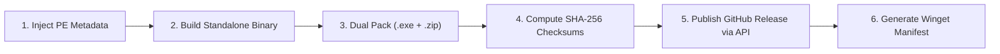

# Windows Zero-Cost Indie Release Pipeline ("Chuẩn HelloKittyXamKinLung")

Dành cho nhà phát triển cá nhân (Indie Dev / Hacker / Security Researcher) muốn đóng gói và phân phối ứng dụng desktop trên Windows một cách **chuyên nghiệp, bảo mật, minh bạch, vượt rào SmartScreen thuận lợi và hoàn toàn MIỄN PHÍ 100%** (không cần bỏ \$400 - \$1,000/năm mua chứng thư số EV Code Signing).

---

## 1. Triết Lý & Quy Chuẩn "HelloKittyXamKinLung"

1. **Thương hiệu cá nhân độc lập (Metadata Branding):** Đóng gói định danh tác giả/biệt danh cá nhân (`HelloKittyXamKinLung`, `p1rkr41n`...) trực tiếp vào Header của file PE (`.exe`), hiển thị đẹp mắt trong tab Properties -> Details của Windows.
2. **Chi phí \$0 (Zero Cost):** Tận dụng tối đa các cơ chế bảo vệ danh tiếng tự nhiên, SHA-256 integrity, kho Winget của Microsoft và đóng gói định dạng `.zip` để không tốn chi phí mua chứng chỉ số.
3. **Phân phối kép (Dual Packaging):** Luôn phát hành đồng thời cả file chạy nhanh `.exe` và file nén sạch `.zip`. Trình duyệt Edge/Chrome đối xử với file `.zip` nhẹ nhàng hơn rất nhiều so với file `.exe` trần chưa có danh tiếng.
4. **Minh bạch mật mã (SHA-256 Integrity):** Bắt buộc tự động xuất file `SHA256SUMS.txt` đi kèm mỗi bản phát hành để người dùng đối soát tính toàn vẹn.
5. **Git Hygiene (Mã nguồn sạch):** Chỉ lưu trữ mã nguồn trong kho Git; tuyệt đối không commit file chạy `.exe` hay token nhạy cảm vào Git history. File thực thi chỉ được đẩy lên GitHub Releases.

---

## 2. Quy Trình 6 Bước Thực Hiện Bản Release Chuẩn



---

### Bước 1: Nhúng Metadata Thương Hiệu Cá Nhân Vào Ứng Dụng

Cấu hình thông tin tác giả vào bộ đóng gói (File PE Version Info):

#### Với dự án Electron (`package.json` -> `build.win`):
```json
{
  "build": {
    "appId": "com.hellokittyxamkinlung.app",
    "productName": "Toad",
    "copyright": "Copyright © 2026 HelloKittyXamKinLung. All rights reserved.",
    "win": {
      "target": "portable",
      "companyName": "HelloKittyXamKinLung",
      "legalTrademarks": "HelloKittyXamKinLung",
      "artifactName": "${productName}-${version}-x64-portable.${ext}"
    }
  }
}
```

#### Với dự án Rust / Tauri (`Cargo.toml` hoặc `tauri.conf.json`):
```json
{
  "tauri": {
    "bundle": {
      "publisher": "HelloKittyXamKinLung",
      "copyright": "Copyright © 2026 HelloKittyXamKinLung"
    }
  }
}
```

---

### Bước 2 & 3: Đóng Gói Phân Phối Kép (`.exe` và `.zip`)

Sau khi trình biên dịch xuất ra file thực thi chính (ví dụ `Toad-2.3.2-x64-portable.exe`):
1. **File thực thi trực tiếp:** `[AppName]-[Version]-x64-portable.exe`
2. **File nén zip (Bỏ qua rào cản Edge download warning):** `[AppName]-[Version]-x64-portable.zip`

Lệnh PowerShell đóng gói zip nén tối ưu (Level = Optimal):
```powershell
Compress-Archive -Path "releases\$AppName-$Version-x64-portable.exe" `
                 -DestinationPath "releases\$AppName-$Version-x64-portable.zip" `
                 -CompressionLevel Optimal -Force
```

---

### Bước 4: Tạo Bảng Băm Mật Mã `SHA256SUMS.txt`

Bảo đảm người dùng và cộng đồng bảo mật có thể xác minh tính toàn vẹn của ứng dụng:

```powershell
$files = Get-ChildItem -Path "releases" -Include *.exe, *.zip -File
$checksums = foreach ($file in $files) {
    $hash = (Get-FileHash -Path $file.FullName -Algorithm SHA256).Hash.ToLower()
    "$hash  $($file.Name)"
}
$checksums | Out-File -FilePath "releases\SHA256SUMS.txt" -Encoding ascii -Force
```

---

### Bước 5: Tự Động Hóa Xuất Bản Lên GitHub Releases

Sử dụng script Node.js hoặc GitHub CLI (`gh release create`) để tải trực tiếp lên GitHub Releases mà **không bao giờ commit file nhị phân vào Git tree**:

```powershell
# Tạo release và upload cả 3 artifact cùng lúc
gh release create "v$Version" `
  "releases\$AppName-$Version-x64-portable.exe" `
  "releases\$AppName-$Version-x64-portable.zip" `
  "releases\SHA256SUMS.txt" `
  --title "$AppName v$Version - Portable Release (HelloKittyXamKinLung Standard)" `
  --notes-file "releases\RELEASE_NOTES.md"
```

---

### Bước 6: Phân Phối Qua Microsoft Winget (Miễn Phí 100%, Xóa Bỏ SmartScreen)

Khi ứng dụng được phân phối qua **Windows Package Manager (`winget`)**, hệ thống của Microsoft tự động xác thực và người dùng cài đặt an toàn chỉ bằng một dòng lệnh.

Template manifest Winget (`HelloKittyXamKinLung.Toad.yaml`):
```yaml
PackageIdentifier: HelloKittyXamKinLung.Toad
PackageVersion: 2.3.2
PackageName: Toad
Publisher: HelloKittyXamKinLung
License: MIT
ShortDescription: High-Performance Tabular Data & Security Log Analyzer
Installers:
  - Architecture: x64
    InstallerType: portable
    InstallerUrl: https://github.com/p1rkr41n/toad_electron/releases/download/v2.3.2/Toad-2.3.2-x64-portable.exe
    InstallerSha256: <SHA256_HASH_HERE>
ManifestType: singleton
ManifestVersion: 1.6.0
```

Lệnh cài đặt của người dùng cuối:
```powershell
winget install HelloKittyXamKinLung.Toad
```

---

## 3. Hướng Dẫn Vượt SmartScreen Dành Cho Người Dùng Tải File Lẻ

Trong phần `README.md` hoặc trang download của bạn, luôn đính kèm hướng dẫn 3 bước thân thiện:

1. **Khi tải qua Edge:** Nhấp chuột vào nút `...` (hoặc mũi tên cạnh nút Delete) -> chọn **Keep** -> chọn **Keep anyway**.
2. **Khi mở file:** Bấm **More info** -> chọn **Run anyway**.
3. **Gỡ cờ cảnh báo vĩnh viễn bằng PowerShell:**
   ```powershell
   Unblock-File .\Toad-2.3.2-x64-portable.exe
   ```

---

## 4. Danh Sách Kiểm Tra Nhanh Trước Khi Bấm Nút Phát Hành (Release Checklist)

- [ ] Thông tin Metadata đã nhúng tên `HelloKittyXamKinLung` trong file `package.json` / PE header.
- [ ] Phiên bản đã được cập nhật đồng bộ (`package.json`, Dialog header, README).
- [ ] Đã chạy test QA toàn diện và đạt **100% Pass**.
- [ ] Đã tạo đủ cả 2 định dạng: `.exe` và `.zip`.
- [ ] Đã tạo file mã băm `SHA256SUMS.txt`.
- [ ] File `.gitignore` đã loại trừ toàn bộ thư mục tạm, thư mục build, file nhị phân trung gian.
- [ ] Release đã được publish lên GitHub và kiểm tra link download trực tiếp thành công.

