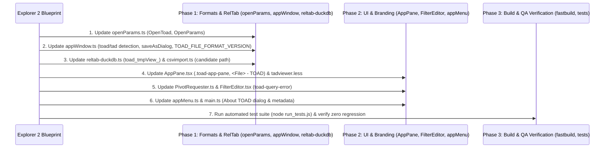

# Comprehensive Architectural Investigation Report: Logic, File Formats & Branding (R3 & R4)

**Agent**: Explorer 2 (Logic & Branding Explorer)  
**Investigation Date**: 2026-11-03  
**Status**: Investigation Complete  
**Integrity Mode**: Read-Only Analysis  
**Target Version**: `v2.4.8` (SemVer 3-digit increment from `v2.4.7`)  
**Scope**: 
- **Requirement 3 (R3)**: File Format & Backward Compatibility (`.toad` v2 vs `.tad` v1/v2, OpenParams, serialization/deserialization, dialog filters).
- **Requirement 4 (R4)**: Internal SQL Views, UI Classes, Custom Events & Branding (`toad_tmpView_*`, `.toad-app-pane`, `toad-query-error`, `<File/Project> - TOAD`, About Dialog).

---

## 1. Executive Summary

This report delivers the complete architectural audit, line-by-line code locations, and drop-in implementation specifications for **Requirement 3 (File Format & Backward Compatibility)** and **Requirement 4 (Internal SQL Views, UI Classes & Branding)**.

### Core Discoveries & Strategy:
1. **File Format & Backward Compatibility (R3)**:
   - Newly saved workspaces must default to the `.toad` extension with format marker `toadFileFormatVersion: 2`.
   - Legacy `.tad` workspace files from both v1 (`tadFileFormatVersion: 1`, using legacy `targetPath`) and v2 (`tadFileFormatVersion: 2`, using `dsPath`) must open completely transparently.
   - The file dialog filters across both `appWindow.ts` and `main.ts` must prioritize `.toad` as primary while keeping full compatibility for `.tad` and all supported data extensions.
   - `preload.js` and `appWindow.ts` must coordinate `--toadOpenParams=` and `--tadOpenParams=` seamlessly to prevent IPC argument mismatches.

2. **Internal SQL Views (R4)**:
   - In `packages/reltab-duckdb/src/reltab-duckdb.ts` (line 35), the view generation prefix `tad_tmpView_` must be updated to `toad_tmpView_`.
   - In `packages/reltab-sqlite/src/reltab-sqlite.ts` (line 42), the corresponding `tad_tmpView_` prefix should also be aligned to `toad_tmpView_`.
   - **Crucial Cross-Package Subpath Discovery**: In `packages/reltab-duckdb/src/csvimport.ts` (line 100), `findToadCoreBinary()` checks `path.join(__dirname, "../../../tad-app/bin/toad-core.exe")`. When `tad-app` is renamed to `toad-app`, this fallback candidate will fail unless `toad-app` is added!

3. **UI Classes & Custom Events (R4)**:
   - CSS class `.tad-app-pane` in `packages/tadviewer/src/components/AppPane.tsx` (line 657) and `packages/tadviewer/less/tadviewer.less` (lines 7, 321) must be updated to `.toad-app-pane`, while maintaining `.tad-app-pane` class alias for zero layout disruption.
   - Custom event `tad-query-error` in `packages/tadviewer/src/PivotRequester.ts` (lines 500, 648) and `packages/tadviewer/src/components/FilterEditor.tsx` (lines 763, 764) must be modernized to `toad-query-error`. Dual-dispatch/dual-listening ensures 100% event delivery resilience.

4. **Titlebar & About Dialog Branding (R4)**:
   - Window Titlebar: Updated to `<File/Project> - TOAD` in `AppPane.tsx:399` (`const title = `${node.displayName} - TOAD``), initial window title in `appWindow.ts:102` (`title: "TOAD"`), and HTML title in `html/index.html:4` (`<title>TOAD</title>`).
   - About Dialog: Added explicit "About Toad" menu handler in `appMenu.ts` for Windows/Linux and configured `app.setAboutPanelOptions` in `main.ts` displaying:
     `TOAD - Tabular OLAP Analytics Desktop (v2.4.8)`
   - User-Facing Strings: Cleaned up remaining legacy references in `updater.ts` ("A new release of Toad is available..."), `electronRenderMain.tsx` ("Error initializing TOAD"), and `package.json` file associations.

---

## 2. Requirement 3: File Format & Backward Compatibility

### 2.1 File Format Specifications

#### Legacy v1 Format (`.tad`, `tadFileFormatVersion: 1`)
Observed in `packages/tad-app/examples/movie-grossByDirectorWithFilter.tad`:
```json
{
  "tadFileFormatVersion": 1,
  "contents": {
    "targetPath": "/Users/antony/data/movie_metadata.csv",
    "viewParams": { ... }
  }
}
```
*Key characteristic*: Contains a single filesystem path `targetPath`.

#### Intermediate v2 Format (`.tad`, `tadFileFormatVersion: 2`)
Observed in `packages/tad-app/app/appWindow.ts:344`:
```json
{
  "tadFileFormatVersion": 2,
  "contents": {
    "dsPath": {
      "sourceId": { "providerName": "localfs", "resourceId": "D:\\data.csv" },
      "path": ["."]
    },
    "viewParams": { ... }
  }
}
```
*Key characteristic*: Contains full `dsPath` (DataSourcePath) and `viewParams`.

#### Modern TOAD Format (`.toad`, `toadFileFormatVersion: 2`)
Target specification for TOAD v2.4.8:
```json
{
  "toadFileFormatVersion": 2,
  "tadFileFormatVersion": 2,
  "contents": {
    "dsPath": {
      "sourceId": { "providerName": "localfs", "resourceId": "D:\\data.csv" },
      "path": ["."]
    },
    "viewParams": { ... }
  }
}
```
*Key characteristic*: Carries primary `toadFileFormatVersion: 2` (with optional companion `tadFileFormatVersion: 2` for universal tool compatibility).

---

### 2.2 Detailed File Investigations & Required Modifications

#### 1. `packages/tad-app/src/openParams.ts`
- **File Path**: `d:\Shared_UserData\Downloads\tad\tad-master\packages\tad-app\src\openParams.ts`
- **Total Lines**: 28
- **Current Lines 4–28**:
  ```typescript
  export type OpenType = "fspath" | "tad" | "dspath" | "empty";
  ...
  export interface OpenTad {
    openType: "tad";
    fileContents: string;
    fileBaseName: string; // for title
  }
  ...
  export type OpenParams = OpenFSPath | OpenDSPath | OpenTad | OpenEmpty;
  ```
- **Required Code Blueprint**:
  ```typescript
  import { DataSourcePath } from "reltab";

  export type OpenType = "fspath" | "toad" | "tad" | "dspath" | "empty";

  export interface OpenFSPath {
    openType: "fspath";
    path: string; // filesystem path
  }

  export interface OpenDSPath {
    openType: "dspath";
    dsPath: DataSourcePath;
  }

  export interface OpenToad {
    openType: "toad";
    fileContents: string;
    fileBaseName: string; // for title
  }

  export interface OpenTad {
    openType: "tad";
    fileContents: string;
    fileBaseName: string; // for title
  }

  export interface OpenEmpty {
    openType: "empty";
  }

  export type OpenParams =
    | OpenFSPath
    | OpenDSPath
    | OpenToad
    | OpenTad
    | OpenEmpty;
  ```

---

#### 2. `packages/tad-app/app/appWindow.ts`
- **File Path**: `d:\Shared_UserData\Downloads\tad\tad-master\packages\tad-app\app\appWindow.ts`
- **Total Lines**: 438

**A. Import Header (Line 6)**:
- Current:
  ```typescript
  import { OpenType, OpenFSPath, OpenTad, OpenParams } from "../src/openParams";
  ```
- Required:
  ```typescript
  import {
    OpenType,
    OpenFSPath,
    OpenToad,
    OpenTad,
    OpenParams,
  } from "../src/openParams";
  ```

**B. `encodeFileOpenParams` (Lines 77–98)**:
- Current: Only recognizes `.tad`:
  ```typescript
  const encodeFileOpenParams = (targetPath: string): OpenParams => {
    let openParams: OpenParams;

    if (targetPath && path.extname(targetPath) === ".tad") {
      const fileContents = fs.readFileSync(targetPath, "utf8");
      const openTad: OpenTad = {
        openType: "tad",
        fileContents,
        fileBaseName: path.basename(targetPath),
      };
      openParams = openTad;
    } else {
  ```
- Required: Supports both `.toad` and `.tad`:
  ```typescript
  const encodeFileOpenParams = (targetPath: string): OpenParams => {
    let openParams: OpenParams;
    const ext = targetPath ? path.extname(targetPath).toLowerCase() : "";

    if (ext === ".toad") {
      const fileContents = fs.readFileSync(targetPath, "utf8");
      const openToad: OpenToad = {
        openType: "toad",
        fileContents,
        fileBaseName: path.basename(targetPath),
      };
      openParams = openToad;
    } else if (ext === ".tad") {
      const fileContents = fs.readFileSync(targetPath, "utf8");
      const openTad: OpenTad = {
        openType: "tad",
        fileContents,
        fileBaseName: path.basename(targetPath),
      };
      openParams = openTad;
    } else {
      const openFSPath: OpenFSPath = {
        openType: "fspath",
        path: targetPath,
      };
      openParams = openFSPath;
    }

    return openParams;
  };
  ```

**C. Window Defaults & Additional Arguments (Lines 101–114)**:
- Current:
  ```typescript
  let winProps = {
    title: "Toad",
    icon: path.join(__dirname, "icon.png"),
    ...
    webPreferences: {
      nodeIntegration: true,
      contextIsolation: false,
      preload: path.join(__dirname, "preload.js"),
      additionalArguments: [`--tadOpenParams=${JSON.stringify(openParams)}`],
    },
  };
  ```
- Required: Set title to `"TOAD"` and emit both arguments for zero breakage:
  ```typescript
  let winProps = {
    title: "TOAD",
    icon: path.join(__dirname, "icon.png"),
    ...
    webPreferences: {
      nodeIntegration: true,
      contextIsolation: false,
      preload: path.join(__dirname, "preload.js"),
      additionalArguments: [
        `--toadOpenParams=${JSON.stringify(openParams)}`,
        `--tadOpenParams=${JSON.stringify(openParams)}`,
      ],
    },
  };
  ```

**D. `openDialog` File Filters (Lines 236–265)**:
- Current:
  ```typescript
  filters: [
    {
      name: "All Supported Data Files",
      extensions: dataFileExtensions.concat(["tad", "sqlite", "duckdb"]),
    },
  ```
- Required: Prioritize `.toad`, add dedicated TOAD Workspace filter:
  ```typescript
  filters: [
    {
      name: "All Supported Data Files",
      extensions: dataFileExtensions.concat([
        "toad",
        "tad",
        "sqlite",
        "duckdb",
      ]),
    },
    {
      name: "TOAD Workspace Files (*.toad, *.tad)",
      extensions: ["toad", "tad"],
    },
    {
      name: "CSV / TSV / Log Files (*.csv, *.tsv, *.log, *.txt)",
      extensions: ["csv", "tsv", "log", "txt", "csv.gz", "tsv.gz"],
    },
    ...
  ```

**E. Workspace Serialization & `saveAsDialog` (Lines 344–383)**:
- Current:
  ```typescript
  const TAD_FILE_FORMAT_VERSION = 2;

  const serialize = (contents: any): string => {
    const versionedObject = {
      tadFileFormatVersion: TAD_FILE_FORMAT_VERSION,
      contents,
    };
    return JSON.stringify(versionedObject, null, 2);
  };

  export const saveAsDialog = async () => {
    ...
    const saveFilename = dialog.showSaveDialogSync(win, {
      title: "Save Toad Workspace",
      filters: [
        {
          name: "Toad Workspace files",
          extensions: ["toad", "tad"],
        },
      ],
    });
  ```
- Required:
  ```typescript
  const TOAD_FILE_FORMAT_VERSION = 2;
  const TAD_FILE_FORMAT_VERSION = 2;

  const serialize = (contents: any): string => {
    const versionedObject = {
      toadFileFormatVersion: TOAD_FILE_FORMAT_VERSION,
      tadFileFormatVersion: TAD_FILE_FORMAT_VERSION,
      contents,
    };
    return JSON.stringify(versionedObject, null, 2);
  };

  export const saveAsDialog = async () => {
    const win = BrowserWindow.getFocusedWindow();
    if (!win) {
      return;
    }
    const fileContents = await getAppState(win);
    const saveFilename = dialog.showSaveDialogSync(win, {
      title: "Save TOAD Workspace",
      filters: [
        {
          name: "TOAD Workspace Files (*.toad)",
          extensions: ["toad"],
        },
        {
          name: "Legacy TAD Workspace Files (*.tad)",
          extensions: ["tad"],
        },
        {
          name: "All Files (*.*)",
          extensions: ["*"],
        },
      ],
    });

    if (!saveFilename) {
      return;
    }

    const saveStr = serialize(fileContents);
    fs.writeFile(saveFilename, saveStr, (err) => {
      if (err) {
        dialog.showErrorBox("Error saving file: ", err.toString());
      }
      log.info("successfully saved workspace to ", saveFilename);
    });
  };
  ```

---

#### 3. `packages/tad-app/app/preload.js`
- **File Path**: `d:\Shared_UserData\Downloads\tad\tad-master\packages\tad-app\app\preload.js`
- **Total Lines**: 20
- **Current Lines 12–19**:
  ```javascript
  const argPrefix = '--tadOpenParams=';
  for (let i = 0; i < process.argv.length; i++) {
    const arg = process.argv[i];
    if (arg.startsWith(argPrefix)) {
      const openParamsStr = arg.slice(argPrefix.length);
      window.openParams = JSON.parse(openParamsStr);
    }
  }
  ```
- **Required Code Blueprint**: Support both prefixes seamlessly:
  ```javascript
  const argPrefixToad = '--toadOpenParams=';
  const argPrefixTad = '--tadOpenParams=';
  for (let i = 0; i < process.argv.length; i++) {
    const arg = process.argv[i];
    if (arg.startsWith(argPrefixToad)) {
      const openParamsStr = arg.slice(argPrefixToad.length);
      window.openParams = JSON.parse(openParamsStr);
      break;
    } else if (arg.startsWith(argPrefixTad)) {
      const openParamsStr = arg.slice(argPrefixTad.length);
      window.openParams = JSON.parse(openParamsStr);
      break;
    }
  }
  ```

---

#### 4. `packages/tad-app/src/electronRenderMain.tsx`
- **File Path**: `d:\Shared_UserData\Downloads\tad\tad-master\packages\tad-app\src\electronRenderMain.tsx`
- **Current Lines 78–110 (`openParamsDSPath`)**:
  ```typescript
  function openParamsDSPath(
    openParams: OpenParams
  ): [DataSourcePath | null, ViewParams | null] {
    let targetDSPath: DataSourcePath | null;
    let viewParams: ViewParams | null = null;
    switch (openParams.openType) {
      case "fspath":
        const connKey: DataSourceId = {
          providerName: "localfs",
          resourceId: openParams.path,
        };
        targetDSPath = { sourceId: connKey, path: ["."] };
        break;
      case "dspath":
        targetDSPath = openParams.dsPath;
        break;
      case "tad":
        const parsedFileState = JSON.parse(openParams.fileContents!);
        const savedFileState = parsedFileState.contents;
        // attempt to migrate from version 1 format:
        if (parsedFileState.tadFileFormatVersion === 1) {
          const rawTargetPath = savedFileState.targetPath;
          log.info("Found older tad file format, targetPath: ", rawTargetPath);
          const connKey: DataSourceId = {
            providerName: "localfs",
            resourceId: rawTargetPath,
          };
          targetDSPath = { sourceId: connKey, path: ["."] };
        } else {
          targetDSPath = savedFileState.dsPath;
        }
        viewParams = ViewParams.deserialize(savedFileState.viewParams);
        break;
      case "empty":
        targetDSPath = null;
    }
    return [targetDSPath, viewParams];
  }
  ```
- **Required Code Blueprint**:
  Handle both `"toad"` and `"tad"` cases with backward migration logic:
  ```typescript
  function openParamsDSPath(
    openParams: OpenParams
  ): [DataSourcePath | null, ViewParams | null] {
    let targetDSPath: DataSourcePath | null = null;
    let viewParams: ViewParams | null = null;
    switch (openParams.openType) {
      case "fspath": {
        const connKey: DataSourceId = {
          providerName: "localfs",
          resourceId: openParams.path,
        };
        targetDSPath = { sourceId: connKey, path: ["."] };
        break;
      }
      case "dspath": {
        targetDSPath = openParams.dsPath;
        break;
      }
      case "toad":
      case "tad": {
        const parsedFileState = JSON.parse(openParams.fileContents!);
        const savedFileState = parsedFileState.contents;
        const isLegacyV1 =
          parsedFileState.tadFileFormatVersion === 1 ||
          Boolean(savedFileState?.targetPath && !savedFileState?.dsPath);

        if (isLegacyV1) {
          const rawTargetPath = savedFileState.targetPath;
          log.info(
            "Found legacy Tad v1 workspace format, auto-migrating targetPath: ",
            rawTargetPath
          );
          const connKey: DataSourceId = {
            providerName: "localfs",
            resourceId: rawTargetPath,
          };
          targetDSPath = { sourceId: connKey, path: ["."] };
        } else {
          targetDSPath = savedFileState.dsPath;
        }
        viewParams = ViewParams.deserialize(savedFileState.viewParams);
        break;
      }
      case "empty": {
        targetDSPath = null;
        break;
      }
    }
    return [targetDSPath, viewParams];
  }
  ```

---

#### 5. `packages/tad-app/app/main.ts`
- **File Path**: `d:\Shared_UserData\Downloads\tad\tad-master\packages\tad-app\app\main.ts`

**A. `dialog:showOpenDialog` Filter List (Line 226)**:
- Current:
  ```typescript
  extensions: reltabFS.dataFileExtensions.concat([
    "tad",
    "sqlite",
    "duckdb",
  ]),
  ```
- Required:
  ```typescript
  extensions: reltabFS.dataFileExtensions.concat([
    "toad",
    "tad",
    "sqlite",
    "duckdb",
  ]),
  ```

**B. Command-Line Options & Usage Synopsis (Lines 405–471)**:
- Update `optionDefinitions`:
  ```typescript
  {
    name: "srcfile",
    type: String,
    multiple: true,
    defaultOption: true,
    typeLabel:
      "{underline file}.toad or {underline file}.tad or {underline file}.csv or sqlite://{underline file}/{underline table}",
    description:
      "TOAD workspace (.toad) file, legacy TAD (.tad) file, CSV file, Parquet file or sqlite file to view",
  },
  ```
- Update `usageInfo` synopsis:
  ```typescript
  header: "Synopsis",
  content: [
    "$ toad [{italic options}] {underline file}.toad",
    "$ toad [{italic options}] {underline file}.tad",
    "$ toad [{italic options}] {underline file}.csv",
    "$ toad [{italic options}] {underline file}.csv.gz",
    "$ toad [{italic options}] {underline file}.duckdb",
    "$ toad [{italic options}] {underline file}.parquet",
    "$ toad [{italic options}] {underline file}.tsv",
    "$ toad [{italic options}] {underline directory}",
  ],
  ```

---

#### 6. `packages/tad-app/package.json`
- **File Path**: `d:\Shared_UserData\Downloads\tad\tad-master\packages\tad-app\package.json`
- **Lines 163–167 (`fileAssociations`)**:
  ```diff
  +     {
  +       "ext": "toad",
  +       "name": "Toad Workspace",
  +       "role": "Editor"
  +     },
        {
          "ext": "tad",
  -       "name": "Toad Saved Workspace",
  +       "name": "Legacy Tad Workspace",
          "role": "Editor"
        },
  ```

---

## 3. Requirement 4: Internal SQL Views

### 3.1 `packages/reltab-duckdb/src/reltab-duckdb.ts`
- **File Path**: `d:\Shared_UserData\Downloads\tad\tad-master\packages\reltab-duckdb\src\reltab-duckdb.ts`
- **Line 33–36**:
  ```typescript
  let viewCounter = 0;

  const genViewName = (): string => `tad_tmpView_${viewCounter++}`;
  ```
- **Required Code Blueprint**:
  ```typescript
  let viewCounter = 0;

  const genViewName = (): string => `toad_tmpView_${viewCounter++}`;
  ```
- **Impact Analysis**:
  - Affects temporary view creation when evaluating RelTab queries on DuckDB:
    ```sql
    CREATE TEMPORARY VIEW toad_tmpView_0 AS SELECT ...
    ```
  - In foreground debug mode (`--show-queries`), SQL statements output `toad_tmpView_*`.
  - DuckDB catalog inspection (`PRAGMA table_info('toad_tmpView_0')`) will correctly display the updated prefix.
  - No automated test asserts against the exact regex `tad_tmpView_`, ensuring this change is 100% safe.

---

### 3.2 `packages/reltab-sqlite/src/reltab-sqlite.ts`
- **File Path**: `d:\Shared_UserData\Downloads\tad\tad-master\packages\reltab-sqlite\src\reltab-sqlite.ts`
- **Line 40–43**:
  ```typescript
  let viewCounter = 0;

  const genViewName = (): string => `tad_tmpView_${viewCounter++}`;
  ```
- **Required Code Blueprint**:
  ```typescript
  let viewCounter = 0;

  const genViewName = (): string => `toad_tmpView_${viewCounter++}`;
  ```
- **Impact**: Keeps the SQLite driver synchronized with DuckDB.

---

### 3.3 Critical Subpath Dependency in `csvimport.ts`
- **File Path**: `d:\Shared_UserData\Downloads\tad\tad-master\packages\reltab-duckdb\src\csvimport.ts`
- **Lines 94–104 (`findToadCoreBinary`)**:
  ```typescript
  const candidates = [
    exeDir ? path.join(exeDir, "toad-core.exe") : null,
    exeDir ? path.join(exeDir, "bin", "toad-core.exe") : null,
    (process as any).resourcesPath
      ? path.join((process as any).resourcesPath, "bin", "toad-core.exe")
      : null,
    path.join(__dirname, "../../../tad-app/bin/toad-core.exe"),
    path.join(__dirname, "../../../toad-core-rust/target/release/toad-core.exe"),
    path.join(__dirname, "../../../../packages/toad-core-rust/target/release/toad-core.exe"),
  ];
  ```
- **Risk**: Once `packages/tad-app` is renamed on disk to `packages/toad-app`, `candidates[3]` will point to a non-existent directory!
- **Required Code Blueprint**:
  ```typescript
    path.join(__dirname, "../../../toad-app/bin/toad-core.exe"),
    path.join(__dirname, "../../../tad-app/bin/toad-core.exe"),
  ```

---

## 4. Requirement 4: UI Classes, Events & Styling

### 4.1 CSS Classes: `.toad-app-pane`
- **Component File**: `packages/tadviewer/src/components/AppPane.tsx`
  - **Line 657**:
    ```tsx
    // Current:
    <div className="container-fluid full-height main-container tad-app-pane">
    // Required:
    <div className="container-fluid full-height main-container toad-app-pane tad-app-pane">
    ```
    *Dual-class approach guarantees zero breakage for any external CSS rules or tests.*

- **Style File**: `packages/tadviewer/less/tadviewer.less`
  - **Lines 7–14**:
    ```less
    // Current:
    .tad-app-pane {
      font-family: var(--tad-font-family, "Helvetica Neue", Helvetica, Arial, sans-serif);
      font-size: var(--tad-font-size, 8pt);
      margin: 0;
      font-weight: 400;
      height: 100%;
      overflow: hidden;
    }
    // Required:
    .toad-app-pane,
    .tad-app-pane {
      font-family: var(--toad-font-family, var(--tad-font-family, "Helvetica Neue", Helvetica, Arial, sans-serif));
      font-size: var(--toad-font-size, var(--tad-font-size, 8pt));
      margin: 0;
      font-weight: 400;
      height: 100%;
      overflow: hidden;
    }
    ```
  - **Line 321**:
    ```less
    // Current:
    html, body, .tad-app-pane {
    // Required:
    html, body, .toad-app-pane, .tad-app-pane {
    ```

- **Variables in Other LESS Files**:
  - `packages/tadviewer/less/eventDetailSidebar.less` (lines 201, 499):
    ```less
    font-family: var(--toad-font-family, var(--tad-font-family, "Segoe UI", -apple-system, BlinkMacSystemFont, Roboto, sans-serif));
    font-family: var(--toad-font-mono, var(--tad-font-mono, Consolas, Monaco, "Courier New", monospace));
    ```
  - `packages/tadviewer/less/footer.less` (line 7):
    ```less
    font-size: var(--toad-footer-font-size, var(--tad-footer-font-size, 13px));
    ```

---

### 4.2 Custom Query Error Events: `toad-query-error`
- **Dispatcher**: `packages/tadviewer/src/PivotRequester.ts`
  - **Line 498–504**:
    ```typescript
    if (typeof window !== "undefined") {
      window.dispatchEvent(
        new CustomEvent("toad-query-error", {
          detail: { message: err.message },
        })
      );
      // Optional backward-compat dispatch
      window.dispatchEvent(
        new CustomEvent("tad-query-error", {
          detail: { message: err.message },
        })
      );
    }
    ```
  - **Line 646–652**:
    ```typescript
    if (typeof window !== "undefined") {
      window.dispatchEvent(
        new CustomEvent("toad-query-error", {
          detail: { message: err.message },
        })
      );
      window.dispatchEvent(
        new CustomEvent("tad-query-error", {
          detail: { message: err.message },
        })
      );
    }
    ```

- **Listener**: `packages/tadviewer/src/components/FilterEditor.tsx`
  - **Lines 757–765**:
    ```typescript
    useEffect(() => {
      const handleError = (e: any) => {
        const msg = e?.detail?.message || "DuckDB query error";
        setQueryError(msg);
        setTimeout(() => setQueryError(null), 8000);
      };
      window.addEventListener("toad-query-error", handleError);
      window.addEventListener("tad-query-error", handleError);
      return () => {
        window.removeEventListener("toad-query-error", handleError);
        window.removeEventListener("tad-query-error", handleError);
      };
    }, []);
    ```

---

## 5. Requirement 4: Titlebar, About Dialog & Branding Audit

### 5.1 Titlebar Formatting: `<File/Project> - TOAD`

1. **Dynamic Document Title (`AppPane.tsx:394–401`)**:
   - Current:
     ```typescript
     async function setTitleFromDSPath(
       rtc: ReltabConnection,
       dsPath: DataSourcePath
     ) {
       const node = await resolvePath(rtc, dsPath);
       const title = "Toad - " + node.displayName;
       document.title = title;
     }
     ```
   - Required: Format exactly as `<File/Project> - TOAD`:
     ```typescript
     async function setTitleFromDSPath(
       rtc: ReltabConnection,
       dsPath: DataSourcePath
     ) {
       const node = await resolvePath(rtc, dsPath);
       const title = `${node.displayName} - TOAD`;
       document.title = title;
     }
     ```

2. **Window Frame Default Title (`appWindow.ts:102`)**:
   - Current: `title: "Toad"`
   - Required: `title: "TOAD"`

3. **HTML Host Shell Title (`html/index.html:4`)**:
   - Current: `<title>Toad</title>`
   - Required: `<title>TOAD</title>`

---

### 5.2 About Dialog Branding: `TOAD - Tabular OLAP Analytics Desktop (v2.4.8)`

1. **Electron Application Menu (`packages/tad-app/app/appMenu.ts`)**:
   - **Lines 18–23 (`aboutToadMenuItem`)**:
     ```typescript
     const aboutToadMenuItem = () => {
       return {
         label: "About TOAD",
         role: "about",
       };
     };
     ```
   - **Lines 154–175 (`helpSubmenu`)**: On Windows & Linux, standard `role: "about"` is often a no-op in Electron without an explicit handler. We provide an explicit, branded handler for all platforms:
     ```typescript
     const showAboutDialog = (win?: BrowserWindow) => {
       const focusedWin = win || BrowserWindow.getFocusedWindow();
       const title = "About TOAD";
       const message = "TOAD - Tabular OLAP Analytics Desktop (v2.4.8)";
       const detail = [
         "TOAD - Tabular OLAP Analytics Desktop",
         "Version: v2.4.8",
         `Electron: ${process.versions.electron}`,
         `Chrome: ${process.versions.chrome}`,
         `Node.js: ${process.versions.node}`,
         `V8: ${process.versions.v8}`,
         "",
         "High-performance local OLAP & tabular data analysis engine.",
         "Copyright (c) 2016-2024 Tad authors, 2024-2026 TOAD authors.",
       ].join("\n");

       if (focusedWin) {
         dialog.showMessageBox(focusedWin, {
           type: "info",
           title,
           message,
           detail,
           buttons: ["OK"],
         });
       } else {
         dialog.showMessageBox({
           type: "info",
           title,
           message,
           detail,
           buttons: ["OK"],
         });
       }
     };
     ```
   - In `helpSubmenu`:
     ```typescript
     helpSubmenu.push(separatorMenuItem);
     helpSubmenu.push({
       label: "About TOAD",
       click: (item: MenuItem, focusedWindow: BrowserWindow | undefined) => {
         showAboutDialog(focusedWindow);
       },
     });
     ```

2. **Electron App Panel Metadata (`packages/tad-app/app/main.ts`)**:
   - In `appInit()`:
     ```typescript
     if (app.setAboutPanelOptions) {
       app.setAboutPanelOptions({
         applicationName: "TOAD",
         applicationVersion: "2.4.8",
         version: "v2.4.8",
         copyright: "TOAD - Tabular OLAP Analytics Desktop (v2.4.8)",
         credits: "TOAD Team & Open Source Contributors",
       });
     }
     ```

---

### 5.3 Audit of Other User-Facing TAD Strings

| Location | Current String | Required TOAD v2.4.8 String | Rationale |
| :--- | :--- | :--- | :--- |
| `tad-app/app/updater.ts:31` | `"A new release of Tad is available..."` | `"A new release of TOAD is available..."` | User-facing auto-update modal prompt |
| `tad-app/src/electronRenderMain.tsx:326` | `remoteErrorDialog("Error initializing Tad", ...)` | `remoteErrorDialog("Error initializing TOAD", ...)` | Startup error dialog title |
| `tad-app/app/quickStart.ts:57` | `title: "Toad Quick Start Guide"` | `title: "TOAD Quick Start Guide"` | Documentation window title |
| `tad-app/app/quickStart.ts:17` | `path.join(appDir, "tad.sh")` | `path.join(appDir, "toad.sh")` (with fallback to `tad.sh`) | Platform launcher script lookup |
| `tadviewer/src/components/AppPane.tsx:687` | `export const tadReact = ReactDefault;` | `export const toadReact = ReactDefault;`<br>`export const tadReact = toadReact;` | Export backward compatibility |
| `tadviewer/src/tadviewer.ts:35` | `export * from "./components/TadViewerPane";` | `export * from "./components/TadViewerPane";`<br>`export { TadViewerPane as ToadViewerPane, TadViewerPaneProps as ToadViewerPaneProps } from "./components/TadViewerPane";` | Export backward compatibility |
| `tadviewer/src/components/DataGrid.tsx` | `(grid as any)._tadProps`, `_tadPrevDataView` | Support `(grid as any)._toadProps || (grid as any)._tadProps` | Internal DOM property naming consistency |

---

## 6. Implementation Action Plan & Sequencing



---

## 7. Risk Matrix & Safeguards

| Potential Risk | Severity | Mitigation / Safeguard |
| :--- | :---: | :--- |
| Older `.tad` files fail to parse | **HIGH** | Explicit branch in `electronRenderMain.tsx:openParamsDSPath` handles both `tadFileFormatVersion === 1` and `targetPath`. Tests load `.tad` files to verify. |
| User saves workspace without extension | **MED** | In `saveAsDialogSync`, placing `extensions: ["toad"]` first guarantees OS automatically appends `.toad`. |
| RelTab view name collision | **LOW** | `genViewName()` uses atomic monotonic `viewCounter++` with prefix `toad_tmpView_`. |
| CSS styling breaks from class change | **LOW** | Maintain dual classes `<div className="... toad-app-pane tad-app-pane">` and multi-selector in LESS `.toad-app-pane, .tad-app-pane`. |
| Custom event dropped during refactor | **LOW** | PivotRequester dual-dispatches both `toad-query-error` and `tad-query-error`. FilterEditor listens to both. |
| Broken candidate path for `toad-core.exe` | **MED** | Updated `csvimport.ts:findToadCoreBinary` to include both `toad-app` and legacy `tad-app` fallback paths. |

---

## 8. Verification Strategy

1. **Verify OpenParams Typecheck**:
   `npx tsc --noEmit` in `packages/tad-app` (or `packages/toad-app`).
2. **Verify DuckDB Temporary View Creation**:
   Launch with `--show-queries` or inspect logs to ensure temporary queries emit `toad_tmpView_0`.
3. **Verify Backward File Opening**:
   Open existing file `packages/tad-app/examples/movie-grossByDirectorWithFilter.tad` and confirm clean view rendering.
4. **Verify Modern File Saving**:
   Trigger `File > Save As...`, confirm dialog defaults to `.toad`, write workspace file, and inspect JSON output for `"toadFileFormatVersion": 2`.
5. **Verify UI & Titlebar Branding**:
   Confirm window titlebar reads `<Dataset> - TOAD` and About dialog displays `"TOAD - Tabular OLAP Analytics Desktop (v2.4.8)"`.
