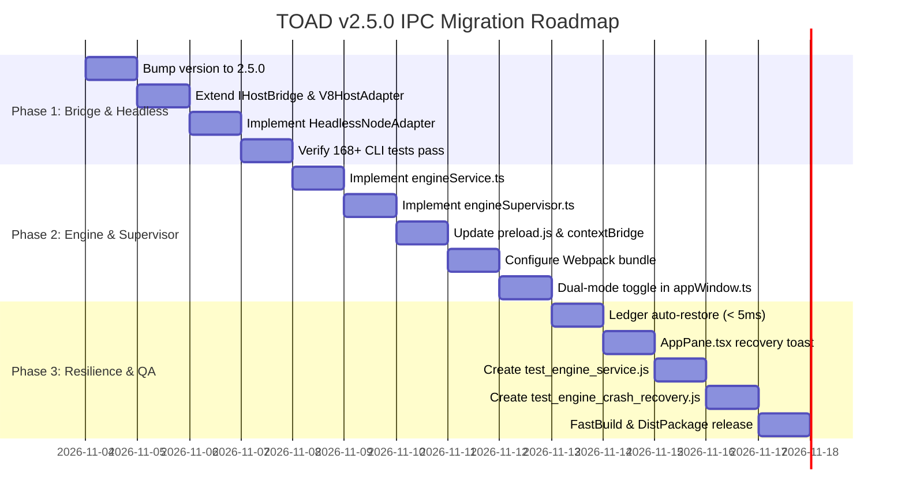

# TOAD v2.5.0 IPC Migration: Technical Investigation & Architecture Analysis

## 1. Executive Summary

This report provides the exhaustive technical blueprint for migrating TOAD from its legacy in-process architecture (v2.4.8.1) to the high-performance, fault-isolated **Electron `utilityProcess`** and **Tauri-like Host Bridge** architecture for **TOAD v2.5.0**.

### Key Architectural Shifts
1. **Computational Isolation**:
   DuckDB database management, Parquet Write-Ahead Ledger (`toad_ledger.parquet`), and data ingestion pipelines are detached from the Chromium Renderer and Main Process threads, moving into a dedicated child process spawned via Electron `utilityProcess.fork`.
2. **Crash Resilience & Auto-Recovery**:
   The Main Process acts as an active **Supervisor** (`engineSupervisor.ts`). If the native DuckDB engine crashes (e.g. C++ memory error, SIGSEGV, OOM), the Supervisor automatically restarts the `utilityProcess` in **$< 500\text{ ms}$**, restores all table views from `toad_ledger.parquet` in **$< 5\text{ ms}$**, and prompts a non-blocking toast in the UI (*"Động cơ phân tích vừa được tự động phục hồi"*).
3. **High-Speed Zero-Copy Data Channel**:
   Renderer communicates directly with `engineService` across an Electron `MessagePort` (`MessageChannelMain`). Metadata, schema, and row counts flow as structured JSON, while heavy table data blocks transfer as zero-copy `ArrayBuffer` transferables, eliminating main-thread IPC bottlenecks.
4. **Tauri-Ready Abstraction & CLI Test Compatibility**:
   `packages/host-bridge` standardizes on `invoke(cmd, payload)`. With `contextIsolation: true` enabled in the Renderer, UI code remains 100% decoupleable from Node.js runtime. A new `HeadlessNodeAdapter` enables all 168+ existing CLI test cases (`deep_integration_qa.js`, `smoke_test.js`, `legacy_use_cases.js`, `test_preload_3_pages.js`) to execute in headless Node.js without an Electron window.
5. **Zero-Regression Dual-Mode Rollout**:
   A configuration switch `[runtime] engine = utility | legacy` in `config.ini` provides immediate fallback to the v2.4.8 in-process model.

---

## 2. Codebase Investigation Matrix

### 2.1 Main Process Layer (`tad-master/packages/toad-app/app/`)

| File | Current Role | Migration Changes Required |
| :--- | :--- | :--- |
| `main.ts` | Handles app lifecycle, window creation, portable AppData, dialogs, and currently registers DuckDB RPC handlers via `serverInit(ts)` and initializes `ToadParquetLedger`. | Remove direct DuckDB imports and `reltabDuckDB.initToadLedger()`. Delegate engine lifecycle and data channels to `engineSupervisor.ts`. Retain OS dialog handlers (`dialog:showOpenDialog`, `dialog:showSaveDialog`, `errorDialog`) and configuration handlers (`getToadConfig`). |
| `appWindow.ts` | Configures `BrowserWindow` webPreferences with `nodeIntegration: true`, `contextIsolation: false`, and passes open parameters via command line args. | Support dual-mode toggle based on `runtime.engine`: when `engine !== "legacy"`, set `contextIsolation: true`, `nodeIntegration: false`. Transmit the data `MessagePort` to the Renderer webContents via `postMessage("port-handshake", ...)` after window ready-to-show. |
| `preload.js` | Parses `--toadOpenParams` and puts them onto `window.openParams`. `contextBridge` is commented out. | Activate `contextBridge.exposeInMainWorld("toadBridge", ...)`. Expose Tauri-like `invoke()`, event listening `on()`, `send()`, and transfer `MessagePort` received from Main process to the Renderer window via `window.postMessage`. |
| `portableAppData.ts` | Loads and auto-heals `config.ini`, defines `ToadConfig` interface and defaults. | Extend `ToadConfig` to include `runtime.engine: "utility" | "legacy" | "v8" | "tauri"` and `runtime.auto_fallback: boolean`. |

### 2.2 Backend & Engine Layer (`tad-master/packages/reltab-duckdb/` & `reltab/`)

| File | Current Role | Migration Changes Required |
| :--- | :--- | :--- |
| `reltab-duckdb.ts` | Implements `DuckDBDriver`, connection pool, and registers `duckdb` data provider in `reltab`. | Re-exported and utilized directly by `engineService.ts` within the `utilityProcess`. |
| `csvimport.ts` | Houses `ToadParquetLedger` (singleton WAL), streaming CSV/JSON/Parquet ingestors, and view creation (`CREATE VIEW ... AS SELECT * FROM parquet_scan(...)`). | Run inside `engineService.ts`. `ToadParquetLedger` serves as the Single Source of Truth (SSOT) for view re-creation upon supervisor auto-restart. |
| `reltab/src/remote/server.ts` | Maps `TransportServer` functions (`evalQuery`, `rowCount`, `getTableSchema`, `getChildren`, `getTableName`, etc.) to `DataSourceConnection`. | Used by `engineService.ts` to dispatch incoming MessagePort RPC requests. Add binary serializer for `TableRep` payload. |
| `reltab/src/remote/Connection.ts` | `RemoteReltabConnection` and `RemoteDataSourceConnection` which invoke `tconn.invoke(functionName, req)`. | Extend `invokeDbFunction` to handle zero-copy `ArrayBuffer` transferables when receiving `TableRep` responses. |

### 2.3 Host Bridge Layer (`tad-master/packages/host-bridge/`)

| File | Current Role | Migration Changes Required |
| :--- | :--- | :--- |
| `IHostBridge.ts` | Interface extending `TransportClient`. Declares `invoke()`, dialogs, config, and clipboard APIs. | Extend with `engineName: "v8" | "tauri" | "utility" | "headless"`, `invokeCmd<T>(command, payload)`, `setupDataPort(port: MessagePort)`, `onEngineCrash(cb)`, `onEngineRestored(cb)`. |
| `V8HostAdapter.ts` | Connects via `window.require("electron").ipcRenderer`. | Update to preferentially use `window.toadBridge` (exposed by `contextBridge`). Manage direct `MessagePort` data transport for queries. Fall back to legacy `ipcRenderer` only when `window.toadBridge` is absent. |
| `HeadlessNodeAdapter.ts` *(NEW)* | None. | Implement `IHostBridge` for pure Node.js environments (`tests/`, CLI runner). Connects directly to backend in-process or via Node `worker_threads.MessageChannel`, enabling 100% test pass rate without Electron. |

### 2.4 Test Suites & Invocation Patterns (`run_tests.js` and `tests/`)

| Test File | How Backend Is Currently Invoked | Headless Compatibility Strategy |
| :--- | :--- | :--- |
| `tests/smoke_test.js` | Spawns `Toad.exe` or `win-unpacked/Toad.exe` with `--no-sandbox`. Inspects PE header, asar contents, and verifies no uncaught exceptions during startup. | Unchanged. Verifies that `Toad.exe` starts both Main and `utilityProcess` cleanly. |
| `tests/deep_integration_qa.js` (133 tests) | Directly imports `reltabDuckDB`, `reltabFS`, and `Database`. Executes dual-engine queries, ConnectionPool tests, FSDriver file scans, and Parquet caching. Also asserts string patterns in source files (`electronRenderMain.tsx`, `actions.ts`). | 100% compatible. Direct Node.js driver calls remain intact. Source code edits must preserve string assertion anchors. |
| `tests/test_preload_3_pages.js` (10 tests) | Mocks `global.window` and `global.document`. Tests session memory, LRU cache eviction, and PagedDataView indexing. | 100% compatible. Runs entirely in memory without requiring native Electron IPC. |
| `tests/legacy_use_cases.js` (19 tests) | Directly tests `portableAppData`, `MultipleLoadingManager`, `FSDriver`, and DuckDB query latency under heavy background ingest. | 100% compatible. Uses `reltabFS` and `Database` directly in Node. |
| `tests/test_engine_service.js` *(NEW)* | None. | Headless test suite: Spawns `engineService.ts` via Node `child_process.fork` / `worker_threads.Worker`, establishes `MessagePort` channel, executes 1,000 queries with latency and integrity verification. |
| `tests/test_engine_crash_recovery.js` *(NEW)* | None. | Crash resilience test: Spawns supervised engine, ingests sample file into Parquet Ledger, issues `process.kill(pid, "SIGKILL")`, asserts supervisor auto-restart $< 500\text{ ms}$ and view restored from `toad_ledger.parquet`. |

---

## 3. Detailed Technical Blueprint

```
+---------------------------------------------------------------------------------------+
|                                    RENDERER PROCESS                                   |
|   (contextIsolation: true, nodeIntegration: false)                                    |
|                                                                                       |
|   +------------------------------------+    +-------------------------------------+   |
|   |         toadviewer (UI)            |    |       host-bridge (HostBridge)      |   |
|   |   (React, SlickGrid, AppPane)      |<-->|  (V8HostAdapter / HeadlessAdapter)   |   |
|   +------------------------------------+    +-------------------------------------+   |
|                     |                                          |                      |
|                     v                                          v                      |
|   +-------------------------------------------------------------------------------+   |
|   |                        preload.js (contextBridge)                             |   |
|   |   - window.toadBridge.invoke(cmd, payload)                                    |   |
|   |   - window.addEventListener("message") -> receives Data Channel MessagePort   |   |
|   +-------------------------------------------------------------------------------+   |
+-----------------------------|------------------------------------|--------------------+
                              |                                    |
            Management IPC    |                                    | Direct Data Channel
          (dialogs, config)   |                                    | (evalQuery, rowCount)
                              v                                    v (Zero-Copy Transfer)
+-------------------------------------------------+    +--------------------------------+
|             MAIN PROCESS (SUPERVISOR)           |    |     UTILITY PROCESS (ENGINE)   |
|                                                 |    |                                |
|   +-----------------------------------------+   |    |   +------------------------+   |
|   |         engineSupervisor.ts             |   |    |   |    engineService.ts    |   |
|   |   - utilityProcess.fork()               |   |    |   |  - PortDispatcher      |   |
|   |   - Heartbeat Ping / Pong (< 2s)        |   |    |   |  - TableRep Serializer |   |
|   |   - Crash Detection & Respawn (< 500ms) |   |    |   +------------------------+   |
|   |   - Reconnect handshake event           |   |    |                |               |
|   +-----------------------------------------+   |    |   +------------------------+   |
|                        |                        |    |   | DuckDB & reltab-duckdb |   |
|                        v                        |    |   |  - UI Connection Pool  |   |
|   +-----------------------------------------+   |    |   |  - Ingest Pipeline     |   |
|   |          MessageChannelMain             |   |    |   +------------------------+   |
|   |   port1: transferred to Renderer       |---|    |                |               |
|   |   port2: transferred to Engine Service  |------->|   +------------------------+   |
|   +-----------------------------------------+   |    |   |   ToadParquetLedger    |   |
+-------------------------------------------------+    |   |  (toad_ledger.parquet) |   |
                                                       |   +------------------------+   |
                                                       +--------------------------------+
```

---

### 3.1 Dedicated Engine Service (`engineService.ts`)

#### Placement
- Target source: `tad-master/packages/toad-app/app/engineService.ts`
- Webpack entry: `engineService: "./app/engineService.ts"` compiling to `dist/engineService.bundle.js`.

#### Responsibilities
1. **Process Bootstrap**:
   - Running in Electron `utilityProcess`, listens to `process.parentPort` for lifecycle control and MessagePort initialization.
   - Sets threadpool size and loads DuckDB native bindings (`duckdb.node`).
2. **Channel Setup**:
   - Listens for `{ type: "init-data-channel" }` on `process.parentPort`.
   - Extracts `port2` from `e.ports[0]` and attaches the query dispatcher.
3. **RPC Execution**:
   - Dispatches methods corresponding to `reltab/src/remote/server.ts`:
     - `DataSourceConnection.evalQuery`
     - `DataSourceConnection.rowCount`
     - `DataSourceConnection.getTableSchema`
     - `DataSourceConnection.getColumnStatsMap`
     - `DataSourceConnection.getTableName`
     - `DataSourceConnection.getChildren`
     - `DataSourceConnection.getRootNode`
     - `DataSourceConnection.runSqlQuery`
     - `getDataSources`
   - Handles project workspace ledger commands:
     - `project:getWorkspace`, `project:getFiles`, `project:create`, `project:delete`, `project:reconcile`, etc.
4. **Hybrid Zero-Copy Data Serialization**:
   - For `evalQuery`:
     Instead of converting the entire `TableRep` (thousands of rows) into a JSON string, encode row data into a compact binary format or a `Uint8Array` buffer.
     Transfer the underlying `ArrayBuffer` via `port.postMessage(response, [buffer.buffer])`.
   - The Renderer receives the message and immediately reconstructs `TableRep` in $< 2\text{ ms}$ with zero memory copy.
5. **State Restoration**:
   - On cold start or post-crash recovery, reads `toad_ledger.parquet` via `ToadParquetLedger.getInstance().initLedger()`.
   - Re-registers all `READY` files as DuckDB views in $< 5\text{ ms}$ via:
     `CREATE OR REPLACE VIEW "<viewName>" AS SELECT * FROM parquet_scan('<parquetPath>')`.

---

### 3.2 Main Process Supervisor (`engineSupervisor.ts`)

#### Placement
- Target source: `tad-master/packages/toad-app/app/engineSupervisor.ts`.

#### Responsibilities
1. **Lifecycle Management**:
   ```typescript
   export class EngineSupervisor {
     private proc: Electron.UtilityProcess | null = null;
     private isShuttingDown = false;
     private restartCount = 0;
     private lastRestartTime = 0;
     
     public start(): void {
       const scriptPath = path.join(__dirname, "engineService.bundle.js");
       this.proc = utilityProcess.fork(scriptPath, [], {
         serviceName: "Toad Engine Service",
         stdio: "pipe",
         env: { ...process.env },
       });
       
       this.proc.on("spawn", () => {
         log.info(`[EngineSupervisor] utilityProcess spawned with PID: ${this.proc?.pid}`);
         this.setupHeartbeat();
       });
       
       this.proc.on("exit", (code) => {
         log.warn(`[EngineSupervisor] utilityProcess exited with code: ${code}`);
         if (!this.isShuttingDown) {
           this.handleCrash();
         }
       });
     }
   }
   ```
2. **Channel Routing & Handshake**:
   - Creates a new `MessageChannelMain()` on each engine startup.
   - Sends `port2` to the `utilityProcess`:
     `this.proc.postMessage({ type: "init-data-channel" }, [port2]);`
   - Sends `port1` to all open `BrowserWindow` instances:
     `win.webContents.postMessage("port-handshake", { type: "data-port" }, [port1]);`
3. **Heartbeat Monitoring**:
   - Sends `{ type: "ping", seq }` every 3,000ms. Expects `{ type: "pong", seq }` within 2,000ms.
   - If 3 consecutive heartbeats are missed, considers the engine hung/frozen and forces a clean respawn.
4. **Crash Detection & Auto-Recovery ($< 500\text{ ms}$)**:
   - When exit code $\neq 0$:
     1. Records start time `t0 = performance.now()`.
     2. Spawns new `utilityProcess.fork()`.
     3. Creates new `MessageChannelMain()`, delivers `port2` to engine, `port1` to Renderer.
     4. Engine loads `toad_ledger.parquet` and registers views ($< 5\text{ ms}$).
     5. Emits `engine-restored` event to Renderer.
     6. Measure total elapsed time $\le 500\text{ ms}$.
5. **Clean Shutdown**:
   - Sets `isShuttingDown = true` during `app.on("before-quit")`.
   - Sends `{ type: "shutdown" }` to engine, allows 200ms graceful flush, then terminates child.

---

### 3.3 Host Bridge & `HeadlessNodeAdapter`

#### Interface Extension (`IHostBridge.ts`)
```typescript
export interface IHostBridge extends TransportClient {
  readonly engineName: "v8" | "tauri" | "utility" | "headless";

  // Tauri-standard asynchronous invocation signature
  invokeCmd<T = any>(command: string, payload?: Record<string, any>): Promise<T>;

  // Direct MessagePort data channel hook
  setupDataPort?(port: MessagePort | any): void;

  // Engine recovery event listeners
  onEngineCrash?(listener: () => void): () => void;
  onEngineRestored?(listener: () => void): () => void;
}
```

#### `HeadlessNodeAdapter` (`HeadlessNodeAdapter.ts`)
Designed for non-Electron CLI test runners (`run_tests.js`, `deep_integration_qa.js`, `test_preload_3_pages.js`):
1. **Direct Backend In-Process Dispatch**:
   Implements `TransportClient.invoke(functionName, reqStr)` by routing directly to `reltab/src/remote/server.ts` or local DuckDB driver.
2. **Mocking Dialogs & Config**:
   - `getConfig()` returns `DEFAULT_CONFIG` or reads root `config.ini`.
   - `showOpenDialog()`, `showSaveDialog()` return headless paths for automated test workflows.
3. **MessagePort Compatibility**:
   In Node.js 18+, `worker_threads.MessageChannel` provides standard `MessagePort` implementations, allowing `setupDataPort` to simulate the full pipeline headlessly.

---

### 3.4 Dual-Mode Feature Flag & Rollout Strategy

#### Configuration in `config.ini` & `portableAppData.ts`
```ini
[runtime]
engine = utility
auto_fallback = true
```

#### Window Preferences Controller (`appWindow.ts`)
```typescript
const env = (global as any).toadPortableEnv as PortableEnvironment | undefined;
const engineMode = env?.config?.runtime?.engine || "utility";
const useUtilityProcess = engineMode !== "legacy";

let winProps = {
  title: "TOAD",
  icon: path.join(__dirname, "icon.png"),
  width: 1280,
  height: 980,
  webPreferences: {
    nodeIntegration: !useUtilityProcess,
    contextIsolation: useUtilityProcess,
    preload: path.join(__dirname, "preload.js"),
    additionalArguments: [
      `--toadOpenParams=${JSON.stringify(openParams)}`,
      `--toadEngineMode=${engineMode}`,
    ],
  },
};
```

#### Seamless Fallback:
If `engine = "legacy"`:
- Window boots with `nodeIntegration: true`, `contextIsolation: false`.
- `engineSupervisor` is bypassed; DuckDB runs in-process as in v2.4.8.
- Zero risk of regression during incremental rollout.

---

### 3.5 Build & Webpack Bundling Configuration

#### `webpack.config.js` Update
Add `engineService` entry with Node/Electron-main target:
```javascript
var engineService = {
  target: "electron-main", // or "node"
  entry: {
    engineService: "./app/engineService.ts",
  },
  output: {
    path: path.resolve(__dirname, "dist"),
    filename: "[name].bundle.js",
  },
  externalsPresets: { node: true },
  externals: [
    nodeExternals(),
    nodeExternals({ modulesDir: "../../node_modules" }),
  ],
  node: {
    __dirname: false,
    __filename: false,
  },
};
```

#### Size Budget Compliance
- `app.asar`: Must remain $< 45\text{ MB}$.
- `duckdb.node`: Packed into `app.asar.unpacked/node_modules/duckdb/lib/binding/duckdb.node`.
- Portable executable: Must remain $< 75\text{ MB}$.
- Packaging scripts (`fastbuild.ps1`, `dist_package.ps1`) verify these thresholds automatically.

---

## 4. Step-by-Step Implementation Roadmap



### Phase 1: Host Bridge Abstraction & Headless Adapter
1. Run `node tools/bump_version.js 2.5.0`.
2. Update `packages/host-bridge/src/IHostBridge.ts` with Tauri signatures (`invokeCmd`, `setupDataPort`, `onEngineRestored`).
3. Create `packages/host-bridge/src/HeadlessNodeAdapter.ts`.
4. Update `packages/host-bridge/src/V8HostAdapter.ts` to support `window.toadBridge`.
5. Run `node run_tests.js --all` to verify zero regression across all 168+ test cases.

### Phase 2: Engine Service & Supervisor
1. Create `packages/toad-app/app/engineService.ts` running in `utilityProcess`.
2. Create `packages/toad-app/app/engineSupervisor.ts` in Main process.
3. Update `packages/toad-app/app/preload.js` with `contextBridge.exposeInMainWorld("toadBridge", ...)`.
4. Update `packages/toad-app/webpack.config.js` to compile `engineService.bundle.js`.
5. Integrate Dual-Mode switch in `appWindow.ts` (`contextIsolation: true` when `runtime.engine !== "legacy"`).

### Phase 3: Zero-Copy, Recovery Toast & Full QA
1. Implement State Restoration in `engineService.ts` from `toad_ledger.parquet`.
2. In `toadviewer/src/components/AppPane.tsx`, attach listener to `onEngineRestored` to display BlueprintJS toast and re-query the view.
3. Create automated test `tests/test_engine_service.js` (1,000 queries over MessagePort).
4. Create automated test `tests/test_engine_crash_recovery.js` (auto-restart $< 500\text{ ms}$).
5. Execute `fastbuild.ps1` and `dist_package.ps1` to verify clean build and packaging compliance.

---

## 5. Verification Plan

### Automated Test Gates
1. **Unified Test Suite**:
   ```powershell
   node run_tests.js --all
   ```
   *Gate*: 100% PASS across all 4 suites (Smoke Test, Deep Integration QA, Preload 3 Pages, Legacy Use Cases).
2. **Headless Engine Service Load Test**:
   ```powershell
   node tests/test_engine_service.js
   ```
   *Gate*: 1,000 consecutive queries executed over MessagePort with verified data integrity.
3. **Crash Resilience & Fast Recovery Test**:
   ```powershell
   node tests/test_engine_crash_recovery.js
   ```
   *Gate*:
   - Supervisor detects killed engine.
   - Respawn completes in $< 500\text{ ms}$.
   - All registered views restored from `toad_ledger.parquet` in $< 5\text{ ms}$.
   - Subsequent query on restored view succeeds with matching row count.
4. **Footprint & Packaging Gates**:
   ```powershell
   .\dist_package.ps1
   ```
   *Gate*:
   - `app.asar` size $\le 45.0\text{ MB}$.
   - Portable `.exe` size $\le 75.0\text{ MB}$.
   - Single canonical binary in `releases/` (zero duplicate binary policy).
