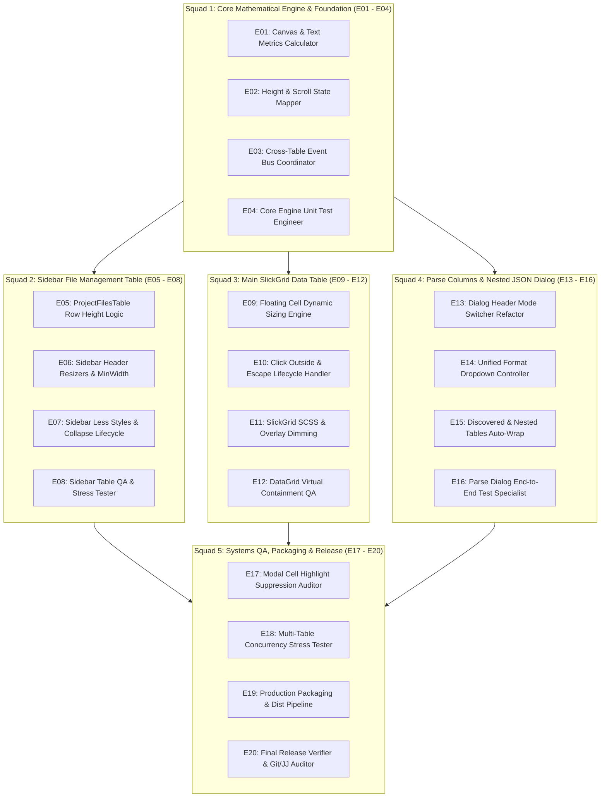

# Comprehensive Specification Mining & Technical Architecture Survey

**Document Target**: `spec_miner_survey_squads/analysis.md`  
**Author**: `teamwork_spec_miner` (Read-Only Specification Miner)  
**Date**: 2026-11-04  
**Project**: ToadViewer v2.5.1  
**Authoritative Sources**:
1. `ORIGINAL_REQUEST.md` (verbatim requirements R1 — R5)
2. `C:/Users/huydq/.gemini/antigravity/brain/489b863f-84dc-4fd6-bbfb-142488ba4d23/ke_hoach_trien_khai_20_ki_su_song_song.md` (Technical implementation plan for 20 parallel engineers)
3. ToadViewer codebase: `tad-master/packages/toadviewer/`, `tests/`, `run_tests.js`, `package_release.ps1`

---

## Executive Summary

This specification mining report documents the complete behavioral contracts, mathematical formulas, interface definitions, boundary conditions, event lifecycles, and no-conflict engineering partitions for:
1. **Intelligent Line Calculation & Dynamic Auto-Wrap across All 3 Tables** (Sidebar Files Table, Main DataGrid, Parse Columns / Discovered Fields Table).
2. **Parse Columns Header & Format Dropdown Refactor** (strict `[Visual]` and `[Regex]` tabs, `Nested JSON` in format dropdown, elimination of redundant switches, auto-scan trigger, and unified DuckDB view application).
3. **Modal Active Cell Highlight Suppression** (complete elimination of floating cells and active/selected cell glow behind Blueprint modal overlays).
4. **Automated Unit, Integration & Concurrency Test Suites** (3 new test suites totaling 50 tests, bringing the total suite to 575+ tests).
5. **5-Squad Parallel Architecture (E01 — E20)** (file ownership, interface boundaries, and isolation guarantees for zero merge conflicts).

---

## 1. Specifications, Mathematical Formulas & Boundary Contracts

### 1.1 Line Count Calculation Engine (`calculateLineCount`)

The pure mathematical and heuristic line calculation engine must evaluate the number of visual lines $N$ rendered for an arbitrary text snippet inside a column of given width $W$.

```typescript
export interface CellLineCalcOptions {
  fontFamily?: string;      // default: "Inter, -apple-system, BlinkMacSystemFont, 'Segoe UI', Roboto, sans-serif"
  fontSize?: number;        // default: 12 (px)
  fontWeight?: string | number; // default: 400
  paddingX?: number;        // default: 12 (px, total horizontal cell padding, e.g. 6px left + 6px right)
  fallbackCharWidth?: number; // default: 7.2 (px per character in monospace/sans-serif fallback)
}

export function calculateLineCount(
  text: string | number | boolean | null | undefined,
  columnWidth: number,
  options?: CellLineCalcOptions
): number;
```

#### Line Calculation Algorithm:
1. **Null/Empty Handling**:
   - If `text == null` or `text === ""` or `String(text).trim() === ""`: return $1$.
2. **Available Content Width**:
   - $W_{\text{avail}} = \max(20, \text{columnWidth} - (\text{options.paddingX} \lor 12))$.
3. **Newline Splitting**:
   - Split `String(text)` by `/\r\n|\r|\n/`.
   - Each hard newline produces at least 1 visual line.
4. **Sub-line Wrapping Simulation**:
   - **Browser / Canvas 2D mode**: If `typeof document !== "undefined"` and `document.createElement`:
     - Reuse a cached singleton `HTMLCanvasElement` and `CanvasRenderingContext2D`.
     - Set font: `${fontWeight} ${fontSize}px ${fontFamily}`.
     - For each hard line paragraph:
       - If paragraph width $\le W_{\text{avail}}$, line count increment is $1$.
       - Otherwise, tokenise by whitespace or break continuous long words exceeding $W_{\text{avail}}$ into wrapped segments using `ctx.measureText(token).width`.
   - **Headless / Node.js fallback mode** (e.g. CLI test runners):
     - Effective character width: $C_w = \text{options.fallbackCharWidth} \lor 7.2\text{px}$.
     - Maximum characters per visual line: $M_{\text{chars}} = \max(1, \lfloor W_{\text{avail}} / C_w \rfloor)$.
     - For each paragraph:
       - If paragraph length $\le M_{\text{chars}}$, increment is $1$.
       - If paragraph contains whitespace: simulate word wrap greedily.
       - If paragraph has continuous unbreakable text (e.g. long JSON or hex hash): $\lceil \text{length} / M_{\text{chars}} \rceil$.
5. **Total Line Count**:
   - Sum of wrapped visual lines across all hard paragraphs. Return integer $N \ge 1$.

---

### 1.2 Height and Scroll State Contract (`getHeightAndScrollState`)

```typescript
export interface CellHeightScrollState {
  shouldExpand: boolean;   // false when N <= 1; true when N >= 2
  height: number;          // exact pixel height
  overflowY: "hidden" | "auto";
  hasScrollbar: boolean;   // false when N <= 5; true when N > 5
  lineCount: number;       // computed N
}

export function getHeightAndScrollState(
  lineCount: number,
  lineHeight: number = 17,    // default line height: 17px
  verticalPadding: number = 8, // default total padding: 8px (4px top + 4px bottom)
  defaultHeight: number = 24  // default compact cell height: 24px (DataGrid) or 25px (Sidebar)
): CellHeightScrollState;
```

#### Exact Mathematical Partition:

| Line Count ($N$) | `shouldExpand` | Height Formula ($H$) | Height Value | `overflowY` | `hasScrollbar` | Visual Elevation & Shadow |
|:---|:---:|:---|:---:|:---:|:---:|:---|
| **$N \le 1$** | `false` | $H = \text{defaultHeight}$ | `24px` (or `25px`) | `"hidden"` | `false` | Flat, 0 elevation, no box-shadow, transparent border |
| **$N = 2$** | `true` | $H = 2 \times 17 + 8$ | `42px` | `"hidden"` | `false` | Elevated (`z-index: 20`), box-shadow, Blueprint border |
| **$N = 3$** | `true` | $H = 3 \times 17 + 8$ | `59px` | `"hidden"` | `false` | Elevated (`z-index: 20`), box-shadow, Blueprint border |
| **$N = 4$** | `true` | $H = 4 \times 17 + 8$ | `76px` | `"hidden"` | `false` | Elevated (`z-index: 20`), box-shadow, Blueprint border |
| **$N = 5$** | `true` | $H = 5 \times 17 + 8$ | `93px` | `"hidden"` | `false` | Elevated (`z-index: 20`), box-shadow, Blueprint border |
| **$N > 5$** | `true` | $H = 5 \times 17 + 8$ (Capped) | `93px` (approx 93-95px) | `"auto"` | `true` | Elevated (`z-index: 20`), slim 4px vertical scrollbar |

#### Boundary Conditions & Guarantees:
- **No scrollbar below $N = 6$**: Cells with 2, 3, 4, or 5 lines MUST fit their text exactly without triggering a vertical scrollbar (`overflow-y: hidden`).
- **Strict Cap at 5 Lines**: Under NO circumstances may an in-place cell expand beyond 5 lines ($93\text{px} - 95\text{px}$). The former $180\text{px}$ arbitrary cap is eliminated.
- **Scrollbar Styling**: When $N > 5$, vertical scrollbar is slim ($4\text{px}$ width, $2\text{px}$ thumb border-radius, track transparent, thumb `#94a3b8` light / rgba dark).

---

### 1.3 The 4-Way Collapse Lifecycle

Every expanded cell or row across all three tables must adhere to the 4-way collapse lifecycle:

1. **Re-click Active Cell / Selected Row (Toggle Click)**:
   - Clicking an already expanded cell or row immediately toggles it back to compact collapsed state ($24\text{px} - 25\text{px}$).
2. **Click Another Cell / Row**:
   - Selecting a new cell or row immediately dismisses the previously expanded cell before evaluating the new target.
3. **Click Outside (Mousedown Outside)**:
   - A document-level `mousedown` event outside the table/grid container immediately dismisses any active expanded floating cell or row expansion.
4. **Press Escape Key (`Escape` / `keyCode === 27`)**:
   - A `keydown` listener on `window` and the grid container immediately dismisses the floating cell and resets active expansion.

---

## 2. Parse Columns Header & Format Refactor Requirements

### 2.1 Header Mode Switcher Refactor

In `tad-master/packages/toadviewer/src/components/RegexDialog.tsx`:

- **Current State**:
  - Contains 3 tabs in the capsule segmented switch (lines 1504-1589):
    1. `#ntab-simple` (`[Visual]`)
    2. `#ntab-nested` (`[Nested JSON]`) — redundant top-level tab
    3. `#ntab-adv` (`[Regex]`)
- **Required Refactored State**:
  - Remove button `#ntab-nested` completely from the header switcher.
  - Header switcher strictly contains only two options:
    - **Visual Mode**: `id="ntab-simple"`
    - **Regex Mode**: `id="ntab-adv"`

---

### 2.2 Format Dropdown (`minFormatSelect`) Refactor

- **Current State**:
  - The format dropdown in the minimalist natural language bar (`using [Format ▾]`) contains:
    `<option value="kv">Key=Value</option>`
    `<option value="json">JSON</option>`
    `<option value="space">Delimited</option>`
    `<option value="raw">Raw</option>`
    `<option value="csv">CSV</option>`
    `<option value="arr">Array</option>`
  - Next to it is a conditional button `#btn-switch-nested`:
    ```tsx
    {formatType === "json" && (
      <button type="button" id="btn-switch-nested" onClick={...}>
        Auto-Flatten Available ➔
      </button>
    )}
    ```
- **Required Refactored State**:
  1. Add `<option value="nested_json">Nested JSON</option>` into `<select id="minFormatSelect">`.
  2. Remove button `#btn-switch-nested` (`Auto-Flatten Available ➔`) entirely.
  3. Update `ExtractionFormatType` union in `tad-master/packages/toadviewer/src/actions.ts`:
     ```typescript
     export type ExtractionFormatType =
       | "raw"
       | "kv"
       | "json"
       | "nested_json"
       | "json_array"
       | "csv"
       | "space"
       | "arr";
     ```

---

### 2.3 Automatic View Switching & Auto-Scan Trigger

When `formatType === "nested_json"` is selected in `minFormatSelect`:
1. Switch dialog body view to the Nested JSON workspace:
   - Render `SampleScanController` (sample size dropdown 50/100/500/1000, scan progress, leaf count badge).
   - Render `NestedFieldsTable` (search filter, select all/none/invert, column name inline editor, type dropdown, fill-rate meter, sample value).
   - Render live DuckDB SQL preview (`DuckDbJsonSqlBuilder.buildCreateViewSql`).
2. **Auto-Scan Trigger**:
   - If `nestedFields.length === 0` and `selectedCol` is non-empty, automatically invoke `triggerNestedScan(100)` with 100 sample rows.
3. When any other format (`kv`, `json`, `space`, `raw`, `csv`, `arr`) is selected:
   - Restore the standard Visual sample viewing and rule extraction view (`MinimalExtractRuleBox`, sample line list).

---

### 2.4 Apply Button Handling (`handleApply`)

Update `handleApply` in `RegexDialog.tsx`:
- Trigger nested JSON extraction when `mode === "nested_json" || formatType === "nested_json"`:
  ```typescript
  if (mode === "nested_json" || formatType === "nested_json") {
    const activeFields = nestedFields.filter(
      (f) => f.enabled && (f.customColName || f.dotPath).trim().length > 0
    );
    if (activeFields.length === 0) {
      throw new Error("Please select at least one nested JSON field to extract!");
    }
    // Generate DuckDB CREATE VIEW SQL and execute via dbc.runSqlQuery
  }
  ```
- Update `enabledCount` calculation to reflect `nestedFields.filter(f => f.enabled).length` whenever `formatType === "nested_json"`.

---

## 3. Modal Active Cell Highlight Suppression

### 3.1 Dialog Open Lifecycle & Grid Reset

When `RegexDialog` (or any Blueprint modal dialog) opens (`isOpen === true`):
1. **Event Dispatch**:
   - Dispatch custom event `"dismiss-grid-cell-expand"` via `window.dispatchEvent` or `GridOverlayBus.dispatchDismissCellExpand()`.
2. **DOM Cleanup**:
   - Remove classes `.slick-cell-active-expanded`, `.slick-row-has-expanded`, and `.slick-row-active-expanded` from all container nodes.
3. **Grid Active Cell Reset**:
   - Call `grid.resetActiveCell()` on the SlickGrid instance to clear internal active row and cell indices.

```typescript
// RegexDialog.tsx
useEffect(() => {
  if (isOpen) {
    GridOverlayBus.dispatchDismissCellExpand();
    const container = document.querySelector(".slick-viewport");
    if (container) {
      container.querySelectorAll(".slick-cell-active-expanded")
        .forEach((el) => el.classList.remove("slick-cell-active-expanded"));
      container.querySelectorAll(".slick-row-has-expanded, .slick-row-active-expanded")
        .forEach((el) => {
          el.classList.remove("slick-row-has-expanded");
          el.classList.remove("slick-row-active-expanded");
        });
    }
  }
}, [isOpen]);
```

---

### 3.2 Overlay CSS Suppression (`slickgrid.scss`)

When Blueprint modal overlay is active, Blueprint adds class `bp4-overlay-open` to `document.body`.

In `tad-master/packages/toadviewer/src/slickgrid.scss`, add high-specificity override rules:

```scss
/* Suppress all active/selected cell glows behind modal dialogs */
body.bp4-overlay-open {
  .slick-cell.active,
  .slick-row.active .slick-cell,
  .slick-cell.selected {
    background: transparent !important;
    background-color: transparent !important;
    box-shadow: none !important;
    outline: none !important;
    border-color: transparent !important;
  }

  /* Force hide any floating active expanded cells while overlay is open */
  .slick-cell.slick-cell-active-expanded {
    display: none !important;
    visibility: hidden !important;
  }
}
```

---

### 3.3 Custom Event Bus (`GridOverlayBus.ts`)

A new centralized TypeScript event bus module `tad-master/packages/toadviewer/src/utils/GridOverlayBus.ts`:

```typescript
export const GRID_OVERLAY_EVENTS = {
  DISMISS_CELL_EXPAND: "dismiss-grid-cell-expand",
  MODAL_OPENED: "modal-overlay-opened",
  MODAL_CLOSED: "modal-overlay-closed",
} as const;

export class GridOverlayBus {
  static dispatchDismissCellExpand(): void {
    if (typeof window !== "undefined") {
      window.dispatchEvent(new CustomEvent(GRID_OVERLAY_EVENTS.DISMISS_CELL_EXPAND));
    }
  }

  static subscribeDismissCellExpand(handler: () => void): () => void {
    if (typeof window === "undefined") return () => {};
    window.addEventListener(GRID_OVERLAY_EVENTS.DISMISS_CELL_EXPAND, handler);
    return () => {
      window.removeEventListener(GRID_OVERLAY_EVENTS.DISMISS_CELL_EXPAND, handler);
    };
  }
}
```

---

## 4. Test Suite Requirements & Registration

### 4.1 New Test Suites

1. **`tests/unit/test_cell_line_calculator.js` (25 Test Cases)**:
   - Tests 1-7: Line boundary contracts ($N = 1, 2, 3, 4, 5, 6, 100$).
   - Tests 8-13: Column width variations ($45\text{px}, 100\text{px}, 140\text{px}, 200\text{px}, 400\text{px}, 1200\text{px}$).
   - Tests 14-18: Text types & edge cases (empty string, single word, long unbroken string/hex, multiline `\r\n`, numbers, timestamps).
   - Tests 19-21: Unicode & complex formatting (Vietnamese diacritics, emoji, deeply nested JSON payloads).
   - Tests 22-25: Height mapping contract (`shouldExpand`, `height`, `overflowY`, `hasScrollbar`).

2. **`tests/unit/test_parse_dialog_nested_dropdown.js` (15 Test Cases)**:
   - Tests 1-3: Header mode switcher contains strictly `[Visual]` and `[Regex]`; `#ntab-nested` is absent.
   - Tests 4-6: Format dropdown `<select id="minFormatSelect">` contains `<option value="nested_json">`; `#btn-switch-nested` is removed.
   - Tests 7-9: Selecting `nested_json` triggers auto-scan `triggerNestedScan(100)` when field list is empty; switches body view to Nested JSON.
   - Tests 10-12: Selecting non-nested formats restores visual sample viewer and rule mapping.
   - Tests 13-15: `handleApply` executes nested JSON extraction and SQL generation when `formatType === "nested_json"`.

3. **`tests/qa/test_modal_cell_glow_suppression.js` (10 Test Cases)**:
   - Tests 1-3: Dialog opening fires `"dismiss-grid-cell-expand"`; calls `grid.resetActiveCell()`.
   - Tests 4-6: Floating cell classes (`.slick-cell-active-expanded`, `.slick-row-has-expanded`) are purged.
   - Tests 7-8: Under `body.bp4-overlay-open`, active cell styles have transparent background and no shadow/outline.
   - Tests 9-10: Rapid modal open/close stress (100 cycles) maintains clean grid state with zero memory leaks.

---

### 4.2 Updates to Existing Test Suites

- **`tests/unit/test_project_files_table_wrap_resize.js`**:
  - Update Test 1.13 to assert that expanded height caps at 5 lines ($93\text{px}$) with `overflow-y: auto`, rather than old $180\text{px}$.
  - Assert that $N \le 1$ remains flat ($25\text{px}$, `overflow-y: hidden`).
- **`tests/unit/test_datagrid_floating_wrap.js`**:
  - Update Test 2.11 to assert 5-line height cap ($93\text{px}$) and $2..5$ line height scaling ($N \times 17 + 8\text{px}$).
- **`tests/qa/test_grid_wrap_concurrency_stress.js`**:
  - Re-verify 100K-row virtual grid access, coordinate invariance, and $< 16.6\text{ms}$ frame time under dynamic line calculation.

---

### 4.3 Test Registration in `run_tests.js`

Register the 3 new test suites in `run_tests.js`:
- `tests/unit/test_cell_line_calculator.js` (Unit & Default runs)
- `tests/unit/test_parse_dialog_nested_dropdown.js` (Unit & Default runs)
- `tests/qa/test_modal_cell_glow_suppression.js` (QA & Default runs)
- **Target**: Total test count increases from 526+ to 575+ tests, passing 100% cleanly.

---

## 5. 5-Squad Organization & No-Conflict Partitioning

### 5.1 Squad Breakdown & Responsibilities



---

### 5.2 No-Conflict File Boundary Matrix

| Engineer | Primary Owned File | Secondary / Consumer Files | Isolation Boundary Rule |
|:---|:---|:---|:---|
| **E01** | `tad-master/packages/toadviewer/src/utils/CellLineCalculator.ts` | None | Pure line calculation function; zero DOM dependency in core logic |
| **E02** | `tad-master/packages/toadviewer/src/utils/CellLineCalculator.ts` | None | Pure height and scroll state mapping; zero DOM dependency |
| **E03** | `tad-master/packages/toadviewer/src/utils/GridOverlayBus.ts` | `DataGrid.tsx`, `RegexDialog.tsx` | New standalone event bus file; exports typed constants & dispatchers |
| **E04** | `tests/unit/test_cell_line_calculator.js` | None | New standalone unit test suite (25 test cases) |
| **E05** | `tad-master/packages/toadviewer/src/components/ProjectFilesTable.tsx` | None | Edits strictly row rendering within `<tbody>` lines 660-778 |
| **E06** | `tad-master/packages/toadviewer/src/components/ProjectFilesTable.tsx` | None | Edits strictly header resizers within `<thead>` lines 500-660 |
| **E07** | `tad-master/packages/toadviewer/less/sidebar.less` | None | Edits strictly `.file-table-row.is-selected` and `.is-expanded` |
| **E08** | `tests/unit/test_project_files_table_wrap_resize.js` | None | Updates sidebar table test suite to new 5-line height cap |
| **E09** | `tad-master/packages/toadviewer/src/components/DataGrid.tsx` | None | Edits strictly `tryExpandCell` function (lines 605-654) |
| **E10** | `tad-master/packages/toadviewer/src/components/DataGrid.tsx` | None | Edits strictly event subscriptions & cleanup in `grid.destroy` (lines 920-940) |
| **E11** | `tad-master/packages/toadviewer/src/slickgrid.scss` | None | Removes `max-height: 180px !important;` and adds `body.bp4-overlay-open` suppression |
| **E12** | `tests/unit/test_datagrid_floating_wrap.js` | None | Updates DataGrid floating wrap test suite to new contracts |
| **E13** | `tad-master/packages/toadviewer/src/components/RegexDialog.tsx` | None | Removes `#ntab-nested` button in header switcher (lines 1530-1561) |
| **E14** | `tad-master/packages/toadviewer/src/components/RegexDialog.tsx`, `actions.ts` | None | Modifies `#minFormatSelect`, removes `#btn-switch-nested`, updates `handleApply` |
| **E15** | `tad-master/packages/toadviewer/src/components/NestedFieldsTable.tsx` | None | Adds column resizer handles and cell wrap expansion to discovered fields table |
| **E16** | `tests/unit/test_parse_dialog_nested_dropdown.js` | None | New standalone unit test suite (15 test cases) |
| **E17** | `tests/qa/test_modal_cell_glow_suppression.js` | `RegexDialog.tsx` (review) | New QA test suite verifying modal active cell suppression |
| **E18** | `tests/qa/test_grid_wrap_concurrency_stress.js` | `run_tests.js` | Updates concurrency stress test suite; validates 100-cycle switching $< 15\text{ms}$ |
| **E19** | `dist_package.ps1`, `package_release.ps1`, `tools/clean_cache.ps1` | None | Verifies zero-duplicate binary packaging; produces root `Toad.exe` & `releases/` pair |
| **E20** | Git / Jujutsu (`jj`) metadata | Documentation / Release | Release gatekeeper; audits identity `HelloKittyXamKinLung`, English-only text, 100% test pass |

---

## 6. Discovered Features & Edge Cases

### 6.1 Features Discovered

| # | Category | Feature | Description | Inputs | Outputs | Error Behavior | Discovered Via |
|---|----------|---------|-------------|--------|---------|----------------|----------------|
| 1 | Line Math | `calculateLineCount` | Pure text metrics calculation of visual line count $N$ | `text`, `columnWidth`, `options` | integer $N \ge 1$ | Returns 1 on empty/null; clamps width to $\ge 20\text{px}$ | `ORIGINAL_REQUEST.md` R1 |
| 2 | Height State | `getHeightAndScrollState` | Pure mapping of line count to height & scroll properties | $N$, `lineHeight`, `padding`, `defaultHeight` | `CellHeightScrollState` | Defaults to $N \le 1$ flat state on NaN | `ke_hoach_trien_khai` §2 |
| 3 | Table 1 Wrap | Sidebar File Table Wrap | Selected row expands to $\max(N_{\text{name}}, N_{\text{dir}})$ lines | Selected row click in `ProjectFilesTable` | Inline height & overflow on row | Reverts to 25px flat if $N \le 1$ | `ProjectFilesTable.tsx` |
| 4 | Table 2 Wrap | SlickGrid Floating Cell Wrap | In-place active cell floats with dynamic height | Cell click in `DataGrid` | `.slick-cell-active-expanded` with inline height | Immediately dismissed on scroll or $N \le 1$ | `DataGrid.tsx` |
| 5 | Table 3 Wrap | Nested & Discovered Fields Wrap | Discovered field sample value & dotpath wrap | Cell click in `NestedFieldsTable` | Expanded inline height & scrollbar if $N > 5$ | Ignores clicks while renaming | `NestedFieldsTable.tsx` |
| 6 | Lifecycle | 4-Way Collapse Lifecycle | Toggle click, other cell, outside click, Escape | Mouse or Keyboard event | Dismisses floating cells and resets expansion | Gracefully handles missing container DOM | `DataGrid.tsx`, `ProjectFilesTable.tsx` |
| 7 | Parse Dialog | Strict 2-Tab Header | Header mode switcher limited to Visual & Regex | User tab click | `mode = "simple"` or `"advanced"` | `#ntab-nested` button removed from DOM | `RegexDialog.tsx` |
| 8 | Parse Dialog | Format Dropdown Nested JSON | `nested_json` option in `#minFormatSelect` | User select option | Body switches to Nested JSON; auto-scans 100 rows | No-op scan if already populated | `RegexDialog.tsx` |
| 9 | Modal Glow | Overlay Cell Suppression | Suppresses glowing active cells behind modal | `isOpen === true` / `bp4-overlay-open` | Transparent active/selected background, no shadow | Safe even if grid is not mounted | `slickgrid.scss`, `RegexDialog.tsx` |
| 10 | Event Bus | `GridOverlayBus` | Decoupled cross-component overlay events | CustomEvents on `window` | Typed event broadcast and subscription | Clean unmount removal; no leaks | Architecture Plan S1 |
| 11 | Packaging | Zero-Duplicate Binary Policy | Ensures only `Toad.exe` and single version pair exist | `package_release.ps1` | Clean canonical release binaries | Throws error if old versions linger | `AGENTS.md` & `package_release.ps1` |

---

### 6.2 Edge Cases

| # | Feature | Input | Observed / Required Behavior |
|---|---------|-------|------------------------------|
| 1 | `calculateLineCount` | Empty string `""` or `null` or `undefined` | Returns exactly $1$ line; height remains default $24\text{px} - 25\text{px}$. |
| 2 | `calculateLineCount` | Unbroken 100-character alphanumeric string without spaces | Wraps characters across lines based on available column width; does not overflow container. |
| 3 | `calculateLineCount` | Text with CRLF (`\r\n`) and LF (`\n`) newlines | Each hard newline increments line count; segments wrap independently. |
| 4 | `calculateLineCount` | Narrow column width ($45\text{px}$ minimum width) | Correctly clamps available width to minimum $20\text{px}$; character wrap scales gracefully. |
| 5 | `getHeightAndScrollState` | $N = 1$ | Returns `{ shouldExpand: false, height: 24, overflowY: "hidden", hasScrollbar: false }`. |
| 6 | `getHeightAndScrollState` | Boundary $N = 5$ | Returns `{ shouldExpand: true, height: 93, overflowY: "hidden", hasScrollbar: false }` (no scrollbar). |
| 7 | `getHeightAndScrollState` | Boundary $N = 6$ | Returns `{ shouldExpand: true, height: 93, overflowY: "auto", hasScrollbar: true }` (scrollbar enabled). |
| 8 | `getHeightAndScrollState` | Extreme $N = 100$ (large JSON) | Returns `{ shouldExpand: true, height: 93, overflowY: "auto", hasScrollbar: true }` (height strictly capped at 93px). |
| 9 | 4-Way Collapse | User re-clicks active cell | Collapses immediately back to standard single line ($24\text{px}$). |
| 10 | 4-Way Collapse | User scrolls virtual DataGrid while cell expanded | `grid.onScroll` immediately calls `dismissFloatingCell()` to prevent coordinate tear. |
| 11 | Parse Dialog Dropdown | User selects `nested_json` when 0 fields discovered | Automatically triggers `triggerNestedScan(100)` and shows scanning spinner. |
| 12 | Parse Dialog Dropdown | User switches from `nested_json` back to `kv` | Restores Visual sample viewing and token rule extractor; preserves previously discovered nested fields in memory. |
| 13 | Modal Glow Suppression | Modal opens while cell is currently expanded | Immediately dispatches `"dismiss-grid-cell-expand"`, dismisses floating DOM node, and clears active cell index. |
| 14 | Modal Glow Suppression | User hovers over grid cells while modal backdrop is visible | Mouse events are blocked by Blueprint overlay backdrop (`bp4-overlay-backdrop`). |

---

## 7. Verification Method for Downstream Implementers

Downstream squad engineers can verify their implementations using:
1. **Unit Tests Execution**:
   ```powershell
   & "node-v18.20.4-win-x64\node.exe" run_tests.js --unit
   ```
2. **Comprehensive Test Suite**:
   ```powershell
   & "node-v18.20.4-win-x64\node.exe" run_tests.js --all
   ```
   *Gate Requirement: 100% PASS across 575+ tests.*
3. **Packaging Assertion**:
   ```powershell
   & powershell -ExecutionPolicy Bypass -File package_release.ps1 -AppName Toad -Version 2.5.1
   ```
   *Gate Requirement: Zero duplicate binaries; portable executable generated in `releases/`.*
