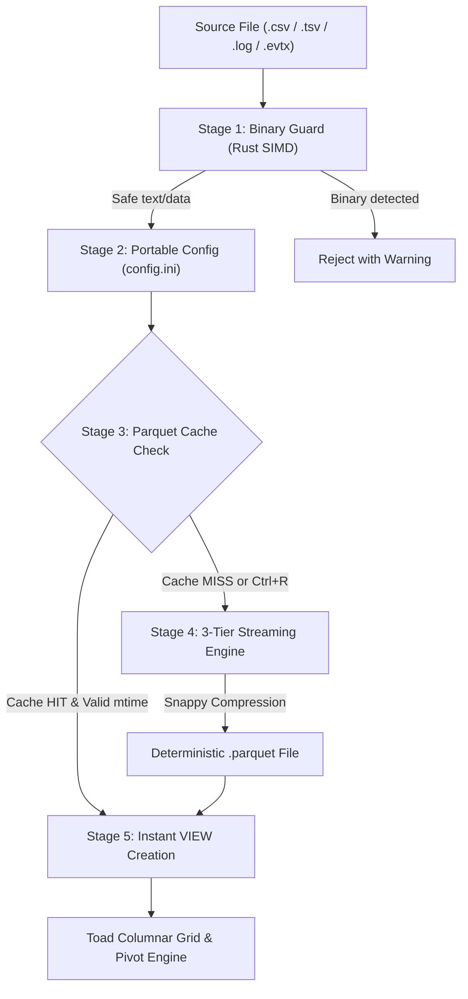

# Toad (v1.3.9.1) - High-Performance Tabular Data Viewer & Big Data Log Analyzer

[](LICENSE)
[](https://duckdb.org/)
[](releases/)
[-orange.svg)](releases/)

> **Toad** is a blazing-fast, lightweight, and modern desktop application designed for querying, exploring, and analyzing tabular data files of virtually any scale (including **Big Data 40GB+ / 60,000,000+ rows**). Powered by **DuckDB 1.0.0**, native **Apache Parquet**, and an embedded **Rust SIMD Core**, Toad delivers sub-second pivot tables, compound filtering with ArcSight ESM query ergonomics, visual ingestion progress dialog, $O(1)$ instant row counting, automatic chronological time sorting, background distinct filter caching, Dracula dark theme, instant **Smart Expand 1-click triage**, and a flexible **pagination engine (default 1,000 rows with zero arbitrary upper limit)**.
>
> 📖 **[Read the Quick Start Guide (v1.3.9.1)](file:///D:/Shared_UserData/Downloads/tad/QUICK_START.md)** for a fast walkthrough of all features.

---

## 1. Quick Download & Portable Distribution

Toad is packaged as a completely self-contained portable Windows executable—no administrator privileges, background daemons, or installation wizards required.

| Executable | Size | Description |
| :--- | :--- | :--- |
| **[`Toad.exe`](file:///D:/Shared_UserData/Downloads/tad/Toad.exe)** | ~92 MB | Primary standalone portable executable (v1.3.9.1) |
| **[`releases/toad_v1.3.9.1_portable.exe`](file:///D:/Shared_UserData/Downloads/tad/releases/toad_v1.3.9.1_portable.exe)** | ~92 MB | Versioned portable release binary |
| **[`releases/RELEASE_NOTES.md`](file:///D:/Shared_UserData/Downloads/tad/releases/RELEASE_NOTES.md)** | - | Full Version Changelog & Technical Specifications |
| **[`QUICK_START.md`](file:///D:/Shared_UserData/Downloads/tad/QUICK_START.md)** | - | Complete Quick Start & Feature Guide |

### Non-Polluting Portable Architecture
Toad does not write into `C:\Users\<user>\AppData\Roaming`. Instead, all configuration (`config.ini`), query filters (`filters_preset.json`), logs, and transient Parquet caches are encapsulated within a local folder named `toadAppData_[id]` created right alongside the executable.

---

## 2. Toad QuickStart & Comprehensive User Guide

### 2.1 What Toad Is
The Toad desktop app lets you explore, filter, pivot, and analyze tabular data across several standard data formats:

| Format | Extension | Capabilities |
| :--- | :--- | :--- |
| **Delimited Text** | `.csv`, `.tsv`, `.txt` | Ultra-fast multi-threaded streaming with 3-tier fallback parser |
| **Apache Parquet** | `.parquet` | Native columnar scanning with zero conversion overhead |
| **DuckDB Database** | `.duckdb` | Full SQL schema tree browsing and instant table views |
| **SQLite Database** | `.sqlite`, `.db` | Embedded relational database inspection |
| **JSON / JSON Lines** | `.json`, `.jsonl`, `.ndjson` | Structured and semi-structured streaming ingestion |
| **Windows Event Logs** | `.evtx` | Rust-accelerated EVTX decoding into columnar records |
| **Raw Event Logs** | `.log` | Ingests unformatted log lines directly into a `raw_event` column |
| **Toad Workspaces** | `.tad` | Saves and restores entire pivot tables, filters, and layouts |

---

### 2.2 Launching Toad
There are three convenient ways to launch Toad:

1. **Direct Launch**: Double-click [`Toad.exe`](file:///D:/Shared_UserData/Downloads/tad/Toad.exe). Use **File &rarr; Open** to choose any supported data file.
2. **Context Menu or Drag & Drop**: In Windows File Explorer, right-click any `.csv`, `.parquet`, or `.log` file and choose **Open With... &rarr; Toad**, or simply drag and drop the file directly onto an open Toad window.
3. **Command Line Interface (CLI)**:
   ```powershell
   # Basic launch
   toad sales_2026.csv

   # Inspect generated SQL queries in the console
   toad -f --show-queries access_log.parquet
   ```

---

### 2.3 Exploring Tabular Data with Pivot Tables
The core analytical feature of Toad is its **Hierarchical Pivot Table**. A Toad pivot table transforms flat data into a navigable multi-level *tree table* by:
- Grouping rows that share identical values across selected **Pivot Columns**.
- Computing aggregate values (such as `sum`, `avg`, `min`, `max`, `uniq`, or row counts) for all other columns in each grouped branch.
- Providing instant drill-down and drill-up into underlying data.

```
+-- Country: USA (1,452 rows)
|   +-- Director: Christopher Nolan (11 movies | Gross: $2.1B | Rating: 8.4)
|   |   |-- Inception (2010 | Gross: $292M | Rating: 8.8)
|   |   |-- Interstellar (2014 | Gross: $188M | Rating: 8.6)
|   +-- Director: Quentin Tarantino (9 movies | Gross: $649M | Rating: 8.2)
+-- Country: UK (684 rows)
```

To build a pivot table:
1. Click the **Pivot** icon (`pivot-table`) on the left **ActivityBar** to open the sidebar.
2. Check the box under **Pivot** next to any column you want to group by (e.g., `country`, then `director`).
3. Select the desired **Pivot Tree Leaf Level** from the dropdown at the bottom of the column selector.

---

### 2.4 Column Management, Staged Changes & Push to Top (v1.2.5)
- **Icon-Only Action Toolbar**: Streamlined with clean, minimalist icon buttons: **Realtime Sync** (`⚡`), **Revert** (`↶`), and **Play** (`▶`).
- **Realtime Sync Mode Toggle**: When Realtime is enabled (active amber glow), all column modifications (`Show`, `Pivot`, `Sort`, `Push to Top`) apply immediately to the table without needing Play. When disabled, Staged mode takes effect.
- **Search & Jump-to-Select Column (Non-Filtering)**: Type in the search box to find any column by name. Toad instantly scrolls the list directly to the matching row and selects it with a prominent highlight—without hiding or filtering out any other columns! Press `Enter` to cycle through multiple matches.
- **Multi-Column Push to Top in Selection Order (`Top` Column)**: Each column row includes a dedicated **Top** button (`↑`). You can select multiple columns to push to the top simultaneously. Each selected column displays its queue order number (e.g. `↑ 1`, `↑ 2`, `↑ 3`, `↑ 4`). Columns are placed at the very beginning of the table in the exact sequence they were clicked (for example, selecting A, C, B, D places them as the first 4 columns). Per design, columns are not rearranged immediately—they are pushed to the top only after clicking the **Play** button (or immediately when in Realtime mode)!
- **Tab Change Auto-Revert**: In Staged mode, if you switch to another tab (e.g. in Additional Properties or ActivityBar) or click **Revert** without pressing Play, the staged Columns state automatically restores to match the active main table.
- **Synchronized Table Order**: Columns in the sidebar reflect the exact visual column sequence displayed in the main grid.
- **Order Toggle**: Click the **Column** header to instantly toggle between **Table Order** and **Alphabetical (A-Z)**.

---

### 2.5 In-Place Double-Click Column Renaming (v1.2.2)
You can customize column display names on the fly without modifying the original data on disk:
1. In the **Columns** sidebar, **double-click** any column name.
2. The label transforms into an inline text editor.
3. Type the new display name and press **Enter** (or click away) to save, or press **Escape** to cancel.
4. The updated name instantly propagates across table headers, sort indicators, and pivot trees.

---

### 2.6 ArcSight ESM Query Search & Compound Filtering (v1.3.5)
Toad features an enterprise-grade compound query engine modeled after ArcSight ESM Query Search:

1. Click the **Filter** button in the bottom footer (or press `Ctrl+F`) to open the query editor.
2. **Dual View Modes ("Tree View" ⇄ "Raw SQL")**: Seamlessly switch between graphical visual block construction and direct Raw SQL editing.
3. **Multi-Tag Pill Inputs (`IN` / `NOT IN`)**: Type or paste lists of values, automatically separating on commas or newlines into discrete tag pills with type-aware integer parsing.
4. **1-Click SQL Copy & Real-Time Stats**: Copy the compiled DuckDB `WHERE` predicate with one click, while viewing live matched row counts (`Matched: X / Y rows`) and query latency (`Latency: Z ms`).
5. **Integrated Group Header Actions**: Add conditions (`+`) and nested subgroups (`📁`) directly from the group header with concise `AND` / `OR` logic selectors and clean subgroup headers.
6. **Sequential Keyboard Navigation**: Click any rule to select it and use `↑` / `↓` keys to step conditions sequentially through parent and nested groups.
7. Click **Apply** (or press `Enter`) to execute the query against DuckDB, with **Live update** mode available for instant keystroke evaluation.

---

### 2.7 Dracula Theme & Theme Switcher (v1.3.6)
Toad v1.3.6 features a built-in **Dracula Theme** crafted specifically for extended data exploration, DFIR investigations, and dim environments without eye-straining pitch-black contrast:
- **120° Soft Inversion Palette**: Rather than pure `#000000` pitch black, Toad applies an 88% inversion rotated 120 degrees (`invert(0.88) hue-rotate(120deg) contrast(1.02)`). This shifts bright backgrounds to a gentle Dracula slate (`#24262b`) with emerald/cyan accent highlights (`#50fa7b` / `#8be9fd`), ensuring crystal-clear text contrast across all table cells, column headers, and dialogs.
- **1-Click Theme Toggle**: Switch themes instantly using the theme toggle icon (`[🌙 / ⚡]`) docked at the bottom of the left vertical **Activity Bar**.
- **Auto-Persistence**: Remembers your preferred theme across sessions via local storage.

---

### 2.8 Dynamic Regex Column Extraction (v1.2.1)
When analyzing semi-structured text or log files (e.g. Nginx, Syslog, Suricata), Toad allows you to extract structured fields using regular expressions:

1. Click the **Regex** button (code icon `</>`) in the footer or left ActivityBar.
2. **Source Column**: Choose the target text column (defaults to `raw_event` or the first column).
3. **Sample Event**: Toad fetches the first non-null sample row. You can edit this sample directly inside the dialog to test your regex pattern.
4. **Regular Expression**: Enter a regex pattern using capture groups `(group1) (group2)...`:
   ```regex
   (\d{4}-\d{2}-\d{2}\s+\d{2}:\d{2}:\d{2})\s+\[(\w+)\]\s+(.*)
   ```
5. **Live Output Preview**: Match results appear in real-time beneath the input box:
   - `str0: 2026-10-17 14:02:11`
   - `str1: ERROR`
   - `str2: Connection timed out to database`
6. **Collision-Free Auto-Resuming Index**: Toad automatically scans existing schema columns to detect the highest index `$X_{max}$`. If `str0` and `str1` already exist, subsequent extractions automatically resume from `str2`, preventing accidental column collisions!
7. Click **Apply**: DuckDB generates a dynamic SQL View, integrates the newly extracted columns into the **Columns** manager, and appends them to the table grid.

---

### 2.8 Aggregations & Formatting Options
Under **Additional Properties** at the bottom of the sidebar:
- **Aggregations**: Customize aggregate functions for non-leaf pivot cells:
  - `sum` (default for numeric fields)
  - `avg` (arithmetic mean)
  - `min` / `max` (range bounds)
  - `uniq` (unique string count, default for text fields)
  - `null` (disables aggregation for that column)
- **Formatting**: Configure decimal point precision, thousands grouping separators, and date-time representations per column.

---

### 2.9 Multi-File & Folder Data Sources
Click the **Data Sources** icon (`database`) on the ActivityBar to explore multi-file workspaces:
- When opening a directory, Toad presents a hierarchical tree of all supported files.
- Click any file to switch views without reloading the application.
- When opening `.duckdb` or `.sqlite` files, Toad displays all internal tables and views as navigable child nodes.

---

### 2.10 Multi-Window Parquet Sharing & Instant Reload (v1.2.0)
- **Shared Parquet Cache**: When opening the same dataset across multiple Toad windows, Toad detects the existing deterministic Parquet cache and connects instantly (0 ms conversion, 0 duplicate disk bytes).
- **Force Reopen / Reload**: Press **`Ctrl+R`** or **`F5`** at any time to invalidate existing caches and stream fresh data from disk.

---

## 3. High-Performance Ingestion Engine & Architecture

To achieve sub-second responsiveness on massive datasets, Toad employs a **5-Stage Streaming Ingestion Pipeline** combining native Rust SIMD checks with DuckDB's vectorized columnar engine.



### 3.1 The 5-Stage Ingestion Pipeline

#### Stage 1: Binary Guard (Crash Prevention)
- Inspects the first 8 KB of the incoming file using a SIMD-accelerated null-byte check (`toad-core.exe inspect`).
- Instantly halts ingestion if binary executables (PE, ELF) or corrupted files are opened, protecting the DuckDB C++ core from segmentation faults.

#### Stage 2: Portable Configuration & Auto-Healing
- Reads `config.ini` from the local `toadAppData_[id]` directory before every file import.
- Dynamically configures DuckDB threads and memory limits (`SET max_memory = '...'`).
- Features a 4-level schema validator with **Auto-Healing**: invalid or missing keys are restored to safe defaults on the fly.

#### Stage 3: Deterministic Parquet Caching
- Generates a deterministic cache key based on the absolute file path and file modification time (`mtime`):
  ```
  filename_cached_[hash10].parquet
  ```
- If the Parquet cache already exists and `src.mtime <= cache.mtime`, Toad skips Stage 4 entirely and jumps directly to Stage 5.

#### Stage 4: 3-Tier Fallback Streaming Engine
Converts text datasets to high-performance Parquet format using a robust fallback cascade:
- **Tier 0 (Primary Engine)**:
  ```sql
  COPY (SELECT * FROM read_csv('source.csv', auto_detect=true, sample_size=100000, ignore_errors=true, null_padding=true))
  TO 'cache.parquet' (FORMAT PARQUET, COMPRESSION 'SNAPPY', ROW_GROUP_SIZE 25000);
  ```
- **Tier 1 (Single-Thread Fallback)**:
  Engaged if multi-threaded chunking encounters corrupted lines or oversized rows (`parallel=false`).
- **Tier 2 (All-Varchar Fallback)**:
  Guaranteed import mode (`all_varchar=true`). Treats every field as string to guarantee 100% data preservation even with irregular schemas.

#### Stage 5: Zero-Copy VIEW Handoff
Rather than copying data into DuckDB memory tables, Toad binds the resulting Parquet file as a virtual SQL View:
```sql
CREATE OR REPLACE VIEW table_data AS SELECT * FROM parquet_scan('cache.parquet');
```
This guarantees **zero duplicate RAM allocation**, enabling instant analytical queries over multi-gigabyte files.

---

### 3.2 Configuration Reference (`config.ini`)

The `config.ini` file located inside your `toadAppData_[id]/` folder allows granular performance tuning:

```ini
# ==============================================================================
#                      TOAD VIEWER SYSTEM CONFIGURATION (CONFIG.INI)
# ==============================================================================

[general]
viewer = toad
language = en

[duckdb]
# Maximum RAM allocated for DuckDB (auto, 1GB, 2GB, 4GB, 8GB...)
max_memory = auto

# Maximum CPU threads used for parallel processing (0 = all cores)
threads = 0

# Synthesize a consolidated [raw_event] column (default: false for max speed)
add_raw_event = false

[parquet]
# Temporary cache compression: snappy (recommended), zstd, gzip, none
compression = snappy

# Rows per data block for filter skipping
row_group_size = 25000

[system]
# Clean up temporary Parquet files upon closing Toad
temp_cleanup = true

# Protect against accidental binary file ingestion
binary_guard = true
```

---

## 4. Release Notes & Changelog

### Version 1.3.9.1 (Current Release)
- **Instant Smart Expand Trigger (1-Click & Focus Auto-Open)**: Selecting or clicking the `_expand` column instantly opens Event Details without requiring Enter. Strict dismissal ensures the panel only closes via `✕` or <kbd>Esc</kbd>.
- **Fixed Filter `IN` / `NOT IN` Array Normalization (No more `t.map is not a function`)**: Safe array conversion when switching from single-value to list operators.

### Version 1.3.9
- **Flawless Master-Detail Keyboard Navigation**: Resolved arrow navigation double-invocation bug when inspecting events. Pressing <kbd>&darr;</kbd> or <kbd>&uarr;</kbd> now keeps the Event Details panel smoothly open and updates the row details continuously without collapsing.
- **Clean Single Filter Suggestion Dropdown**: Removed duplicate native HTML5 `<datalist>` popup at the top of the input. Autocomplete now exclusively displays the styled React suggestion menu at the bottom with theme and keyboard navigation support.
- **Dynamic Flexible Page Size Engine**:
  - Default page size set to **1,000 rows**.
  - On-the-fly footer selector dropdown (`500`, `1,000`, `2,500`, `5,000`, `10,000`, or custom).
  - Configurable persistent parameter `page_size = 1000` in `config.ini` under `[general]`.
  - **Zero Upper Bound Constraint ("User Discretion")**: Users are free to set 20,000+, 50,000+, or any preferred page size without system clamping.
- **Full Version Synchronization**: Synchronized documentation, badges, release notes, and build pipelines to `1.3.9`.

### Version 1.3.8
- **Non-Blocking Parallel Ingestion (`SET preserve_insertion_order = false`)**: Triumphed over throughput stuttering and jagged saw-tooth I/O fluctuations during big dataset ingestion.
- **Adaptive Smart Memory Budgeting Guard**: Defensively limits DuckDB memory to <= 45% RAM (max 8GB) when `max_memory = auto`, avoiding OS page swapping and system freezes.
- **100K Row Group Size for SSD & HDD**: Quadrupled default row group size to 100,000 rows, cutting disk flush frequency by 75% and sustaining 130-160 MB/s on HDDs and 1,500+ MB/s on NVMe.

### Version 1.2.7
- **Interactive Drag & Drop Filter Reordering**: Filter condition blocks can now be freely dragged up and down to adjust condition evaluation order within any logical group.
- **Sub-Group Nesting & Unnesting**: Effortlessly drag conditions into child groups (nesting into sub-group logic) or pull them out of groups into the parent group or root level (unnesting), eliminating the need to delete and recreate rules from scratch.
- **Visual Drag Handles & One-Click Navigation Buttons**: Each condition row is equipped with an ergonomic vertical drag handle (`⋮⋮`) and accessibility buttons (**Move Up** `↑`, **Move Down** `↓`, **Move Out** `←`) for quick and precise condition restructuring.
- **Sub-Group Header Controls**: Reorganize or unnest entire compound condition blocks directly from the nested group header toolbar.
- **Empty Group Drop Zone**: Seamlessly drag conditions into newly initialized empty sub-groups with visual drop feedback (`group-drag-over`).

### Version 1.2.6
- **Row Event Details Expand Button**: Added a dedicated expand button (`›`) at the beginning of every event row in the main table. Clicking it smoothly slides open an **Event Details** secondary table on the right side.
- **Event Details Secondary Table**:
  - Displays all **Field Names** (`tên trường`) and **Field Contents** (`nội dung trường`) of the expanded event.
  - Automatically identifies data types with compact badges (`str`, `int`, `time`, `num`, `bool`).
  - Pre-wraps multiline logs, SQL queries, user agents, and structured payloads in monospace font without breaking grid layouts.
- **Instant Collapse (`✕`)**: Includes a prominent `✕` button in the header of the secondary table to collapse the panel at any time, with keyboard support (<kbd>Esc</kbd>).
- **In-Panel Field Search & Filter**: Filter fields instantly by field name, display name, column ID, or value content.
- **One-Click JSON Export & Field Copy**: Copy the entire event formatted as clean JSON via **Copy JSON**, or copy individual field values on hover with the clipboard button.
- **Draggable Border Resizing**: Dynamically adjust the width of the secondary panel to inspect wide log events or nested JSON payloads.

### Version 1.2.5
- **Realtime Sync Mode & Icon-Only Toolbar**: Added a dedicated **Realtime Sync** toggle button (`⚡`). When enabled, all column actions apply instantly without clicking Play; when disabled, Staged mode takes over. Toolbar buttons are streamlined into clean, icon-only buttons (**Realtime**, **Revert**, **Play**).
- **Search & Jump-to-Select Column**: Integrated a fast column search input that smoothly scrolls to the matching column and highlights/selects it without filtering out any other columns. Supports `Enter` cycling through matches.
- **Multi-Column Push to Top in Selection Order**: Added support for selecting multiple columns to push to the top simultaneously in user selection order (e.g. choosing A, C, B, D positions them as the first 4 columns). Visual badges show the selection rank. Applied atomically when Play is clicked (or instantly in Realtime mode).
- **Tab Change & Revert Auto-Reset**: In Staged mode, switching tabs (in Additional Properties, ActivityBar, or opening a different file) or clicking **Revert** automatically discards staged edits and restores the column view to match the active table.

### Version 1.2.4
- **100% English UI Localization**: Translated all remaining Vietnamese interface strings across dialogs, placeholders, tooltips, and status callouts (Regex Dialog, Column Selector, Filter Row, ActivityBar, Footer).
- **Embedded Toad QuickStart**: Integrated the complete User Guide and QuickStart directly into `README.md`.
- **Architectural Flow Optimization**: Reordered documentation structure to prioritize user guidance while maintaining in-depth ingestion architecture documentation.

### Version 1.2.3
- **Searchable Filter Column Autocomplete**: Integrated fuzzy multi-character search dropdown into the filter pane (`react-select`). Users can search across hundreds of columns by typing any substring.
- **Enhanced Column Type Badges**: Display uppercase data type indicators next to column names in search suggestions.

### Version 1.2.2
- **Synchronized Table-Order Columns**: Sidebar column list now matches the exact visual display order of the main data grid.
- **In-Place Double-Click Column Renaming**: Inline renaming for any column directly from the sidebar (`displayName`).
- **Order Mode Toggle**: Switch between **Table Order** and **Alphabetical (A-Z)** with a single click.

### Version 1.2.1
- **Dynamic Regex Column Extraction**: Extract structured capture groups into new columns directly from the UI.
- **Non-Overlapping `$X_{max}$` strX Detection**: Automatically resumes column naming from `str(max+1)` to eliminate naming collisions.
- **Columns Manager Integration**: Newly extracted regex fields automatically appear in the Column Selector.

### Version 1.2.0
- **Deterministic Multi-Window Parquet Cache**: Multiple windows opening the same file share existing Parquet conversions without redundant processing.
- **Reopen & Reload Shortcut (`Ctrl+R` / `F5`)**: One-touch cache invalidation and data refresh.
- **Circular Brand Identity**: Redesigned high-DPI circular cutout Toad application icon.
- **Raw Event Mode**: Native single-column ingestion for unformatted `.log` and `.txt` files.

### Version 1.1.0 & 1.0.0
- 5-Stage Streaming Ingestion Engine with DuckDB.
- Native Rust SIMD Binary Guard (`toad-core.exe`).
- Portable `toadAppData` environment with Auto-Healing configuration validator.

---

## 5. Development & Build Instructions

### Prerequisites
- Windows 10/11 x64
- Node.js v18+ & npm
- Rust toolchain (optional, for compiling `toad-core.exe`)

### Rebuilding Packages
```powershell
# 1. Build reltab & DuckDB backend
cd packages/reltab; npm run build
cd ../reltab-duckdb; npm run build
cd ../reltab-fs; npm run build

# 2. Build tadviewer UI component
cd ../tadviewer; npm run build

# 3. Build & package desktop application
cd ../tad-app; npm run build-prod
npx electron-builder --win portable --publish=never
```

---

## 6. License & Credits

- **License**: MIT License
- **Author**: HelloKittyXamKinLung (`dev@example.com`)
- **Core Dependencies**: [DuckDB](https://duckdb.org/), [Electron](https://www.electronjs.org/), [BlueprintJS](https://blueprintjs.com/), [SlickGrid](https://github.com/mleibman/SlickGrid), [React](https://react.dev/).
