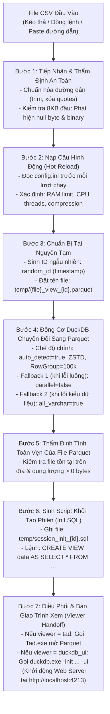

# KIẾN TRÚC VÀ WORKFLOW CHI TIẾT CỦA BỘ XỬ LÝ CSV_PROC
*(Từ giai đoạn tiếp nhận CSV đến trước khi mở DuckDB Web UI)*

---

## 1. Sơ Đồ Khái Quát Toàn Bộ Luồng Xử Lý (Workflow Diagram)



---

## 2. Chi Tiết Các Giai Đoạn Thực Thi

### Giai Đoạn 1: Tiếp Nhận & Thẩm Định An Toàn (Input Reception & Validation)
* **Tiếp nhận**: File CSV được đưa vào qua tham số dòng lệnh `csv_proc.exe "data.csv"`, kéo thả vào icon, hoặc nhập đường dẫn từ cửa sổ tương tác (interactive console loop).
* **Chuẩn hóa đường dẫn**: Cắt bỏ khoảng trắng thừa, loại bỏ các ký tự bọc ngoài `"` hoặc `'`.
* **Thẩm định nhị phân (`is_binary_file`)**:
  * Đọc trước **8,192 bytes đầu tiên** của file.
  * Nếu phát hiện các byte `\0` (null-byte) liên tục (dấu hiệu file nhị phân `.exe`, `.bin`, `.zip` bị đổi đuôi giả mạo `.csv`), hệ thống **tự động bỏ qua (SKIP)** nhằm chống tràn bộ nhớ hoặc làm sập tiến trình phân tích.

---

### Giai Đoạn 2: Nạp Cấu Hình Động (Hot-Reload Config)
Trước mỗi lần chạy file, hệ thống tự động đọc lại file `config.ini`:
* **Hạn mức tài nguyên DuckDB**:
  * `max_memory`: Mặc định là `auto` (không giới hạn, để DuckDB tận dụng tối đa RAM hệ thống).
  * `threads`: Mặc định là `0` (không giới hạn, sử dụng 100% tất cả các nhân CPU).
* **Tùy chọn cột phụ**: `add_raw_event`: `false` (mặc định - giữ cấu trúc Columnar nguyên bản siêu tốc).
* **Định dạng nén**: `compression = zstd`, `row_group_size = 100000` (tối ưu hóa tốc độ tìm kiếm nhảy cóc).
* In bảng tóm tắt cấu hình đang áp dụng ra màn hình console để người dùng kiểm soát.

---

### Giai Đoạn 3: Chuẩn Bị Tài Nguyên Tạm (Temp Resource Preparation)
* Khởi tạo mã định danh duy nhất theo mili-giây UNIX epoch: `random_id = SystemTime::now()...as_millis()`.
* Đặt tên file Parquet trung gian trong thư mục `temp/`:
  `temp/<tên_file_gốc>_view_<random_id>.parquet`
* Chuẩn hóa toàn bộ dấu gạch chéo ngược Windows (`\`) thành gạch chéo xuôi SQL (`/`):
  Ví dụ: `D:/Shared_UserData/Downloads/workflow/csv_proc/temp/access_view_1740000.parquet`.

---

### Giai Đoạn 4: Động Cơ DuckDB Chuyển Đổi Sang Parquet (Streaming Engine)
`csv_proc.exe` gọi tiến trình `duckdb.exe` chạy ngầm để thực hiện câu lệnh chuyển đổi:

```sql
COPY (
    SELECT * 
    FROM read_csv(
        'D:/Data/input.csv',
        auto_detect = true,      -- Tự động nhận diện dấu phân cách (, ; \t) và kiểu dữ liệu (Date, IP, Int, String)
        sample_size = 100000,   -- Quét 100,000 dòng đầu để suy luận kiểu dữ liệu chính xác
        ignore_errors = true,   -- Bỏ qua các dòng lỗi cấu trúc thay vì dừng cả quá trình
        strict_mode = false     -- Chế độ khoan dung với các dòng thừa/thiếu cột
    )
) 
TO 'D:/.../temp/input_view_1740000.parquet' 
(FORMAT PARQUET, COMPRESSION ZSTD, ROW_GROUP_SIZE 100000);
```

* **Cơ chế nén phân cụm (Row Group Skipping)**: Dữ liệu được nén thành từng block 100,000 dòng kèm metadata chỉ mục `min`/`max` cho từng cột, giúp các truy vấn tìm kiếm sau này có thể bỏ qua hàng triệu dòng mà không cần giải nén.
* **Cơ chế chống lỗi 3 tầng (Fallback Pipeline)**:
  * Nếu lệnh chính thành công: Tiếp tục bước sau.
  * **Fallback 1**: Nếu gặp lỗi do đọc song song nhiều luồng (xảy ra khi có các dòng log quá dài), tự động chuyển sang đơn luồng `parallel = false`.
  * **Fallback 2**: Nếu tiếp tục gặp lỗi xung đột kiểu dữ liệu, tự động chuyển sang chế độ `all_varchar = true` (coi toàn bộ các cột là dạng chuỗi text) để đảm bảo ép dữ liệu thành công 100%.
* Ngay sau khi chuyển đổi xong, tiến trình DuckDB này **đóng lại và giải phóng toàn bộ tài nguyên**.

---

### Giai Đoạn 5: Thẩm Định Tính Toàn Vẹn Của File Parquet
* Kiểm tra file `.parquet` tạm có thực sự xuất hiện trên đĩa và dung lượng `> 0` bytes hay không.
* In thông báo: `[OK] Du lieu san sang. Dung luong Parquet: <X> bytes`.

---

### Giai Đoạn 6: Sinh Script Khởi Tạo Phiên (Session Init SQL Generation)
Để DuckDB UI có thể nạp sẵn dữ liệu mà người dùng không cần gõ lệnh nạp file thủ công, `csv_proc.exe` tự động ghi một file script tạm:
* Tên file: `temp/session_init_<random_id>.sql`
* Nội dung script:
  ```sql
  -- Thiết lập tài nguyên (nếu có cấu hình hạn mức)
  SET max_memory = '...';
  SET threads = ...;

  -- Tạo Bảng Ảo (VIEW) mang tên "data" trỏ thẳng vào file Parquet vừa nén:
  CREATE OR REPLACE VIEW data AS SELECT * FROM 'D:/.../temp/input_view_1740000.parquet';
  ```

---

### Giai Đoạn 7: Bàn Giao Cho Trình Xem (Viewer Handoff)
* **Nếu chọn `tad`**: Khởi chạy `Tad.exe` mở trực tiếp file Parquet với giao diện bảng native siêu nhẹ.
* **Nếu chọn `duckdb_ui`**:
  * Thực thi lệnh:
    ```cmd
    tools\duckdb\duckdb.exe -init "temp\session_init_1740000.sql" -ui
    ```
  * DuckDB Engine khởi động máy chủ Web cục bộ tại cổng `4213`, nạp sẵn bảng ảo `data`, và tự động gọi trình duyệt web mở địa chỉ `http://localhost:4213/` để người dùng bắt đầu truy vấn phân tích.
