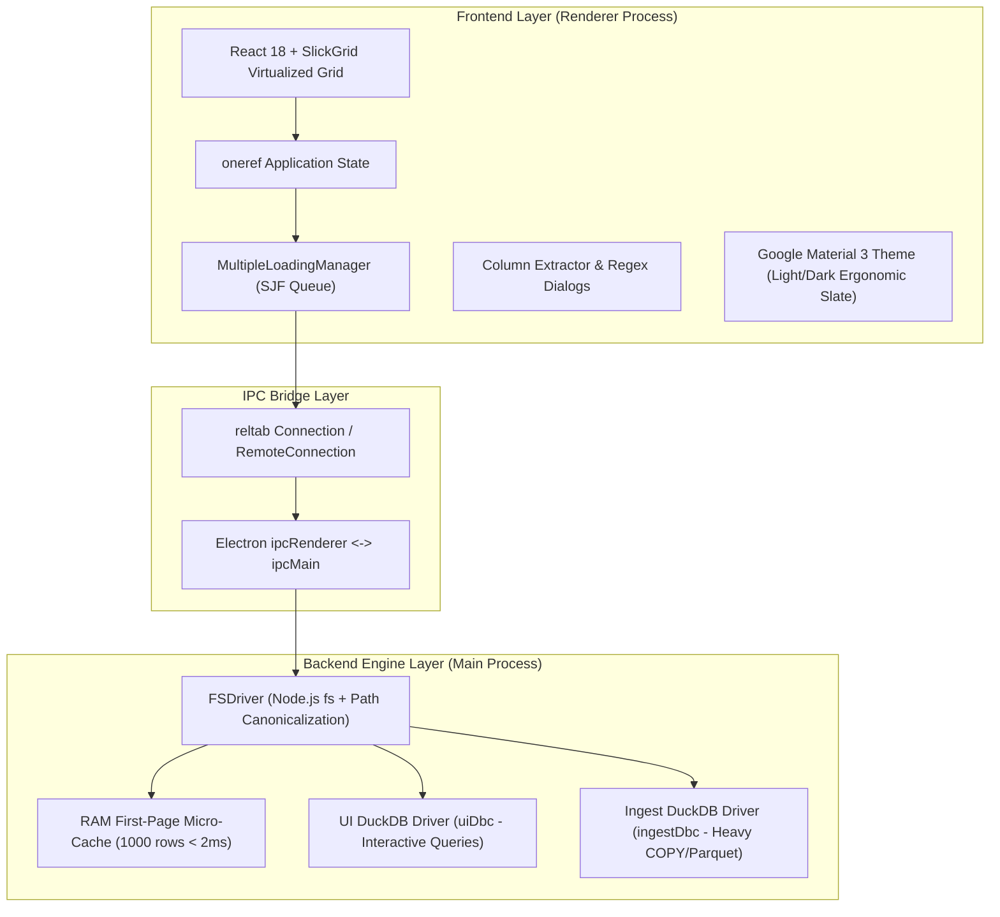
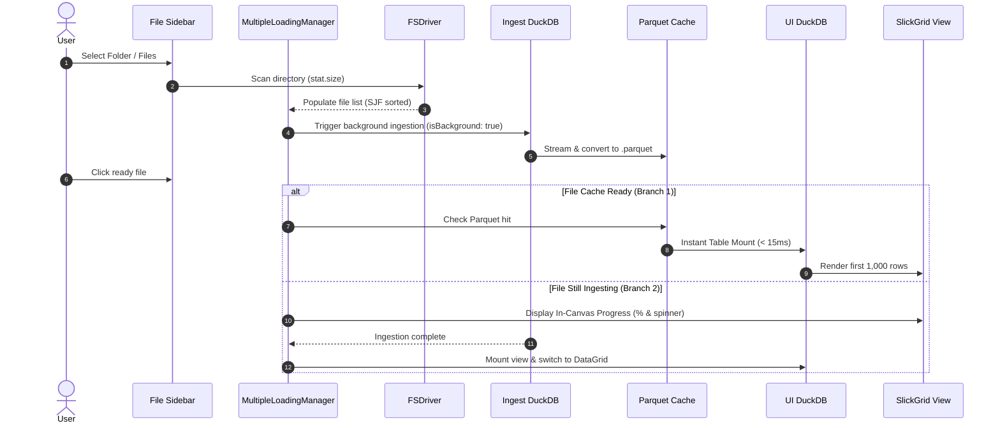

# TOAD ARCHITECTURE SPECIFICATION
> **Product:** Toad - Log & Forensic Data Analysis Platform  
> **Target Release:** v2.1.6 (Final Stable Electron Release)  
> **Status:** Current Production Architecture  

---

## 1. High-Level System Overview

Toad is a high-performance desktop application designed for rapid exploratory analysis, digital forensics, and incident response (DFIR). It processes massive semi-structured and structured datasets (CSV, TSV, JSONL, Parquet, W3C Web Logs) using embedded DuckDB engines and an asynchronous, non-blocking React/SlickGrid UI.



---

## 2. Dual-Engine DuckDB Architecture

To prevent heavy background ingestion (e.g. converting multi-gigabyte CSV/JSONL to Parquet) from locking up interactive UI queries (sorting, filtering, scrolling SlickGrid), Toad v2.0+ isolates the database workloads into two distinct DuckDB driver singletons:

```
+-------------------------------------------------------------------------+
|                              HOST RUNTIME                               |
|                                                                         |
|  +---------------------------+           +---------------------------+  |
|  |     UI ENGINE (uiDbc)     |           |   INGEST ENGINE (ingest)  |  |
|  |  Interactive User Queries |           |  Background File Loading  |  |
|  |                           |           |                           |  |
|  | - Threads: 2 cores        |           | - Threads: totalCpus - 2  |  |
|  | - ConnectionPool: Reused  |           | - Dedicated COPY & Parquet|  |
|  | - Latency: p99 < 50ms     |           | - Non-blocking streaming  |  |
|  +-------------+-------------+           +-------------+-------------+  |
|                |                                       |                |
|                +-------------------+-------------------+                |
|                                    |                                    |
|                       Underlying OS Storage Engine                      |
|                       Parquet Temporary Cache Store                     |
+-------------------------------------------------------------------------+
```

### 2.1. Ingest Engine (`ingestDbc`)
- Dedicated to heavy data ingestion (`read_csv_auto`, `read_json_auto`, `COPY ... TO ... (FORMAT PARQUET)`).
- Configured with `threads = max(1, totalCpus - 2)` to fully utilize hardware multi-threading without starving the OS or UI.
- Emits real-time progress callbacks through `MultipleLoadingManager`.

### 2.2. UI Engine (`uiDbc`)
- Serves instant interactive queries from SlickGrid and the Filter Builder (`SELECT * FROM table LIMIT 1000 OFFSET n`).
- Employs a `ConnectionPool` to eliminate connection creation overhead.
- Maintains strict UI responsiveness: p50 query latency < 15ms, p99 latency < 50ms even during concurrent 4-worker file ingestion.

---

## 3. Data Pipeline & File Ingestion Lifecycle



---

## 4. Multi-Format Column Extractor Engine

Toad includes an embedded SQL Vectorized Column Extractor capable of parsing complex, semi-structured logs directly into typed relational columns using DuckDB Common Table Expressions (CTE):

1. **Header Prefix CTE (`split_log`)**: Isolates raw unstructured log preambles (e.g. syslog timestamps, hostnames) prior to extracting delimited payload fields.
2. **Quote Pair Enclosure Resilience**: Preserves embedded delimiters within quotes (`"quoted, data"`).
3. **Inline Type Selector**: Uses DuckDB `TRY_CAST(val AS TYPE)` with automatic type coercion fallbacks to prevent runtime schema conversion aborts.
4. **Delimited & Custom Separator Engine**: Auto-detects W3C space delimiters, tab separators, and custom ASCII delimiters (`|`, `~`, `\t`).
5. **Auto-Pruned Unmatched Columns**: Measures actual field fill rates and auto-prunes `unmatched_raw_event` when 100% of tokens match cleanly.

---

## 5. UI & Theme Architecture

- **Google Material 3 Ergonomic Slate Palette**:
  - Dark Mode: Surface `#1E222B`, Sidebar `#161920`, Grid lines `#2E3440` (gentle and subtle, avoiding high-contrast eye fatigue).
  - Light Mode: Clean contrast, WCAG AAA compliant (>= 7.0:1 contrast ratio).
- **Independent Theme Toggle**:
  - Isolated from OS `prefers-color-scheme` to prevent unwanted auto-switching.
  - Persisted in localStorage (`toad-theme-v2`).
- **ActivityBar & Sidebar Synchronization**:
  - Warm amber theme button with instant M3 Sun/Moon glyph transition.
  - Expand column `_expand` synchronization with full row selection state.

