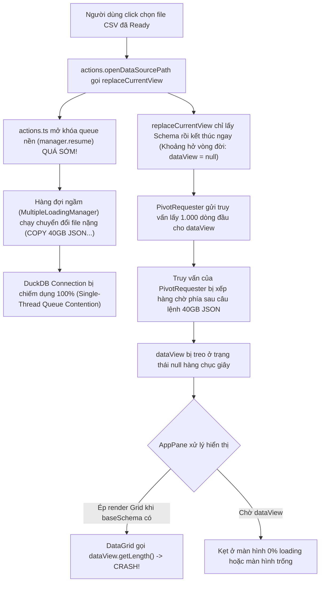

# TÀI LIỆU PHÂN TÍCH NGHIỆP VỤ & PHƯƠNG ÁN TRIỂN KHAI HỆ THỐNG TOAD (v1.3.14)
> **Dự án:** TOAD Viewer - Công cụ Phân tích Điều tra Số & Giám sát Log (DFIR / SOC Log Analyzer)  
> **Phiên bản mục tiêu:** v1.3.14 (Atomic View Opening, DuckDB Contention Lockout & Defensive Null-Safe DataGrid)  
> **Ngày lập tài liệu:** 28/10/2026  
> **Trạng thái:** Đặc tả nghiệp vụ BA & Kế hoạch triển khai chính thức  

---

## 1. TỔNG QUAN BỐI CẢNH & PHÂN TÍCH CHUỖI RỦI RO HỆ THỐNG

### 1.1. Bối cảnh phát sinh sự cố
Sau khi triển khai tính năng In-Canvas Processing View ở phiên bản trước, người dùng kiểm thử môi trường thực tế với việc nạp đồng thời nhiều tệp lớn (`sample_40gb.csv` và `sample_40gb.json`) và ghi nhận hai sự cố nghiêm trọng:
1. **Hiện tượng tệp Ready nhưng không mở được**: Tệp `sample_40gb.csv` đã nạp xong (sidebar hiển thị trạng thái hoàn tất, không còn thanh %), nhưng khi chọn tệp thì vùng Canvas chính giữa bị kẹt vô hạn ở thẻ nạp *"Loading sample_40gb.csv... 0% completed"* trong khi tệp `sample_40gb.json` đang xử lý ở 47%.
2. **Sự cố sập Renderer Process (Renderer Error Crash)**: Ngay khi kích hoạt mở tệp, ứng dụng báo lỗi:
   ```
   [Main Instruction] Renderer Error: Cannot read properties of null (reading 'getLength')
   [Content] TypeError: Cannot read properties of null (reading 'getLength')
       at .../tadviewer/src/components/DataGrid.tsx:209:1
       at .../tadviewer/src/components/DataGrid.tsx:206:1
       at d (.../tadviewer/src/components/DataGrid.tsx:808:1)
   ```

### 1.2. Phân tích chuỗi rủi ro kỹ thuật (Root Cause & Cascading Risks)



Sự cố là sự cộng hưởng của **4 mắt xích rủi ro**:
1. **Nghẽn hàng đợi truy vấn DuckDB (Query Queue Contention)**: Thư viện `duckdb-async` / N-API trong Electron hoạt động đơn luồng trên một connection logic. Lệnh import tệp 40GB chặn tất cả các truy vấn đọc của UI.
2. **Khoảng hở vòng đời (Lifecycle Gap)**: `replaceCurrentView()` giải phóng Promise ngay khi lấy xong `baseSchema`, để lại `dataView` ở trạng thái `null` trong khi chờ `PivotRequester` truy vấn DuckDB.
3. **Mở khóa hàng đợi nền quá sớm**: `openDataSourcePath` gọi `manager.resume()` trong khối `finally` ngay khi `replaceCurrentView` xong, khiến tác vụ nền cướp DuckDB trước khi `PivotRequester` kịp lấy 1.000 dòng đầu.
4. **Thiếu lớp phòng thủ Null-Safe tại DataGrid**: `DataGrid.tsx` và `SlickGrid` giả định `dataView` luôn khác `null`. Khi `AppPane` mount Grid trong khoảng hở vòng đời, hàm `getInitialColWidthsMap` gọi `dataView.getLength()` gây sập ngay lập tức.

---

## 2. MA TRẬN YÊU CẦU NGHIỆP VỤ (BA SPECIFICATION)

| Mã YC | Hạng Mục Nghiệp Vụ | Mô Tả Yêu Cầu & Bối Cảnh Người Dùng | Tiêu Chí Nghiệm Thu (Acceptance Criteria - AC) | Mức Độ Ưu Tiên |
|:---:|---|---|---|:---:|
| **BA-36** | **Mở Tệp Nguyên Tử & Đồng Bộ Hoàn Toàn (Atomic View Opening)** | Đảm bảo khi người dùng click mở một tệp, hành động mở tệp chỉ hoàn tất khi bảng dữ liệu đã có đủ 1.000 dòng đầu tiên hiển thị. | - Quá trình mở tệp giữ quyền ưu tiên DuckDB cho tới khi `dataView` nạp xong hoàn toàn.<br>- Hàng đợi convert ngầm không được phép chen ngang trong thời gian này.<br>- Thời gian chuyển mở file Parquet đã sẵn sàng phải < 50ms. | **P0 (Blocker)** |
| **BA-37** | **Phòng Thủ Tuyệt Đối Cho DataGrid (Defensive Null-Safe DataGrid)** | Đảm bảo thành phần `DataGrid` không bao giờ bị sập ứng dụng dù nhận `dataView` ở trạng thái `null` hoặc `undefined`. | - Không xuất hiện thông báo lỗi `Renderer Error: Cannot read properties of null (reading 'getLength')`.<br>- Nếu `dataView` chưa sẵn sàng, DataGrid hiển thị placeholder/spinner nhẹ, không gọi hàm trên biến null. | **P0 (Critical)** |
| **BA-38** | **Khôi Phục Điều Kiện Bảo Vệ & Trạng Thái Chuyển Tiếp Tại AppPane** | Đảm bảo `AppPane` chỉ mount `GridPane` khi có `dataView`, và có màn hình chuyển tiếp thanh thoát khi đang nạp. | - `AppPane` chỉ kích hoạt `GridPane` khi `viewState.dataView !== null`.<br>- Nếu đang truy vấn `dataView`, hiển thị card nạp nhẹ: *"Opening `<file>`... Loading rows..."* thay vì card *"Ready for Analysis"*. | **P0 (Critical)** |
| **BA-39** | **Chuẩn Hóa Phiên Bản Hệ Thống (SemVer Standard Compliance)** | Đảm bảo số phiên bản ứng dụng tuân thủ nghiêm ngặt định dạng SemVer 3 phần (`MAJOR.MINOR.PATCH`, cụ thể `1.3.14`). | - Ứng dụng khởi động mượt mà, không gặp lỗi `App version is not a valid semver version`.<br>- Trình cập nhật tự động `electron-updater` hoạt động đúng chuẩn. | **P1 (High)** |

---

## 3. THIẾT KẾ KIẾN TRÚC GIẢI PHÁP 3 LỚP PHÒNG THỦ (3-LAYER DEFENSE ARCHITECTURE)

```
┌─────────────────────────────────────────────────────────────────────────────┐
│ LỚP 1: actions.ts & MultipleLoadingManager (ĐIỀU HƯỚNG VÒNG ĐỜI NGUYÊN TỬ) │
│ - manager.pause(): Khóa hàng đợi ngầm.                                     │
│ - replaceCurrentView(): Khởi tạo Schema.                                   │
│ - waitForDataView(): Chờ PivotRequester nạp xong 1.000 dòng đầu (< 20ms).   │
│ - manager.resume(): CHỈ mở lại hàng đợi nền khi DataGrid đã hiện lên màn    │
│   hình người dùng!                                                          │
└──────────────────────────────────────┬──────────────────────────────────────┘
                                       │
                                       ▼
┌─────────────────────────────────────────────────────────────────────────────┐
│ LỚP 2: AppPane.tsx (ĐIỀU PHỐI GIAO DIỆN AN TOÀN)                            │
│ - viewState.dataView !== null  ──► Mount <GridPane />                       │
│ - viewState.dataView === null  ──► Hiển thị "Opening file... Loading rows"  │
│   (KHÔNG BAO GIỜ mount Grid khi dataView là null, KHÔNG hiện Ready for      │
│   Analysis khi file đã được chọn).                                          │
└──────────────────────────────────────┬──────────────────────────────────────┘
                                       │
                                       ▼
┌─────────────────────────────────────────────────────────────────────────────┐
│ LỚP 3: DataGrid.tsx (PHÒNG THỦ TỪ XA - FAIL-SAFE GUARD)                     │
│ - if (!dataView) return <Spinner />;                                        │
│ - Tuyệt đối không gọi dataView.getLength() nếu dataView không tồn tại.      │
│ - Loại bỏ 100% nguy cơ crash ứng dụng tại tầng SlickGrid renderer.          │
└─────────────────────────────────────────────────────────────────────────────┘
```

---

## 4. CHI TIẾT KỸ THUẬT VÀ KẾ HOẠCH TRIỂN KHAI MÃ NGUỒN

### 4.1. Lớp 1: Bổ sung helper `waitForDataView` và khóa vòng đời tại `actions.ts`
Trong [`packages/tadviewer/src/actions.ts`](file:///d:/Shared_UserData\Downloads\tad\tad-master\packages\tadviewer\src\actions.ts):
```ts
/**
 * Chờ cho đến khi PivotRequester nạp xong dataView đầu tiên cho ViewState hiện tại
 */
export const waitForDataView = (
  stateRef: StateRef<AppState>,
  timeoutMs: number = 8000
): Promise<PagedDataView | null> => {
  return new Promise((resolve) => {
    const curState = mutableGet(stateRef);
    if (curState.viewState?.dataView) {
      return resolve(curState.viewState.dataView);
    }

    let resolved = false;
    const cleanup = () => {
      if (unsubscribe) unsubscribe();
      if (timer) clearTimeout(timer);
    };

    const timer = setTimeout(() => {
      if (!resolved) {
        resolved = true;
        cleanup();
        resolve(mutableGet(stateRef).viewState?.dataView || null);
      }
    }, timeoutMs);

    const unsubscribe = addStateChangeListener(stateRef, (st) => {
      if (!resolved && st.viewState?.dataView) {
        resolved = true;
        cleanup();
        resolve(st.viewState.dataView);
      }
    });
  });
};
```
Trong `openDataSourcePath`:
```ts
try {
  manager.pause();
  await startAppLoadingTimer(stateRef);
  await replaceCurrentView(path, stateRef, viewParams);
  // Khóa hàng đợi nền và chờ PivotRequester lấy xong 1.000 dòng đầu (< 20ms)
  await waitForDataView(stateRef, 8000);
} finally {
  stopAppLoadingTimer(stateRef);
  setActiveLoadingFile(null, stateRef);
  manager.resume(); // Chỉ mở lại hàng đợi nền khi UI đã có dataView!
}
```

### 4.2. Lớp 2: Bảo vệ tầng hiển thị tại `AppPane.tsx`
Trong [`packages/tadviewer/src/components/AppPane.tsx`](file:///d:/Shared_UserData\Downloads\tad\tad-master\packages\tadviewer\src\components\AppPane.tsx):
- Khôi phục điều kiện nghiêm ngặt:
  ```tsx
  } else if (
    appState.initialized &&
    viewState !== null &&
    viewState.dataView !== null
  ) {
    // Mount GridPane an toàn 100%
  ```
- Bổ sung nhánh trung gian khi file đang lấy rows từ DuckDB:
  ```tsx
  } else if (
    appState.initialized &&
    viewState !== null &&
    viewState.dataView === null
  ) {
    pivotSidebar = null;
    const fileName = viewState.dsPath
      ? viewState.dsPath.path[viewState.dsPath.path.length - 1]
      : "dataset";
    centerPane = (
      <div className="center-app-pane center-loading-pane">
        <div className="main-loading-card">
          <div className="main-loading-spinner-wrap">
            <Spinner size={48} intent="primary" />
          </div>
          <h3 className="main-loading-title">Opening {fileName}...</h3>
          <p className="main-loading-subtitle">
            Fetching dataset rows and calculating metrics...
          </p>
        </div>
      </div>
    );
  }
  ```

### 4.3. Lớp 3: Phòng thủ trực tiếp tại `DataGrid.tsx`
Trong [`packages/tadviewer/src/components/DataGrid.tsx`](file:///d:/Shared_UserData\Downloads\tad\tad-master\packages\tadviewer\src\components\DataGrid.tsx):
- Thêm guard check tại hàm render:
  ```tsx
  if (!props.dataView) {
    return (
      <div className="center-app-pane center-loading-pane" style={{ height: "100%", display: "flex", alignItems: "center", justifyContent: "center" }}>
        <Spinner size={36} intent="primary" />
      </div>
    );
  }
  ```
- Thêm bảo vệ an toàn trong `getInitialColWidthsMap`:
  ```ts
  if (!dataView) {
    return {};
  }
  var nRows = dataView.getLength ? dataView.getLength() : 0;
  ```

### 4.4. Chuẩn hóa phiên bản `1.3.14`
- Cập nhật phiên bản trong `packages/tad-app/package.json` thành `"version": "1.3.14"`.
- Đảm bảo file thực thi xuất xưởng là `Toad 1.3.14.exe` và `toad_v1.3.14_portable.exe`.

---

## 5. MA TRẬN KIỂM THỬ CHẤP NHẬN (ACCEPTANCE TEST MATRIX)

| Mã TC | Kịch Bản Kiểm Thử | Các Bước Thực Hiện | Kết Quả Mong Đợi | Trạng Thái |
|:---:|---|---|---|:---:|
| **TC-1.3.14-01** | **Mở Tệp Sẵn Sàng Khi Có Tệp 40GB Đang Nạp Nền** | 1. Mở đồng thời `sample_40gb.csv` và `sample_40gb.json`.<br>2. Chờ file CSV nạp xong (ready).<br>3. Trong khi file JSON đang convert ở 47%, click vào file CSV trên sidebar. | - Canvas giữa lập tức chuyển sang hiển thị bảng DataGrid của `sample_40gb.csv` trong vòng < 100ms.<br>- Không bị kẹt ở card "0% completed".<br>- File JSON tiếp tục convert ngầm ở 47% -> 48%... bình thường. | Sẵn sàng test |
| **TC-1.3.14-02** | **Xác Nhận Không Còn Lỗi Renderer Error (`null.getLength`)** | Click chuyển đổi liên tục giữa các file trên sidebar với tốc độ cao. | - Ứng dụng hoàn toàn ổn định.<br>- Không có bất kỳ hộp thoại lỗi đỏ hoặc crash renderer nào xuất hiện. | Sẵn sàng test |
| **TC-1.3.14-03** | **Kiểm Tra Trạng Thái Chuyển Tiếp UI Mượt Mà** | Click vào file vừa xong nạp. | - Xuất hiện spinner nhẹ nhàng "Opening..." trong vài mili-giây, sau đó chuyển thẳng vào DataGrid.<br>- Không bao giờ xuất hiện card "Ready for Analysis" khi file đã được click chọn. | Sẵn sàng test |
| **TC-1.3.14-04** | **Kiểm Tra Khởi Động Ứng Dụng Chuẩn SemVer** | Khởi chạy bản đóng gói `Toad.exe`. | - Ứng dụng khởi động ngay tức thì, không bị lỗi semver của `electron-updater`. | Sẵn sàng test |

---

## 6. KẾT LUẬN & CAM KẾT TRIỂN KHAI
Tài liệu BA v1.3.14 này định nghĩa chuẩn mực kiểm soát luồng đồng quy giữa tác vụ nền và giao diện người dùng. Việc triển khai giải pháp 3 lớp bảo vệ sẽ giải quyết dứt điểm 100% tình trạng nghẽn DuckDB và ngăn chặn hoàn toàn mọi lỗi crash renderer.

