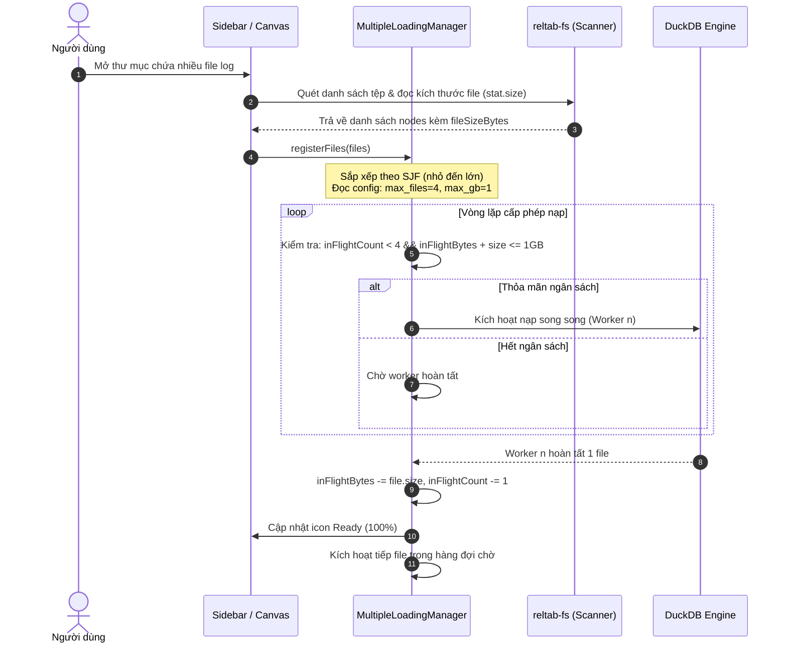

# TÀI LIỆU PHÂN TÍCH NGHIỆP VỤ & PHƯƠNG ÁN TRIỂN KHAI HỆ THỐNG TOAD (v1.3.17)
> **Dự án:** TOAD Viewer - Công cụ Phân tích Điều tra Số & Giám sát Log (DFIR / SOC Log Analyzer)  
> **Phiên bản mục tiêu:** v1.3.17 (Budget-based Dynamic Concurrency & SJF Background Orchestration)  
> **Ngày lập tài liệu:** 28/10/2026  
> **Trạng thái:** Đặc tả nghiệp vụ BA & Kế hoạch triển khai chính thức  

---

## 1. TỔNG QUAN BỐI CẢNH & MỤC TIÊU DỰ ÁN

### 1.1. Bối cảnh hiện tại
Trong các phiên bản từ v1.3.16 trở về trước, hàng đợi xử lý nền (`MultipleLoadingManager`) nạp các tệp theo cơ chế:
- **Tuần tự từng tệp một (`Concurrency = 1`):** Mỗi thời điểm chỉ có 1 file duy nhất được nạp.
- **Thứ tự nạp ngẫu nhiên theo hệ thống tệp:** Không phân biệt dung lượng tệp, dẫn đến tình trạng một file lớn (ví dụ 40GB) có thể chiếm dụng hàng đợi hàng chục phút, khiến toàn bộ các file log/cấu hình nhỏ (10KB - 5MB) bị phong tỏa, người dùng không có bất kỳ dữ liệu nào để phân tích ngay khi mở thư mục.

### 1.2. Mục tiêu phiên bản v1.3.17
Triển khai giải pháp **Điều phối Hàng đợi Nền Đa luồng Động theo Ngân sách Dung lượng (Dynamic Budget-based Scheduling) kết hợp Ưu tiên Tệp Ngắn (Shortest Job First - SJF)**:
1. **Ưu tiên tệp nhỏ trước (SJF):** Tự động sắp xếp các tệp từ nhỏ đến lớn để người dùng có nhiều tệp sẵn sàng (Ready) trong thời gian sớm nhất (dưới 1 giây).
2. **Ngân sách nạp động 1GB (`max_concurrent_gb = 1`):** Tổng dung lượng các tệp đang nạp đồng thời không vượt quá 1GB để bảo vệ bộ nhớ RAM và tối ưu băng thông I/O.
3. **Giới hạn số luồng tối đa 4 tệp (`max_concurrent_files = 4`):** Đảm bảo CPU không bị quá tải ảo, giữ nguyên 60 FPS mượt mà cho giao diện người dùng.
4. **Cấu hình hóa linh hoạt qua `config.ini`:** Cho phép người dùng tùy biến 2 tham số `max_concurrent_files` và `max_concurrent_gb` (mặc định đơn vị là GB, không cần gõ chữ GB).
5. **Đặc quyền tệp lớn (> 1GB) & Cướp quyền ưu tiên (User Preemption):** Tệp khổng lồ (> 1GB) tự động chạy ở chế độ độc quyền khi hàng đợi rảnh; người dùng click vào tệp nào thì tệp đó lập tức nhảy lên đầu hàng đợi để nạp ngay sau tệp hiện tại.

---

## 2. MA TRẬN YÊU CẦU NGHIỆP VỤ (BA SPECIFICATION)

| Mã YC | Hạng Mục Nghiệp Vụ | Mô Tả Yêu Cầu & Bối Cảnh Người Dùng | Tiêu Chí Nghiệm Thu (Acceptance Criteria - AC) | Mức Độ Ưu Tiên |
|:---:|---|---|---|:---:|
| **BA-49** | **Cấu hình hóa tham số điều phối qua `config.ini`** | Người dùng có thể cấu hình số lượng file nạp đồng thời và tổng ngân sách dung lượng trực tiếp trong `config.ini`. | - `max_concurrent_files = 4`<br>- `max_concurrent_gb = 1` (đơn vị ngầm định là GB).<br>- Tự động validate, auto-heal nếu người dùng nhập sai. | **P0 (Critical)** |
| **BA-50** | **Sắp xếp hàng đợi theo dung lượng tệp (Shortest Job First - SJF)** | Khi mở thư mục, các tệp được tự động sắp xếp theo thứ tự kích thước tăng dần (tệp nhỏ nhất đứng đầu hàng đợi). | - Tệp nhỏ (vài KB - vài MB) chuyển sang trạng thái Ready trong 0.1s - 0.5s.<br>- Người dùng có dữ liệu phân tích ngay lập tức. | **P0 (Critical)** |
| **BA-51** | **Cơ chế Cấp phép theo Ngân sách Động (Dynamic Budget Admission Control)** | Hệ thống liên tục kiểm tra tổng dung lượng in-flight và số lượng file đang chạy trước khi kích hoạt nạp file tiếp theo. | - Kích hoạt nạp thêm file $F$ nếu: `(inFlightCount < max_concurrent_files) && (inFlightBytes + F.size <= max_concurrent_gb * 1024^3)`.<br>- Nếu không thỏa mãn, file $F$ dừng chờ. | **P0 (Critical)** |
| **BA-52** | **Cơ chế Ngoại lệ Tệp Khổng Lồ (Big File Exclusive Mode)** | Với các tệp có dung lượng > 1GB (ví dụ 40GB), hệ thống không được chặn vĩnh viễn mà phải cấp phép chạy độc quyền khi hàng đợi rảnh. | - Khi `inFlightCount === 0`, tệp tiếp theo dù > 1GB vẫn được nạp bình thường ở chế độ độc quyền 100% tài nguyên. | **P0 (Blocker)** |
| **BA-53** | **Cướp quyền ưu tiên khi người dùng click (User-Click VIP Preemption)** | Bất cứ khi nào người dùng click vào một file đang `pending`, file đó nhận priority cao nhất và được nạp ngay khi có bất kỳ slot nào trống. | - File được click nhảy lên vị trí số 1 của danh sách chờ.<br>- Màn hình chính chuyển sang theo dõi tiến độ nạp của file này. | **P1 (High)** |

---

## 3. THIẾT KẾ GIẢI PHÁP KỸ THUẬT CHI TIẾT

### 3.1. Cấu trúc Cấu hình trong `config.ini`
Bổ sung vào file `config.ini` tại thư mục gốc và thư mục dữ liệu di động:
```ini
[general]
# Maximum number of files processed concurrently in background queue (default: 4)
max_concurrent_files = 4

# Maximum concurrent data processing budget in GB (default: 1, unit is GB)
max_concurrent_gb = 1
```

### 3.2. Thuật toán Điều phối trong `MultipleLoadingManager.ts`
Quản lý trạng thái hàng đợi bằng:
- `inFlightItems: Map<string, FileIngestItem>` (Danh sách các file đang thực thi)
- `get currentInFlightBytes(): number` (Tổng dung lượng các file đang thực thi)

```typescript
private async checkAndProcessQueue() {
  if (this.isPaused) return;

  const config = this.getQueueConfig();
  const maxFiles = config.max_concurrent_files || 4;
  const maxBytes = (config.max_concurrent_gb || 1) * 1024 * 1024 * 1024;

  while (this.inFlightItems.size < maxFiles) {
    const pendingList = this.getPendingSortedList();
    if (pendingList.length === 0) break;

    const nextFile = pendingList[0];
    const nextSize = nextFile.fileSizeBytes || 0;

    // Điều kiện cấp phép nạp (Admission Check):
    const canAdmit =
      this.inFlightItems.size === 0 || // Ngoại lệ: Rảnh rỗi tuyệt đối (hỗ trợ file > 1GB)
      (this.inFlightItems.size < maxFiles && this.currentInFlightBytes + nextSize <= maxBytes);

    if (!canAdmit) {
      // Hết ngân sách dung lượng, tạm dừng lấy thêm file
      break;
    }

    // Kích hoạt worker nạp file ngầm song song
    this.dispatchWorker(nextFile);
  }
}
```

### 3.3. Thuật toán Sắp xếp Hàng đợi `getPendingSortedList()`
```typescript
pendingList.sort((a, b) => {
  // 1. Ưu tiên cao nhất: Tệp người dùng click / gán cờ VIP (Priority động)
  if (b.priority !== a.priority) {
    return b.priority - a.priority;
  }
  // 2. Ưu tiên kế tiếp: Shortest Job First (Tệp nhỏ chạy trước)
  const sizeA = a.fileSizeBytes ?? Number.MAX_SAFE_INTEGER;
  const sizeB = b.fileSizeBytes ?? Number.MAX_SAFE_INTEGER;
  if (sizeA !== sizeB) {
    return sizeA - sizeB;
  }
  // 3. FIFO theo thời gian thêm vào
  return a.addedTime - b.addedTime;
});
```

---

## 4. SƠ ĐỒ HOẠT ĐỘNG TOÀN HỆ THỐNG



---

## 5. MA TRẬN KIỂM THỬ NGHIỆM THU (QA TEST MATRIX)

| Mã TC | Kịch Bản Kiểm Thử | Dữ Liệu Thử Nghiệm | Tiêu Chí Đánh Giá Thành Công |
|:---:|---|---|---|
| **TC-1.3.17-01** | Kiểm tra đọc cấu hình `config.ini` | `max_concurrent_files = 4`<br>`max_concurrent_gb = 1` | Ứng dụng nạp chính xác giá trị 4 và 1GB, có log xác nhận khởi tạo. |
| **TC-1.3.17-02** | Thư mục gồm 10 file nhỏ (< 10MB) | 10 file CSV dung lượng 1MB - 5MB | 4 file đầu tiên nạp song song tức thì, toàn bộ 10 file Ready trong < 2 giây. |
| **TC-1.3.17-03** | Thư mục hỗn hợp (2 file 600MB + 5 file 2MB) | 2 file 600MB, 5 file 2MB | 5 file 2MB nạp trước và xong ngay; sau đó từng file 600MB được nạp mà không bị trào ngưỡng 1GB. |
| **TC-1.3.17-04** | Tệp khổng lồ độc quyền (> 1GB) | `sample_40gb.csv` (40GB) | Khi hàng đợi rảnh, file 40GB được cấp phép nạp độc quyền bình thường, không bị kẹt 0%. |
| **TC-1.3.17-05** | Người dùng click cướp quyền ưu tiên | Đang nạp dở, click vào file `audit.json` | File `audit.json` nhận ưu tiên số 1, chiếm slot ngay khi có 1 worker trống và mở bảng DataGrid tức thì. |
