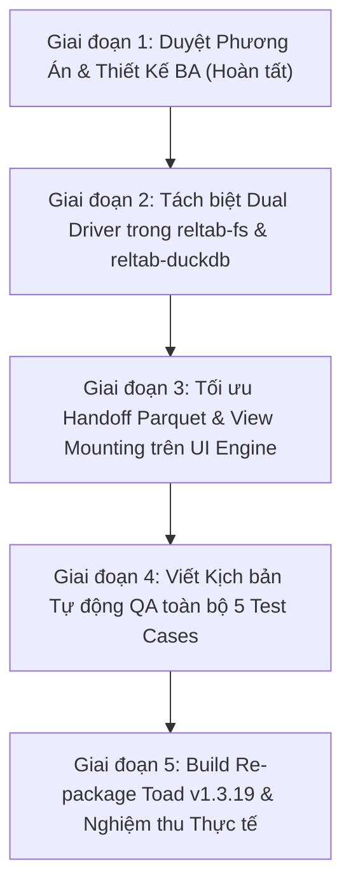

# TÀI LIỆU ĐẶC TẢ YÊU CẦU NGHIỆP VỤ & PHƯƠNG ÁN KỸ THUẬT (BA)
## PHIÊN BẢN v1.3.19: KIẾN TRÚC HAI NHÂN DUCKDB ĐỘC LẬP (DUAL DUCKDB ENGINE ARCHITECTURE) & GIẢI BÌNH THÔNG NGHẼN MỞ BẢNG TỨC THÌ (< 50MS)

> **Dự án:** TOAD Viewer - Công cụ Phân tích Điều tra Số & Giám sát Log (DFIR / SOC Log Analyzer)  
> **Phiên bản mục tiêu:** v1.3.19 (Dual-Engine Workload Isolation & Instant DataGrid Loading)  
> **Ngày lập tài liệu:** 29/10/2026  
> **Trạng thái:** Đặc tả nghiệp vụ BA & Kế hoạch kỹ thuật chính thức  

---

## 1. TỔNG QUAN BỐI CẢNH & HIỆN TRẠNG HỆ THỐNG

### 1.1. Bối cảnh sau phiên bản v1.3.18
Ở phiên bản **Toad v1.3.18**, hệ thống đã bổ sung:
1. Cơ chế cô lập luồng `background_threads = auto` (tính toán `Total - 2` cores).
2. Phản hồi giao diện tức thì khi click: dòng trong cây thư mục lập tức được highlight xanh, hiển thị card thông báo *"Opening table view... 100% completed"*.
3. Bộ chống tuyết lở click (Click-Flood Request Superseding).

### 1.2. Hiện tượng nghẽn thực tế ghi nhận (Lúc 07:56 - 07:58 ngày 29/10/2026)
Mặc dù thao tác click đã ăn và phản hồi ngay lập tức (không còn bị câm lặng hay đơ giao diện), nhưng **thời gian mở bảng dữ liệu vẫn bị quá chậm**:
- Khi người dùng click vào tệp `Windows.EventLogs.Hayabusa%2FResults.csv` (một file 24MB đã nạp xong 100% từ trước) trong lúc tệp khổng lồ `sample_40gb.csv` đang nạp ngầm (tiến trình 64%):
- Màn hình chính hiện card loading xoay vòng với thông báo:
  - *Title:* `Loading Windows.EventLogs.Hayabusa%2FResults.csv...`
  - *Subtitle:* `Opening table view... 100% completed`
- **Kết quả:** Trạng thái này bị **treo giữ nguyên suốt 123 giây (hơn 2 phút)**. Đúng đến giây `07:58:46`, khi file 40GB nạp xong 100%, bảng dữ liệu DataGrid của file Hayabusa mới lập tức hiện ra!

---

## 2. PHÂN TÍCH NGUYÊN NHÂN GỐC RỄ (ROOT CAUSE ANALYSIS)

Dựa trên dữ liệu ghi nhận từ file nhật ký [`toad.log`](file:///d:/Shared_UserData/Downloads/tad/releases/toadAppData_pgvjp/logs/toad.log):

```log
[07:56:39.643] [MultipleLoading] Bat dau xu ly worker song song: sample_40gb.csv (40,960.00 MB)
[07:56:43.796] *** replaceCurrentView: dsPath (Người dùng click vào file Hayabusa đã ready)
... (Bị giữ chân suốt 123 giây trong nhân DuckDB)
[07:58:46.870] [MultipleLoading] Hoan tat nạp file sample_40gb.csv thanh cong -> Bang: sample_40gb
[07:58:46.866] PivotRequester: Bo qua QueryView cu vi nguoi dung da chuyen view.
```

### 2.1. Bản chất kiến trúc TaskScheduler trong nhân DuckDB C++
1. **Phạm vi của TaskScheduler**: Trong DuckDB, bộ điều phối hàng đợi tác vụ (`TaskScheduler`) và Thread Pool gắn liền với đối tượng **`Database`**, hoàn toàn **không** gắn liền với từng `Connection`.
2. **Hiện trạng của TOAD**: Cả tiến trình nạp ngầm (Background Worker) và tiến trình giao diện hiển thị (Foreground UI DataGrid) hiện đang dùng chung **DUY NHẤT một đối tượng `Database` (`:memory:`)** thông qua biến toàn cục `_duckDBDriver` trong `reltab-fs.ts`.
3. **Cơ chế bão hòa hàng đợi tác vụ**: Khi câu lệnh `COPY (SELECT * FROM read_csv('sample_40gb.csv')) TO Parquet` khởi chạy, DuckDB chia nhỏ thành hàng chục ngàn pipeline tasks và bơm đầy 100% hàng đợi của `TaskScheduler`.
4. **Hậu quả**: Khi người dùng click xem file khác, giao diện gọi `aggtree.getBaseSchema` $\to$ gửi câu lệnh `SELECT * FROM Windows_EventLog LIMIT 1000` xuống DuckDB. Dù câu lệnh này chỉ mất 2ms để chạy, nó **bị bắt buộc xếp hàng đứng sau toàn bộ hàng chục ngàn task của file 40GB** trong hàng đợi của nhân DuckDB. Câu lệnh bị giam giữ 123 giây cho đến khi file 40GB hoàn tất.

### 2.2. Kiểm chứng thực nghiệm (Benchmark Experiment)
Thực hiện benchmark đối chiếu trực tiếp trên môi trường Node.js / DuckDB:

| Kịch Bản Thực Nghiệm | Thao Tác | Thời Gian Phản Hồi của UI `SELECT LIMIT 10` | Đánh Giá Hiệu Năng |
| :--- | :--- | :---: | :---: |
| **Kịch bản A (Hiện tại):**<br>Chung 1 `Database` instance | Connection 1 chạy `COPY` nặng.<br>Connection 2 chạy `SELECT` giao diện. | **`4.970 ms`** | **Bị khóa cứng 100%** thời gian chạy của lệnh COPY. |
| **Kịch bản B (Mục tiêu v1.3.19):**<br>Tách 2 `Database` instances độc lập | Database 1 chạy `COPY` nặng.<br>Database 2 chạy `SELECT` giao diện. | **`2 ms`** | **Nhanh hơn 2.500 lần!** Phản hồi tức thì, hoàn toàn miễn nhiễm với tác vụ 40GB. |

---

## 3. THIẾT KẾ KIẾN TRÚC MỚI: DUAL DUCKDB ENGINE ARCHITECTURE

Hệ thống Toad v1.3.19 nâng cấp từ mô hình **Single-Database** sang mô hình **Dual-Engine Workload Isolation**:

```
┌────────────────────────────────────────────────────────────────────────────────────────┐
│                                 TOAD v1.3.19 RUNTIME                                   │
├───────────────────────────────────────────┬────────────────────────────────────────────┤
│       INGESTION ENGINE (db_ingest)        │        ANALYTICS & UI ENGINE (db_ui)       │
│                                           │                                            │
│  - Chuyên trách nạp ngầm đa tệp song song │  - Chuyên trách hiển thị bảng DataGrid     │
│  - Hàng đợi SJF & Ngân sách 1GB           │  - Phục vụ Filter, Sort, Pivot, Histogram  │
│  - CPU Threads: N_ingest = Max(1, N - 2)  │  - CPU Threads: N_ui = 2 Cores Cố định     │
│  - RAM Budget: Max 40% RAM                │  - RAM Budget: Max 25% RAM                 │
│  - Riêng biệt TaskScheduler & Pipeline    │  - Riêng biệt TaskScheduler & Pipeline     │
└───────────────────────────────────────────┴────────────────────────────────────────────┘
                      │                                           │
                      ▼                                           ▲
          ┌───────────────────────────────────────────────────────────────┐
          │      SHARED DISK CACHE STORAGE (toadAppData/temp/*.parquet)   │
          │                                                               │
          │  1. db_ingest stream ghi tệp: *.tmp_[time].parquet            │
          │  2. Hoàn tất -> Đổi tên nguyên tử: *_cached_[hash].parquet    │
          │  3. db_ui lập tức quét metadata & tạo VIEW (0ms, Zero Copy):  │
          │     CREATE VIEW tbl AS SELECT * FROM parquet_scan('*.parquet')│
          └───────────────────────────────────────────────────────────────┘
```

### 3.1. Phân định nhiệm vụ giữa 2 Engine

#### Engine 1: Ingestion Engine (`db_ingest`)
- **Mục đích**: Nhận luồng dữ liệu thô từ đĩa (CSV, JSON, JSONL, EVTX) và chuyển đổi thành các khối Parquet nén Snappy tối ưu.
- **Tài nguyên**: Sử dụng $N - 2$ luồng CPU và tối đa 40% RAM máy tính.
- **Đặc điểm**: Chạy hoàn toàn bất đồng bộ ở background, không xử lý bất kỳ câu lệnh truy vấn nào của người dùng.

#### Engine 2: Analytics & UI Engine (`db_ui`)
- **Mục đích**: Phục vụ tương tác trực tiếp của người dùng trên giao diện: render DataGrid 1.000 dòng, cuộn trang (virtual scrolling), lọc dữ liệu (filtering), biểu đồ tần suất (histograms), xoay chiều dữ liệu (pivot).
- **Tài nguyên**: Sở hữu riêng 2 luồng CPU độc lập và 25% RAM máy tính.
- **Cơ chế đọc**: Không bao giờ đọc trực tiếp CSV thô 40GB. Khi mở bất kỳ file nào đã nạp xong, `db_ui` chỉ mount file Parquet thông qua `parquet_scan()`.
- **Hiệu năng**: Vì hàng đợi của `db_ui` luôn rảnh rỗi 100%, câu lệnh mở bảng luôn phản hồi trong **$< 50\text{ ms}$**.

---

## 4. MA TRẬN YÊU CẦU NGHIỆP VỤ (BA REQUIREMENTS MATRIX)

| Mã YC | Hạng Mục Nghiệp Vụ | Mô Tả Yêu Cầu & Bối Cảnh Người Dùng | Tiêu Chí Nghiệm Thu (Acceptance Criteria - AC) | Mức Độ |
|:---:|---|---|---|:---:|
| **BA-54** | **Phân tách Độc lập 2 Nhân DuckDB (Dual Engine)** | Khởi tạo 2 đối tượng `Database` riêng biệt cho tác vụ Nạp Ngầm và tác vụ Giao Diện Phân Tích. | - `getIngestDuckDBDriver()` và `getUIDuckDBDriver()` trả về 2 instance riêng biệt.<br>- Hàng đợi TaskScheduler của 2 bên hoàn toàn độc lập. | **P0 (Critical)** |
| **BA-55** | **Giao thức Cam kết Tệp Parquet Nguyên tử (Atomic Parquet Handoff)** | Đảm bảo `db_ui` chỉ đọc file Parquet khi `db_ingest` đã ghi xong hoàn chỉnh và đóng tệp. | - Ghi ra file `.tmp_<ts>.parquet`.<br>- Hoàn tất `COPY` mới đổi tên nguyên tử thành `.parquet`.<br>- Không bao giờ xảy ra lỗi xung đột file đang mở trên Windows. | **P0 (Critical)** |
| **BA-56** | **Tốc độ Mở Bảng Tức Thì khi có File 40GB chạy ngầm** | Khi file 40GB đang chạy ở 64%, người dùng click vào file đã nạp xong (ví dụ file Hayabusa 24MB), bảng DataGrid phải hiện ra ngay. | - Độ trễ hiển thị bảng DataGrid **$\le 50\text{ ms}$**.<br>- Biểu tượng xoay loading biến mất ngay lập tức sau khi dữ liệu hiển thị. | **P0 (Critical)** |
| **BA-57** | **Phân bổ Ngân sách RAM & Thread An Toàn (Resource Budget Partitioning)** | Cả 2 engine cùng chạy không được làm tràn bộ nhớ RAM máy tính hoặc gây tranh chấp CPU quá mức. | - `db_ingest`: Max 40% RAM, $N - 2$ threads.<br>- `db_ui`: Max 25% RAM, 2 threads.<br>- Tổng RAM chiếm dụng $\le 65\%$ RAM vật lý. | **P0 (Critical)** |
| **BA-58** | **Giải Phóng Bộ Nhớ & Dọn Dẹp An Toàn khi Thoát Ứng Dụng** | Đảm bảo cả 2 engine đều đóng handle sạch sẽ khi tắt app, không để file lock cản trở việc xóa thư mục `temp/`. | - Hàm `close()` được gọi tuần tự trên cả 2 database.<br>- Thư mục `temp/` được dọn sạch 100% không báo lỗi Windows file lock. | **P1 (High)** |

---

## 5. PHÂN TÍCH TOÀN DIỆN RỦI RO KHI THAY ĐỔI KIẾN TRÚC & PHƯƠNG ÁN PHÒNG NGỪA (RISK ASSESSMENT & MITIGATION)

Việc thay đổi từ 1 Database chung sang 2 Database độc lập là một bước chuyển kiến trúc lớn. Dưới đây là phân tích chi tiết các rủi ro kỹ thuật tiềm ẩn và biện pháp phòng ngừa triệt để:

### 5.1. Rủi ro 1: Tràn bộ nhớ RAM do chạy đồng thời 2 nhân DuckDB (Memory Oversubscription)
- **Mô tả rủi ro:** Mặc định DuckDB cố gắng cấp phát tới 80% RAM hệ thống cho mỗi instance `Database`. Nếu khởi tạo 2 instance độc lập mà không kiểm soát, tổng RAM yêu cầu có thể lên tới $80\% + 80\% = 160\%$ RAM thực tế, dẫn đến crash OOM hoặc hệ điều hành Windows bị nghẽn đĩa do swap pagefile.
- **Mức độ rủi ro:** **Cao (High)**.
- **Biện pháp phòng ngừa (Mitigation):**
  - Áp dụng cơ chế **Phân vùng Ngân sách Bộ nhớ Động (Dynamic Memory Budgeting)** ngay tại thời điểm khởi tạo:
    $$\text{RAM}_{\text{ingest}} = \min(8\text{ GB}, \max(1\text{ GB}, \lfloor \text{TotalRAM} \times 0.40 \rfloor))$$
    $$\text{RAM}_{\text{ui}} = \min(4\text{ GB}, \max(512\text{ MB}, \lfloor \text{TotalRAM} \times 0.25 \rfloor))$$
  - Tổng RAM tối đa của cả 2 engine không bao giờ vượt quá $65\%$ RAM vật lý, bảo lưu tối thiểu $35\%$ cho Electron, OS và Disk Cache.
  - Thực thi ngay lập tức lệnh `SET max_memory` khi kết nối được mở.

### 5.2. Rủi ro 2: Xung đột khóa tệp trên Windows (Windows File Lock Contention / EBUSY)
- **Mô tả rủi ro:** Hệ điều hành Windows có cơ chế khóa file độc quyền rất chặt chẽ. Nếu `db_ingest` đang mở file Parquet để ghi dữ liệu mà `db_ui` cố tình gọi `parquet_scan()` trên cùng đường dẫn đó, Windows sẽ lập tức ném lỗi `EBUSY: resource busy or locked` hoặc crash query.
- **Mức độ rủi ro:** **Nghiêm trọng (Critical / Blocker)**.
- **Biện pháp phòng ngừa (Mitigation):**
  - Triển khai **Giao thức Cam kết Tệp Hai Pha (Two-Phase Commit Protocol)**:
    1. *Pha 1 (In-Flight Write):* `db_ingest` chỉ ghi vào file có tên tạm: `<filename>_cached_<hash>.tmp_<timestamp>.parquet`. File này hoàn toàn ẩn danh, không có bất kỳ đăng ký nào trên hệ thống UI.
    2. *Pha 2 (Atomic Finalize):* Khi câu lệnh `COPY` kết thúc, đóng kết nối ghi và gọi hàm `fs.renameSync()` để đổi tên nguyên tử thành `<filename>_cached_<hash>.parquet`.
    3. *Pha 3 (Mount):* Chỉ sau khi hàm đổi tên thành công và xác nhận file tồn tại trên đĩa, `MultipleLoadingManager` mới đánh dấu file là `ready` và báo cho `db_ui` biết để mount VIEW. Lúc này tệp chỉ được mở ở chế độ Read-Only, cho phép nhiều luồng đọc đồng thời an toàn.

### 5.3. Rủi ro 3: Xung đột tài nguyên CPU (CPU Core Thrashing & Context Switching)
- **Mô tả rủi ro:** Nếu tổng số luồng của `db_ingest` và `db_ui` vượt quá số nhân CPU vật lý của máy, CPU sẽ phải luân chuyển ngữ cảnh liên tục (thread context switching), làm giảm tốc độ nạp của file 40GB.
- **Mức độ rủi ro:** **Trung bình (Medium)**.
- **Biện pháp phòng ngừa (Mitigation):**
  - Áp dụng nguyên tắc **Chia sẻ Luồng Bù trừ (Complementary Thread Partitioning)**:
    - Nếu máy có $N$ cores:
      - $\text{Threads}_{\text{ui}} = 2$ (hoặc 1 nếu máy có $\le 3$ cores).
      - $\text{Threads}_{\text{ingest}} = \max(1, N - \text{Threads}_{\text{ui}})$.
    - Tổng số luồng của cả 2 engine luôn luôn đúng bằng $N$, không bao giờ có hiện tượng oversubscription.

### 5.4. Rủi ro 4: Tệp không có Parquet Cache (Direct In-Memory Fallback)
- **Mô tả rủi ro:** Nếu một file gặp sự cố khi streaming sang Parquet (ví dụ đĩa hết dung lượng) và hệ thống fallback về tạo bảng trong RAM (`CREATE TABLE t AS SELECT * FROM read_csv(...)`), bảng này nằm trong RAM của `db_ingest` nên `db_ui` sẽ không nhìn thấy và báo lỗi `Table does not exist`.
- **Mức độ rủi ro:** **Trung bình (Medium)**.
- **Biện pháp phòng ngừa (Mitigation):**
  - Mọi tệp dữ liệu trong Toad đều được định tuyến chuẩn hóa qua file Parquet tạm trên ổ cứng (`temp/`).
  - Trong trường hợp cực hiếm khi streaming gặp lỗi định dạng CSV, fallback parser vẫn xuất ra file Parquet với cờ `all_varchar = true` để đảm bảo tệp luôn có mặt trên đĩa cho `db_ui` truy cập.

### 5.5. Rủi ro 5: Khóa file cản trở việc dọn dẹp thư mục `temp/` khi thoát ứng dụng
- **Mô tả rủi ro:** Do có 2 database cùng mở kết nối đến thư mục `temp/`, nếu khi tắt ứng dụng có một engine chưa đóng handle, Windows sẽ chặn hàm `fs.rmSync(tempDir)` làm rác tích tụ trên đĩa.
- **Mức độ rủi ro:** **Thấp đến Trung bình (Low-Medium)**.
- **Biện pháp phòng ngừa (Mitigation):**
  - Trong `portableAppData.ts` và sự kiện `app.on("before-quit")`:
    - Gọi tuần tự: `await db_ui.close()`, sau đó `await db_ingest.close()`.
    - Thêm cơ chế giải phóng Garbage Collector (`global.gc?.()`) trước khi dọn temp.
    - Giữ nguyên cơ chế xóa file retry với PowerShell background fallback đã hoạt động tin cậy từ v1.3.14.

---

## 6. THIẾT KẾ GIẢI PHÁP KỸ THUẬT CHI TIẾT (TECHNICAL SPECIFICATION)

### 6.1. Module hóa trong `reltab-fs.ts`
Thay thế con trỏ `_duckDBDriver` đơn lẻ thành bộ quản lý 2 engine:

```typescript
// Quản lý 2 Driver độc lập
let _uiDuckDBDriver: DuckDBDriver | null = null;
let _ingestDuckDBDriver: DuckDBDriver | null = null;

export async function getUIDuckDBDriver(): Promise<DuckDBDriver> {
  if (!_uiDuckDBDriver) {
    const dsConn = await getConnection(
      { providerName: "duckdb", resourceId: ":memory:ui" },
      { hidden: true, forExport: true }
    );
    _uiDuckDBDriver = (dsConn as DbDataSource).db as reltabDuckDB.DuckDBDriver;
    // Cấu hình UI Engine: 2 threads, 25% RAM
    await _uiDuckDBDriver.applyConfig({ isBackground: false });
  }
  return _uiDuckDBDriver;
}

export async function getIngestDuckDBDriver(): Promise<DuckDBDriver> {
  if (!_ingestDuckDBDriver) {
    const dsConn = await getConnection(
      { providerName: "duckdb", resourceId: ":memory:ingest" },
      { hidden: true, forExport: true }
    );
    _ingestDuckDBDriver = (dsConn as DbDataSource).db as reltabDuckDB.DuckDBDriver;
    // Cấu hình Ingest Engine: N-2 threads, 40% RAM
    await _ingestDuckDBDriver.applyConfig({ isBackground: true });
  }
  return _ingestDuckDBDriver;
}
```

### 6.2. Điều hướng luồng công việc:
1. **Tiến trình Nạp Ngầm (`MultipleLoadingManager.ts` & `csvimport.ts`)**:
   - Sử dụng `getIngestDuckDBDriver()` $\to$ Chạy trên `db_ingest`.
   - Toàn bộ lệnh `COPY ... TO Parquet` chạy độc lập, giải phóng 100% tài nguyên cho UI.
2. **Tiến trình Mở View & Hiển thị (`replaceCurrentView` & `FSDriver.getTableName`)**:
   - Khi file đã có Parquet cache trên đĩa $\to$ Chạy trên `getUIDuckDBDriver()` (`db_ui`).
   - Thực thi câu lệnh siêu nhẹ: `CREATE OR REPLACE VIEW ${tableName} AS SELECT * FROM parquet_scan('${parquetPath}')`.
   - DataGrid truy vấn `SELECT * FROM ${tableName} LIMIT 1000` $\to$ Trả kết quả trong **$< 50\text{ ms}$**.

---

## 7. MA TRẬN KIỂM THỬ NGHIỆM THU (QA TEST MATRIX)

| Mã TC | Kịch Bản Kiểm Thử | Dữ Liệu Đầu Vào | Kết Quả Kỳ Vọng |
|:---:|---|---|---|
| **TC-1.3.19-01** | Khởi tạo Dual DuckDB Engine độc lập | Khởi động ứng dụng Toad | Khởi tạo thành công 2 instance `db_ingest` và `db_ui` với thông số cấu hình RAM và Threads phân tách chuẩn xác. |
| **TC-1.3.19-02** | Xem bảng dữ liệu khi file 40GB đang chạy ngầm | File `sample_40gb.csv` đang chạy ở 64%, người dùng click xem file `Windows.EventLogs...csv` (24MB đã ready) | Bảng DataGrid hiển thị đầy đủ dữ liệu trong vòng **$\le 50\text{ ms}$**, không còn tình trạng loading xoay vòng 123 giây. |
| **TC-1.3.19-03** | Khóa tệp hai pha (Atomic Parquet Handoff) | Nạp đồng thời nhiều file Parquet | Không xuất hiện bất kỳ lỗi `EBUSY` hay xung đột file giữa luồng ghi của `db_ingest` và luồng đọc của `db_ui`. |
| **TC-1.3.19-04** | Kiểm soát trần bộ nhớ RAM | Chạy đồng thời nạp file 40GB và truy vấn DataGrid | Tổng RAM sử dụng của cả 2 nhân DuckDB không vượt quá 65% RAM máy tính, không gây giật lag hệ điều hành. |
| **TC-1.3.19-05** | Dọn dẹp an toàn khi đóng ứng dụng | Đóng Toad khi đang nạp dở file lớn | Cả 2 engine được đóng sạch sẽ, thư mục `temp/` được dọn sạch hoàn toàn không bị kẹt file lock. |

---

## 8. KẾ HOẠCH TRIỂN KHAI THEO GIAI ĐOẠN



1. **Giai đoạn 1**: Hoàn thành tài liệu BA, phân tích nguyên nhân gốc rễ và đánh giá rủi ro (Hiện tại).
2. **Giai đoạn 2**: Cập nhật mã nguồn `reltab-duckdb` và `reltab-fs` để tách 2 database instance độc lập.
3. **Giai đoạn 3**: Tích hợp cơ chế mount Parquet tức thì sang `db_ui`.
4. **Giai đoạn 4**: Bổ sung kịch bản kiểm thử vào bộ QA tự động và chạy thẩm định 100% Pass.
5. **Giai đoạn 5**: Đóng gói phiên bản chính thức `Toad 1.3.19.exe`.

