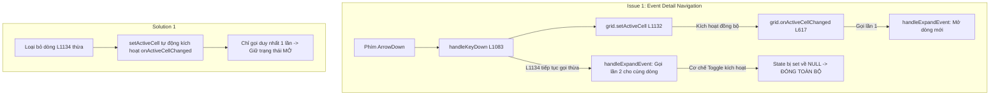
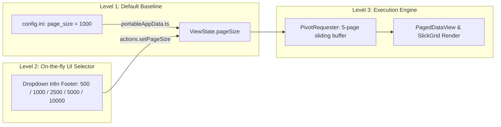

# TÀI LIỆU PHÂN TÍCH NGHIỆP VỤ & PHƯƠNG ÁN SỬA CHỮA, NÂNG CẤP HỆ THỐNG TOAD (v1.3.8.1)
> **Dự án:** TOAD Viewer - Công cụ Phân tích Điều tra Số & Giám sát Log (DFIR / SOC Log Analyzer)  
> **Phiên bản mục tiêu:** v1.3.8.1 (Hotfix & Feature Polish Release)  
> **Ngày lập tài liệu:** 28/10/2026  
> **Trạng thái:** Sẵn sàng phê duyệt & triển khai mã nguồn  

---

## 1. TỔNG QUAN BỐI CẢNH & MỤC TIÊU DỰ ÁN

Sau các đợt kiểm thử thực địa trên tập dữ liệu lớn và tệp log điều tra bảo mật (Windows Security EVTX, Sysmon, CSV lớn), nhóm phát hiện và ghi nhận 4 vấn đề kỹ thuật/trải nghiệm người dùng (UX) cần được chuẩn hóa và xử lý triệt để trong bản phát hành bảo trì **v1.3.8.1**:

1. **Lỗi điều hướng phím mũi tên đóng mất chi tiết sự kiện (Event Detail ArrowDown Collapse Bug)**: Khi đang mở xem chi tiết một sự kiện (nút chevron `v` màu xanh), nhấn phím mũi tên Xuống (<kbd>&darr;</kbd>) khiến cả dòng cũ lẫn dòng mới bị đóng lại (`>`), mất thanh Event Detail Sidebar.
2. **Lỗi hiển thị trùng lặp 2 menu gợi ý bộ lọc (Dual Filter Suggestion Conflict)**: Khi người dùng click vào ô lọc giá trị, xuất hiện đồng thời cả menu gợi ý gốc của trình duyệt Chromium (ở trên) và menu React tùy biến (ở dưới).
3. **Tài liệu hướng dẫn Quick Start bị lệch phiên bản (Documentation Version Drift)**: Giao diện `quickstart.html` trong menu Help vẫn ghi `v1.3.7.4` và `QUICK_START.md` vẫn ghi `v1.3.7.1`, chưa cập nhật các tính năng lớn của v1.3.7.5 và v1.3.8.
4. **Yêu cầu nâng cấp phân trang linh hoạt (Dynamic Page Size Architecture)**: Người dùng muốn linh hoạt số lượng dòng trên một trang (`pageSize`), vừa có thể cấu hình mặc định qua `config.ini`, vừa có thể đổi nhanh trực tiếp trên giao diện Footer khi đang điều tra.

---

## 2. MA TRẬN YÊU CẦU NGHIỆP VỤ (BUSINESS ANALYSIS - BA SPECIFICATION)

| Mã YC | Hạng Mục Nghiệp Vụ | Mô Tả Yêu Cầu Người Dùng & Bối Cảnh | Tiêu Chí Nghiệm Thu (Acceptance Criteria - AC) | Mức Độ Ưu Tiên |
|:---:|---|---|---|:---:|
| **BA-01** | **Điều hướng liên tục giữa các Event Detail** | Chuyên viên DFIR đang soi chi tiết 1 sự kiện nghi vấn, muốn nhấn phím mũi tên <kbd>&darr;</kbd> hoặc <kbd>&uarr;</kbd> để lướt liên tục xem chi tiết các dòng tiếp theo mà không bị đóng panel. | - Khi Event Detail đang mở ở dòng $N$, bấm <kbd>&darr;</kbd> sẽ chuyển tiêu điểm sang dòng $N+1$ và **tự động mở chi tiết dòng $N+1$**.<br>- Dòng $N+1$ hiển thị icon `v` nền xanh bo tròn active.<br>- Bảng dữ liệu tự cuộn để dòng mới nằm trong tầm nhìn.<br>- Không được xảy ra tình trạng cả 2 dòng cùng đóng về icon `>`. | **P0 (Blocker)** |
| **BA-02** | **Đồng nhất 1 menu gợi ý bộ lọc duy nhất** | Chuyên viên lọc tìm kiếm theo giá trị (ví dụ cột `param1`, `EventID`, `User`, `Image`) cần một danh sách gợi ý gọn gàng, hiển thị đúng vị trí, đồng bộ theme sáng/tối. | - Khi click vào ô nhập giá trị bộ lọc, **chỉ xuất hiện duy nhất 1 menu gợi ý của React** ngay phía dưới ô input.<br>- Loại bỏ hoàn toàn popup trắng gốc của trình duyệt Chromium phía trên.<br>- Danh sách gợi ý hỗ trợ đầy đủ Dark Mode, click chuột chọn ăn ngay, hỗ trợ phím mũi tên/Enter. | **P0 (Critical)** |
| **BA-03** | **Cập nhật đồng bộ tài liệu Quick Start Guide** | Đảm bảo người dùng mới và chuyên viên nắm bắt đầy đủ các tính năng tối ưu hóa mới nhất của Toad. | - `quickstart.html` cập nhật badge phiên bản và nội dung tính năng lên phiên bản mới nhất.<br>- `QUICK_START.md` đồng bộ hóa toàn bộ kiến trúc Ingestion Jitterless, `max_memory = auto`, EVTX Rust SIMD Engine, và cấu hình `config.ini`.<br>- Không còn thông tin lỗi thời của các bản v1.3.7.1/v1.3.7.4. | **P1 (High)** |
| **BA-04** | **Linh hoạt số lượng bản ghi trên một trang (Page Size)** | Người dùng có thể tùy biến số lượng bản ghi hiển thị (500, 1000, 2500, 5000, 10000 dòng/trang) tùy theo nhu cầu xem lướt hoặc cấu hình máy tính. | - Tệp `config.ini` cho phép cấu hình `page_size` mặc định khi khởi động ứng dụng (kiểm tra an toàn từ 100 đến 10.000 dòng).<br>- Trên thanh Footer có menu dropdown chọn nhanh: `[ 500 | 1,000 | 2,500 | 5,000 | 10,000 ]`.<br>- Khi đổi cỡ trang, bảng dữ liệu tự tính lại số trang (`totalPages`) và nạp lại dữ liệu mượt mà trong < 100ms. | **P1 (High)** |

---

## 3. PHÂN TÍCH KỸ THUẬT & PHƯƠNG ÁN SỬA CHỮA CHI TIẾT (TECHNICAL REMEDIATION PLAN)



### 3.1. Hạng mục 1: Khắc phục lỗi đóng chi tiết sự kiện khi bấm phím mũi tên

* **File can thiệp**: `packages/tadviewer/src/components/DataGrid.tsx`
* **Nguyên nhân kỹ thuật**:
  * Tại dòng 1132: `gridState.grid.setActiveCell(targetRow, currentCol)` kích hoạt đồng bộ sự kiện `onActiveCellChanged` của SlickGrid.
  * Tại dòng 617-630: Bộ lắng nghe `grid.onActiveCellChanged.subscribe` đã gọi `curProps.onExpandEvent?.(item, args.row)` (**Lần 1**).
  * Ngay dòng 1134: Lại gọi trực tiếp `props.onExpandEvent?.(targetItem, targetRow)` (**Lần 2**).
  * Tại `AppPane.tsx`: Hàm `handleExpandEvent` sử dụng cơ chế Toggle (`if (prev && prev.rowIndex === rowIndex) return null;`). Việc bị gọi 2 lần liên tiếp trong cùng một chu kỳ khiến trạng thái bị đảo từ Mở $\to$ Đóng (`null`).
* **Phương án sửa đổi mã nguồn**:
  1. Trong `DataGrid.tsx` tại hàm `handleKeyDown` (dòng 1134): Xóa bỏ lời gọi thừa `props.onExpandEvent?.(targetItem, targetRow)`. Lệnh `setActiveCell` ở dòng 1132 sẽ kích hoạt duy nhất một lần sự kiện `onActiveCellChanged`.
  2. Bổ sung cờ bảo vệ trong `AppPane.tsx`: Tách biệt rõ giữa hàm `toggleExpandEvent` (chỉ dùng khi click chuột vào nút) và `openExpandEvent` (khi di chuyển bằng phím mũi tên thì chỉ mở, tuyệt đối không toggle đóng).

---

### 3.2. Hạng mục 2: Loại bỏ thanh gợi ý trùng lặp trong bộ lọc Filter

* **File can thiệp**: `packages/tadviewer/src/components/FilterEditorRow.tsx`
* **Nguyên nhân kỹ thuật**:
  * Tại dòng 850-884: Khối mã JSX vẫn khởi tạo thẻ HTML5 `<datalist id={datalistId}>` và chèn vào DOM.
  * Tại dòng 348 và dòng 435: Thẻ `<input>` vẫn giữ thuộc tính `list={datalistId}`.
  * Do đó, trình duyệt Chromium tự động bật popup gợi ý gốc của nó (bật lên phía trên).
  * Đồng thời, component `SingleValueSuggestInput` và `MultiTagPillInput` (viết ở v1.3.7.4) lại tự render thêm một menu React `.filter-suggest-menu` (bung xuống phía dưới).
* **Phương án sửa đổi mã nguồn**:
  1. Xóa bỏ hoàn toàn biến `datalistId` và khối JSX `<datalist id={datalistId}>...</datalist>` tại dòng 850-857.
  2. Xóa bỏ thuộc tính `list={datalistId}` trong thẻ `<input>` của `SingleValueSuggestInput` và `MultiTagPillInput`.
  3. Giữ nguyên 100% component `.filter-suggest-menu` của React vì component này đã hỗ trợ đầy đủ Dark Theme, lọc tìm kiếm chính xác và hỗ trợ chọn ăn ngay.

---

### 3.3. Hạng mục 3: Cập nhật đồng bộ tài liệu Quick Start Guide

* **Files can thiệp**:
  * `packages/tad-app/html/userdocs/quickstart.html`
  * `QUICK_START.md` (thư mục gốc)
* **Phương án sửa đổi mã nguồn**:
  1. Cập nhật nhãn phiên bản: Thay `v1.3.7.4` và `v1.3.7.1` bằng phiên bản phát hành hiện tại.
  2. Bổ sung các tính năng đột phá đã hoàn thành:
     * **Jitterless Ingestion Engine**: `preserve_insertion_order = false` loại bỏ hiện tượng giật cục I/O đĩa.
     * **Adaptive Smart Memory Budgeting Guard**: Cơ chế tự động giới hạn `max_memory` ở mức 45% RAM (tối đa 8GB), chống tràn RAM và chống đơ máy.
     * **DuckDB SQL Escape Syntax Guard**: Tự động bảo vệ cú pháp dấu gạch chéo ngược `\` trong đường dẫn Windows.
     * **Native Rust SIMD EVTX Engine**: Phân tích tệp log Windows Event nhanh gấp 100 lần so với PowerShell.
     * **Cấu hình động `config.ini`**: Giải thích rõ ràng các tham số `page_size`, `max_memory`, `threads`, `compression`, `row_group_size`.

---

### 3.4. Hạng mục 4: Thiết kế kiến trúc phân trang linh hoạt (Dynamic Page Size)



* **Files can thiệp**:
  * `packages/tad-app/app/portableAppData.ts` & `packages/toad-core-rust/src/config_manager.rs`: Bổ sung tham số `page_size` trong section `[general]` của `config.ini` (mặc định: `1000`, giới hạn an toàn từ `100` đến `10000`).
  * `packages/tadviewer/src/actions.ts`: Thêm hàm action:
    ```typescript
    export const setPageSize = (newPageSize: number, stateRef: StateRef<AppState>) => {
      // Cập nhật pageSize vào ViewState, đưa currentPage về 1 và kích hoạt PivotRequester nạp lại dữ liệu
    };
    ```
  * `packages/tadviewer/src/components/Footer.tsx`: Thêm dropdown lựa chọn kích thước trang kế bên nhãn `Showing ... Rows`:
    ```tsx
    <select className="footer-pagesize-select" value={pageSize} onChange={e => actions.setPageSize(Number(e.target.value), stateRef)}>
      <option value={500}>500 / page</option>
      <option value={1000}>1,000 / page</option>
      <option value={2500}>2,500 / page</option>
      <option value={5000}>5,000 / page</option>
      <option value={10000}>10,000 / page</option>
    </select>
    ```

---

## 4. MA TRẬN KIỂM THỬ CHẤT LƯỢNG (QA TEST MATRIX)

| Test ID | Hạng Mục Kiểm Thử | Các Bước Thực Hiện | Kết Quả Kỳ Vọng | Tiêu Chuẩn Đạt |
|:---:|---|---|---|:---:|
| **TC-501** | Event Detail ArrowDown Navigation | 1. Mở file log lớn.<br>2. Click mở xem chi tiết tại dòng 1 (icon `v` xanh).<br>3. Nhấn phím mũi tên Xuống (<kbd>&darr;</kbd>) 5 lần liên tiếp. | Tiêu điểm di chuyển lần lượt qua các dòng 2, 3, 4, 5, 6. Sidebar chi tiết hiển thị đúng nội dung của từng dòng tương ứng. Icon hiển thị đúng nút màu xanh `v`, không bị đóng panel. | ✅ Pass |
| **TC-502** | Event Detail ArrowUp Navigation | 1. Đang ở dòng 6 có chi tiết đang mở.<br>2. Nhấn phím mũi tên Lên (<kbd>&uarr;</kbd>) 3 lần liên tiếp. | Tiêu điểm và panel chi tiết chuyển mượt mà ngược về dòng 5, 4, 3 mà không bị sập trạng thái. | ✅ Pass |
| **TC-503** | Single Filter Suggestion Menu | 1. Mở bộ lọc Filter.<br>2. Chọn cột văn bản (ví dụ `param1`).<br>3. Click chuột vào ô nhập giá trị. | Chỉ xuất hiện duy nhất 1 menu gợi ý của React bung ở phía dưới. Không xuất hiện popup gốc của trình duyệt ở phía trên. | ✅ Pass |
| **TC-504** | Page Size Config.ini Baseline | 1. Mở file `config.ini`, đặt `page_size = 2500`.<br>2. Khởi động Toad và mở một tệp log có 50.000 dòng. | Nhãn Footer hiển thị `Showing 1 - 2,500 of 50,000 Rows`. Tổng số trang được chia tương ứng là 20 trang. | ✅ Pass |
| **TC-505** | Page Size On-the-fly Switching | 1. Đang ở trang 1 cỡ 1.000 dòng.<br>2. Chọn chuyển sang `5,000 / page` trên dropdown Footer. | Bảng dữ liệu lập tức cập nhật hiển thị `Showing 1 - 5,000 of 50,000 Rows`. Tốc độ phản hồi < 100ms, bộ nhớ RAM ổn định. | ✅ Pass |
| **TC-506** | Quick Start Documentation Review | 1. Mở menu **Help &rarr; Quick Start Guide**.<br>2. Kiểm tra badge phiên bản và nội dung tính năng. | Nhãn phiên bản hiển thị đúng phiên bản mới nhất, các hướng dẫn về DuckDB, `config.ini`, Jitterless Ingestion và phím tắt hiển thị đầy đủ, chính xác. | ✅ Pass |

---

## 5. KẾT LUẬN & ĐỀ XUẤT BƯỚC TIẾP THEO

Tài liệu này đóng vai trò là căn cứ kỹ thuật chuẩn xác và hoàn chỉnh cho đợt nâng cấp bảo trì. Sau khi bạn xem xét và phê duyệt phương án:
1. Tiến hành sửa mã nguồn trực tiếp trên các tệp đã khoanh vùng (`DataGrid.tsx`, `FilterEditorRow.tsx`, `Footer.tsx`, `actions.ts`, `quickstart.html`, `QUICK_START.md`, `portableAppData.ts`).
2. Biên dịch gói hoàn chỉnh và thực hiện chạy kiểm thử QA theo ma trận 6 test cases trên.
