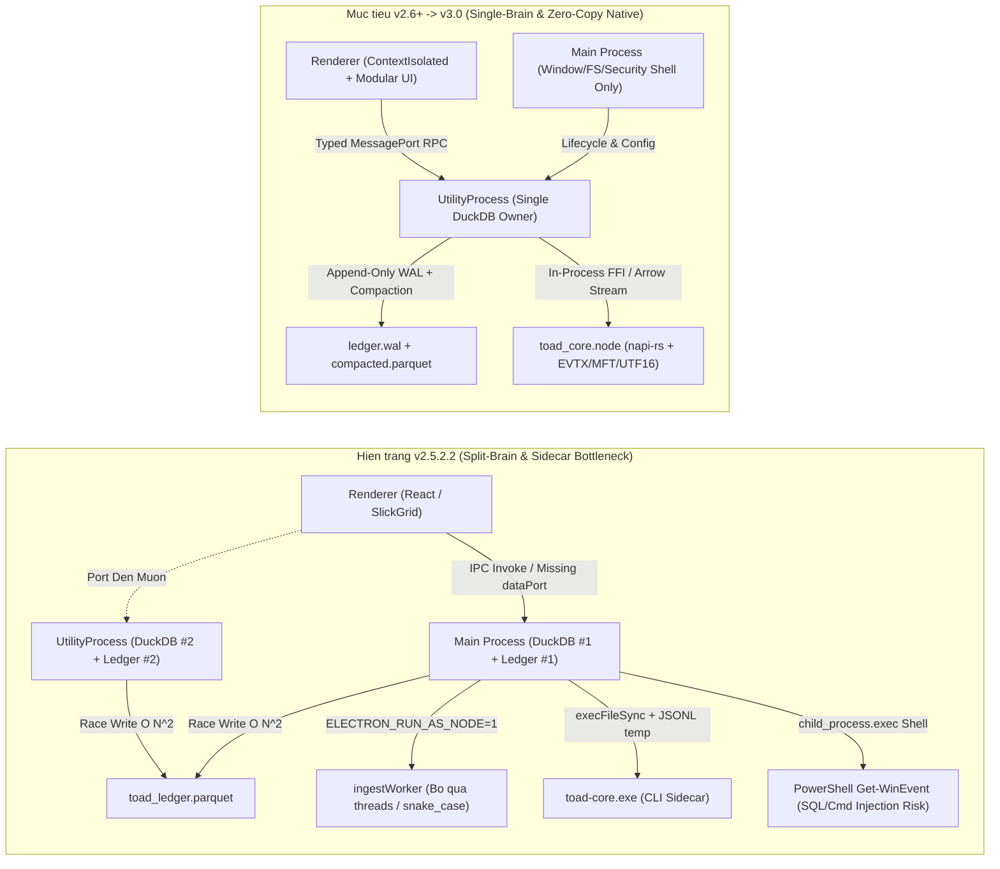

# Đề xuất Nâng cấp Kiến trúc, Bảo mật & Năng lực DFIR cho Dự án TOAD (v2.6+ → v3.0)

> **Cơ sở lập đề xuất**: Kiểm toán tĩnh toàn bộ mã nguồn workspace `tad-master/`, phân tích artifact đã đóng gói (`v2.5.2.2` EXE / `win-unpacked` / `app.asar` / PE headers / Electron Fuses), và thực thi trực tiếp các bộ kiểm thử `--smoke`, `--unit`, `--qa` và `cargo test`.
>
> **Lưu ý về Phạm vi Ngôn ngữ**: Tài liệu đề xuất nội bộ này được trình bày bằng tiếng Việt để phục vụ đánh giá kỹ thuật trong nhóm phát triển. Theo quy định *English-Only Public Language Policy*, mọi commit public, tag, GitHub Release, release notes, log runtime, và tài liệu công khai phải sử dụng **100% tiếng Anh**.

---

## Tóm tắt Điều hành (Executive Summary)

**TOAD (`v2.5.2.2`)** đã tiến hóa vượt xa codebase gốc `Tad` để trở thành một công cụ phân tích bảng dữ liệu lớn & nhật ký DFIR chạy cục bộ (offline-first) rất có giá trị, kết hợp **DuckDB**, **Parquet Persistent Cache**, **Electron 31**, **React 18 / BlueprintJS / SlickGrid** và sidecar **Rust (`toad-core.exe`)** xử lý EVTX/CSV. Hệ thống kiểm thử tự động hiện tại đạt độ phủ cao ở các luồng đơn vị (**251/251 unit tests passed**) và kiểm thử EVTX/Fuzzing (**95/95 tests passed**).

Tuy nhiên, phân tích ngược artifact phát hành cùng kiểm toán mã nguồn cho thấy tốc độ phát triển tính năng nóng qua các bản vá `v2.0 → v2.5.2.2` đã tích tụ **nợ kiến trúc nghiêm trọng**:

1. **Split-Brain Dual-DuckDB & Race Condition**: Cả **Main Process** (`main.ts`) lẫn **Utility Process** (`engineService.ts`) đều khởi tạo DuckDB và `ToadParquetLedger` riêng biệt cùng trỏ vào một file `toad_ledger.parquet` mà không có khóa liên tiến trình; cổng `MessagePort` (`toad-engine-port`) lại được gắn sau khi `RemoteReltabConnection` khởi tạo.
2. **Lỗi Toàn vẹn Ledger (`GG.11` FAIL) & Độ phức tạp Ghi $O(N^2)$**: Kiểm thử QA trực tiếp ghi nhận test `GG.11 Corrupted Ledger File Append Resilience & Self-Healing` **thất bại** do DuckDB `conn` giữ trạng thái transaction lỗi khi fallback sang `createSql` (`TransactionContext Error: cannot start a transaction within a transaction`). Ngoài ra, mỗi sự kiện trạng thái file đều rewrite toàn bộ `toad_ledger.parquet`.
3. **Bề mặt Bảo mật & Binary Hardening Yếu**: Lỗ hổng **Command Injection** trong nhánh fallback PowerShell EVTX (`csvimport.ts:3832-3842`), `shell.openExternal` chưa lọc scheme URL (`preload.js`), `quickStart.ts` bật `nodeIntegration: true`, toàn bộ 4 thành phần nhị phân (`Toad.exe` SFX 32-bit, `win-unpacked\Toad.exe`, `toad-core.exe`, `duckdb.node`) đều **unsigned** và **tắt Electron Integrity Fuses** (`RunAsNode=1`, `NodeOptions=1`, `AsarIntegrityValidation=0`).
4. **Hợp đồng Config & Pipeline Bị Đứt Gãy**: `ingestWorker.ts` đọc snake_case (`row_group_size`, `max_memory`) trong khi `csvimport.ts` truyền camelCase (`rowGroupSize`, `maxMemory`, `threads`), khiến tham số tối ưu worker bị bỏ qua; `filters_preset.json` được tạo sẵn mẫu DFIR nhưng **không có bất kỳ module UI nào đọc**.
5. **Phình to Đóng gói (ASAR Bloat) & Stack EOL**: `app.asar` chứa **5.568 file / 54,68 MB** (chưa nén) gồm hàng loạt package UI đã được Webpack gộp sẵn (`lodash`, `@apache-arrow`, `flatpickr`, `ajv`, `@emotion/*`, `react-select`, `react-dnd`, `node-addon-api`), tồn tại file trùng lặp `tad-master/packages/toad-app/release/Toad 2.5.2.2.exe` vi phạm chính sách Zero-Duplicate Binary, và runtime phụ thuộc Node `18.20.4` (EOL) + TypeScript `4.8.3` + DuckDB `1.0.0`.

| Chỉ số / Trạng thái | Hiện trạng (v2.5.2.2 — Quan sát) | Mục tiêu đề xuất (v2.6 → v3.0) |
| :--- | :--- | :--- |
| Kiến trúc Engine | Split-brain (Main DuckDB + `utilityProcess` DuckDB) | **Single Engine** (`utilityProcess` làm Owner duy nhất) |
| Ghi Ledger (`ToadParquetLedger`) | Rewrite toàn bộ file Parquet mỗi batch ($O(N^2)$); fail `GG.11` | **Append-Only Micro-WAL + Compaction**, 100% pass `GG.11` |
| Sidecar Rust (`toad-core`) | Spawns `toad-core.exe` đồng bộ (`execFileSync`) + file tạm JSONL | **Native N-API (`napi-rs`) / Arrow Stream**, zero-temp JSONL |
| Hỗ trợ Encoding / Nén | Chặn `.csv.gz` và file **UTF-16LE/BE** (có byte `0x00`) | Hỗ trợ `.gz` stream & auto-transcode UTF-16LE/BE |
| Electron Fuses & Hardening | `RunAsNode=1`, `AsarIntegrity=0`, `NodeOptions=1` | Di cư worker → `RunAsNode=0`, `OnlyLoadAppFromAsar=1`, `AsarIntegrity=1` |
| Kích thước `app.asar` | **5.568 files** / **54,68 MB** uncompressed (29,71 MB `.asar`) | **< 1.000 files** (giảm > 18 MB rác `node_modules`) |
| Năng lực DFIR | `ForensicDecoder` (B64/URL/Defang), `filters_preset.json` chết | UI Hunting Presets, **Δt Beaconing**, **Bookmarks + MITRE**, **Case Markdown Export** |
| Toolchain & Runtime | Node `18.20.4`, TS `4.8.3`, Electron `31.0.1`, DuckDB `1.0.0` | **Node 22 LTS**, **TS 5.x**, **Electron 33+/35+**, **DuckDB 1.2+** |

---

## Phần 1: Bằng chứng Kiểm toán Hiện trạng (REA Evidence Ledger)

### 1.1 Kiểm toán Artifact Đã Đóng Gói (`v2.5.2.2`)

Quá trình phân tích trực tiếp các nhị phân đang tồn tại trong workspace ghi nhận các dữ kiện sau:

#### A. Bảng Kiểm kê Nhị phân & Chuẩn Bị Trùng lặp (Zero-Duplicate Policy)
| Đường dẫn Artifact | Kích thước | SHA-256 / Kiến trúc PE | Cờ Hardening (`DllCharacteristics`) | Vấn đề Ghi nhận |
| :--- | :--- | :--- | :--- | :--- |
| `Toad.exe` (root) | 75.919.256 B (72,40 MB) | `6F93F10D...8E9` / PE32 (`0x014c`) | `0x8540` (`HIGH_ENTROPY_VA=False`, `GUARD_CF=False`) | SFX wrapper 32-bit, Unsigned (`SecDir=0`) |
| `releases/Toad-2.5.2.2-x64-portable.exe` | 75.919.256 B (72,40 MB) | `6F93F10D...8E9` (Trùng khớp root) | `0x8540` | Canonical portable release |
| `tad-master/packages/toad-app/release/Toad 2.5.2.2.exe` | 75.919.256 B (72,40 MB) | `6F93F10D...8E9` (**Trùng lặp**) | `0x8540` | **Vi phạm Zero-Duplicate Binary** |
| `release/win-unpacked/Toad.exe` | 180.267.520 B | PE32+ (`0x8664`), Unsigned | `0xc160` (`GUARD_CF=True`, `HIGH_ENTROPY_VA=True`) | Electron 31.0.1 runtime |
| `win-unpacked/resources/bin/toad-core.exe` | 815.104 B | PE32+ (`0x8664`), Unsigned | `0x8160` (**`GUARD_CF=False`**) | Imports: `ntdll`, `KERNEL32`, `msvcrt`, `synch`, `bcryptprimitives` |
| `app.asar.unpacked/.../duckdb.node` | 26.427.392 B | PE32+ (`0x8664`), Unsigned | `0x0160` (**`GUARD_CF=False`**) | DuckDB 1.0.0 N-API native addon |
| `duckdb.dll` (root) | 29.435.360 B | Timestamp `2025-04-07` | — | **Orphan binary** (`0` tham chiếu trong `tad-master/packages`) |
| `WebView2Loader.dll` (root) | 160.880 B | Timestamp `2006-07-24` | — | **Orphan binary** (`0` tham chiếu trong `tad-master/packages`) |

#### B. Trạng thái Electron Fuses (`win-unpacked\Toad.exe`, offset `0x8fefad0`, bitmask `10110001`)
* `[0] RunAsNode`: **ENABLED (1)** — *Bắt buộc hiện tại* vì `reltab-duckdb/src/csvimport.ts:2852` spawn `ingestWorker` qua `ELECTRON_RUN_AS_NODE: "1"`. **Không được tắt Fuse này trước khi di cư worker.**
* `[1] EnableCookieEncryption`: **DISABLED (0)**
* `[2] EnableNodeOptionsEnvironmentVariable`: **ENABLED (1)** — Cho phép kẻ tấn công/malware tiêm `NODE_OPTIONS=--require=...` vào quy trình DFIR.
* `[3] EnableNodeCliInspectArguments`: **ENABLED (1)** — Cho phép mở inspector/debugger trên bản phát hành.
* `[4] EnableEmbeddedAsarIntegrityValidation`: **DISABLED (0)** — Không phát hiện nếu `app.asar` bị chỉnh sửa trên máy nạn nhân / USB portable.
* `[5] OnlyLoadAppFromAsar`: **DISABLED (0)** — Cho phép Electron tải code ngoài ASAR nếu có thư mục `app/` cạnh `.exe`.
* `[6] LoadBrowserProcessSpecificV8Snapshot`: **DISABLED (0)**
* `[7] GrantFileProtocolExtraAsarIntegrityValidation`: **ENABLED (1)**

#### C. Phân tích Phình to `app.asar` (29.710.504 B nén | 54.678.728 B giải nén | 5.568 files)
Kiểm tra các lệnh `require(...)` thực tế trong bundle đầu ra của Webpack so với nội dung thực sự đóng gói trong `app.asar`:
* `dist/toadapp.bundle.js` (`5.639.716 B`): Chỉ gọi duy nhất `require('util')` — toàn bộ thư viện React, UI, biểu đồ/grid đã được Webpack đóng gói nội bộ.
* `dist/engineService.bundle.js` (`25.305 B`): Chỉ gọi 4 package ngoài (`electron-log`, `loglevel`, `reltab`, `reltab-duckdb`) + 3 built-in Node (`fs`, `path`, `util`).
* `dist/main.bundle.js` (`102.398 B`): Chỉ gọi 11 package ngoài (`command-line-args`, `command-line-usage`, `console.table`, `electron-log`, `electron-updater`, `fast-csv`, `loglevel`, `reltab`, `reltab-duckdb`, `reltab-fs`, `source-map-support/register`) + 9 built-in Node/Electron.
* **Nguyên nhân phình to**: `tad-master/packages/toad-app/package.json` khai báo `"toadviewer": "^0.12.0"` ngay trong `dependencies` và dùng cấu hình `build.files: ["node_modules", ...]` theo kiểu blacklist thủ công. Do đó, hàng chục thư viện frontend/build không bao giờ được Main hoặc Engine `require` vẫn bị nhồi vào `app.asar`:
  * `node_modules/duckdb`: `27.294.527 B` (gồm `duckdb.node` 26,43 MB trong `app.asar.unpacked`)
  * `node_modules/lodash`: `1.409.004 B`
  * `node_modules/@apache-arrow/es2015-cjs`: `1.113.411 B`
  * `node_modules/electron-updater`: `944.319 B` (hiện app phân phối portable EXE, tính năng auto-update thực chất chưa hoàn thiện URL thật)
  * `node_modules/@mapbox/node-pre-gyp`: `794.887 B` (công cụ cài đặt build-time)
  * `node_modules/flatpickr`: `698.128 B`, `ajv`: `688.455 B`, `@emotion/babel-plugin`: `633.577 B`, `react-select`: `604.387 B`, `react-dnd`: `597.098 B`, `source-map`: `510.932 B`, `immutable`: `415.461 B`, `yaml`: `413.721 B`, `@emotion/react`: `408.157 B`, `rimraf`: `406.426 B`, `node-addon-api`: `368.039 B` (chứa `341.157 B` C++ `.h` headers), `path-scurry`: `348.525 B`, `encoding`: `333.624 B`.

### 1.2 Kết quả Chạy Kiểm thử Thực tế (Verified Baseline)

Chạy trực tiếp bộ runner trong workspace bằng Node `v18.20.4` và `cargo test`:

| Bộ Kiểm thử | Lệnh Thực thi | Kết quả Thực tế | Ghi chú Quan sát |
| :--- | :--- | :--- | :--- |
| **Smoke Test** | `run_tests.js --smoke` | Exit code `0` (`[PASS]`) | Cảnh báo `toad.log not found in expected locations`, rơi về kiểm tra stdout/stderr; `win-unpacked\Toad.exe` thoát sớm code `0` (`Active: false`). |
| **Unit Tests** | `run_tests.js --unit` | **12/12 suites PASSED** (`251 tests`, `22.47s`) | Đạt 100% trên config, traverser, JSON flattening, wrap/resize, filter lifecycle, trace logger. |
| **Deep Integration QA** | `run_tests.js --qa` (`deep_integration_qa.js`) | **222 PASSED / 1 FAILED** (`223 tests`, `66.04s`) | **FAIL tại `GG.11 Corrupted Ledger File Append Resilience & Self-Healing`** (`Serialization Error` -> `TransactionContext Error: cannot start a transaction within a transaction`). |
| **EVTX JSON Parity QA** | `run_tests.js --qa` (`test_realworld_evtx_json.js`) | **35/35 PASSED** | Dump 22,07 MB `System.evtx` qua `toad-core.exe` mất `2.629 ms`. |
| **Adversarial Fuzzing QA** | `run_tests.js --qa` (`test_json_adversarial_fuzz.js`) | **40/40 PASSED** | Kiểm thử fuzzing nested/unicode/numeric bounds. |
| **Grid Wrap Stress QA** | `run_tests.js --qa` (`test_grid_wrap_concurrency_stress.js`) | **10/10 PASSED** | 100K virtual scroll viewport (`0px` drift, `2.01 MB` heap delta). |
| **Modal Glow Suppression QA** | `run_tests.js --qa` (`test_modal_cell_glow_suppression.js`) | **10/10 PASSED** | Kiểm tra CSS/EventBus khi mở dialog. |
| **Rust Core Cargo Tests** | `cargo test --manifest-path .../Cargo.toml` | **4 PASSED / 0 FAILED** (`lib.rs`) | `main.rs` (0 tests), doc-tests (0 tests); **`evtx_parser.rs` chưa có unit test Rust nào**. |

### 1.3 Phân định REA: Observed vs Inferred vs Unknowns

* **Observed Facts (Sự thật đã xác minh trực tiếp)**: Toàn bộ bảng hash/kích thước PE, Electron Fuses bitmask `10110001`, danh mục ASAR 5.568 files, danh sách package chết (`tadweb-app`, `tadweb-server`, `reltab-aws-athena`, `reltab-bigquery`, `reltab-snowflake` có 0 tham chiếu từ `toad-app`/`toadviewer`), số liệu dòng code monolith (`csvimport.ts` 4.329L, `RegexDialog.tsx` 2.802L, `DataGrid.tsx` 2.491L, `actions.ts` 1.628L, `FilterEditor.tsx` 1.288L, `portableAppData.ts` 1.241L), thất bại `GG.11`, lỗi fallback `ingestWorker.ts`, command injection trong `csvimport.ts:3832-3842`, placeholder `example.com` / `v2.4.8`, và chuỗi tiếng Việt trong `binary_guard.rs:66,93`, `csvimport.ts:2402`, `portableAppData.ts:176-180`.
* **Inferred (Suy luận từ bằng chứng)**: Việc không thể giữ transaction sạch trên DuckDB connection sau ngoại lệ `Serialization Error` giải thích đồng thời lỗi `GG.11` và rủi ro mất toàn bộ lịch sử `toad_ledger.parquet` nếu một tiến trình khác gây lỗi đọc tạm thời khiến code rơi vào nhánh `createSql`. Sự trùng hợp 0 tham chiếu tới `filters_preset.json` cho thấy tính năng preset bị bỏ dở sau khi viết scaffold ở `portableAppData.ts`.
* **Unknowns / Tooling Blocker (Khoảng trống chưa kiểm chứng)**:
  * **REA CLI Blocker**: Gói `rea-agents` (`v6.9.0`) yêu cầu Node `^22.23.4 || ^24.22.1 || >=26.12.1`, trong khi máy chủ chỉ có portable `node-v18.20.4-win-x64` (v18.20.4). Vì nguyên tắc không tự ý cài đặt Node/công cụ ngoài phạm vi dự án, việc quét binary tự động bằng `rea-agents` chưa thực thi được và được thay thế bằng script kiểm tra PE/ASAR/Fuses độc lập bằng Python 3.14 + `cargo test`.
  * **Live Desktop Interactive Telemetry**: Do `--smoke` chạy headless khiến `Toad.exe` thoát sớm (`toad.log not found`), độ trễ render thực tế của Chromium GPU, phản ứng Microsoft Defender SmartScreen trên Windows 11 sạch, và mức tiêu thụ RAM thật khi mở đồng thời 5+ tab Parquet >10M dòng vẫn cần đo bổ sung khi có GUI session.

---

## Phần 2: Phân tích Chuyên sâu Các Lỗ hổng & Nút thắt Trọng yếu

### 2.1 Kiến trúc "Split-Brain" giữa Main Process và `utilityProcess`
* **Quan sát cụ thể**:
  * `main.ts:216` khởi chạy `serverInit(ts)`, `main.ts:795-808` khởi tạo `ToadParquetLedger` và `performStartupReconciliation()`, đồng thời `main.ts:363-483` xử lý toàn bộ IPC `project:*` ngay tại **Main Process**.
  * Trong khi đó, `main.ts:852` khởi động `EngineSupervisor` (`utilityProcess` chạy `engineService.ts`) — tiến trình này tiếp tục mở một thực thể **DuckDB thứ hai** và một **Ledger Singleton thứ hai** rồi gọi `replayLedgerViews()`.
  * Phía Client (`appMain.tsx:161`), `new RemoteReltabConnection(tconn)` được khởi tạo *trước khi* nhận `toad-engine-port` (`main.ts:846-852`). Khi `setDataPort` (`Connection.ts:551-563`) chạy, nó **không cập nhật** các `RemoteDataSourceConnection` đã được tạo từ trước.
  * Khi `dataPort` chưa sẵn sàng (`null`), `Connection.ts:282` truyền object thô `payload` sang `ElectronHostAdapter.invokeBinary("evalQuery", payload)` (`ElectronHostAdapter.ts:171`), rơi ngược về `V8HostAdapter.invoke("evalQuery", payload)` → `preload.js:149` → `server.ts:313` nơi thực hiện `JSON.parse(encodedReq)` lên một **JS Object** (gây lỗi kiểu runtime).
  * `purgeProjectCache` / `removeFileFromProject` (`csvimport.ts:934-959, 1002-1007`) cố gọi `(globalThis as any).multipleLoadingManagerInstance` trong khi singleton này chỉ tồn tại ở **Renderer**, khiến việc xóa cache từ Main/Engine âm thầm vô tác dụng.

### 2.2 Khuyết tật Toàn vẹn Ledger (`GG.11`) & Lỗi Nạp Worker Config
* **Ledger Wipeout & $O(N^2)$ Rewrite (`csvimport.ts:2202-2406`)**:
  * Mỗi lần ghi event trạng thái file (`STARTED`, `READY`, `ERROR`, `MODIFIED`), hàm `recordEvents` chạy `COPY (SELECT ... FROM read_parquet('toad_ledger.parquet') UNION ALL VALUES ...) TO tmpPath` rồi đổi tên đè lên file gốc. Điều này tạo độ phức tạp đĩa $O(N^2)$ khi ingest hàng nghìn file trong một case DFIR lớn.
  * Nghiêm trọng hơn: tại dòng `2376-2386`, nếu `appendSql` thất bại (như file corrupt trong `GG.11` hoặc lock xung đột giữa Main và Engine), code rơi sang `await conn.run(createSql)` **trên chính connection `conn` đang kẹt transaction lỗi** → gây `TransactionContext Error: cannot start a transaction within a transaction` (chứng minh qua `GG.11` fail). Tệ hơn nữa, nếu `conn` không lỗi transaction mà chỉ gặp lỗi đọc tạm thời, `createSql` sẽ **ghi đè xóa sạch toàn bộ lịch sử case** trong `toad_ledger.parquet`.
* **Sai Lệch Hợp đồng `ingestWorker.ts`**:
  * `csvimport.ts:2840-2849` truyền config bằng **camelCase** (`{ rowGroupSize, threads, maxMemory }`), nhưng `ingestWorker.ts:36, 47` lại đọc **snake_case** (`cfg.row_group_size`, `cfg.max_memory`) và hoàn toàn không thực thi `SET threads = ...`. Hệ quả là mọi cấu hình giới hạn RAM/Thread cho worker trong `config.ini` đều bị bỏ qua âm thầm.

### 2.3 Bề mặt Bảo mật & Bất tương thích Định dạng DFIR Thực tế
* **Command Injection ở nhánh PowerShell EVTX (`csvimport.ts:3832-3842`)**: Chuỗi `filePath` được nội suy trực tiếp vào script PowerShell `Get-WinEvent -Path '${filePath}'` và gọi qua `child_process.exec("powershell ... \"${psScript}\" > \"${tempJsonl}\"")`. Một file evidence có tên dạng `evil'; Calc #.evtx` hoặc chứa `$(...)` có thể thực thi lệnh OS tùy ý khi người dùng mở file bằng Toad.
* **`shell.openExternal` không kiểm tra Scheme (`preload.js:360-365, 426-434`)**: Nhận URL và truyền thẳng ra shell Windows mà không bắt buộc `url.startsWith("https://")` / `URL.protocol`, tiềm ẩn rủi ro mở URI nguy hiểm (`file:`, `ms-msdt:`, SMB UNC leak NTLM hash).
* **Legacy `nodeIntegration` (`quickStart.ts:62-63`)**: Cửa sổ QuickStart bật `nodeIntegration: true, contextIsolation: false`. Ngoài ra `appWindow.ts:176-180` viết `if (idx) { delete mainWindows[idx]; }` bỏ sót phần tử index `0` và để lại lỗ `undefined` trong mảng cửa sổ.
* **Derived Views Bị Mất Khi Crash (`actions.ts:1191, 1455`)**: Người dùng tách cột bằng Regex/KV (`CREATE VIEW "..._rx1"`) nhưng tên view và SQL định nghĩa không được ghi nhận vào Ledger, cũng như biến đếm `regexViewSeq` nằm ở bộ nhớ Renderer — nếu `EngineSupervisor` auto-restart (<500ms), `replayLedgerViews()` không khôi phục được view đã tách.
* **Binary Guard Chặn `.gz` & Log Windows UTF-16 (`csvimport.ts:159`, `binary_guard.rs:40-45, 88-99`)**: Heuristic từ chối mọi file không nằm trong `[".parquet", ".duckdb", ".sqlite", ".evtx"]` nếu phát hiện byte `0x00` trong header. Điều này chặn đứng 2 loại evidence DFIR cực kỳ phổ biến:
  1. Log nén `.csv.gz`, `.tsv.gz`, `.jsonl.gz` (chứa gzip magic `1F 8B 08` + bytes mtime/flags có `0x00`) mặc dù DuckDB hỗ trợ đọc gzip trực tiếp.
  2. File text **UTF-16LE / UTF-16BE** từ Windows (`reg export`, `powershell > out.txt`, `wmic`, một số log IIS/legacy Windows) vì cứ mỗi ký tự ASCII lại đi kèm byte `0x00`.

### 2.4 Khoảng trống DFIR (`ROADMAP.md` & Config Chết) & Nợ Bảo trì
* **Config Chết**: `portableAppData.ts:224-256` tạo file `filters_preset.json` với 2 mẫu preset (`Hayabusa Critical & High`, `Suspicious PowerShell Execution`), nhưng quét toàn bộ repo xác nhận **không có bất kỳ module nào trong `toadviewer` hoặc `toad-app` đọc file này**.
* **Tính năng DFIR Phase 4 Chưa Hoàn Thiện**: Hiện mới có `ForensicDecoder.ts` (decode Base64 UTF-8/UTF-16LE, URL, Defang IoC `hxxp` / `[.]`). Vẫn thiếu toàn bộ các tính năng cốt lõi trong `ROADMAP.md`: phân tích **$\Delta t$ / Beaconing**, **Evidence Bookmarking & MITRE ATT&CK TTP Tagging**, **Hunting Presets UI**, **Xuất báo cáo Timeline Markdown**, và parser gốc cho `$MFT` / Prefetch / Registry Hive.
* **Monolith & Package Thừa**: `csvimport.ts` (4.329 dòng) gộp cả DB connection pool, binary guard, SQL path escaping, Ledger CRUD, project cache purge, và EVTX parser invocation. 5 package legacy từ `tad` (`tadweb-app`, `tadweb-server`, `reltab-aws-athena`, `reltab-bigquery`, `reltab-snowflake`) vẫn tồn tại với 0 tham chiếu từ `toad-app`. Phiên bản package nội bộ lệch nhau (`toad-app` `2.5.2.2`, `reltab` `0.14.0`, `toad-core-rust` `1.2.0`), kèm metadata placeholder `example.com` và chuỗi `v2.4.8` hardcoded trong `main.ts:488-490`.

---

## Phần 3: Lộ trình Đề xuất Nâng cấp (P0 → P3)

### Giai đoạn P0: Khẩn cấp — Vá Lỗi Đỏ, Bảo mật & Vệ sinh Bản dựng (`v2.5.3` / `v2.6.0-alpha`)
*Mục tiêu: Đưa bộ kiểm thử về 100% PASS, bịt lỗ hổng Command Injection & URI leak, chuẩn hóa thông tin phát hành theo quy chuẩn dự án.*

1. **[P0.1] Vá triệt để lỗi `GG.11` và đồng bộ `ingestWorker.ts`**
   * **Ledger Error Recovery (`csvimport.ts:2369-2398`)**: Khi `appendSql` ném lỗi, thực hiện `try { await conn.run("ROLLBACK;"); } catch {}` (hoặc đóng `conn` cũ và mở connection mới sạch sẽ) trước khi chạy recovery. Không bao giờ chạy `createSql` ghi đè `toad_ledger.parquet` nếu file gốc > 0 bytes bị lỗi đọc tạm thời; thay vào đó, sao lưu file gốc sang `toad_ledger.parquet.corrupt.<ts>` trước khi tạo ledger mới (tránh xóa nhầm dữ liệu điều tra).
   * **Sửa `ingestWorker.ts:36-47`**: Chuẩn hóa interface `IngestWorkerConfig` dùng chung từ `reltab-duckdb`, chấp nhận cả camelCase và fallback snake_case, và bổ sung `SET threads = ${Math.max(1, Number(cfg.threads))};` ngay khi khởi tạo worker DuckDB.
2. **[P0.2] Loại bỏ Command Injection ở EVTX PowerShell Fallback (`csvimport.ts:3832-3842`)**
   * Thay `child_process.exec(...)` bằng `child_process.execFile("powershell.exe", ["-NoProfile", "-NonInteractive", "-ExecutionPolicy", "Bypass", "-Command", "& { param($p) Get-WinEvent -Path $p | ForEach-Object { ... } }", filePath], { shell: false })` — hoặc truyền `filePath` qua biến môi trường (`env: { TOAD_EVTX_PATH: filePath }` + `$env:TOAD_EVTX_PATH`) để triệt tiêu hoàn toàn nguy cơ nội suy chuỗi vào PowerShell/cmd.
3. **[P0.3] Gia cố Bề mặt Electron UI & Window Lifecycle**
   * `preload.js:360-365, 426-434`: Bổ sung `isSafeExternalUrl(raw)` chỉ cho phép `protocol === "http:" || protocol === "https:"` trước khi gọi `shell.openExternal`.
   * `quickStart.ts:62-63`: Chuyển sang `nodeIntegration: false, contextIsolation: true`, dùng preload whitelist chung thay vì lộ API Node trong cửa sổ Welcome.
   * `appWindow.ts:176-180`: Thay `if (idx) delete mainWindows[idx]` bằng `const idx = mainWindows.indexOf(win); if (idx !== -1) mainWindows.splice(idx, 1);`.
4. **[P0.4] Vệ sinh Metadata, Duplicate Binary & Ngôn ngữ Công khai**
   * Sửa `toad-app/package.json`: cập nhật `homepage`, `repository.url`, `appId` (`io.github.hellokittyxamkinlung.toad`), `electron-updater` config (hoặc gỡ bỏ nếu chỉ phân phối portable).
   * Sửa `main.ts:488-490`: đọc version động từ `app.getVersion()` thay vì hardcoded `"2.4.8"`. Cập nhật `reltab-duckdb/package.json` mô tả đúng DuckDB.
   * Xóa bản sao dư thừa `tad-master/packages/toad-app/release/Toad 2.5.2.2.exe` và hai DLL mồ côi `duckdb.dll`, `WebView2Loader.dll` ở thư mục gốc; cập nhật `dist_package.ps1` / `package_release.ps1` dọn file tạm `release\Toad *.exe` sau khi xuất ra `releases/`.
   * Chuyển đổi toàn bộ log/chuỗi hướng tới người dùng cuối sang tiếng Anh chuẩn: `binary_guard.rs:66,93`, `csvimport.ts:2402`, và `# Tu khoa che do an toan...` trong `portableAppData.ts:176-180`.

---

### Giai đoạn P1: Tái kiến trúc Cốt lõi — Single Engine, WAL Ledger, Native Rust N-API & Security Fuses (`v2.6.0`)
*Mục tiêu: Chấm dứt Split-Brain, đẩy tốc độ ingest/parse lên native zero-copy, thu gọn ASAR > 35%, khóa Electron Fuses.*

1. **[P1.1] Hợp nhất 100% Sang Single Engine (`utilityProcess`)**
   * Hiện thực hóa hoàn chỉnh tài liệu thiết kế `docs/FUTURE_KE_HOACH_CHUYEN_DOI_MO_HINH_IPC_UTILITYPROCESS.md`:
     * Xóa `serverInit(ts)` khỏi Main Process (`main.ts:216`) và xóa `ToadParquetLedger` khỏi Main (`main.ts:795-808`). Main Process chỉ đảm nhiệm Window, Dialog chọn file, Menu, và giám sát `EngineSupervisor`.
     * Mọi handler `project:*`, `reltab:*`, `ledger:*` đều chạy duy nhất trong `engineService.ts` (`utilityProcess`). Main chuyển tiếp hoặc cung cấp `MessagePort` trực tiếp cho Renderer.
     * **Sửa Race khởi tạo Port**: Renderer giữ một `DeferredPortRouter` hoặc chờ promise `window.toadBridge.waitForEnginePort()` trước khi gọi `new RemoteReltabConnection`, đồng thời `RemoteReltabConnection.setDataPort` phải broadcast port mới tới mọi `RemoteDataSourceConnection` đang tồn tại và chuẩn hóa kiểu dữ liệu giữa `invokeBinary` và `V8HostAdapter` (`server.ts:313` không gọi `JSON.parse` nếu payload đã là object).
     * **Đồng bộ Cache Eviction liên tiến trình**: Thay hack `(globalThis as any).multipleLoadingManagerInstance` trong `csvimport.ts` bằng event IPC `cache:invalidate` phát từ `engineService` qua `MessagePort` về Renderer.
2. **[P1.2] Tái kiến trúc `ToadParquetLedger` thành Append-Only Micro-WAL**
   * Thay cơ chế `COPY (read_parquet UNION ALL new) TO tmp` bằng kiến trúc 2 tầng:
     * **Tầng Nóng (`ledger.wal.jsonl` hoặc SQLite WAL)**: Mỗi thay đổi trạng thái file (`STARTED`, `READY`, `MODIFIED`) chỉ append 1 dòng mất **< 0.5ms** ($O(1)$), bất biến không bao giờ rewrite lịch sử đang có.
     * **Tầng Lạnh (`toad_ledger.parquet`)**: Tự động gộp (compact) khi số dòng WAL vượt ngưỡng (ví dụ > 500 events) hoặc lúc app đóng/idle bằng cơ chế atomic snapshot.
     * **Bền vững hóa Derived Regex/Split Views**: Lưu danh sách view do người dùng tạo (`view_name`, `parent_view`, `create_sql`) vào Ledger để khi `EngineSupervisor` auto-restart sau crash, `replayLedgerViews()` tái tạo lại cả bảng gốc lẫn các cột đã bóc tách.
3. **[P1.3] Di cư `ingestWorker` & Bật Toàn Bộ Electron Security Fuses**
   * Di cư `runIngestInWorker` (`csvimport.ts:2852`) từ `child_process.fork` với `ELECTRON_RUN_AS_NODE=1` sang một **dedicated `utilityProcess` worker pool** (hoặc **Node `worker_threads`** bên trong `engineService`).
   * Ngay khi không còn phụ thuộc `ELECTRON_RUN_AS_NODE`, cấu hình `@electron/fuses` trong bước `afterPack.js`:
     * `RunAsNode`: **DISABLE (`0`)**
     * `EnableNodeOptionsEnvironmentVariable`: **DISABLE (`0`)**
     * `EnableNodeCliInspectArguments`: **DISABLE (`0`)**
     * `EnableCookieEncryption`: **ENABLE (`1`)**
     * `EnableEmbeddedAsarIntegrityValidation`: **ENABLE (`1`)**
     * `OnlyLoadAppFromAsar`: **ENABLE (`1`)**
   * Kết hợp bật `/guard:cf` (`GUARD_CF`) cho `toad-core` và build SFX 64-bit thay cho SFX 32-bit `0x014c`.
4. **[P1.4] Nâng cấp `toad-core-rust` Thành N-API Addon (`napi-rs`) + Hỗ trợ `.gz` & UTF-16**
   * Thay thế mô hình gọi CLI `toad-core.exe` qua `execFileSync` (tạo chi phí spawn process + ghi/đọc file tạm JSONL trên đĩa) bằng **Native Addon (`toad_core.node`)** biên dịch với `napi-rs`, gọi trực tiếp từ `engineService.ts` (`utilityProcess`):
     * Xuất luồng record sang DuckDB qua Arrow IPC / `duckdb_appender` hoặc memory stream, loại bỏ bước tạo file `.jsonl` trung gian cho file EVTX vừa và lớn.
     * Bổ sung **unit tests & fuzz tests** trực tiếp trong `evtx_parser.rs` (hiện đang có 0 tests) dùng bộ fixture EVTX ẩn danh.
   * **Mở rộng `binary_guard.rs` & `csvimport.ts`**:
     * Nhận diện **Gzip BOM / Magic (`1F 8B 08`)** cho `.csv.gz`, `.tsv.gz`, `.jsonl.gz`, `.json.gz` → cho phép đi qua Binary Guard và đọc thẳng bằng bộ giải nén streaming hoặc `read_csv(..., compression='gzip')` của DuckDB.
     * Nhận diện **UTF-16LE (`FF FE`) / UTF-16BE (`FE FF`)** và heuristic null-byte xen kẽ chu kỳ 2 byte → tự động transcode streaming sang UTF-8 bằng Rust SIMD thay vì báo lỗi file nhị phân.
5. **[P1.5] Tối ưu Đóng gói ASAR (`ASAR Diet`)**
   * Chuyển `toadviewer`, `react`, `react-dom` trong `tad-master/packages/toad-app/package.json` từ `dependencies` sang `devDependencies` (vì Renderer đã bundle 100% qua Webpack vào `toadapp.bundle.js`).
   * Đóng gói `main.bundle.js` và `engineService.bundle.js` sạch hơn, chỉ whitelist đúng 11–14 runtime `node_modules` cần thiết (như `duckdb`, `reltab*`, `electron-log`, `fast-csv`, `command-line-args`) và **loại bỏ hoàn toàn** `lodash`, `@apache-arrow`, `flatpickr`, `ajv`, `@emotion/*`, `react-select`, `react-dnd`, `@mapbox/node-pre-gyp`, `node-addon-api` (`.h`), `rimraf`, `source-map`. Kỳ vọng giảm kích thước `app.asar` chưa nén từ **54,68 MB (5.568 files)** xuống còn **< 32 MB (< 1.000 files)**.

---

### Giai đoạn P2: Nâng cấp Năng lực DFIR Chuyên sâu & Tái cấu trúc Mã nguồn (`v2.7.0`)
*Mục tiêu: Hoàn thành lộ trình Phase 4 DFIR và chia nhỏ các file monolith.*

1. **[P2.1] Kết nối UI Threat Hunting Presets (`filters_preset.json`)**
   * Xây dựng IPC/Bridge để tải `filters_preset.json` vào `FilterEditor.tsx` (dropdown **"DFIR Presets"** + nút **"Save Current Filter as Preset"**).
   * Bổ sung thư viện preset chuẩn hóa cho **Windows Event Log / Sysmon / Hayabusa / Linux Auditd** (ví dụ: *Log Clear EventID 1102/104*, *Lateral Movement 4624 Type 3/10 + 4648*, *Service Creation 7045/4697*, *LSASS Access Sysmon ID 10*, *Encoded PowerShell*).
2. **[P2.2] Bộ Công cụ Điều tra DFIR Phase 4 (`ROADMAP.md`)**
   * **Time-Delta ($\Delta t$) & Beaconing Analyzer**: Tính `EPOCH(ts) - LAG(EPOCH(ts)) OVER (ORDER BY ts)` trực tiếp bằng DuckDB Window Function trên cột timestamp đã chọn; thêm tab thống kê nhanh jitter/chu kỳ lặp (ví dụ: phát hiện C2 beacon gửi tín hiệu mỗi `60s ± 5%` theo cặp `(src_ip, dst_ip, dst_port)`).
   * **Persistent Evidence Bookmarking & MITRE ATT&CK Tagging**: Cho phép điều tra viên đánh dấu (bookmark) dòng log quan trọng, gắn thẻ Technique ID (ví dụ `T1059.001`, `T1003.001`) và ghi chú phân tích, lưu bền vững trong Case SQLite/WAL theo từng Project.
   * **Case Timeline Report Exporter**: Nút **Export Incident Timeline** xuất toàn bộ các dòng đã bookmark (kèm IoC đã tự động **Defang** qua `ForensicDecoder.ts` + bộ lọc đang dùng + hash nguồn) ra file `.md` / `.json` phục vụ báo cáo IR ngay lập tức.
   * **Mở rộng Native Parsers trong `toad-core`**: Tận dụng hệ sinh thái Rust crate để thêm chế độ đọc nhanh **`$MFT`** (`mft` crate), **Windows Prefetch (`.pf`)** và **multi-line / corrupt JSONL log** ngay trong cùng N-API addon.
3. **[P2.3] Chia Tách Monolith & Dọn Dẹp Monorepo**
   * **Xóa 5 package chết không còn dùng**: `tadweb-app`, `tadweb-server`, `reltab-aws-athena`, `reltab-bigquery`, `reltab-snowflake` (giúp tăng tốc cài đặt và giảm bề mặt audit lỗ hổng `npm`).
   * **Chia tách 5 file phình to nhất**:
     * `reltab-duckdb/src/csvimport.ts` (**4.329 dòng**) → tách thành `DuckDbPool.ts`, `BinaryGuard.ts`, `ToadLedgerStore.ts`, `CsvIngestPipeline.ts`, `JsonIngestPipeline.ts`, `EvtxIngestBridge.ts`.
     * `toadviewer/src/components/RegexDialog.tsx` (**2.802 dòng**) → tách thành `SimpleParserForm.tsx`, `RegexBuilderForm.tsx`, `SchemaPreviewGrid.tsx`, `SqlExtractionBuilder.ts`.
     * `toadviewer/src/components/DataGrid.tsx` (**2.491 dòng**) → tách `GridColumnSizer.ts`, `ExpandedCellOverlay.tsx`, `SlickGridAdapter.tsx`.
     * `toadviewer/src/actions.ts` (**1.628 dòng**) → tách `viewActions.ts`, `extractionActions.ts`, `projectActions.ts`.
     * `toadviewer/src/components/FilterEditor.tsx` (**1.288 dòng**) → tách `FilterTreeBuilder.tsx`, `RawSqlFilterPane.tsx`, `PresetPicker.tsx`.

---

### Giai đoạn P3: Hiện đại hóa Toolchain, Supply Chain & CI/CD (`v3.0.0`)
*Mục tiêu: Thoát khỏi runtime End-of-Life, hỗ trợ sẵn công cụ kiểm toán thế hệ mới (`rea-agents`), tự động hóa kiểm thử hồi quy.*

1. **[P3.1] Nâng cấp Runtime & Bundler Cốt lõi**
   * **Node.js `18.20.4` (EOL) → Node `22 LTS` (v22.23+)** hoặc **`24 LTS`**: Cho phép chạy bản test runner tích hợp, đồng thời đáp ứng yêu cầu Node `>=22.23.4` để tích hợp `rea-agents` vào quy trình kiểm toán bảo mật tự động.
   * **Electron `31.0.1` → Electron `33+ / 35+`** (Chromium mới, bản vá V8 sandbox & `utilityProcess` ổn định hơn).
   * **TypeScript `4.8.3` → `5.6+`**: Chuẩn hóa phiên bản đồng nhất cho mọi package trong workspace, bật `strictNullChecks` từng bước cho `reltab` và `toadviewer`.
   * **DuckDB `duckdb-async 1.0.0` → DuckDB `1.2+` (hoặc `@duckdb/node-api` chính thức)**: Khai thác cải tiến CSV sniffer, `read_json` recovery và giảm rò rỉ bộ nhớ trên bảng rộng hàng trăm cột (như Windows EVTX/Sysmon sau flatten).
   * **Webpack `5.65` → `esbuild` / Vite**: Giảm thời gian build phát triển từ hàng chục giây xuống < 2 giây.
2. **[P3.2] Hợp nhất Build, Smoke Test & Phân phối Chuẩn (`package_release.ps1`)**
   * **Hợp nhất Script Build (`fastbuild.ps1`, `dist_package.ps1`, `build_all.ps1`)**:
     * Chỉ định 1 script build chuẩn (`tools/build.ps1`) đảm bảo biên dịch theo đúng đồ thị phụ thuộc (`reltab` → `reltab-fs` / `aggtree` / `reltab-duckdb` → `host-bridge` → `toadviewer` → `toad-core` Rust → `toad-app`), khắc phục việc `dist_package.ps1` bỏ quên build các package nền và `fastbuild.ps1` bỏ qua `toad-core-rust`.
     * Đồng bộ hóa phiên bản toàn monorepo thông qua `tools/bump_version.js` (tránh tình trạng `0.14.0` vs `2.5.2.2` vs `1.2.0`).
   * **Sửa `tests/smoke_test.js`**: Bổ sung cờ `--smoke-check` trong `main.ts` để khởi động Electron Main → fork `utilityProcess` → khởi chạy DuckDB + kiểm tra version bảng + ghi marker vào `toad.log` rồi mới thoát có kiểm soát, giúp test `--smoke` kiểm chứng được cả Electron + `utilityProcess` thay vì thoát sớm và mất `toad.log`.
   * **CI/CD Pipeline (GitHub Actions)**: Chạy tự động trên mỗi PR: `cargo test` → `unit` (251+ tests) → `qa` (bao gồm `GG.11` pass 100%) → ASAR bloat budget check (`<= 1.000 files`) → Verify Electron Fuses → đóng gói `releases/Toad-<ver>-x64-portable.exe` + `.zip` + `.sha256` + cập nhật Winget manifest.

---

## Phần 4: Ma trận Theo dõi Thực thi & Tiêu chí Nghiệm thu

| Hạng mục | Ưu tiên | Rủi ro khi Thực hiện | Tiêu chí Nghiệm thu Bắt buộc (Acceptance Gate) |
| :--- | :---: | :--- | :--- |
| Vá `GG.11` & Sửa `ingestWorker` config | **P0** | Thấp | `run_tests.js --qa` đạt **223/223 PASSED (0 fail)**; xác nhận `PRAGMA threads` và `max_memory` trong worker khớp `config.ini`. |
| Vá PowerShell EVTX Injection & URL guard | **P0** | Thấp | Unit test truyền tên file chứa `'; calc.exe #`, `$(whoami)` và URL `file://` đều bị vô hiệu hóa hoàn toàn. |
| Clean Metadata, Duplicate EXE & English Policy | **P0** | Thấp | Chỉ còn 2 file nhị phân hợp lệ (`Toad.exe` root & `releases/Toad-*.exe`), 0 kết quả `example.com` / `v2.4.8` / chuỗi log tiếng Việt. |
| Hợp nhất Single-Engine (`utilityProcess`) & WAL | **P1** | Trung bình–Cao | Gỡ `serverInit` khỏi Main; `EngineSupervisor` crash & auto-restart vẫn giữ nguyên view tách cột; ingest 1.000 file liên tiếp không phình write I/O $O(N^2)$. |
| Worker không dùng `RUN_AS_NODE` + Khóa Fuses | **P1** | Trung bình | Script kiểm tra Fuse trên `win-unpacked\Toad.exe` xác nhận `RunAsNode=0`, `NodeOptions=0`, `AsarIntegrity=1`, `OnlyLoadAppFromAsar=1`. |
| `toad-core` (`napi-rs`) + `.gz` & UTF-16 | **P1** | Trung bình | Benchmark mở `System.evtx` (22 MB) giảm từ `2.629ms` (CLI+temp file) xuống `< 1.200ms`; mở thành công `.csv.gz` và file `reg export` UTF-16LE. |
| ASAR Diet | **P1** | Thấp | Tổng số file bên trong `app.asar` giảm từ `5.568` xuống **< 1.000 files**; `--smoke` và `--qa` pass đầy đủ sau đóng gói. |
| DFIR Phase 4 & UI Preset + Xóa Dead Packages | **P2** | Trung bình | UI nạp/lưu được `filters_preset.json`; tính được `Δt` / bookmark + tag MITRE + xuất `.md`; xóa sạch 5 package `tadweb-*` / cloud unused. |
| Toolchain Node 22 + Electron 33+ + Unified CI | **P3** | Cao (Native ABI rebuild) | Biên dịch thành công `duckdb` & `toad_core.node` trên ABI mới; chạy `npx rea-agents` trên Node 22 LTS không còn lỗi version. |

