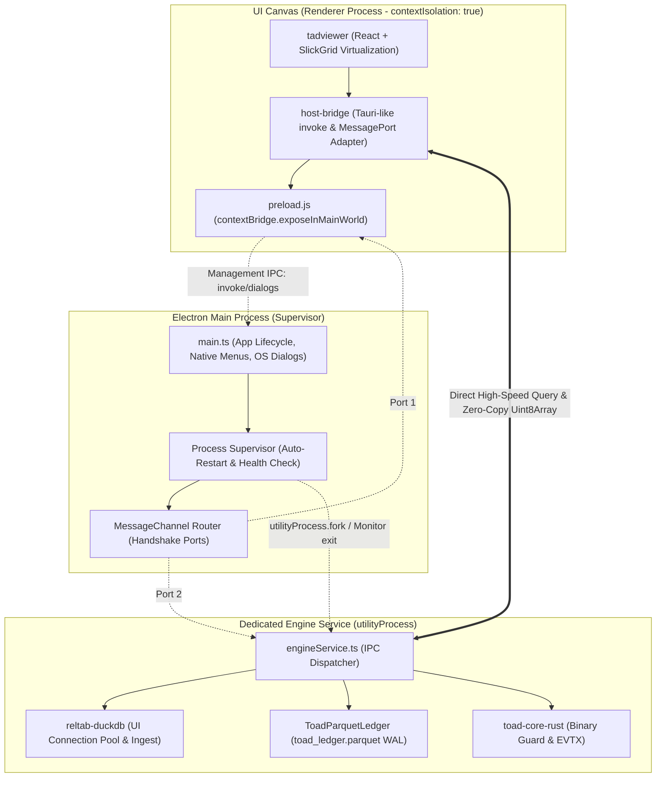

# Kế Hoạch Chi Tiết Chuyển Đổi Sang Mô Hình IPC (Tauri-like Bridge & UtilityProcess)

## 1. Mục Tiêu & Bối Cảnh (Goal Description)

Hiện tại, ứng dụng **Toad (v2.4.6)** đang vận hành theo mô hình kết hợp:
* **Giao diện (UI Renderer)**: Chạy trong tiến trình Chromium Renderer (`tadviewer`), hiển thị lưới dữ liệu SlickGrid ảo hóa.
* **Tiến trình Chính (Main Process)**: Vừa gánh vác vòng đời ứng dụng Electron, vừa trực tiếp quản lý và thực thi DuckDB (UI Driver), quản lý trạng thái Parquet Ledger (`toad_ledger.parquet`) và điều phối hàng đợi.
* **Ingestion Worker**: Chạy trên `child_process` độc lập để bảo vệ sập C++ khi nạp CSV.

### Mục Tiêu Chuyển Đổi:
1. **Tách biệt hoàn toàn tính toán khỏi Main Process**: Đưa toàn bộ động cơ phân tích DuckDB, Parquet Ledger và pipeline xử lý dữ liệu sang một **Dedicated Engine Service** chạy trên **Electron `utilityProcess`**.
2. **Chuẩn hóa Giao thức Tauri-like IPC (`invoke(cmd, args)`)**: Thiết kế tầng cầu nối `host-bridge` tuân thủ nghiêm ngặt mô hình lệnh bất đồng bộ của **Tauri v2** (`invoke<T>(command, payload)`), kết hợp bật `contextIsolation: true` và `preload.js`. Đảm bảo trong tương lai khi chuyển đổi frontend sang Tauri, **100% mã nguồn UI không cần phải viết lại**.
3. **Tối ưu hóa hiệu năng dữ liệu lớn qua MessagePort & Transferable Objects**: Sử dụng kênh `MessagePort` kết nối trực tiếp giữa Renderer và `utilityProcess`, truyền tải metadata qua JSON và dữ liệu cột nặng qua `Uint8Array / ArrayBuffer` dạng Zero-Copy Transferable.
4. **Giám sát & Tự phục hồi (Supervised Auto-Restart)**: Main process đóng vai trò giám sát viên (supervisor); khi `utilityProcess` gặp sự cố sập native C++ hoặc OOM, tự động khởi động lại trong <500ms và khôi phục trạng thái bảng từ Parquet Ledger mà không làm sập ứng dụng.

---

## 2. Các Quyết Định Thiết Kế Đã Thống Nhất (Architecture Decisions)



1. **Runtime Concurrency**: Sử dụng **Electron `utilityProcess`** thay vì Child Process thông thường vì được tích hợp sâu vào V8 loop của Chromium, hỗ trợ `MessagePort` native và cô lập crash hoàn hảo.
2. **Kênh dữ liệu**: 
   - **Management Channel (Main Process IPC)**: Quản lý dialog file, cấu hình window, menu, khởi tạo ban đầu.
   - **Data Query Channel (Direct MessagePort)**: Giao tiếp trực tiếp giữa Renderer và `utilityProcess` để truy vấn SQL, lấy schema, đếm dòng, lấy dữ liệu phân trang.
3. **Giao thức Serialization**: **Hybrid JSON + Uint8Array**:
   - Metadata / Schema: JSON DTO có cấu trúc chặt chẽ.
   - Row / Column Data: Chuyển đổi thành Typed Arrays truyền qua MessagePort với cơ chế Zero-Copy Transfer.
4. **Khôi phục sự cố**: Tự phục hồi dựa trên **Single Source of Truth** (`toad_ledger.parquet`). Khi service hồi sinh, DuckDB snapshot nạp lại toàn bộ registered views trong `<5ms`.

---

## 3. User Review Required (Điểm Cần Người Dùng Chú Ý)

> [!IMPORTANT]
> **Kích hoạt `contextIsolation: true`**:
> Việc chuyển sang `contextIsolation: true` yêu cầu loại bỏ hoàn toàn các lệnh gọi trực tiếp `window.require('electron')` trong mã nguồn UI renderer (`tadviewer`). Tất cả giao tiếp phải đi qua `window.toadBridge` được phơi bày an toàn bởi `preload.js`. Điều này bảo vệ an ninh bộ nhớ và là điều kiện bắt buộc để sau này chạy trên WebView2 của Tauri.

> [!NOTE]
> **Zero Regression Target**:
> Hệ thống hiện tại có bộ kiểm thử 138 test cases (`tests/deep_integration_qa.js`, `tests/smoke_test.js`). Kế hoạch đảm bảo toàn bộ 138/138 test cases tiếp tục vượt qua 100% sau khi chuyển đổi.

---

## 4. Open Questions

Toàn bộ các nhánh rẽ trong cây thiết kế đã được giải quyết triệt để thông qua phiên phỏng vấn `/grill-me`. Không còn câu hỏi mở nào tồn đọng trước khi triển khai.

---

## 5. Kế Hoạch Thay Đổi Chi Tiết (Proposed Changes)

Lộ trình chuyển đổi được chia làm 3 giai đoạn lũy tiến:

---

### Giai Đoạn 1: Chuẩn hóa Giao diện Cầu nối (Tauri-like IPC Abstraction & contextIsolation)

Mục tiêu: Đưa toàn bộ giao tiếp UI về chuẩn `invoke(cmd, args)` của Tauri, tách biệt hoàn toàn Renderer khỏi Node.js runtime.

#### [MODIFY] `packages/host-bridge/src/IHostBridge.ts`
* Mở rộng interface `IHostBridge` bổ sung phương thức lệnh theo chuẩn Tauri:
```typescript
export interface IHostBridge extends TransportClient {
  readonly engineName: "v8" | "tauri";
  
  // Tauri-standard invoke signature
  invokeCmd<T = any>(command: string, payload?: Record<string, any>): Promise<T>;
  
  // Thiết lập kênh MessagePort trực tiếp với Engine Service
  setupDataChannel(port: MessagePort): void;
  ...
}
```

#### [MODIFY] `packages/tad-app/app/preload.js`
* Sử dụng `contextBridge.exposeInMainWorld("toadBridge", ...)` để cung cấp API an toàn cho Renderer, không để lộ đối tượng `ipcRenderer` hay `nodeIntegration`.
* Lắng nghe sự kiện port handshake từ Main process để chuyển tiếp `MessagePort` tới UI.

#### [MODIFY] `packages/host-bridge/src/V8HostAdapter.ts`
* Cập nhật `V8HostAdapter` để sử dụng `window.toadBridge` thay vì gọi trực tiếp `window.electron.ipcRenderer`.

---

### Giai Đoạn 2: Xây Dựng Engine Service với `utilityProcess` & MessagePort

Mục tiêu: Đưa toàn bộ DuckDB, Parquet Ledger và Ingestion pipeline sang tiến trình con riêng.

#### [NEW] `packages/tad-app/app/engineService.ts`
* Điểm vào (entrypoint) cho tiến trình `utilityProcess`.
* Tiếp nhận `MessagePort` từ Main process qua `process.parentPort`.
* Khởi tạo `ToadParquetLedger` và `DuckDBDriver`.
* Điều phối các request truy vấn:
  - `evalQuery`: Chuyển đổi dữ liệu bảng thành mảng nhị phân `Uint8Array` truyền trực tiếp qua MessagePort (Zero-Copy).
  - `rowCount`, `getTableSchema`, `getColumnStatsMap`.
  - Quản lý nạp ngầm file (`MultipleLoadingManager` backend side).

#### [NEW] `packages/tad-app/app/engineSupervisor.ts`
* Quản lý tiến trình `utilityProcess`:
  - Khởi tạo: `utilityProcess.fork(path.join(__dirname, "engineService.js"))`.
  - Thiết lập `MessageChannelMain`: Cấp phát `port1` cho Renderer và `port2` cho `engineService`.
  - Lắng nghe sự kiện `'exit'`: Nếu mã thoát khác 0, tự động khởi động lại và thông báo cho Renderer kết nối lại port mới.

#### [MODIFY] `packages/tad-app/app/main.ts`
* Bật `contextIsolation: true` và `nodeIntegration: false` trong cấu hình `webPreferences` của `BrowserWindow`.
* Loại bỏ việc import trực tiếp DuckDB trong `main.ts`, chuyển quyền sở hữu cho `engineSupervisor`.
* Định tuyến các dialogs hệ thống (Open/Save dialog) qua IPC chuẩn.

#### [MODIFY] `packages/reltab/src/remote/Transport.ts` & `Connection.ts`
* Tối ưu hóa serialization: Khi nhận dữ liệu từ MessagePort, nếu có `ArrayBuffer` đính kèm, tái tạo đối tượng `TableRep` trực tiếp mà không cần qua chuỗi `JSON.parse`.

---

### Giai Đoạn 3: Tự Phục Hồi, Tối Ưu Hóa & Đóng Gói (QA & Benchmark)

#### [MODIFY] `packages/tadviewer/src/ProjectWorkspaceManager.ts` & `MultipleLoadingManager.ts`
* Tinh chỉnh để khi nhận tín hiệu tái kết nối (reconnect) từ `engineSupervisor`, tự động gọi `reconcile` để đồng bộ lại trạng thái hiển thị của các bảng trong chưa đầy 500ms.

#### [MODIFY] `tests/deep_integration_qa.js` & `tests/smoke_test.js`
* Cập nhật harness test để kiểm thử cả 2 chế độ:
  1. Kiểm thử trực tiếp backend qua headless `engineService`.
  2. Kiểm thử end-to-end qua Electron IPC và MessagePort.
* Đảm bảo chỉ số 138/138 tests PASS.

#### [MODIFY] `fastbuild.ps1` & `dist_package.ps1`
* Đảm bảo tệp `engineService.js` được webpack/tsc biên dịch chính xác vào thư mục `app_dist` và được đóng gói đầy đủ vào tệp thực thi `Toad.exe` theo đúng chính sách Zero-Duplicate Binary.

---

## 6. Kế Hoạch Xác Minh (Verification Plan)

### Kiểm Thử Tự Động (Automated Tests)
Chạy lần lượt các bộ kiểm thử tự động tại thư mục gốc:

```powershell
# 1. Kiểm thử TypeScript compilation toàn bộ monorepo
npm run build

# 2. Chạy bộ kiểm thử hợp nhất Toad Test Runner
node run_tests.js --all

# 3. Chạy kiểm thử chuyên sâu về Database Layer & Crash Isolation
node tests/db_layer_qa.js
node tests/deep_integration_qa.js
```

**Tiêu chí thành công**:
- 138/138 tests trong `tests/deep_integration_qa.js` đạt trạng thái PASS.
- Toàn bộ các test case liên quan đến CSV dirty, EVTX Rust decoding và Parquet Ledger hoạt động chính xác.

### Kiểm Thử Thủ Công (Manual Verification)
1. **Kiểm thử Hiển thị & Cuộn dữ liệu**: Mở tệp CSV lớn (>1GB hoặc 10.000.000 dòng), kiểm tra thời gian mở tệp lần đầu và tốc độ chuyển trang (1.000 dòng/trang). Đảm bảo giao diện mượt 60fps không có độ trễ giật lag.
2. **Kiểm thử Khả năng Chịu lỗi (Crash Resilience Test)**:
   - Sử dụng Task Manager kết thúc (Kill Process) tiến trình `utilityProcess` của Toad trong lúc đang xem dữ liệu.
   - **Hiện tượng mong muốn**: Giao diện UI không bị sập; trong vòng <500ms, UI hiển thị thông báo "Động cơ đang tái kết nối...", sau đó dữ liệu bảng tự động nạp lại bình thường nhờ Parquet Ledger.
3. **Kiểm tra Zero-Footprint**: Kiểm tra thư mục `toadAppData_*` đảm bảo không có file rác hoặc tiến trình zombie bị treo lại sau khi đóng ứng dụng.

