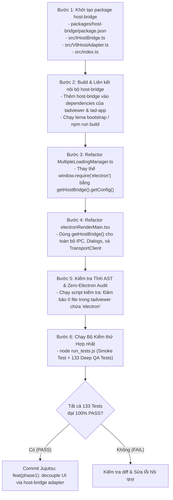

# PHƯƠNG ÁN CHI TIẾT GIAI ĐOẠN 1: CÁCH LY & MODULE HÓA TỪNG CẤU PHẦN (PHASE 1 IMPLEMENTATION PLAN)
> **Tài liệu:** `docs/PHUONG_AN_CHI_TIET_GIAI_DOAN_1_CACH_LY_VA_MODULE_HOA.md`  
> **Dự án:** TOAD - Log & Forensic Data Analysis Platform  
> **Giai đoạn:** Giai đoạn 1 trong Lộ trình Dual-Engine (Tauri vs V8)  
> **Mục tiêu:** Bóc tách triệt để sự phụ thuộc cứng vào Electron trong giao diện (`tadviewer`) và xây dựng lớp Cổng chuyển tiếp chuẩn (`host-bridge`).  
> **Cam kết cốt lõi:** Sau khi hoàn thành Giai đoạn 1, **133/133 test cases trên `run_tests.js` phải đạt 100% PASS** trên nền tảng V8 hiện tại.

---

## I. MỤC TIÊU & PHẠM VI GIAI ĐOẠN 1 (PHASE 1 SCOPE)

### 1.1. Hiện trạng & Vấn đề Cần Giải Quyết
Hiện tại, mã nguồn giao diện (`tadviewer` và `tad-app/src`) đang tồn tại một số điểm gắn chặt trực tiếp vào Electron:
1. `MultipleLoadingManager.ts` gọi trực tiếp `window.require("electron").ipcRenderer.invoke("getToadConfig")`.
2. `electronRenderMain.tsx` nhúng trực tiếp các API `electron.clipboard`, `electron.shell`, `electron.ipcRenderer`.
3. Trình xử lý ngoại lệ cửa sổ (`window.addEventListener("error")`) tự `require("electron")` để bật thông báo lỗi.

**Hậu quả:** Khi chạy trên bất kỳ môi trường nào khác ngoài Electron (như Tauri), giao diện sẽ lập tức ném lỗi ngoại lệ, sập ứng dụng và mất phản hồi.

### 1.2. Mục tiêu Nghiệp vụ của Giai đoạn 1
1. **Xây dựng package mới `packages/host-bridge` (Ring 2):** Cung cấp interface `IHostBridge` bao hàm toàn bộ tương tác giữa Giao diện và Hệ điều hành.
2. **Triển khai `V8HostAdapter`:** Hiện thực hóa toàn bộ interface `IHostBridge` trên nền tảng V8 / Electron hiện tại.
3. **Làm sạch 100% `tadviewer`:** Không còn bất kỳ dòng code nào import hay gọi `require("electron")`.
4. **Giữ nguyên 100% tính năng của Toad v2.1.6:** Người dùng không nhận thấy bất kỳ sự khác biệt nào về giao diện hay tốc độ, toàn bộ 133 test cases kiểm thử hồi quy tiếp tục ĐẠT 100%.

---

## II. MA TRẬN PHÂN LOẠI & THAY ĐỔI CẤU PHẦN

| Cấu phần / Package | Phân tầng Ring | Trạng thái can thiệp | Nội dung thực hiện |
| :--- | :---: | :---: | :--- |
| **`packages/reltab`** | **Ring 0** | 🔒 **Khóa (Giữ nguyên)** | Đã là thuần TypeScript, giữ nguyên interface `TransportClient`. |
| **`packages/reltab-duckdb`** | **Ring 1** | 🔒 **Khóa (Giữ nguyên)** | Dual-Engine DuckDB (`uiDbc`, `ingestDbc`), không phụ thuộc UI. |
| **`packages/reltab-fs`** | **Ring 1** | 🔒 **Khóa (Giữ nguyên)** | File system scanner, Parquet converter và hàng đợi SJF. |
| **`packages/host-bridge`** | **Ring 2** | ✨ **TẠO MỚI** | Chứa `IHostBridge.ts`, `V8HostAdapter.ts` và factory `index.ts`. |
| **`packages/tadviewer`** | **Ring 3** | 🛠️ **Refactor sạch** | Gỡ bỏ `window.require("electron")` trong `MultipleLoadingManager.ts`. |
| **`packages/tad-app/src`** | **Ring 3** | 🛠️ **Refactor sạch** | Tách `electronRenderMain.tsx` thành `AppBootstrapper.tsx` sử dụng `V8HostAdapter`. |

---

## III. THIẾT KẾ CHI TIẾT PACKAGE TẠO MỚI: `packages/host-bridge`

Tạo thư mục mới tại: `tad-master/packages/host-bridge/`

```
packages/host-bridge/
├── package.json
├── tsconfig.json
└── src/
    ├── IHostBridge.ts         # Hợp đồng giao tiếp trừu tượng
    ├── V8HostAdapter.ts       # Adapter cho Electron / Node.js V8 Runtime
    └── index.ts               # Factory cung cấp instance singleton
```

### 3.1. Hợp đồng Giao tiếp Trừu tượng: `IHostBridge.ts`
```typescript
import { TransportClient } from "reltab";

export interface FileFilter {
  name: string;
  extensions: string[];
}

export interface OpenDialogOptions {
  title?: string;
  defaultPath?: string;
  filters?: FileFilter[];
  directory?: boolean;
  multiple?: boolean;
}

export interface SaveDialogOptions {
  title?: string;
  defaultPath?: string;
  filters?: FileFilter[];
}

export interface AppConfigDTO {
  general: {
    viewer: string;
    language: string;
    page_size: number;
    max_concurrent_files: number;
    max_concurrent_gb: number;
  };
  duckdb: {
    max_memory: string;
    threads: number;
    background_threads: string | number;
    add_raw_event: boolean;
  };
  parquet: {
    compression: string;
    row_group_size: number;
  };
  system: {
    temp_cleanup: boolean;
    binary_guard: boolean;
  };
}

export interface IHostBridge extends TransportClient {
  readonly engineName: 'v8' | 'tauri';

  // 1. Quản lý cấu hình ứng dụng
  getConfig(): Promise<AppConfigDTO>;

  // 2. Hộp thoại hệ thống
  showOpenDialog(options: OpenDialogOptions): Promise<string[] | null>;
  showSaveDialog(options: SaveDialogOptions): Promise<string | null>;
  showErrorDialog(title: string, message: string, fatal?: boolean): Promise<void>;

  // 3. Quản lý cửa sổ & Trình duyệt bên ngoài
  openExternal(url: string): Promise<void>;
  copyToClipboard(text: string): void;
  openNewWindow(dsPath: any): Promise<void>;

  // 4. Lắng nghe sự kiện từ Backend (Menu clicks, Hotkeys, Ingest events)
  onEvent<T = any>(channel: string, listener: (data: T) => void): () => void;
  sendEvent(channel: string, payload?: any): void;

  // 5. Quản lý giao diện & Theme
  setTheme(theme: 'light' | 'dark'): void;
  getTheme(): 'light' | 'dark';
}
```

### 3.2. Hiện thực hóa Adapter cho V8: `V8HostAdapter.ts`
```typescript
import { IHostBridge, OpenDialogOptions, SaveDialogOptions, AppConfigDTO } from "./IHostBridge";

export class V8HostAdapter implements IHostBridge {
  readonly engineName = 'v8' as const;
  private ipc: any;
  private clipboard: any;
  private shell: any;

  constructor() {
    if (typeof window !== "undefined") {
      const electron = (window as any).electron || (window as any).require?.("electron");
      if (electron) {
        this.ipc = electron.ipcRenderer;
        this.clipboard = electron.clipboard;
        this.shell = electron.shell;
      }
    }
  }

  // TransportClient interface for reltab
  async invoke(functionName: string, req: any): Promise<any> {
    if (!this.ipc) throw new Error("[V8HostAdapter] ipcRenderer không khả dụng");
    return await this.ipc.invoke(functionName, req);
  }

  async getConfig(): Promise<AppConfigDTO> {
    return await this.invoke("getToadConfig", {});
  }

  async showOpenDialog(options: OpenDialogOptions): Promise<string[] | null> {
    return await this.invoke("dialog:showOpenDialog", options);
  }

  async showSaveDialog(options: SaveDialogOptions): Promise<string | null> {
    return await this.invoke("dialog:showSaveDialog", options);
  }

  async showErrorDialog(title: string, message: string, fatal = false): Promise<void> {
    return await this.invoke("errorDialog", title, message, fatal);
  }

  async openExternal(url: string): Promise<void> {
    if (this.shell) {
      await this.shell.openExternal(url);
    }
  }

  copyToClipboard(text: string): void {
    if (this.clipboard) {
      this.clipboard.writeText(text);
    }
  }

  async openNewWindow(dsPath: any): Promise<void> {
    return await this.invoke("newWindowFromDSPath", dsPath);
  }

  onEvent<T = any>(channel: string, listener: (data: T) => void): () => void {
    if (!this.ipc) return () => {};
    const wrappedHandler = (_: any, data: T) => listener(data);
    this.ipc.on(channel, wrappedHandler);
    return () => {
      this.ipc.removeListener(channel, wrappedHandler);
    };
  }

  sendEvent(channel: string, payload?: any): void {
    if (this.ipc) {
      this.ipc.send(channel, payload);
    }
  }

  setTheme(theme: 'light' | 'dark'): void {
    document.documentElement.className = `theme-${theme}`;
    localStorage.setItem("toad-theme-v2", theme);
  }

  getTheme(): 'light' | 'dark' {
    return (localStorage.getItem("toad-theme-v2") as 'light' | 'dark') || 'light';
  }
}
```

### 3.3. Factory Quản lý Singleton: `index.ts`
```typescript
import { IHostBridge } from "./IHostBridge";
import { V8HostAdapter } from "./V8HostAdapter";

let activeBridge: IHostBridge | null = null;

export function getHostBridge(): IHostBridge {
  if (!activeBridge) {
    // Trong Giai đoạn 1, V8HostAdapter là adapter mặc định duy nhất
    activeBridge = new V8HostAdapter();
  }
  return activeBridge;
}

export function setHostBridge(customBridge: IHostBridge): void {
  activeBridge = customBridge;
}

export * from "./IHostBridge";
export * from "./V8HostAdapter";
```

---

## IV. KẾ HOẠCH REFACTOR CHI TIẾT TỪNG TẬP TIN

### 4.1. File `packages/tadviewer/src/MultipleLoadingManager.ts`
* **Vị trí hiện tại (Dòng 115-130):**
  ```typescript
  // CŨ (Phụ thuộc cứng Electron):
  const electron = typeof window !== "undefined" && (window as any).require ? (window as any).require("electron") : null;
  if (electron && electron.ipcRenderer) {
    const cfg = await electron.ipcRenderer.invoke("getToadConfig");
    ...
  }
  ```
* **Thay thế bằng:**
  ```typescript
  // MỚI (Độc lập 100% qua IHostBridge):
  import { getHostBridge } from "host-bridge";
  
  private async loadConfig() {
    try {
      const bridge = getHostBridge();
      const cfg = await bridge.getConfig();
      if (cfg && cfg.general) {
        this.setConfig({
          maxConcurrentFiles: cfg.general.max_concurrent_files,
          maxConcurrentGB: cfg.general.max_concurrent_gb,
        });
      }
    } catch (err) {
      // Fallback giữ nguyên giá trị mặc định
    }
  }
  ```

### 4.2. File `packages/tad-app/src/electronRenderMain.tsx`
* **Bắt lỗi Window Uncaught Error & Promise Rejection (Dòng 11-36):**
  * Thay vì tự `require("electron")`, chuyển sang gọi `getHostBridge().showErrorDialog()`.
* **Khởi tạo kết nối Remote Connection (Dòng 55-60):**
  * Thay vì khởi tạo `new ElectronTransportClient()`, sử dụng trực tiếp `getHostBridge()` (vì `IHostBridge` đã kế thừa `TransportClient`).
* **Mở cửa sổ mới & Phím tắt:**
  * Chuyển `ipcRenderer.invoke("newWindowFromDSPath")` thành `getHostBridge().openNewWindow(dsPath)`.
  * Chuyển `ipcRenderer.on(...)` thành `getHostBridge().onEvent(...)`.

---

## V. CÁC BƯỚC THỰC HIỆN TUẦN TỰ (STEP-BY-STEP EXECUTION ROADMAP)



---

## VI. BỘ TIÊU CHUẨN NGHIỆM THU GIAI ĐOẠN 1 (GATE 1 ACCEPTANCE CRITERIA)

Để nghiệm thu thành công Giai đoạn 1 và sẵn sàng chuyển sang Giai đoạn 2 (Tạo Shell Tauri), hệ thống bắt buộc phải thỏa mãn **4 Tiêu chí Cứng**:

### Tiêu chí 1: Kiểm toán Không còn Electron trong Renderer (Zero-Electron Audit)
* Chạy script quét toàn bộ thư mục `packages/tadviewer/src`:
  ```powershell
  Get-ChildItem -Path .\tad-master\packages\tadviewer\src -Recurse -File | Select-String -Pattern "require\(['""]electron['""]\)|from ['""]electron['""]"
  ```
* **Kết quả bắt buộc:** Trả về **0 kết quả** (Rỗng).

### Tiêu chí 2: Tính độc lập của Gói `host-bridge`
* `packages/host-bridge` được biên dịch TypeScript thành công (`tsc -b`).
* `IHostBridge` cung cấp đầy đủ các phương thức thay thế cho toàn bộ các lệnh gọi IPC hiện có của frontend.

### Tiêu chí 3: Bộ Kiểm Thử Hợp Nhất 100% PASS
* Chạy trình kiểm thử hợp nhất tại thư mục gốc:
  ```powershell
  node run_tests.js
  ```
* **Kết quả bắt buộc:**
  * Smoke Test: **PASS (100% HEALTHY)**.
  * Deep Integration QA Test: **133 / 133 TEST CASES PASS (100%)** trên toàn bộ Suites A đến BB.

### Tiêu chí 4: Khởi Chạy Ứng Dụng Thực Tế (Runtime Live Verification)
* Chạy thử bản thực thi `Toad 2.1.6.exe`:
  * Mở tệp CSV/JSONL mẫu hiển thị đầy đủ bảng SlickGrid.
  * Mở hộp thoại `Regex Extractor` và chuyển đổi Theme Dark/Light mượt mà.
  * Console không xuất hiện bất kỳ cảnh báo ngoại lệ unhandled rejection nào.

---

## VII. KẾ HOẠCH DỰ PHÒNG & QUẢN TRỊ RỦI RO (ROLLBACK PLAN)

* Mọi thay đổi trong Giai đoạn 1 được thực hiện trên nhánh làm việc của Jujutsu (`jj`).
* Nếu trong quá trình refactor phát sinh lỗi làm đứt gãy 133 test cases, ta có thể dùng lệnh:
  ```powershell
  jj restore -r @-
  ```
  để khôi phục ngay lập tức về trạng thái hoàn hảo của bản phát hành Toad v2.1.6 mà không để lại bất kỳ rủi ro nào cho hệ thống đang vận hành.
