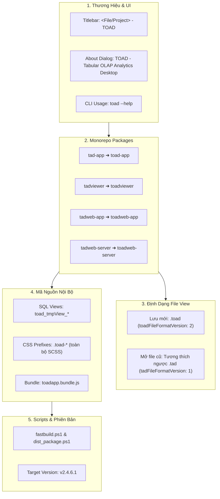

# Phương Án Chi Tiết: Chuyển Đổi Toàn Bộ "TAD" Sang "TOAD" (Tabular OLAP Analytics Desktop)

**Phiên bản mục tiêu**: `v2.4.6.1` (Áp dụng chuẩn Auto 4th-Digit Patch theo `AGENTS.md`)  
**Tên sản phẩm chuẩn hóa**: **TOAD - Tabular OLAP Analytics Desktop**  
**Trạng thái**: Đã thống nhất toàn diện qua phỏng vấn thiết kế (`/grill-me`), sẵn sàng thực thi.

---

## 1. Mục Tiêu & Bối Cảnh (Goal & Context)

Toad ban đầu xuất phát từ bản fork của Tad (tadviewer do Antony Courtney phát triển), sau đó được tái cấu trúc mạnh mẽ thành một công cụ phân tích Big Data Log và an ninh thông tin (DFIR). Tuy nhiên, trong mã nguồn vẫn còn đan xen các định danh cũ mang tên `tad` (tên package, bundle name, CSS class, SQL view prefix, định dạng file `.tad`).

### Mục Tiêu Đợt Nâng Cấp:
1. **Thống nhất bản sắc thương hiệu độc lập**: Chuẩn hóa tên gọi thành **TOAD** với tên viết tắt đầy đủ mang ý nghĩa kỹ thuật: **Tabular OLAP Analytics Desktop**.
2. **Tái cấu trúc mã nguồn toàn diện (Full Rebrand)**: Đổi tên packages trong Monorepo, bundles Webpack, các định danh nội bộ SQL và CSS.
3. **Bảo tồn tính tương thích ngược (Backward Compatibility)**: Hỗ trợ mở và tự động nâng cấp (transparent migration) các file lưu trữ `.tad` cũ của người dùng mà không gây lỗi.
4. **Tuyệt đối không gây hồi quy (Zero Regression)**: Đảm bảo toàn bộ 138/138 integration test cases tiếp tục PASS 100% và quy trình đóng gói `fastbuild.ps1` tạo ra binary `Toad.exe` duy nhất.

---

## 2. Các Quyết Định Thiết Kế Đã Thống Nhất (/grill-me Summary)



1. **Phạm vi đổi tên**: **Toàn diện có tương thích ngược (Full Rebrand + Backward Compatible)**.
2. **Cấu trúc thư mục đĩa**: Giữ nguyên tên thư mục gốc `tad-master`, đổi tên toàn bộ thư mục package con bên trong (`packages/toad-app`, `packages/toadviewer`,...).
3. **Định dạng file cấu hình/view**: Mặc định lưu đuôi `.toad` với key `toadFileFormatVersion: 2`, đồng thời hỗ trợ đọc mượt mà định dạng `.tad` cũ (`tadFileFormatVersion: 1`).
4. **Phong cách hiển thị Titlebar**: Tối giản & tinh tế (`<Tên file/Project> - TOAD`). Chuỗi đầy đủ *"TOAD - Tabular OLAP Analytics Desktop"* hiển thị trong Help > About, metadata và CLI `--help`.
5. **Định danh nội bộ**: Đổi triệt để 100% cả CSS classes (`.toad-*`), SCSS selectors, SQL Temporary Views (`toad_tmpView_*`) và Webpack bundle name (`toadapp.bundle.js`).
6. **Phiên bản ấn định**: `v2.4.6.1` tuân thủ tiêu chuẩn auto 4th-digit patch trong `AGENTS.md`.

---

## 3. Ma Trận Rà Soát Chi Tiết Các Tệp Cần Chuyển Đổi

### 3.1. Tầng Packages & Monorepo Configuration
* **Đổi tên thư mục**:
  - `tad-master/packages/tad-app` ➔ `tad-master/packages/toad-app`
  - `tad-master/packages/tadviewer` ➔ `tad-master/packages/toadviewer`
  - `tad-master/packages/tadweb-app` ➔ `tad-master/packages/toadweb-app`
  - `tad-master/packages/tadweb-server` ➔ `tad-master/packages/toadweb-server`
* **`tad-master/packages/toad-app/package.json`**:
  - Đổi `"name": "toad-app"`
  - Đổi dependency: `"toadviewer": "^0.12.0"`
  - Cập nhật build script: `"build:toadviewer-assets"`
  - Cập nhật file associations: hỗ trợ cả `.toad` và `.tad`
* **`tad-master/packages/toadviewer/package.json`**:
  - Đổi `"name": "toadviewer"`
  - Đổi `"main": "dist/toadviewer.js"`, `"types": "dist/toadviewer.d.ts"`
* **`tad-master/package.json` & `lerna.json`**:
  - Cập nhật danh sách packages và scripts bootstrap.

### 3.2. Tầng Import & Mã Nguồn TypeScript
* **Cập nhật Import toàn dự án**:
  - `import * as tadviewer from "tadviewer"` ➔ `import * as toadviewer from "toadviewer"`
  - `from "tadviewer"` ➔ `from "toadviewer"`
* **`packages/toad-app/src/openParams.ts` & `electronRenderMain.tsx`**:
  - Mở rộng kiểu dữ liệu:
    ```typescript
    export type OpenType = "fspath" | "toad" | "tad" | "dspath" | "empty";
    ```
  - Xử lý nạp file tương thích ngược:
    ```typescript
    case "toad":
    case "tad":
      const parsedFileState = JSON.parse(openParams.fileContents!);
      const isLegacy = parsedFileState.tadFileFormatVersion === 1 || !parsedFileState.toadFileFormatVersion;
      if (isLegacy) {
        log.info("Phát hiện định dạng Tad cũ, tự động nâng cấp sang Toad View...");
        // Auto-migrate targetPath và viewParams
      }
    ```
* **`packages/toad-app/app/main.ts` & `appWindow.ts`**:
  - Tiêu đề cửa sổ mặc định: `"TOAD"`
  - File Filter khi Open/Save:
    - `"TOAD View Files (*.toad)"` (ưu tiên hàng đầu)
    - `"Legacy TAD View Files (*.tad)"` (hỗ trợ đọc)
  - About dialog: *"TOAD - Tabular OLAP Analytics Desktop (v2.4.6.1)"*

### 3.3. Tầng SQL Views & DuckDB Driver
* **`packages/reltab-duckdb/src/reltab-duckdb.ts`**:
  - Đổi hàm sinh tên view nội bộ:
    ```typescript
    let viewCounter = 0;
    const genViewName = (): string => `toad_tmpView_${viewCounter++}`;
    ```
  - Đảm bảo trong câu lệnh `show-queries` và DuckDB catalog hiển thị chuẩn tiền tố `toad_`.

### 3.4. Tầng CSS / SCSS & DOM Styling
* **Đổi tên class CSS trong `toadviewer/src`**:
  - `.tad-viewer` ➔ `.toad-viewer`
  - `.tad-sidebar` ➔ `.toad-sidebar`
  - `.tad-activity-bar` ➔ `.toad-activity-bar`
  - `.tad-filter-pane` ➔ `.toad-filter-pane`
* **Đồng bộ hóa các tệp SCSS/CSS**:
  - `packages/toadviewer/src/components/*.tsx`
  - `packages/toadviewer/src/slickgrid.scss`
  - `packages/toad-app/src/app.css`

### 3.5. Tầng Webpack & Build Packaging Pipeline
* **Webpack Config (`packages/toad-app/tools/webpack.config.js`)**:
  - Đổi tên bundle đầu ra: `toadapp.bundle.js` (thay vì `tadapp.bundle.js`).
  - Đổi entrypoint và alias resolution sang `toadviewer`.
* **`fastbuild.ps1`**:
  - Cập nhật biến `$appDir = "$rootDir\tad-master\packages\toad-app"`
  - Cập nhật build step: `Building toadviewer...`, `Webpack toad-app...`
  - Cập nhật kiểm tra: `Test-Path "$appDir\dist\toadapp.bundle.js"`
* **`dist_package.ps1` & `package_release.ps1`**:
  - Đồng bộ tên bundle và package references.

### 3.6. Tầng Test Suite Runner
* **`run_tests.js`**:
  - Đảm bảo test runner nhận diện các packages mới `toad-app` và `toadviewer`.
* **`tests/deep_integration_qa.js` & `tests/smoke_test.js`**:
  - Kiểm tra tính hợp lệ của việc đọc ghi file `.toad` mới và `.tad` cũ.
  - Đảm bảo 138/138 test cases PASS.

---

## 4. Kế Hoạch Triển Khai (Execution Phases)

| Giai Đoạn | Nội Dung Công Việc | Rủi Ro / Lưu Ý |
| :--- | :--- | :--- |
| **Giai đoạn 1** | Đổi tên thư mục packages trên đĩa & cập nhật `package.json`, `lerna.json`. | Chạy bootstrap lại các symlink liên kết nội bộ. |
| **Giai đoạn 2** | Cập nhật toàn bộ các câu lệnh `import` TypeScript từ `tadviewer` sang `toadviewer`. | Đảm bảo TypeScript compile (`tsc --noEmit`) không có lỗi. |
| **Giai đoạn 3** | Cập nhật SQL view prefix (`toad_tmpView_*`), CSS/SCSS selectors (`.toad-*`) và Webpack bundle name (`toadapp.bundle.js`). | Rà soát DOM UI không bị xô lệch style. |
| **Giai đoạn 4** | Cập nhật bộ nạp `openParams.ts` (hỗ trợ kép `.toad` và `.tad`), cập nhật Titlebar, About dialog và CLI usage. | Thử nghiệm mở file `.tad` cũ và lưu file `.toad` mới. |
| **Giai đoạn 5** | Cập nhật `fastbuild.ps1`, `dist_package.ps1`, `run_tests.js`. Chạy toàn bộ 138 test cases và build bản thực thi `Toad.exe`. | Tuân thủ chính sách Zero-Duplicate Binary và phiên bản `v2.4.6.1`. |

---

## 5. Kế Hoạch Xác Minh & Nghiệm Thu (Verification Plan)

1. **Biên dịch TypeScript**:
   - `packages/host-bridge`: `npm run build`
   - `packages/reltab`: `npm run build`
   - `packages/reltab-duckdb`: `npm run build`
   - `packages/toadviewer`: `npm run build`
   - `packages/toad-app`: `npm run build`
2. **Kiểm thử Tự Động (Automated QA)**:
   - Chạy lệnh: `node run_tests.js --all`
   - **Chỉ tiêu**: PASS 138/138 tests, không có test nào bị fail hoặc timeout.
3. **Kiểm thử Đóng Gói (Build Pipeline)**:
   - Chạy lệnh: `.\fastbuild.ps1`
   - **Chỉ tiêu**: Sinh ra `Toad.exe` tại thư mục gốc trong thời gian < 30 giây, khởi chạy thành công.
4. **Kiểm thử Định Dạng File**:
   - Lưu một workspace hiện tại ra định dạng `.toad`. Mở lại và kiểm tra tính toàn vẹn của bộ lọc và pivot.
   - Mở một tệp `.tad` cũ (nếu có trong sample data) và kiểm tra tính năng auto-upgrade.

