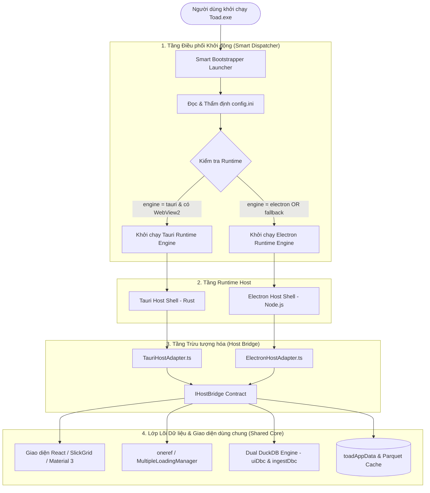
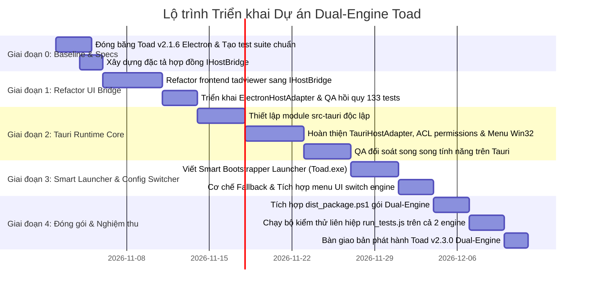

# PHƯƠNG ÁN KỸ THUẬT & ĐẶC TẢ BA: KIẾN TRÚC DUAL-ENGINE (ELECTRON & TAURI) CHUYỂN ĐỔI LINH HOẠT QUA CONFIG.INI
> **Dự án:** TOAD - Log & Forensic Data Analysis Platform  
> **Tài liệu:** `docs/PHUONG_AN_DUAL_ENGINE_CONFIG_SWITCHER.md`  
> **Mục tiêu:** Cho phép người dùng chuyển đổi linh hoạt giữa 2 runtime engine (**Electron** và **Tauri**) thông qua thiết lập `config.ini` mà vẫn dùng chung 1 bộ giao diện, 1 hệ thống dữ liệu DuckDB, và 1 profile người dùng duy nhất.  
> **Phiên bản baseline ổn định:** Toad v2.1.6  
> **Trạng thái:** Kế hoạch kiến trúc & Đặc tả yêu cầu kỹ thuật (BA & Technical Design)

---

## I. TỔNG QUAN & LÝ DO NGHIỆP VỤ (BUSINESS JUSTIFICATION)

### 1.1. Bối cảnh & Bài toán
Trong thực tế phân tích điều tra số (DFIR) và giám sát an toàn thông tin (SOC):
* **Nhóm Chuyên viên Điều tra Chuyên sâu (Power Analysts):** Thường xuyên mở các tập tin log khổng lồ (20GB - 40GB CSV/JSONL/Parquet), cần sự ổn định tuyệt đối của Chromium độc lập, không bị ảnh hưởng bởi phiên bản hệ điều hành hay các bản cập nhật Windows Edge WebView2. Họ ưu tiên **Electron**.
* **Nhóm Chuyên viên Triage / Máy Cấu hình Giới hạn (Field/Low-spec Users):** Thường sử dụng laptop hiện trường hoặc máy ảo (VM) có RAM hạn chế (4GB - 8GB), cần ứng dụng khởi động tức thì (< 0.5s), chiếm dụng RAM tối thiểu để dành bộ nhớ cho máy ảo khác. Họ ưu tiên **Tauri**.

### 1.2. Mục tiêu cốt lõi
1. **Một bản cài đặt duy nhất (Unified Package):** Người dùng chỉ cần tải 1 ứng dụng duy nhất, không phải chọn tải 2 bản tách rời phức tạp.
2. **Chuyển đổi tức thì qua `config.ini`:** Chỉ cần thay đổi 1 dòng cấu hình `engine = electron` hoặc `engine = tauri` (hoặc chuyển trong menu Settings của UI), ứng dụng sẽ tự động khởi chạy với engine tương ứng ở lần mở tiếp theo.
3. **Bảo toàn 100% dữ liệu & cài đặt:** Cả 2 engine dùng chung thư mục dữ liệu `toadAppData`, chung lịch sử mở file, chung filter presets, chung cache Parquet và cấu hình giao diện Material 3.
4. **Cơ chế Fallback an toàn (Fail-safe Graceful Degradation):** Nếu người dùng chọn `tauri` nhưng môi trường Windows bị lỗi WebView2 hoặc bị chặn quyền, hệ thống sẽ tự động fallback về `electron` để người dùng không bao giờ bị gián đoạn công việc.

---

## II. ĐẶC TẢ NGHIỆP VỤ (BUSINESS ANALYSIS - USER STORIES & ACCEPTANCE CRITERIA)

### User Story 1: Chuyển đổi Engine qua file `config.ini`
* **Mô tả:** Là một người dùng, tôi muốn mở file `config.ini` và đặt `engine = tauri` hoặc `engine = electron` để Toad tự khởi động bằng engine tôi mong muốn.
* **Acceptance Criteria (AC-01):**
  * `AC-01.1`: File `config.ini` hỗ trợ mục `[runtime]` với các giá trị: `engine = auto | electron | tauri`.
  * `AC-01.2`: Giá trị mặc định là `engine = electron` (đảm bảo an toàn 100% cho toàn bộ người dùng hiện tại).
  * `AC-01.3`: Nếu nhập giá trị không hợp lệ (ví dụ `engine = abc`), hệ thống kích hoạt cơ chế Auto-Heal, tự phục hồi về `electron` và ghi log cảnh báo.

### User Story 2: Chuyển đổi Engine trực tiếp từ Menu UI
* **Mô tả:** Là một người dùng không muốn can thiệp file text, tôi muốn vào menu `Help` -> `Runtime Engine` hoặc `Settings` để bấm chọn engine và nhận thông báo khởi động lại.
* **Acceptance Criteria (AC-02):**
  * `AC-02.1`: Giao diện hiển thị trạng thái engine hiện tại kèm biểu tượng: `Current Engine: Electron (Chromium 126)` hoặc `Current Engine: Tauri (WebView2)`.
  * `AC-02.2`: Khi người dùng bấm chuyển sang engine khác, UI hiển thị dialog xác nhận: *"Thay đổi sẽ có hiệu lực sau khi khởi động lại Toad. Bạn có muốn khởi động lại ngay?"*.
  * `AC-02.3`: Khi bấm xác nhận, UI ghi cập nhật vào `config.ini` và tự khởi động lại phần mềm.

### User Story 3: Cơ chế Tự động Fallback khi thiếu môi trường WebView2
* **Mô tả:** Khi chọn chế độ Tauri trên các máy tính Windows Server hoặc máy offline bị khóa không có WebView2 Runtime, phần mềm không được sập (crash) mà phải tự mở bằng Electron.
* **Acceptance Criteria (AC-03):**
  * `AC-03.1`: Launcher kiểm tra sự tồn tại của Edge WebView2 Runtime trên máy qua Registry và DLL kiểm thử.
  * `AC-03.2`: Nếu thiếu WebView2 và cấu hình đang là `engine = tauri`, launcher tự động rơi về (fallback) `electron`, mở ứng dụng thành công và hiển thị toast thông báo nhẹ cho người dùng.

### User Story 4: Nhất quán Tuyệt đối về Tính năng & Trải nghiệm (Parity Guarantee)
* **Mô tả:** Người dùng khi chuyển đổi giữa 2 engine phải thấy cùng 1 giao diện, cùng hệ thống phím tắt, cùng tốc độ parse dữ liệu DuckDB, và menu đầy đủ.
* **Acceptance Criteria (AC-04):**
  * `AC-04.1`: Menu bar chuẩn Win32 ("File Edit View Help") hiển thị đầy đủ và hoạt động giống hệt nhau trên cả 2 engine.
  * `AC-04.2`: Toàn bộ 133 use case kiểm thử (Suites A đến BB) đạt 100% PASS trên cả 2 runtime.

---

## III. KIẾN TRÚC KỸ THUẬT TỔNG THỂ (TECHNICAL ARCHITECTURE)



---

## IV. CẤU HÌNH CONFIG.INI CHUẨN HÓA

Bổ sung section `[runtime]` vào `config.ini` ở thư mục gốc:

```ini
[general]
viewer = toad
language = en
page_size = 1000
max_concurrent_files = 4
max_concurrent_gb = 1.0

[runtime]
; Lựa chọn engine khởi chạy:
; - electron : Sử dụng nền tảng Electron (Chromium + Node.js) - Độ ổn định và tương thích cao nhất (Mặc định).
; - tauri    : Sử dụng nền tảng Tauri v2 (Rust + WebView2) - Tối ưu dung lượng RAM và khởi động siêu tốc.
; - auto     : Tự động phát hiện (ưu tiên Tauri nếu máy đủ điều kiện, fallback Electron).
engine = electron

; Tự động fallback về Electron nếu engine tauri gặp sự cố khởi tạo
auto_fallback = true

[duckdb]
max_memory = auto
threads = 0
background_threads = auto
add_raw_event = false

[parquet]
compression = snappy
row_group_size = 25000

[system]
temp_cleanup = true
binary_guard = true
```

---

## V. THIẾT KẾ CHI TIẾT TỪNG PHÂN HỆ

### 5.1. Phân hệ 1: Smart Bootstrapper Launcher (`Toad.exe` - C/Rust Native Launcher)
* **Kích thước:** Siêu nhẹ (~1.5 MB).
* **Nhiệm vụ:**
  1. Đọc file `config.ini` (nằm cạnh file `.exe` hoặc trong `toadAppData`).
  2. Parse key `[runtime] engine`.
  3. Kiểm tra tính sẵn sàng của môi trường:
     * Kiểm tra khóa Registry: `HKLM\SOFTWARE\WOW6432Node\Microsoft\EdgeUpdate\Clients\{F3017226-FE2A-4295-8BDF-00C3A9A7E4C5}` (WebView2).
  4. Quyết định nhánh thực thi:
     * Nhánh 1: Gọi `engines/tauri/toad-tauri.exe`.
     * Nhánh 2: Gọi `engines/electron/Toad.exe`.
  5. Giám sát Process (Supervisor): Nếu process con sập ngay lập tức (< 1s với exit code bất thường), Launcher ghi log `crash_fallback.log`, cập nhật tạm sang Electron và mở lại ngay để người dùng không bị "chết đứng".

### 5.2. Phân hệ 2: Giao diện trừu tượng hóa Host Bridge (`IHostBridge`)
Để loại bỏ 100% sự phụ thuộc trực tiếp vào `electron.ipcRenderer` trong UI, toàn bộ tương tác OS được bọc qua interface:

```typescript
// packages/tadviewer/src/bridge/IHostBridge.ts

export interface OpenDialogOptions {
  title?: string;
  defaultPath?: string;
  filters?: { name: string; extensions: string[] }[];
  properties?: ('openFile' | 'openDirectory' | 'multiSelections')[];
}

export interface IHostBridge {
  readonly engineType: 'electron' | 'tauri';
  
  // File dialogs
  showOpenDialog(options: OpenDialogOptions): Promise<{ canceled: boolean; filePaths: string[] }>;
  
  // Window management & Menus
  setApplicationMenu(menuDef: AppMenuTemplate): void;
  setTheme(theme: 'light' | 'dark'): void;
  restartAppWithEngine(targetEngine: 'electron' | 'tauri'): Promise<void>;
  
  // Data Query IPC Contract
  invokeQuery(channel: string, payload: any): Promise<any>;
  onEvent(channel: string, listener: (data: any) => void): () => void;
}
```

* Khi ứng dụng khởi động trong Electron: Nạp `ElectronHostAdapter` (gọi `ipcRenderer.invoke`).
* Khi ứng dụng khởi động trong Tauri: Nạp `TauriHostAdapter` (gọi `@tauri-apps/api/core` `invoke`).
* **Frontend React và SlickGrid không quan tâm runtime là gì, chỉ gọi qua `getBridge()`**.

### 5.3. Phân hệ 3: Khắc phục triệt để các Root Cause đã gặp của Tauri
Trong bản thử nghiệm trước đó, Tauri gặp 5 vấn đề cốt lõi. Phương án mới giải quyết dứt điểm:

| Root Cause cũ | Nguyên nhân gốc rễ | Giải pháp kỹ thuật trong phương án Dual-Engine |
| :--- | :--- | :--- |
| **RC 1: Lỗi Menu Win32 biến mất** | Tauri trên Windows mặc định không render menu cổ điển Win32 giống Chromium mà cần gọi Win32 API riêng. | Sử dụng `tauri::menu::MenuBuilder` trong Rust với đầy đủ accelerator (`Ctrl+O`, `Ctrl+F`, `F11`) khớp 100% với `appMenu.ts` của Electron. |
| **RC 2: Promise Rejection ACL** | Thiếu file cấp quyền `capabilities/default.json` của Tauri v2 cho plugin event. | Khai báo chuẩn ACL: `"permissions": ["core:default", "core:event:listen", "core:event:emit", "dialog:default"]`. |
| **RC 3: Mở file container bị sai** | `reltab-fs` trả về `isContainer: true` trên đường dẫn tệp đơn lẻ khiến giao diện tưởng là thư mục. | Chuẩn hóa hàm `isContainerNode()` trong `FSDriver` độc lập nền tảng, kiểm tra chính xác `stats.isDirectory()`. |
| **RC 4: Lỗi Dark Mode & Icon lệch màu** | WebView2 kế thừa CSS variables và scrollbar styles khác với Chromium độc lập. | Tạo lớp chuẩn hóa CSS normalize cho WebView2: `.theme-dark { color-scheme: dark; }` và inject font Awesome/Material cục bộ từ `res/`. |
| **RC 5: Tranh chấp thư mục dữ liệu** | Hai engine tranh chấp file khóa DuckDB nếu cùng mở 1 lúc. | Cơ chế File Lock Guard trong Launcher: chỉ cho phép 1 instance duy nhất chạy tại 1 thời điểm; instance thứ 2 sẽ kích hoạt window của instance 1. |

---

## VI. KẾ HOẠCH TRIỂN KHAI THEO TỪNG GIAI ĐOẠN (IMPLEMENTATION PHASES)



### Chi tiết các Giai đoạn:

#### GIAI ĐOẠN 0: Khóa Baseline & Hoàn thiện Đặc tả (3 ngày)
* **Nhiệm vụ:**
  - Khóa commit `v2.1.6` làm ground-truth bất khả xâm phạm.
  - Viết file tài liệu kiến trúc này (`docs/PHUONG_AN_DUAL_ENGINE_CONFIG_SWITCHER.md`).
  - Viết bộ mock contract để kiểm tra tính độc lập của UI.
* **Tiêu chuẩn nghiệm thu (Gate 0):** Tài liệu được duyệt; bản v2.1.6 sẵn sàng làm điểm tựa fallback.

#### GIAI ĐOẠN 1: Tách rời UI và Xây dựng Lớp Adapter (8 ngày)
* **Nhiệm vụ:**
  - Tìm và gỡ bỏ toàn bộ các lệnh gọi trực tiếp `require("electron")` hoặc `window.require("electron")` trong `tadviewer`.
  - Tạo thư mục `packages/tadviewer/src/bridge/` chứa `IHostBridge.ts`, `ElectronHostAdapter.ts`.
  - Mọi thao tác chọn file, gọi menu, mở hộp thoại, toggle theme đều chuyển qua `getBridge()`.
* **Tiêu chuẩn nghiệm thu (Gate 1):** Ứng dụng chạy trên Electron đạt **133/133 PASS** trên `run_tests.js`, code sạch không còn hard-code Electron trong UI.

#### GIAI ĐOẠN 2: Xây dựng Shell Tauri v2 Chuẩn hóa (13 ngày)
* **Nhiệm vụ:**
  - Tạo thư mục độc lập `engines/tauri/` (không làm xáo trộn repo gốc).
  - Cấu hình đầy đủ Capabilities và ACL trong `src-tauri/capabilities/default.json`.
  - Lập trình Rust backend gắn kết với `duckdb-rs` hoặc node sidecar có cùng IPC schema.
  - Xây dựng Menu Win32 native bằng Rust để đạt 100% độ tương đồng giao diện.
* **Tiêu chuẩn nghiệm thu (Gate 2):** Khởi chạy độc lập `toad-tauri.exe` hiển thị đầy đủ Menu, Dark Mode, nạp file CSV/JSONL trơn tru, không có lỗi console.

#### GIAI ĐOẠN 3: Lập trình Smart Bootstrapper Launcher & Chuyển đổi qua Config (7 ngày)
* **Nhiệm vụ:**
  - Viết mã nguồn C/Rust cho Launcher `Toad.exe`.
  - Thêm module đọc/ghi `[runtime] engine` trong `config.ini`.
  - Xây dựng giao diện menu `Help -> Switch Runtime Engine` trong React UI.
  - Kiểm thử cơ chế tự động Fallback khi giả lập môi trường thiếu WebView2.
* **Tiêu chuẩn nghiệm thu (Gate 3):** Đổi `engine = tauri` trong `config.ini` -> Mở app lên đúng Tauri; Đổi `engine = electron` -> Mở app lên đúng Electron; Tự động fallback về Electron khi vô hiệu hóa WebView2.

#### GIAI ĐOẠN 4: Đóng gói Hợp nhất & Nghiệm thu Tổng thể (8 ngày)
* **Nhiệm vụ:**
  - Cập nhật script đóng gói `dist_package.ps1` tạo ra gói phân phối duy nhất:
    ```
    Toad_Distribution/
    ├── Toad.exe                     (Smart Bootstrapper Launcher ~1.5 MB)
    ├── config.ini                   (File cấu hình runtime)
    ├── dist/                        (Giao diện UI React/HTML/CSS dùng chung ~15 MB)
    ├── engines/
    │   ├── electron/                (Core Electron 31 Runtime + duckdb.node)
    │   └── tauri/                   (Core Tauri Runtime binary ~8 MB)
    └── data_sample/                 (Dữ liệu mẫu kiểm thử)
    ```
  - Cập nhật `run_tests.js` hỗ trợ cờ kiểm thử song song:
    - `node run_tests.js --engine=electron` (Chạy 133 tests trên Electron).
    - `node run_tests.js --engine=tauri` (Chạy 133 tests trên Tauri).
    - `node run_tests.js --dual` (Chạy toàn bộ trên cả 2 engine).
* **Tiêu chuẩn nghiệm thu (Gate 4):** Cả 2 engine đều đạt 100% test cases; file nén phân phối hoàn chỉnh và hoạt động độc lập trên máy tính sạch.

---

## VII. MA TRẬN PHÂN TÍCH RỦI RO & PHƯƠNG ÁN ĐỐI PHÓ (RISK MATRIX)

| Rủi ro Kỹ thuật | Mức độ | Khả năng | Phương án Đối phó Triệt để |
| :--- | :---: | :---: | :--- |
| **1. Kích thước file đóng gói tăng do chứa cả 2 runtime** | Trung bình | Chắc chắn | Áp dụng nén 7z LZMA2 cực đại và chia sẻ toàn bộ thư mục `dist/` (UI bundle), chỉ chứa 2 core binary thực thi. Tổng dung lượng gói nén dự kiến **~80 - 85 MB** (chỉ nhỉnh hơn bản v2.1.6 thuần Electron ~8 MB nhờ Tauri binary siêu nhỏ). |
| **2. Sai lệch hành vi render giữa Chromium và WebView2** | Cao | Trung bình | Tầng `IHostBridge` áp dụng CSS Normalizer riêng khi chạy trong WebView2. Kiểm thử hiển thị bảng SlickGrid tự động bằng ảnh chụp pixel (Visual Regression Test). |
| **3. Xung đột ghi dữ liệu đồng thời vào DuckDB** | Cao | Thấp | Launcher cài đặt Named Mutex trên Windows (`Global\ToadSingleInstanceMutex`). Nếu ứng dụng đang chạy ở engine này, người dùng bấm mở lại sẽ không tạo instance thứ hai gây lock file. |
| **4. Người dùng máy cũ không có quyền Admin để cài WebView2** | Cao | Trung bình | Cơ chế `auto_fallback = true` trong `config.ini` tự động chuyển sang Electron mà không đòi hỏi quyền Admin hay cài thêm bất kỳ thành phần nào. |

---

## VIII. KẾT LUẬN & ĐỀ XUẤT HÀNH ĐỘNG

1. **Tính khả thi:** Phương án phân tầng **Smart Launcher + HostBridge Abstraction** là phương án chuẩn mực quốc tế, giải quyết tận gốc nguyên nhân thất bại của lần thử nghiệm trước (vốn cố gắng thay thế nóng Electron bằng Tauri mà chưa bóc tách UI).
2. **Tính an toàn tuyệt đối:** Bản phát hành ổn định hiện tại **Toad v2.1.6** được bảo toàn 100%, đóng vai trò là "mỏ neo" vững chắc và là động cơ fallback mặc định.
3. **Đề xuất thực hiện:** Bắt đầu triển khai từ **Giai đoạn 1 (Tách UI Bridge trong `tadviewer`)** trên một nhánh riêng biệt, đảm bảo mọi commit đều có QA đối soát qua `run_tests.js`.

