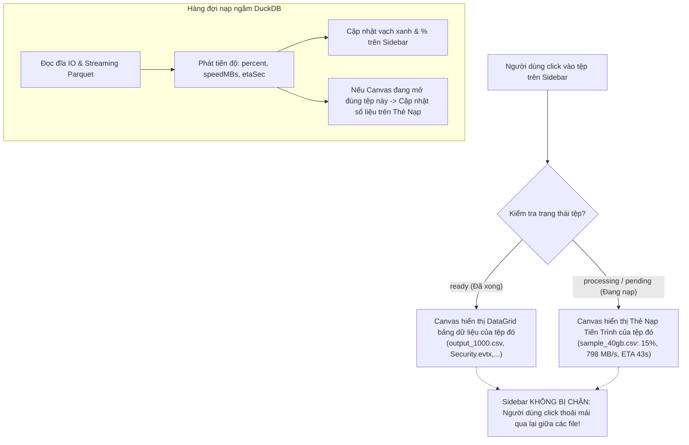

# BÁO CÁO PHÂN TÍCH KỸ THUẬT & PHƯƠNG ÁN NÂNG CẤP IN-CANVAS PROCESSING VIEW (v1.3.13)

> **Hệ thống:** TOAD Viewer - Forensic & DFIR Log Analyzer  
> **Phiên bản mục tiêu:** v1.3.13 (Non-blocking In-Canvas Processing View & Seamless Multi-Tasking)  
> **Ngày lập:** 28/10/2026  
> **Bối cảnh & Phản hồi từ người dùng:**  
> Người dùng ghi nhận từ thực tế sử dụng bản v1.3.12 (qua ảnh chụp màn hình tải tệp lớn `sample_40gb.csv`):  
> - Thuật toán đo lường đọc đĩa IO, trừ lùi 10%, tốc độ `798.0 MB/s`, `ETA: 43s`, và thanh tiến trình `15%` trên sidebar đã hoạt động rất chính xác.  
> - Tuy nhiên, hộp thoại tiến trình lại bật lên dưới dạng một **Popup Modal Dialog (`<Dialog>`)** che khuất toàn bộ màn hình và có lớp phủ mờ (backdrop) khóa chuột.  
> - Điều này làm **chặn hoàn toàn việc click vào các tệp khác** (ví dụ tệp `output_1000.csv` đang mở phía sau), buộc người dùng phải ngồi đợi tệp 40GB nạp xong mới thao tác tiếp được.  
> - **Nguyện vọng của người dùng**: *"Tôi đang muốn ô processing này chỉ hoạt động trong canvas bảng của từng file thay vì là block việc click những file khác?"*

---

## 1. PHÂN TÍCH NGUYÊN NHÂN GỐC & ĐÁNH GIÁ KIẾN TRÚC

```
┌─────────────────────────────────────────────────────────────────────────────────────────┐
│                    HIỆN TRẠNG v1.3.12: MODAL BACKDROP BLOCKING BUG                      │
├─────────────────────────────────────────────────────────────────────────────────────────┤
│                                                                                         │
│  [ Electron Renderer: AppPane.tsx ]                                                     │
│        │                                                                                │
│        ├─ centerPane: Hiển thị bảng DataGrid của output_1000.csv                        │
│        │                                                                                │
│        ├─ IngestProgressDialog: Nhận sự kiện IPC khi background queue nạp sample_40gb   │
│        │      │                                                                         │
│        │      ▼                                                                         │
│        │  <Dialog isOpen={true}> (BlueprintJS Modal Component)                          │
│        │      ├── Sinh ra lớp phủ mờ (Backdrop: rgba(16, 22, 26, 0.7)) che toàn màn hình│
│        │      ├── Khóa sự kiện chuột và bàn phím (Focus Trap & Click Blocker)           │
│        │      └── NGĂN CHẶN người dùng click sang output_1000.csv hoặc các tệp khác!    │
│                                                                                         │
└─────────────────────────────────────────────────────────────────────────────────────────┘
```

### Đánh giá kiến trúc:
1. **Vi phạm triết lý Multiple Loading (Nạp ngầm đa tệp)**:
   - Bản chất của Multiple Loading là cho phép nạp các tệp lớn (hàng chục GB) ở hậu cảnh mà không làm gián đoạn công việc của chuyên viên phân tích.
   - Khi dùng `<Dialog>` nổi lên trên cùng, toàn bộ khả năng đa nhiệm (multi-tasking) bị vô hiệu hóa vì người dùng không thể chuyển ngữ cảnh giữa các tệp.
2. **Khả năng tách ngữ cảnh Canvas (In-Canvas View)**:
   - Giao diện của TOAD vốn được phân chia thành 3 cột chính: `ActivityBar`, `DataSourceSidebar` (trái), và `centerPane` (vùng Canvas trung tâm).
   - Vùng `centerPane` hoàn toàn có thể hiển thị linh hoạt:
     - **Nếu chọn tệp đã xong**: Render bảng `GridPane` (DataGrid).
     - **Nếu chọn tệp đang nạp**: Render thẻ tiến trình `center-loading-pane` với đầy đủ Speed MB/s, ETA, ProgressBar, dung lượng GB/MB.
   - Khi đó, thanh bên trái (`DataSourceSidebar`) luôn luôn click được 100%, không bao giờ bị khóa bởi bất kỳ backdrop nào!

---

## 2. THIẾT KẾ PHƯƠNG ÁN KỸ THUẬT CHI TIẾT (v1.3.13)

### 2.1. Triệt tiêu hoàn toàn Modal Dialog (`<Dialog>`)
- Gỡ bỏ component `<IngestProgressDialog />` khỏi cây DOM của `AppPane.tsx`.
- Ứng dụng sẽ **không còn bất kỳ hộp thoại nổi nào** che khuất màn hình hay sinh ra lớp phủ mờ chặn click chuột.

### 2.2. Cơ chế Điều phối Canvas theo Ngữ cảnh Tệp (Per-File Canvas Routing)
Hệ thống quản lý trạng thái hiển thị của vùng Canvas trung tâm (`centerPane`) theo nguyên tắc độc lập và không phụ thuộc:



### 2.3. Quy tắc Hiển thị và Tương tác Chi tiết
1. **Khi người dùng bấm vào tệp đang nạp (`sample_40gb.csv`)**:
   - `centerPane` chuyển sang `center-loading-pane` chuyên biệt cho tệp đó.
   - Thẻ hiển thị:
     - Biểu tượng tệp lớn kèm spinner xoay mượt.
     - Tên tệp: `Loading sample_40gb.csv...`.
     - Tình trạng: `Reading input: 6.71 GB / 40.00 GB`.
     - Thanh ProgressBar lớn chạy theo thời gian thực (ví dụ `15%`).
     - Hàng chỉ số chi tiết: `% completed`, `Speed: 798.0 MB/s`, `ETA: 43s`.
     - Dòng hướng dẫn: *"Bạn có thể click vào bất kỳ tệp nào khác trên danh sách bên trái để phân tích trong khi tệp này tiếp tục được nạp ngầm."*
2. **Khi người dùng bấm vào tệp đã sẵn sàng (`output_1000.csv` hoặc `Security.evtx`)**:
   - `centerPane` ngay lập tức chuyển sang bảng `DataGrid` của tệp đó.
   - Người dùng cuộn xem, tìm kiếm, lọc dữ liệu 100% trơn tru, không có bất kỳ độ trễ hay cản trở nào.
   - Tệp 40GB vẫn âm thầm nạp ngầm ở background, thanh tiến trình mini trên sidebar vẫn nhảy % bình thường.
3. **Khi tệp 40GB nạp xong 100%**:
   - Nếu người dùng *đang đứng ở màn hình của tệp 40GB*: Thẻ nạp tự động biến mất và chuyển mượt sang bảng dữ liệu `DataGrid` của tệp 40GB.
   - Nếu người dùng *đang đứng ở tệp khác*: Tệp 40GB trên sidebar chuyển sang màu đen/trắng (ready), không làm gián đoạn hay nhảy màn hình phân tích hiện tại của người dùng.
4. **Khi mở tệp đơn từ Menu File > Open hoặc Command Line**:
   - Thay vì hiện popup modal che màn hình, vùng Canvas giữa hiển thị ngay thẻ nạp In-Canvas tương tự, đảm bảo tính đồng nhất tuyệt đối về giao diện.

---

## 3. KẾ HOẠCH TRIỂN KHAI VÀ FILE TÁC ĐỘNG

| STT | File Tác Động | Nội Dung Thay Đổi Kỹ Thuật |
|:---:|---|---|
| 1 | `tadviewer/src/components/AppPane.tsx` | - Xóa bỏ hoàn toàn render `<IngestProgressDialog />`.<br>- Hoàn thiện `center-loading-pane` với đầy đủ các trường: File name, Status text (X GB / Y GB), ProgressBar, Speed MB/s, ETA s, và dòng gợi ý đa nhiệm.<br>- Đảm bảo `centerPane` phản ứng độc lập với trạng thái tệp đang chọn. |
| 2 | `tadviewer/src/MultipleLoadingManager.ts` | - Trong `handleIngestProgress`: Chỉ cập nhật `activeLoadingFile` khi tệp đang hiển thị ở Canvas khớp với tệp đang bắn tiến độ (theo `canonicalPath` hoặc `fileName`).<br>- Không làm ảnh hưởng đến `viewState` của tệp đã sẵn sàng đang mở. |
| 3 | `tadviewer/src/components/DataSourceSidebar.tsx` | - Khi click vào tệp `ready`: Mở ngay `actions.openDataSourcePath` và xóa `activeLoadingFile`.<br>- Khi click vào tệp `processing`/`pending`: Kích hoạt ưu tiên nạp và gán `activeLoadingFile` để Canvas giữa chuyển sang Thẻ Nạp tương ứng. |
| 4 | `tadviewer/src/actions.ts` | - Đồng bộ việc gán `activeLoadingFile` khi mở tệp đơn từ menu/CLI để hiển thị trên Canvas thay vì mở modal. |
| 5 | `tadviewer/less/tadviewer.less` | - Bổ sung styling cho thẻ nạp trung tâm: `main-loading-hint`, tăng cường khoảng cách và độ tương phản giúp thẻ nạp trông hiện đại, tinh gọn và chuyên nghiệp. |

---

## 4. KẾT LUẬN & CAM KẾT
Phương án này giải quyết dứt điểm nhược điểm khóa màn hình của Modal Dialog, biến TOAD thành một công cụ phân tích log đa nhiệm thực thụ (true non-blocking multi-tasking log analyzer), mang lại trải nghiệm tiện dụng tối đa cho người dùng.
