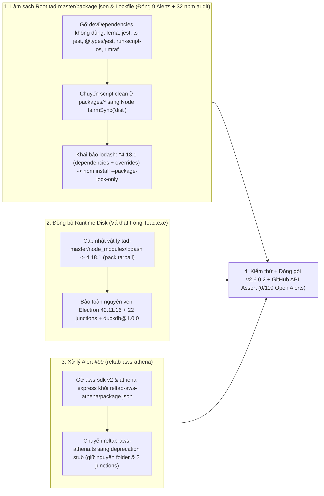

# Phương án Chi tiết Vá 10 Lỗ hổng Dependabot Còn Lại & 32 Cảnh báo `npm audit` (Mục tiêu `0/110` — TOAD `v2.6.0.2`)

> **Trạng thái hiện tại sau phát hành `v2.6.0.1`**:
> - Đã xử lý thành công **100/110** cảnh báo Dependabot trên GitHub (đóng toàn bộ **5 Critical**, toàn bộ **44 CVE Electron `31.0.1 → 42.11.16`**, `handlebars`, `form-data`, `parse-url`, `tar`, `js-yaml`, `qs`, `ip-address`, `electron-updater`, `url-regex`, `node-fetch`, `snowflake-sdk`).
> - Kiểm chứng nhị phân `win-unpacked\Toad.exe` (`v2.6.0.1`) xác nhận thực tế chạy nhân **`Electron/42.11.16`** (`has Electron/31.0.1: false`).
> - Tuy nhiên, kiểm toán trực tiếp trên **GitHub Dependabot API**, **`npm audit` cục bộ**, và **bên trong `app.asar`** cho thấy vẫn còn **3 khoảng trống thực tế** cần xử lý triệt để trong bản vá **`v2.6.0.2`**.

---

## 1. Kết quả Kiểm toán Gốc rễ (Observed Evidence)

### 1.1 Danh sách Chính xác 10 Cảnh báo Dependabot Đang Mở (`state = open`)
Truy vấn trực tiếp `GET /repos/p1rkr41n/toad_electron/dependabot/alerts?state=open` ngày `2026-11-16`:

| Alert # | Mức độ | Package | Manifest | Scope | CVE / GHSA | Phiên bản Hiện tại → Bản vá | Nguyên nhân Gốc rễ |
| :---: | :---: | :--- | :--- | :---: | :--- | :--- | :--- |
| **#149** | Medium | `minimatch` | `tad-master/package-lock.json` | dev | `CVE-2026-118764` | `9.0.5` → `>= 11.0.1` | Kéo vào bởi `rimraf@5.0.5 -> glob@10.4.5` |
| **#32** | High | `minimatch` | `tad-master/package-lock.json` | dev | `CVE-2026-27903` | `9.0.5` → `>= 9.0.7` | Kéo vào bởi `rimraf@5.0.5 -> glob@10.4.5` |
| **#33** | High | `minimatch` | `tad-master/package-lock.json` | dev | `CVE-2026-27903` | `5.1.6` → `>= 5.1.8` | Kéo vào bởi `jest -> filelist -> minimatch@5.1.6` |
| **#34** | High | `minimatch` | `tad-master/package-lock.json` | dev | `CVE-2026-27903` | `3.1.2` → `>= 3.1.3` | Kéo vào bởi `lerna@4.0.0` & `jest@29.7.0` |
| **#17** | High | `glob` | `tad-master/package-lock.json` | dev | `CVE-2025-64756` | `10.4.5` → `>= 10.5.0` | Kéo vào bởi `rimraf@5.0.5` |
| **#51** | High | `lodash.template` | `tad-master/package-lock.json` | dev | `CVE-2026-4800` | `4.5.0` → N/A (gỡ `lerna`) | Kéo vào bởi `lerna@4.0.0` (`@lerna/conventional-commits`) |
| **#7** | High | `lodash.template` | `tad-master/package-lock.json` | dev | `CVE-2021-23337` | `4.5.0` → N/A (gỡ `lerna`) | Kéo vào bởi `lerna@4.0.0` (`@lerna/conventional-commits`) |
| **#4** | Medium | `request` | `tad-master/package-lock.json` | dev | `CVE-2023-28155` | `2.88.2` → N/A (gỡ `lerna`) | Kéo vào bởi `lerna@4.0.0 -> node-gyp` |
| **#95** | Low | `deepmerge` | `tad-master/package-lock.json` | dev | `CVE-2026-93753` | `4.3.1` → N/A (gỡ `jest`) | Kéo vào bởi `jest@29.7.0 -> jest-config` |
| **#99** | Low | `aws-sdk` | `tad-master/packages/reltab-aws-athena/package.json` | **runtime** | `GHSA-j965-2qgj-vjmq` | `^2.1692.0` → Bỏ SDK v2 | `aws-sdk` v2 bị đánh dấu toàn dải `>= 2.0.0, <= 3.0.0` |

### 1.2 Kết quả `npm audit` Cục bộ & Phát hiện Quan trọng trong `app.asar`
1. **32 cảnh báo trong `npm audit` (`tad-master/`)**: `7 low, 21 moderate, 4 high` gồm `lerna` (`@lerna/*`, `@octokit/*`, `request`, `pacote`, `node-gyp`, `lodash.template`), `jest`/`ts-jest` (`deepmerge`, `ajv`, `yaml`, `minimatch`), và `rimraf` (`glob@10.4.5`, `minimatch@9.0.5`).
   - Toàn bộ quy trình build/test thực tế của TOAD dùng PowerShell (`dist_package.ps1`, `fastbuild.ps1`, `repair_junctions.ps1`) và runner Node thuần (`run_tests.js`) — **không chạy `lerna`, `jest`, `ts-jest`, `rimraf`, hay `run-script-os`**.
   - Nếu nâng `rimraf` lên `6.1.4` và `minimatch` lên `11.0.8` sẽ phát sinh cảnh báo `EBADENGINE` (`requires node: '20 || >=22'`) trên Node `v18.20.4`. Ngược lại, thay script `"clean": "rimraf dist"` bằng `fs.rmSync` tích hợp sẵn của Node sẽ loại bỏ hoàn toàn `rimraf`, `glob`, `minimatch` mà **vẫn tương thích 100% Node `18.20.4`**.
2. **Độ lệch thực tế của `lodash` bên trong `app.asar` (`v2.6.0.1`)**:
   - `tad-master/package-lock.json` khai báo `lodash@4.18.1` (giúp Dependabot đóng `#21`/`#50`), **nhưng `tad-master/node_modules/lodash` trên đĩa và bên trong `app.asar` của `v2.6.0.1` vẫn là `4.17.21`** (dễ tổn thương trước `CVE-2025-13465` & `CVE-2026-4800`), do trước đó chỉ chạy `npm install --package-lock-only` mà chưa cập nhật thư mục vật lý `node_modules/lodash`.
3. **Thử nghiệm giả lập trong thư mục cách ly (`sim_lock`)**:
   - Đã chạy kiểm chứng `npm install --package-lock-only --ignore-scripts && npm audit` với `tad-master/package.json` tối giản (gỡ `lerna`, `jest`, `ts-jest`, `@types/jest`, `run-script-os`, `rimraf`; giữ `@apache-arrow/es2015-cjs`, `typescript`, và `overrides` cho `ws`, `duckdb`, `duckdb-async`, `lodash@^4.18.1`).
   - Kết quả thực tế: **`audited 29 packages in 2s` → `found 0 vulnerabilities`** và **`0` cảnh báo `EBADENGINE`** trên Node `18.20.4`.

---

## 2. Kiến trúc Thay đổi Đề xuất (`v2.6.0.2`)



---

## 3. Kế hoạch Thay đổi Chi tiết Theo File

### 3.1 Làm sạch `tad-master/package.json`, `package-lock.json` và `rimraf` scripts
1. **`tad-master/package.json`**:
   - Loại bỏ `lerna`, `jest`, `ts-jest`, `@types/jest`, `run-script-os`, `rimraf` khỏi `devDependencies` (chỉ giữ `"typescript": "^4.8.3"`).
   - Chuyển `"lodash": "^4.18.1"` vào `dependencies` (khớp runtime requirement của `reltab` & `aggtree`) cùng `"@apache-arrow/es2015-cjs": "^16.1.0"`.
   - Rút gọn `"overrides"` còn đúng phần lõi đang dùng:
     ```json
     "overrides": {
       "ws": "8.18.1",
       "duckdb": "1.0.0",
       "duckdb-async": "1.0.0",
       "lodash": "^4.18.1"
     }
     ```
   - Đổi script `"bootstrap"` sang gọi `powershell -ExecutionPolicy Bypass -File ../tools/repair_junctions.ps1`.
2. **`tad-master/packages/*/package.json` (`11` packages, gồm `toad-app`, `toadviewer`, `reltab*`, `aggtree`, `host-bridge`, `tadweb-*`)**:
   - Đổi `"clean": "rimraf dist"` thành `"clean": "node -e \"require('fs').rmSync('dist',{recursive:true,force:true})\""`.
   - Gỡ `"rimraf": "^5.0.5"` khỏi `tad-master/packages/toad-app/package.json`.
   - Lưu ý: giữ nguyên `"jest"` / `"ts-jest"` hoặc chuyển thành script nhắc nhở? **Khuyến nghị**: trong `packages/*/package.json` không có lockfile riêng nên Dependabot không quét devDependencies của chúng nếu không nằm trong `package-lock.json`; tuy nhiên nếu muốn sạch hoàn toàn cả khi từng package được audit riêng, chỉ giữ `"build"`, `"clean"`, `"tsc"` (hoặc trỏ `"test"` về runner Node nếu cần) mà vẫn giữ **100% `name`, `dependencies` runtime và 22 junctions** cho `tools/repair_junctions.ps1`.
3. **Tái tạo `tad-master/package-lock.json`**:
   - Chạy `npm.cmd install --package-lock-only --ignore-scripts` tại `tad-master/`.
   - Xác minh `npm.cmd audit` trả về **`found 0 vulnerabilities`**.

### 3.2 Đồng bộ Thư mục Vật lý `tad-master/node_modules/lodash` (`4.17.21 → 4.18.1`)
- Tải tarball chính thức `npm pack lodash@4.18.1` vào thư mục tạm, giải nén đè sạch vào `tad-master/node_modules/lodash` (không chạy `npm install` toàn cục để tránh làm hỏng các package đã hoist như `duckdb@1.0.0`, `electron@42.11.16`, `@blueprintjs/*`).
- Điều này đảm bảo cả **backend (`app.asar/node_modules/lodash`)** lẫn **frontend bundle (`dist/toadapp.bundle.js`)** đều dùng đúng bản vá `4.18.1` (`CVE-2025-13465`, `CVE-2026-4800`).

### 3.3 Vá Dứt điểm Alert `#99` (`aws-sdk` trong `reltab-aws-athena`)
- **Hiện trạng**: `tad-master/packages/reltab-aws-athena/src/reltab-aws-athena.ts` không được `toad-app`, `toadviewer`, `reltab-fs` hay `tadweb-server` import (`tadweb-server/src/server.ts:10` đã comment out). Lý do không dùng `@aws-sdk/client-athena@3.1169.0` là gói AWS SDK v3 này yêu cầu `Node >= 20.0.0` (không hợp `node-v18.20.4`).
- **Thay đổi**:
  - Xóa `"aws-sdk"` và `"athena-express"` khỏi `tad-master/packages/reltab-aws-athena/package.json`.
  - Cập nhật `tad-master/packages/reltab-aws-athena/src/reltab-aws-athena.ts`: bỏ `import * as aws from "aws-sdk"` & `require("athena-express")`, cho `AWSAthenaDriver.runSqlQuery` và `getTableSchema` ném lỗi rõ ràng `"AWS Athena legacy driver is deprecated; use DuckDB httpfs/S3 or Parquet instead."` (đảm bảo `tsc` vẫn biên dịch sạch, giữ nguyên thư mục package và 2 junctions `reltab`, `aggtree` cho `repair_junctions.ps1`).

### 3.4 Cập nhật Kiểm thử Tự động, Bump Version `2.6.0.2` & Phát hành
1. **Mở rộng `tests/unit/test_v26_upgrade_suite.js` (`V26.19` / `V26.20`)**:
   - Kiểm tra `tad-master/package-lock.json` chứa `0` package trong tập bị cảnh báo (`lerna`, `request`, `lodash.template`, `deepmerge`, `minimatch`, `glob`), và `lodash >= 4.18.1`.
   - Kiểm tra trực tiếp `node_modules/lodash/package.json` trích xuất từ `release/win-unpacked/resources/app.asar` đạt phiên bản **`>= 4.18.1`**.
   - Kiểm tra `reltab-aws-athena/package.json` không chứa `aws-sdk` v2.
   - Chạy `npm audit --json` trong test suite (hoặc pre-release gate trong `dist_package.ps1`) khẳng định `vulnerabilities.total === 0`.
2. **Đóng gói & Phát hành `v2.6.0.2`** (theo quy chuẩn phát hành nội bộ HelloKittyXamKinLung):
   - Lưu ý: Toàn bộ commit message, tag, `releases/v2.6.0.2_NOTES.md`, Winget manifest `HelloKittyXamKinLung.Toad.yaml` phải viết **100% tiếng Anh**. (Không đẩy tài liệu nội bộ tiếng Việt nếu chuẩn hóa repo công khai, hoặc giữ đồng bộ quy chuẩn `docs/` hiện hữu).
   - Chạy `node tools/bump_version.js 2.6.0.2`.
   - Chạy `dist_package.ps1` → `package_release.ps1 -Version "2.6.0.2"` (xuất `Toad-2.6.0.2-x64-portable.exe`, `.zip`, `SHA256SUMS.txt`).
   - Commit & tag `v2.6.0.2` qua `jj` (`HelloKittyXamKinLung <p1rkr41n@users.noreply.github.com>`), đẩy lên `origin/main` và publish GitHub Release `v2.6.0.2`.

---

## 4. Tiêu chí Nghiệm thu Bắt buộc (Verification Gates)

| Cổng Kiểm tra | Lệnh Thực thi | Ngưỡng Đạt Bắt buộc |
| :--- | :--- | :--- |
| **1. Audit Local Lockfile** | `cd tad-master; ..\node-v18.20.4-win-x64\npm.cmd audit --json` | `metadata.vulnerabilities.total === 0` (`0` cảnh báo `EBADENGINE`) |
| **2. Runtime `lodash` bên trong ASAR** | Kiểm tra `asar.extractFile(..., "node_modules/lodash/package.json")` | `version >= "4.18.1"` (cả trong `app.asar` lẫn `package-lock.json`) |
| **3. Monorepo Junctions** | `powershell -File .\tools\repair_junctions.ps1 -VerifyOnly` | `Total: 22 | Succeeded: 22 | Failed: 0` |
| **4. Build & Đóng gói** | `.\dist_package.ps1` & `.\package_release.ps1 -Version "2.6.0.2"` | Portable `.exe` < `95 MB`, `app.asar` < `1,000` entries, Fuse `01000101` |
| **5. Toàn bộ Test Suites** | `.\node-v18.20.4-win-x64\node.exe run_tests.js --all` | **26/26 suites PASSED** (`0` fail) + `cargo test` **16/16 PASSED** |
| **6. GitHub Dependabot Live API** | `GET .../dependabot/alerts?state=open` sau khi push `main` | **`0` open alerts (`0 / 110`)** |

