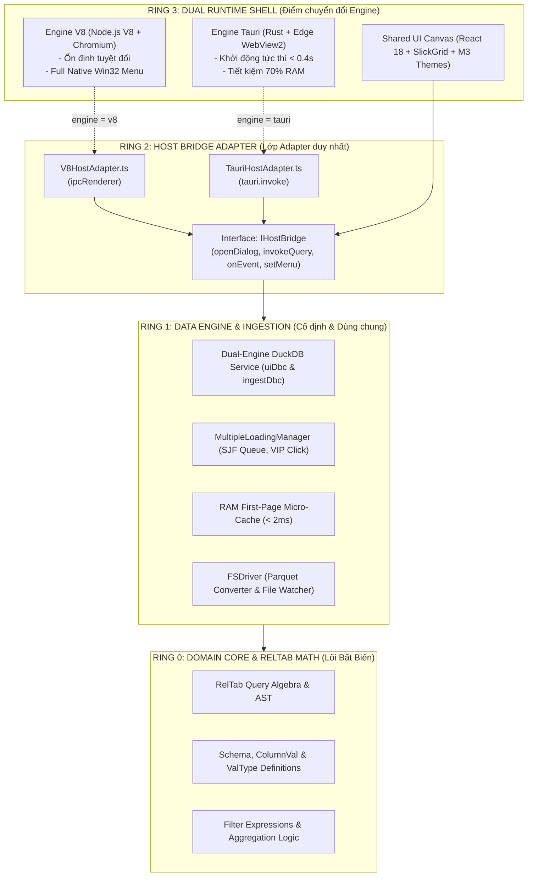

# BẢN ĐẶC TẢ KIẾN TRÚC RING & CHUYỂN ĐỔI ENGINE (TAURI vs V8) QUA CONFIG.INI
> **Tài liệu:** `docs/THIET_KE_KIEN_TRUC_RING_VA_MODULAR_DUAL_ENGINE.md`  
> **Dự án:** TOAD - Log & Forensic Data Analysis Platform  
> **Phạm vi tinh gọn (Tuned Scope):** **CHỈ chuyển đổi duy nhất giữa 2 Runtime Engine: Tauri vs V8 (Electron)**. Toàn bộ các cấu phần khác (CSDL DuckDB, Giao diện React/SlickGrid, Quản lý File FSDriver, Hàng đợi Ingestion) được **GIỮ CỐ ĐỊNH & DÙNG CHUNG 100%**.  
> **Phiên bản baseline ổn định:** Toad v2.1.6  
> **Trạng thái:** Bản thiết kế chi tiết tinh gọn (Tuned Architecture & BA Specification)

---

## CHƯƠNG I: PHÂN TÍCH NGHIỆP VỤ & PHẠM VI TINH GỌN (TUNED BA)

### 1.1. Phạm vi Thiết kế: Đúng trọng tâm, Không Over-Engineering
Theo yêu cầu thực tế của dự án, hệ thống **không cần** chuyển đổi nhiều loại cơ sở dữ liệu hay plugin rườm rà. Hệ thống tập trung tối đa vào **1 bài toán duy nhất**:

$$\boxed{\text{Chuyển đổi linh hoạt giữa 2 Runtime Engine: } \mathbf{Tauri} \longleftrightarrow \mathbf{V8} \text{ (Electron)}}$$

| Thành phần hệ thống | Trạng thái chuyển đổi | Cơ chế vận hành |
| :--- | :---: | :--- |
| **Runtime Engine (Vỏ chạy ứng dụng)** | 🔄 **SWITCHABLE** | **V8 (Electron)** $\longleftrightarrow$ **Tauri (Rust + WebView2)** qua `config.ini`. |
| **Cơ sở dữ liệu (DuckDB Engine)** | 🔒 **CỐ ĐỊNH** | Duy trì duy nhất **Dual-Engine DuckDB** (`uiDbc` tương tác & `ingestDbc` nạp ngầm). Không đổi. |
| **Giao diện Người dùng (UI Canvas)** | 🔒 **CỐ ĐỊNH** | Duy trì duy nhất React 18, Virtualized SlickGrid, Material 3 Dark/Light. Không đổi. |
| **Hệ thống nạp File (FSDriver)** | 🔒 **CỐ ĐỊNH** | Duy trì duy nhất Shortest Job First (SJF) và Parquet cache. Không đổi. |
| **Hồ sơ dữ liệu (`toadAppData`)** | 🔒 **CỐ ĐỊNH** | Dùng chung 100% thư mục dữ liệu, lịch sử file và filter presets. Không đổi. |

### 1.2. Mục tiêu Nghiệp vụ Cốt lõi
* **Lựa chọn V8 (Mặc định - Electron / Node.js V8 Runtime):** Dành cho chuyên viên điều tra chuyên sâu. Yêu cầu Chromium độc lập, tương thích 100% với file log siêu lớn (20GB - 40GB), không bao giờ phụ thuộc vào cập nhật hệ điều hành.
* **Lựa chọn Tauri (Tối ưu - Rust + Edge WebView2 Runtime):** Dành cho máy tính hiện trường, máy ảo RAM yếu (4GB - 8GB). Khởi động siêu tốc (< 0.4s), tiết kiệm 70% RAM.
* **Chuyển đổi tức thì:** Người dùng chỉ cần sửa 1 dòng `engine = v8` hoặc `engine = tauri` trong `config.ini`.

---

## CHƯƠNG II: MÔ HÌNH KIẾN TRÚC PHÂN TẦNG DẠNG RING (RING ARCHITECTURE)

Hệ thống được tổ chức thành 4 vòng đồng tâm. Điểm chuyển đổi (Switch Point) duy nhất nằm ở **Ring 2** và **Ring 3**:



### Chi tiết 4 Vòng Ring:
1. **Ring 0 (Lõi Nguyên Tử - Bất biến):** `reltab` - Chứa toàn bộ logic toán học, kiểu dữ liệu, định dạng bảng. Thuần TypeScript/Rust, không dính dáng đến OS hay giao diện.
2. **Ring 1 (Dịch vụ Dữ liệu DuckDB - Bất biến):** Cung cấp 2 kết nối DuckDB độc lập (`uiDbc` phục vụ SlickGrid < 50ms, `ingestDbc` nạp ngầm Parquet). Cả 2 engine V8 và Tauri đều gọi chung dịch vụ này.
3. **Ring 2 (Host Bridge - Cổng Chuyển Tiếp):** Định nghĩa hợp đồng chung `IHostBridge`. Chỉ gồm đúng **2 Adapter**:
   * `V8HostAdapter`: Dùng khi chạy trên Electron/V8.
   * `TauriHostAdapter`: Dùng khi chạy trên Tauri.
4. **Ring 3 (Vỏ Thực Thi - Runtime Shells):** 
   * Vỏ A: Tiến trình Electron (V8 engine).
   * Vỏ B: Tiến trình Tauri (Rust engine).
   * Giao diện React hiển thị dùng chung 100%.

---

## CHƯƠNG III: THIẾT KẾ MODULE HÓA TINH GỌN (LEAN COMPONENT STRUCTURE)

Thay vì chia vụn vặt nhiều module, cấu trúc dự án được phân định gọn gàng đúng 4 khối:

```
tad/
├── packages/
│   ├── reltab/                # [Ring 0] Core Domain & Math (Dùng chung)
│   ├── reltab-duckdb/         # [Ring 1] Dual DuckDB Driver (Dùng chung)
│   ├── reltab-fs/             # [Ring 1] File Ingestion & SJF Queue (Dùng chung)
│   │
│   ├── host-bridge/           # [Ring 2] Interface IHostBridge + V8/Tauri Adapters
│   │   ├── src/IHostBridge.ts
│   │   ├── src/V8HostAdapter.ts
│   │   ├── src/TauriHostAdapter.ts
│   │   └── src/index.ts       # Runtime Auto-Detector Factory
│   │
│   ├── tadviewer/             # [Ring 3] Giao diện React UI Canvas (Dùng chung)
│   │   ├── src/components/DataGrid.tsx
│   │   └── src/themes/
│   │
│   ├── shell-v8/              # [Ring 3A] Engine V8 (Electron Main Process)
│   │   └── app/main.ts
│   │
│   └── shell-tauri/           # [Ring 3B] Engine Tauri (Rust WRY/TAO Host)
│       ├── src-tauri/src/main.rs
│       └── src-tauri/capabilities/default.json
```

---

## CHƯƠNG IV: CƠ CHẾ SWITCH ENGINE ĐƠN GIẢN QUA CONFIG.INI

### 4.1. File `config.ini` Cực Kỳ Đơn Giản
Người dùng chỉ cần chỉ định mục `[runtime]`:

```ini
[runtime]
; Lựa chọn engine khởi chạy:
; - v8    : Engine Node.js V8 + Chromium (Electron) - Tương thích và ổn định tối đa (Mặc định).
; - tauri : Engine Rust + Edge WebView2 (Tauri) - Siêu nhẹ, khởi động tức thì.
engine = v8

; Tự động fallback về v8 nếu engine tauri gặp lỗi môi trường WebView2
auto_fallback = true

[general]
viewer = toad
language = en
page_size = 1000
max_concurrent_files = 4
max_concurrent_gb = 1.0

[duckdb]
max_memory = auto
threads = 0
background_threads = auto
```

### 4.2. Luồng Điều Phối của Launcher (`Toad.exe` ~1.5MB)
Khi người dùng bấm mở `Toad.exe`:

```mermaid
flowchart TD
    Start([Khởi chạy Toad.exe]) --> ReadConfig[Đọc config.ini: engine]
    ReadConfig --> Decision{engine == ?}

    Decision -- "v8 (mặc định)" --> BootV8[Khởi chạy engines/v8/Toad.exe\n(Electron V8 Runtime)]
    
    Decision -- "tauri" --> CheckWV2{Có WebView2 trên Windows?}
    CheckWV2 -- "Có" --> BootTauri[Khởi chạy engines/tauri/toad-tauri.exe\n(Tauri Runtime)]
    CheckWV2 -- "Không & auto_fallback=true" --> FallbackLog[Ghi log cảnh báo] --> BootV8

    BootV8 --> AppReady([Ứng dụng sẵn sàng phân tích])
    BootTauri --> AppReady
```

---

## CHƯƠNG V: MÃ NGUỒN CỐT LÕI CỦA TẦNG CHUYỂN ĐỔI (HOST BRIDGE)

### 5.1. Interface Hợp Đồng Chung: `IHostBridge.ts`
Giao diện React chỉ tương tác thông qua interface này:

```typescript
// packages/host-bridge/src/IHostBridge.ts

export interface OpenDialogOptions {
  title?: string;
  defaultPath?: string;
  filters?: { name: string; extensions: string[] }[];
  multiple?: boolean;
  directory?: boolean;
}

export interface IHostBridge {
  readonly engineName: 'v8' | 'tauri';

  // Hộp thoại mở file
  showOpenDialog(options: OpenDialogOptions): Promise<string[] | null>;

  // Gọi truy vấn dữ liệu tới DuckDB
  invokeQuery<T = any>(channel: string, payload?: any): Promise<T>;

  // Đăng ký nhận sự kiện (tiến trình nạp file, phím tắt menu)
  onEvent<T = any>(eventName: string, listener: (data: T) => void): () => void;

  // Điều khiển giao diện
  setTheme(theme: 'light' | 'dark'): void;
  restartWithEngine(targetEngine: 'v8' | 'tauri'): Promise<void>;
}
```

### 5.2. Hai Adapter Hiện Thực: `V8HostAdapter` & `TauriHostAdapter`

#### A. Adapter cho Engine V8 (Electron):
```typescript
// packages/host-bridge/src/V8HostAdapter.ts
import { IHostBridge, OpenDialogOptions } from './IHostBridge';

export class V8HostAdapter implements IHostBridge {
  readonly engineName = 'v8' as const;
  private ipc = (window as any).electron?.ipcRenderer;

  async showOpenDialog(options: OpenDialogOptions): Promise<string[] | null> {
    return await this.ipc.invoke('dialog:open', options);
  }

  async invokeQuery<T = any>(channel: string, payload?: any): Promise<T> {
    return await this.ipc.invoke(channel, payload);
  }

  onEvent<T = any>(eventName: string, listener: (data: T) => void): () => void {
    const handler = (_: any, data: T) => listener(data);
    this.ipc.on(eventName, handler);
    return () => this.ipc.removeListener(eventName, handler);
  }

  setTheme(theme: 'light' | 'dark'): void {
    document.documentElement.className = `theme-${theme}`;
    localStorage.setItem('toad-theme-v2', theme);
  }

  async restartWithEngine(targetEngine: 'v8' | 'tauri'): Promise<void> {
    await this.ipc.invoke('app:switch-engine', targetEngine);
  }
}
```

#### B. Adapter cho Engine Tauri:
```typescript
// packages/host-bridge/src/TauriHostAdapter.ts
import { invoke } from '@tauri-apps/api/core';
import { listen } from '@tauri-apps/api/event';
import { open } from '@tauri-apps/plugin-dialog';
import { IHostBridge, OpenDialogOptions } from './IHostBridge';

export class TauriHostAdapter implements IHostBridge {
  readonly engineName = 'tauri' as const;

  async showOpenDialog(options: OpenDialogOptions): Promise<string[] | null> {
    const res = await open({
      title: options.title,
      defaultPath: options.defaultPath,
      multiple: options.multiple ?? false,
      directory: options.directory ?? false,
      filters: options.filters,
    });
    if (!res) return null;
    return Array.isArray(res) ? res : [res];
  }

  async invokeQuery<T = any>(channel: string, payload?: any): Promise<T> {
    return await invoke<T>(channel, payload ?? {});
  }

  onEvent<T = any>(eventName: string, listener: (data: T) => void): () => void {
    let unlistenFn: (() => void) | null = null;
    listen<T>(eventName, (event) => listener(event.payload)).then((fn) => {
      unlistenFn = fn;
    });
    return () => {
      if (unlistenFn) unlistenFn();
    };
  }

  setTheme(theme: 'light' | 'dark'): void {
    document.documentElement.className = `theme-${theme}`;
    localStorage.setItem('toad-theme-v2', theme);
  }

  async restartWithEngine(targetEngine: 'v8' | 'tauri'): Promise<void> {
    await invoke('app_switch_engine', { targetEngine });
  }
}
```

### 5.3. Factory Tự Động Nhận Diện Engine
Trong ứng dụng React, chỉ cần gọi `getHostBridge()`:
```typescript
// packages/host-bridge/src/index.ts
import { IHostBridge } from './IHostBridge';
import { V8HostAdapter } from './V8HostAdapter';
import { TauriHostAdapter } from './TauriHostAdapter';

let activeBridge: IHostBridge | null = null;

export function getHostBridge(): IHostBridge {
  if (activeBridge) return activeBridge;

  // Nếu môi trường có cờ Tauri
  if (typeof window !== 'undefined' && ('__TAURI_INTERNALS__' in window || '__TAURI__' in window)) {
    activeBridge = new TauriHostAdapter();
    return activeBridge;
  }

  // Mặc định là Engine V8 (Electron)
  activeBridge = new V8HostAdapter();
  return activeBridge;
}
```

---

## CHƯƠNG VI: QUY TRÌNH KHI MUỐN VIẾT MỘT RUNTIME ENGINE MỚI

Trong tương lai, nếu nhóm phát triển muốn viết thêm một Runtime Engine mới (ví dụ: **Web Browser Engine** để chạy trực tiếp trên Google Chrome qua WebAssembly), quy trình cực kỳ đơn vị và chỉ gồm **3 bước**:

1. **Bước 1**: Tạo file `WebBrowserHostAdapter.ts` trong `packages/host-bridge/` kế thừa `IHostBridge`.
2. **Bước 2**: Bổ sung nhánh nhận diện vào `packages/host-bridge/src/index.ts`.
3. **Bước 3**: Thêm tùy chọn `engine = web` vào `config.ini`.  
*(Tuyệt đối không cần sửa đổi bất kỳ dòng code nào trong `reltab`, `reltab-duckdb` hay giao diện React `tadviewer`!)*

---

## CHƯƠNG VII: KẾ HOẠCH TRIỂN KHAI 3 GIAI ĐOẠN TINH GỌN

| Giai đoạn | Mục tiêu & Công việc | Tiêu chuẩn Nghiệm thu |
| :---: | :--- | :--- |
| **Giai đoạn 1** | **Host Bridge Refactoring**: Bọc toàn bộ các lệnh gọi native trong `tadviewer` qua `IHostBridge`. Triển khai `V8HostAdapter`. | Bộ test **133 test cases trên `run_tests.js` đạt 100% PASS**. Ứng dụng V8 chạy nguyên bản. |
| **Giai đoạn 2** | **Tauri Shell Implementation**: Xây dựng module `shell-tauri` độc lập, tích hợp Menu Win32 Rust và cấp quyền ACL theo tài liệu `docs_tauri_v2/`. | Khởi chạy `toad-tauri.exe` độc lập, mở file CSV/Parquet và Dark Mode chuẩn 100%. |
| **Giai đoạn 3** | **Launcher Switcher & Packaging**: Viết launcher `Toad.exe` (~1.5MB) đọc `config.ini` chuyển giữa `v8` và `tauri`. Đóng gói bản phân phối kép. | Thay đổi `engine = v8` $\leftrightarrow$ `tauri` trong `config.ini` chuyển đổi mượt mà; tự động fallback nếu thiếu WebView2. |
