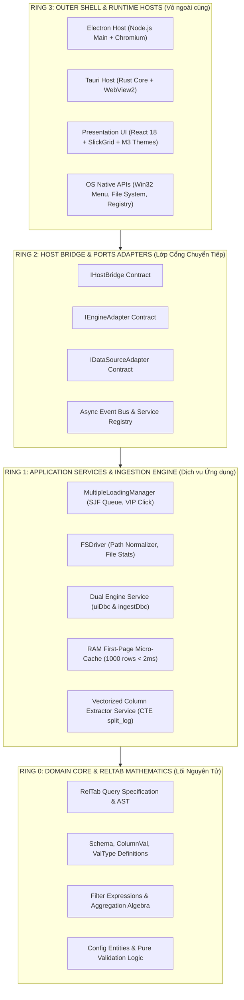
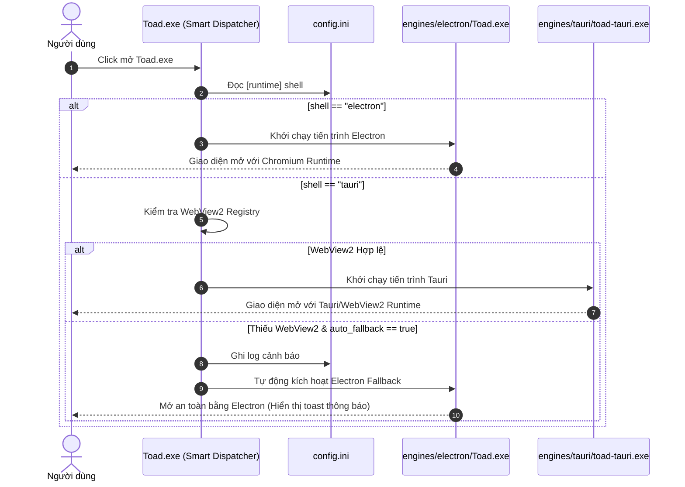
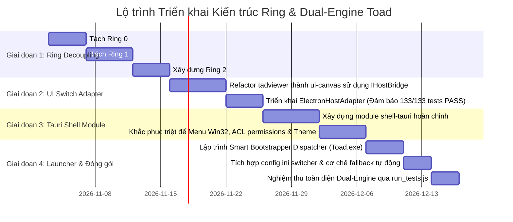

# BẢN ĐẶC TẢ KIẾN TRÚC DẠNG RING (RING ARCHITECTURE) & PHƯƠNG ÁN MODULE HÓA HỆ THỐNG DUAL-ENGINE TOAD
> **Tài liệu:** `docs/THIET_KE_KIEN_TRUC_RING_VA_MODULAR_DUAL_ENGINE.md`  
> **Dự án:** TOAD - Log & Forensic Data Analysis Platform  
> **Phiên bản mục tiêu:** Toad v2.3.0+ Modular Architecture  
> **Trạng thái:** Bản thiết kế chi tiết (Comprehensive Architecture Blueprint & BA Specification)

---

## CHƯƠNG I: TỔNG QUAN BA & PHÂN TÍCH NGHIỆP VỤ NÂNG CAO

### 1.1. Mục tiêu Nghiệp vụ (Business Goals)
1. **Khử phụ thuộc nguyên khối (Decoupling Monolith):** Hiện tại hệ thống đang bị gắn chặt giữa logic xử lý dữ liệu DuckDB, logic giao diện React SlickGrid và môi trường chạy Electron. Mục tiêu là bẻ gãy sự phụ thuộc này thành các **Ring (Vòng đồng tâm)** độc lập.
2. **Cơ chế Chuyển đổi Kiến trúc Đơn giản (Simple Switch):** Cho phép thay đổi Engine chạy ngầm (**Electron** $\leftrightarrow$ **Tauri**) hoặc Engine CSDL (**DuckDB In-Memory** $\leftrightarrow$ **DuckDB Persistent** $\leftrightarrow$ **Custom Engine**) chỉ thông qua 1 cấu hình khóa đơn giản trong `config.ini`.
3. **Khả năng Mở rộng Module Mới (Extensibility):** Bất kỳ lập trình viên nào cũng có thể viết thêm 1 module mới (ví dụ: Module giải mã log EVTX mới, Module parser định dạng mới, hoặc Engine hiển thị Web/Tauri mới) mà **không cần sửa một dòng code nào trong lõi (Core)**.

### 1.2. Các Ràng buộc Bất biến (Invariants)
* **Invariant 1 (Lõi Không Phụ thuộc OS):** Lõi xử lý dữ liệu và bảng quan hệ (RelTab) tuyệt đối không được gọi `window`, `document`, `process`, `electron` hay `tauri`. Lõi phải chạy được trên Node.js thuần, WebWorker, Deno hoặc WebAssembly.
* **Invariant 2 (Bảo toàn Baseline v2.1.6):** Mọi module hóa không được làm gãy bất kỳ test case nào trong bộ 133 tests của `run_tests.js`.
* **Invariant 3 (Tính Tương thích Hồ sơ Người dùng):** Đổi engine không được làm mất cấu hình `toadAppData` hay Parquet Cache.

---

## CHƯƠNG II: MÔ HÌNH KIẾN TRÚC PHÂN TẦNG DẠNG RING (CONCENTRIC RING ARCHITECTURE)

Hệ thống được tổ chức thành 4 vòng đồng tâm. **Quy tắc phụ thuộc (Dependency Rule):** Mã nguồn ở vòng ngoài có thể phụ thuộc vào vòng trong, nhưng mã nguồn ở vòng trong **TUYỆT ĐỐI KHÔNG BIẾT VÀ KHÔNG PHỤ THUỘC VÀO VÒNG NGOÀI**.



### Chi tiết 4 Vòng Ring:

#### 1. Ring 0: Domain Core (Lõi Nguyên Tử - Pure Mathematics & Entities)
* **Trách nhiệm:** Định nghĩa cấu trúc bảng quan hệ (`TableRep`, `Schema`), đại số quan hệ (`FilterExp`, `AggRow`), các kiểu dữ liệu trừu tượng (`ValType: Integer | Real | Text | Boolean | Timestamp`).
* **Đặc tính:** 100% Pure TypeScript/Rust. Zero dependencies. Không I/O, không gọi đĩa, không gọi mạng.
* **Package tương ứng:** `packages/reltab` (được tinh giản).

#### 2. Ring 1: Application Services (Dịch vụ Ứng dụng & Điều phối Dữ liệu)
* **Trách nhiệm:** 
  * Quản lý tiến trình nạp song song Shortest Job First (`MultipleLoadingManager`).
  * Điều phối 2 Engine DuckDB (`uiDbc` xử lý tương tác UI, `ingestDbc` nạp ngầm Parquet).
  * Bộ nhớ đệm tầng 1: RAM First-Page Micro-Cache.
  * Phân tích bóc tách cột tự động qua Vectorized CTE SQL (`split_log`).
* **Đặc tính:** Chứa logic nghiệp vụ điều tra số (DFIR), không phụ thuộc vào việc UI vẽ bằng gì hay App chạy trên Electron hay Tauri.

#### 3. Ring 2: Host Bridge & Adapter Ports (Tầng Giao tiếp & Cổng Chuyển đổi)
* **Trách nhiệm:** 
  * Cung cấp các Hợp đồng Giao tiếp chuẩn (Contracts): `IHostBridge`, `IEngineHost`, `IDialogHost`, `IMenuHost`.
  * **Module Registry (Sổ đăng ký Module)**: Quản lý đăng ký động và nạp các module tại thời điểm ứng dụng khởi động.
* **Đặc tính:** Là "bức tường lửa" ngăn cách hoàn toàn giữa Lõi và Nền tảng thực thi của OS.

#### 4. Ring 3: Outer Shell & Runtimes (Vỏ Thực thi Ngoại vi)
* **Trách nhiệm:**
  * **Host Shell 1 (Electron)**: Cung cấp cửa sổ Chromium, IPC qua `ipcRenderer`/`ipcMain`, Menu Win32 native.
  * **Host Shell 2 (Tauri)**: Cung cấp cửa sổ WebView2 qua WRY/TAO, IPC qua `#[tauri::command]`, Menu Rust.
  * **UI Presentation**: React 18 Components, SlickGrid ảo hóa 100.000 dòng, Bộ style Material 3 Ergonomic Slate.

---

## CHƯƠNG III: THIẾT KẾ MODULE HÓA CẤU PHẦN (COMPONENT MODULARIZATION)

Để hệ thống có thể chuyển đổi mượt mà, toàn bộ mã nguồn được tái cấu trúc thành **6 Module độc lập**:

```
tad/
├── modules/
│   ├── core/                  # Ring 0: RelTab Domain Core
│   │   ├── src/schema/
│   │   ├── src/query/
│   │   └── package.json
│   │
│   ├── engine-duckdb/         # Ring 1: Dịch vụ DuckDB Dual-Engine & Cache
│   │   ├── src/drivers/
│   │   ├── src/cache/
│   │   ├── src/extractor/
│   │   └── package.json
│   │
│   ├── host-bridge/           # Ring 2: Interface chung & Module Registry
│   │   ├── src/contracts/     # IHostBridge, IEngineAdapter
│   │   ├── src/registry/      # ModuleRegistry & ServiceLocator
│   │   └── package.json
│   │
│   ├── shell-electron/        # Ring 3A: Vỏ bọc Electron
│   │   ├── app/main.ts
│   │   ├── app/ElectronBridge.ts
│   │   └── package.json
│   │
│   ├── shell-tauri/           # Ring 3B: Vỏ bọc Tauri v2
│   │   ├── src-tauri/src/main.rs
│   │   ├── src/TauriBridge.ts
│   │   └── Cargo.toml
│   │
│   └── ui-canvas/             # Ring 3C: Giao diện người dùng dùng chung
│       ├── src/components/DataGrid/
│       ├── src/components/Sidebar/
│       ├── src/themes/
│       └── package.json
```

---

## CHƯƠNG IV: CƠ CHẾ SWITCH MODULE & SWITCH ENGINE ĐƠN GIẢN

### 4.1. Cấu hình Khởi động trong `config.ini`
Cơ chế chuyển đổi vận hành thông qua file `config.ini` chuẩn hóa với tính năng tự động thẩm định và fallback:

```ini
[runtime]
; Chọn Shell hiển thị: electron | tauri | auto
shell = electron

; Chọn Engine CSDL: duckdb_dual | duckdb_single | custom
engine = duckdb_dual

; Tự động fallback về Electron nếu shell chỉ định bị lỗi khởi tạo
auto_fallback = true

[modules]
; Bật/tắt các module tính năng mở rộng
enable_forensic_decoders = true
enable_column_extractor = true
enable_ram_micro_cache = true
```

### 4.2. Trình Điều phối Khởi động Thông minh (Smart Bootstrapper Dispatcher)
Ứng dụng sử dụng một launcher native siêu nhẹ (`Toad.exe` ~1.5MB) đặt ở thư mục gốc:



### 4.3. Module Registry & Cơ chế Đăng ký Động trong Code
Tại Ring 2, `ModuleRegistry` đảm nhiệm việc đăng ký và nạp các implementation:

```typescript
// modules/host-bridge/src/registry/ModuleRegistry.ts

export interface IModule {
  readonly id: string;
  readonly name: string;
  readonly version: string;
  initialize(): Promise<void>;
  dispose(): Promise<void>;
}

export class ModuleRegistry {
  private static instance: ModuleRegistry;
  private modules = new Map<string, IModule>();

  static getInstance(): ModuleRegistry {
    if (!this.instance) this.instance = new ModuleRegistry();
    return this.instance;
  }

  register(module: IModule): void {
    console.log(`[ModuleRegistry] Đăng ký module: ${module.id} (v${module.version})`);
    this.modules.set(module.id, module);
  }

  get<T extends IModule>(id: string): T {
    const mod = this.modules.get(id);
    if (!mod) {
      throw new Error(`[ModuleRegistry] Không tìm thấy module: ${id}`);
    }
    return mod as T;
  }
}
```

---

## CHƯƠNG V: QUY CHUẨN & HƯỚNG DẪN VIẾT MODULE MỚI (MODULE DEVELOPER SDK)

Khi muốn viết thêm một module mới (ví dụ: Module kết nối CSDL ClickHouse hoặc SQLite, hoặc Module bóc tách log định dạng mới), lập trình viên tuân thủ **Quy trình 4 Bước Chuẩn mực**:

### Bước 1: Kế thừa Contract tương ứng từ Ring 2 (`host-bridge`)
Mọi module cơ sở dữ liệu mới phải hiện thực interface `IDataEngineModule`:

```typescript
// modules/engine-clickhouse/src/ClickHouseEngineModule.ts
import { IModule } from '@toad/host-bridge';
import { RelTabQuery, QueryResult } from '@toad/core';

export class ClickHouseEngineModule implements IModule {
  readonly id = 'engine_clickhouse';
  readonly name = 'ClickHouse Local Native Driver';
  readonly version = '1.0.0';

  async initialize(): Promise<void> {
    console.log('[ClickHouseEngine] Khởi tạo kết nối ClickHouse...');
    // Cài đặt driver
  }

  async executeQuery(query: RelTabQuery): Promise<QueryResult> {
    // Chuyển đổi RelTab AST sang cú pháp SQL ClickHouse
    // Thực thi và trả về QueryResult dạng bảng
    return { rows: [], schema: null, rowCount: 0 };
  }

  async dispose(): Promise<void> {
    console.log('[ClickHouseEngine] Đóng kết nối.');
  }
}
```

### Bước 2: Đăng ký Module vào Hệ thống
Trong file khởi tạo của ứng dụng:
```typescript
import { ModuleRegistry } from '@toad/host-bridge';
import { ClickHouseEngineModule } from '@toad/engine-clickhouse';

// Đăng ký vào registry
ModuleRegistry.getInstance().register(new ClickHouseEngineModule());
```

### Bước 3: Khai báo Switch trong `config.ini`
Người dùng hoặc quản trị viên chỉ cần cập nhật:
```ini
[runtime]
engine = clickhouse
```

### Bước 4: Viết Bộ Test Đơn lập (Isolated Unit Test)
Module mới được test độc lập hoàn toàn mà không cần mở giao diện người dùng:
```typescript
// tests/clickhouse_module.test.ts
const engine = ModuleRegistry.getInstance().get<ClickHouseEngineModule>('engine_clickhouse');
assert(engine !== null);
```

---

## CHƯƠNG VI: KẾ HOẠCH TRIỂN KHAI THEO 4 GIAI ĐOẠN CHI TIẾT



### Chi tiết các Giai đoạn Thực thi:

#### Giai đoạn 1: Phân tầng Kiến trúc Dạng Ring (Ring Decoupling)
* **Mục tiêu:** Rà soát và tách triệt để Ring 0 (`reltab`) và Ring 1 (`engine-duckdb`).
* **Hành động cụ thể:**
  1. Di chuyển toàn bộ các lệnh gọi I/O trực tiếp (`fs.readFileSync`, `path.resolve`) ra khỏi `reltab`.
  2. Bọc toàn bộ các hàm gọi DuckDB (`getUIDuckDBDriver`, `getIngestDuckDBDriver`) thành một Dịch vụ có vòng đời rõ ràng (`initialize`, `execute`, `dispose`).
  3. Xây dựng module `host-bridge` chứa các interface và `ModuleRegistry`.
* **Tiêu chuẩn nghiệm thu (Gate 1):** Ring 0 và Ring 1 chạy unit test độc lập không cần Electron.

#### Giai đoạn 2: Module hóa Giao diện & Triển khai Electron Adapter
* **Mục tiêu:** Chuyển giao diện `tadviewer` thành module `ui-canvas` thuần khiết.
* **Hành động cụ thể:**
  1. Thay thế toàn bộ các lệnh gọi `ipcRenderer` bằng `getHostBridge().invokeQuery()`.
  2. Thay thế toàn bộ các hộp thoại native (`dialog.showOpenDialog`) bằng `getHostBridge().showOpenDialog()`.
  3. Hiện thực hóa `ElectronHostAdapter` và chạy bộ test hồi quy.
* **Tiêu chuẩn nghiệm thu (Gate 2):** Bộ test **133 test cases trên `run_tests.js` đạt 100% PASS** với kiến trúc Bridge mới.

#### Giai đoạn 3: Hiện thực Module Tauri Shell Độc lập
* **Mục tiêu:** Xây dựng vỏ bọc `shell-tauri` đạt độ tương đồng 100% về tính năng.
* **Hành động cụ thể:**
  1. Sử dụng mã nguồn Menu Win32 chuẩn từ tài liệu `docs_tauri_v2/03_TAURI_V2_MENUS_AND_WINDOW_MANAGEMENT.md`.
  2. Khai báo file `capabilities/default.json` đầy đủ để triệt tiêu lỗi `plugin:event|listen not allowed by ACL`.
  3. Thêm CSS normalizer giải quyết hiện tượng lệch màu thanh cuộn Dark Mode trên WebView2.
* **Tiêu chuẩn nghiệm thu (Gate 3):** `shell-tauri` khởi chạy độc lập, mở được file CSV/Parquet mẫu và hiển thị đúng theme Dark Mode.

#### Giai đoạn 4: Smart Bootstrapper Dispatcher & Đóng gói Hợp nhất
* **Mục tiêu:** Cung cấp trải nghiệm 1 file thực thi duy nhất cho người dùng cuối.
* **Hành động cụ thể:**
  1. Biên dịch Launcher `Toad.exe` bằng Rust/C nhỏ gọn (~1.5MB) với cơ chế kiểm tra WebView2 và fallback an toàn.
  2. Cập nhật script đóng gói `dist_package.ps1` gom chung thư mục `dist` và 2 shell thực thi.
  3. Thêm tham số kiểm thử cho `run_tests.js`:
     * `node run_tests.js --engine=electron`
     * `node run_tests.js --engine=tauri`
     * `node run_tests.js --all`
* **Tiêu chuẩn nghiệm thu (Gate 4):** Đổi `engine` trong `config.ini` chuyển đổi mượt mà giữa Electron và Tauri; nếu thiếu WebView2 tự động mở bằng Electron mà không hề báo lỗi.

---

## CHƯƠNG VII: BẢNG SO SÁNH TRƯỚC VÀ SAU KHI ÁP DỤNG KIẾN TRÚC RING

| Đặc tính kỹ thuật | Kiến trúc Cũ (Monolith v2.1.6) | Kiến trúc Mới (Ring & Modular v2.3.0) |
| :--- | :--- | :--- |
| **Tính liên kết mã nguồn** | Giao diện React gắn chặt vào Electron `ipcRenderer`. | Giao diện React chỉ biết `IHostBridge` trừu tượng. |
| **Cơ chế đổi Engine** | Không thể đổi (chỉ chạy duy nhất Electron). | Đổi linh hoạt qua `config.ini` (`electron` $\leftrightarrow$ `tauri`). |
| **Khả năng Fallback** | Không có (sập là dừng hẳn ứng dụng). | Tự động rơi về Electron an toàn nếu máy thiếu WebView2. |
| **Mở rộng Module mới** | Phải sửa trực tiếp vào mã nguồn lõi. | Kế thừa interface Ring 2 và đăng ký qua `ModuleRegistry`. |
| **Kiểm thử tự động** | Phải khởi động cả ứng dụng lớn để test. | Test riêng từng Ring: Ring 0 $\rightarrow$ Ring 1 $\rightarrow$ Ring 2 $\rightarrow$ Ring 3. |
| **Dung lượng đóng gói** | Bản Electron: ~72 MB. | Bản Dual-Engine nén hợp nhất: **~80 - 85 MB** (chứa cả 2 engine). |
| **Mức chiếm RAM** | Cố định: ~200 - 300 MB. | Linh hoạt: **~40 - 60 MB** khi chạy Tauri; ~200 MB khi chạy Electron. |
