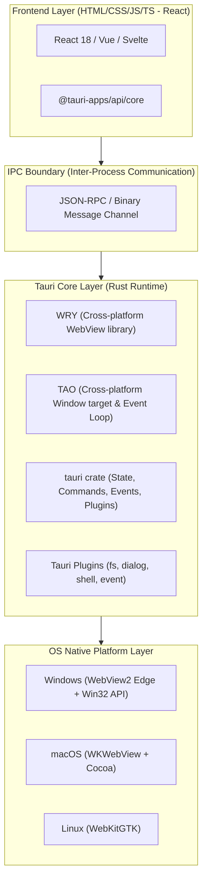

# CHUYÊN ĐỀ 01: KIẾN TRÚC CỐT LÕI TAURI v2 (TAURI v2 CORE ARCHITECTURE)
> **Mục tiêu:** Hiểu sâu về mô hình kiến trúc của Tauri v2, cách thức hoạt động của TAO & WRY, so sánh toàn diện với Electron và cấu hình chuẩn `tauri.conf.json`.

---

## 1. TỔNG QUAN KIẾN TRÚC TAURI v2

Khác với Electron (đóng gói sẵn cả Chromium và Node.js vào từng ứng dụng dẫn đến dung lượng > 100MB và tốn RAM), **Tauri** sử dụng kiến trúc phân tầng tận dụng Webview có sẵn của hệ điều hành:



### Các thành phần cốt lõi:
1. **TAO**: Thư viện tạo cửa sổ (Windowing library) viết bằng Rust, kế thừa từ `winit`, chịu trách nhiệm quản lý cửa sổ, event loop hệ thống, menu và system tray.
2. **WRY**: Lớp bao bọc Webview đa nền tảng kết nối trực tiếp với:
   * **Windows**: `Microsoft.Web.WebView2` (nhân Blink của Edge).
   * **macOS / iOS**: `WKWebView` (nhân WebKit của Safari).
   * **Linux**: `WebKitGTK`.
   * **Android**: `android.webkit.WebView`.
3. **Tauri Runtime (`tauri` crate)**: Quản lý vòng đời ứng dụng, hệ thống Plugin, điều phối Command/Event, quản lý State và cơ chế bảo mật phân quyền (ACL).

---

## 2. BẢNG SO SÁNH TOÀN DIỆN: TAURI v2 vs ELECTRON

| Tiêu chí | Tauri v2 | Electron 31+ | Nhận định kỹ thuật |
| :--- | :---: | :---: | :--- |
| **Kích thước file thực thi (.exe)** | **~5 - 12 MB** | **~70 - 100 MB** | Tauri nhỏ hơn ~90% nhờ không đóng gói Chromium. |
| **Mức chiếm dụng RAM khi mở** | **~35 - 60 MB** | **~180 - 300 MB** | Tauri tiết kiệm 70 - 80% RAM. |
| **Thời gian khởi động lạnh (Cold Boot)** | **~0.2 - 0.4s** | **~1.5 - 2.5s** | Tauri khởi động gần như tức thì. |
| **Độ độc lập môi trường** | Phụ thuộc vào WebView2 của OS | Độc lập 100% (Bundled Chromium) | Electron an toàn hơn trên máy Windows cổ không có mạng. |
| **Ngôn ngữ Backend** | Rust (Hiệu năng cực cao, memory-safe) | Node.js (JavaScript / TypeScript) | Rust tối ưu cho xử lý dữ liệu nặng và bảo vệ mã nguồn. |
| **Hệ thống phân quyền (Security)** | Granular ACL (Cấp quyền từng hàm) | Tự do theo Node.js contextIsolation | Tauri bảo mật cao hơn nhưng đòi hỏi cấu hình ACL chuẩn. |

---

## 3. CẤU TRÚC DỰ ÁN TAURI v2 TIÊU CHUẨN

Một dự án desktop Tauri v2 tiêu chuẩn có cấu trúc tách biệt rõ ràng giữa Frontend và Rust Backend:

```
my-toad-project/
├── package.json                 # Cấu hình frontend dependencies
├── src/                         # Mã nguồn giao diện (React, TypeScript, CSS)
│   ├── App.tsx
│   ├── main.tsx
│   └── components/
├── src-tauri/                   # MÃ NGUỒN BACKEND RUST
│   ├── Cargo.toml               # Khai báo crate & dependencies Rust
│   ├── build.rs                 # Script build mã nguồn Rust của Tauri
│   ├── tauri.conf.json          # FILE CẤU HÌNH TRUNG TÂM TAURI v2
│   ├── capabilities/            # THƯ MỤC CẤP QUYỀN ACL (MỚI TRÊN v2)
│   │   └── default.json         # Danh sách quyền cho phép frontend gọi
│   ├── icons/                   # Bộ icon ứng dụng (ico, png)
│   └── src/
│       ├── main.rs              # Điểm khởi chạy (Entry point)
│       ├── lib.rs               # Module thư viện & đăng ký lệnh/plugin
│       └── commands.rs          # Các hàm Command gọi từ JS
```

---

## 4. CẤU HÌNH CHUẨN `tauri.conf.json` CHO ỨNG DỤNG WINDOWS

Dưới đây là cấu hình hoàn chỉnh mẫu tối ưu cho dự án phân tích dữ liệu desktop trên Windows:

```json
{
  "$schema": "https://schema.tauri.app/config/2",
  "productName": "Toad",
  "version": "2.2.0",
  "identifier": "com.toad.analyzer",
  "build": {
    "beforeDevCommand": "npm run dev",
    "devUrl": "http://localhost:5173",
    "beforeBuildCommand": "npm run build",
    "frontendDist": "../dist"
  },
  "app": {
    "withGlobalTauri": true,
    "windows": [
      {
        "title": "Toad - Forensic Data Analyzer",
        "width": 1400,
        "height": 900,
        "minWidth": 900,
        "minHeight": 600,
        "resizable": true,
        "fullscreen": false,
        "decorations": true,
        "theme": "Dark"
      }
    ],
    "security": {
      "csp": "default-src 'self' 'unsafe-inline' 'unsafe-eval' asset: data: blob:;"
    }
  },
  "bundle": {
    "active": true,
    "targets": "all",
    "icon": [
      "icons/32x32.png",
      "icons/128x128.png",
      "icons/icon.ico"
    ],
    "windows": {
      "webviewInstallMode": {
        "type": "downloadBootstrapper"
      }
    }
  },
  "plugins": {
    "dialog": {},
    "fs": {},
    "shell": {
      "open": true
    }
  }
}
```

---

## 5. VÒNG ĐỜI BUILD & ĐÓNG GÓI ỨNG DỤNG (BUILD PIPELINE)

Khi chạy lệnh `cargo tauri build`:
1. **Frontend Compilation**: Chạy `beforeBuildCommand` (Webpack hoặc Vite) đóng gói toàn bộ React code thành các file tĩnh HTML/CSS/JS tại `frontendDist`.
2. **Rust Compilation**: `rustc` biên dịch mã nguồn `src-tauri` cùng toàn bộ crate thành file nhị phân native (`.exe`).
3. **Asset Ingestion**: Toàn bộ nội dung thư mục `frontendDist` được nhúng trực tiếp hoặc tải động qua giao thức an toàn `asset://` hoặc `tauri://localhost`.
4. **Binary Packaging**: Sinh ra file thực thi duy nhất trong `src-tauri/target/release/` với dung lượng chỉ từ ~7MB - 12MB.

