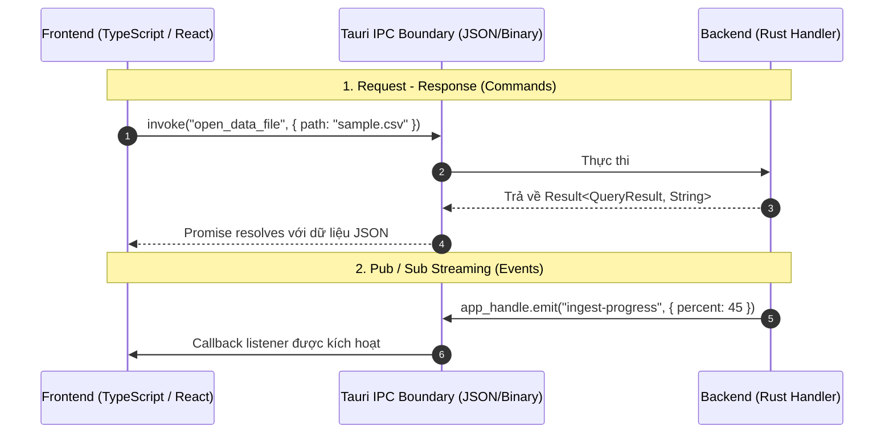

# CHUYÊN ĐỀ 02: HỆ THỐNG IPC & BẢO MẬT PHÂN QUYỀN ACL TRONG TAURI v2
> **Mục tiêu:** Nắm vững cơ chế truyền thông điệp IPC (Commands & Events), hệ thống Capabilities/ACL mới của Tauri v2, và xử lý triệt để lỗi phân quyền `plugin:event|listen not allowed by ACL`.

---

## 1. CƠ CHẾ IPC TRONG TAURI v2: COMMANDS vs EVENTS

Tauri v2 cung cấp 2 phương thức giao tiếp chính giữa JavaScript (Frontend) và Rust (Backend):



---

## 2. VIẾT TAURI COMMANDS (RUST & TYPESCRIPT)

### 2.1. Cú pháp Backend (Rust)
Các hàm Command được gắn attribute `#[tauri::command]`. Chúng hỗ trợ cả hàm đồng bộ (synchronous) và bất đồng bộ (`async`):

```rust
// src-tauri/src/commands.rs
use tauri::{AppHandle, State};
use serde::{Serialize, Deserialize};

#[derive(Serialize, Deserialize)]
pub struct QueryRequest {
    pub file_path: String,
    pub limit: usize,
    pub offset: usize,
}

#[derive(Serialize, Deserialize)]
pub struct QueryResponse {
    pub rows: Vec<serde_json::Value>,
    pub total_count: usize,
    pub duration_ms: f64,
}

// Command bất đồng bộ trả về Result<T, E>
#[tauri::command]
pub async fn execute_query(
    request: QueryRequest,
    app: AppHandle,
) -> Result<QueryResponse, String> {
    // Xử lý dữ liệu
    if !std::path::Path::new(&request.file_path).exists() {
        return Err(format!("File không tồn tại: {}", request.file_path));
    }

    // Giả lập xử lý trả về kết quả
    Ok(QueryResponse {
        rows: vec![],
        total_count: 0,
        duration_ms: 12.5,
    })
}
```

Đăng ký Command vào ứng dụng trong `lib.rs` / `main.rs`:
```rust
// src-tauri/src/lib.rs
pub fn run() {
    tauri::Builder::default()
        .invoke_handler(tauri::generate_handler![
            commands::execute_query,
            // thêm các commands khác tại đây
        ])
        .run(tauri::generate_context!())
        .expect("Lỗi khởi chạy ứng dụng Tauri");
}
```

### 2.2. Cú pháp Frontend (TypeScript)
Sử dụng hàm `invoke` từ thư viện `@tauri-apps/api/core`:

```typescript
import { invoke } from '@tauri-apps/api/core';

interface QueryRequest {
  file_path: string;
  limit: number;
  offset: number;
}

interface QueryResponse {
  rows: any[];
  total_count: number;
  duration_ms: number;
}

async function loadData() {
  try {
    const result = await invoke<QueryResponse>('execute_query', {
      request: {
        file_path: 'C:/data/logs.csv',
        limit: 1000,
        offset: 0,
      },
    });
    console.log('Query thành công:', result.rows);
  } catch (error) {
    console.error('Lỗi từ Rust backend:', error);
  }
}
```

---

## 3. BẢO MẬT PHÂN QUYỀN ACL (ACCESS CONTROL LIST) TRONG TAURI v2

### 3.1. Sự thay đổi mang tính cách mạng từ v1 lên v2
* **Tauri v1:** Sử dụng `allowlist` phẳng trong `tauri.conf.json`.
* **Tauri v2:** Bãi bỏ hoàn toàn `allowlist`. Thay thế bằng **Hệ thống Capabilities & Granular Permissions** đặt trong thư mục `src-tauri/capabilities/`. Mọi command và plugin nếu không được khai báo rõ ràng trong file capability sẽ **BỊ CHẶN TUYỆT ĐỐI** bởi security sandbox.

### 3.2. Giải phẫu Sự cố Thường gặp: `[Promise Rejection] Command plugin:event|listen not allowed by ACL`
Khi Frontend gọi hàm `listen()` từ `@tauri-apps/api/event`:
```javascript
import { listen } from '@tauri-apps/api/event';
listen('my-event', (e) => console.log(e));
```
Hàm này thực chất gọi xuống lệnh ngầm `plugin:event|listen`. Nếu `capabilities/default.json` chưa cấp quyền này, Tauri runtime sẽ ném ngoại lệ:
```
Unhandled Promise Rejection: Command plugin:event|listen not allowed by ACL
```

### 3.3. File Cấu hình Chuẩn `src-tauri/capabilities/default.json`
Để cấp toàn quyền hợp lệ cho Event, Dialog, File System và các API cốt lõi, file capability phải được cấu hình đầy đủ như sau:

```json
{
  "$schema": "../gen/schemas/desktop-schema.json",
  "identifier": "default",
  "description": "Cấp quyền toàn diện cho cửa sổ chính của Toad",
  "windows": [
    "main",
    "*"
  ],
  "permissions": [
    "core:default",
    "core:event:default",
    "core:event:allow-listen",
    "core:event:allow-emit",
    "core:path:default",
    "core:window:default",
    "core:window:allow-set-title",
    "core:window:allow-maximize",
    "core:window:allow-minimize",
    "core:window:allow-close",
    "dialog:default",
    "dialog:allow-open",
    "dialog:allow-save",
    "fs:default",
    "fs:allow-read-file",
    "fs:allow-write-file",
    "fs:allow-read-dir",
    "fs:allow-stat",
    "shell:default",
    "shell:allow-open"
  ]
}
```

> [!IMPORTANT]
> Sau khi tạo hoặc chỉnh sửa file trong thư mục `src-tauri/capabilities/`, bạn **PHẢI** chạy lại `cargo build` để trình biên dịch Rust sinh lại macro phân quyền nội bộ (`gen/schemas/`).

---

## 4. TẠO CAPABILITY TÙY BIẾN CHO CÁC COMMAND TỰ VIẾT

Nếu bạn muốn tạo quyền hạn riêng để kiểm soát xem cửa sổ nào được phép gọi command nhạy cảm (ví dụ `drop_database` hay `delete_cache`):

1. Khai báo quyền trong `src-tauri/permissions/admin.json`:
```json
{
  "$schema": "../gen/schemas/permission-schema.json",
  "identifier": "allow-admin-commands",
  "description": "Cho phép thực thi lệnh quản trị",
  "commands": {
    "allow": [
      "clear_disk_cache",
      "reset_user_database"
    ]
  }
}
```
2. Kích hoạt quyền đó vào file `capabilities/default.json`:
```json
{
  "permissions": [
    "core:default",
    "allow-admin-commands"
  ]
}
```
Phương chế này đảm bảo mã độc từ webview bên ngoài không bao giờ có thể tự ý kích hoạt các hàm nguy hiểm trên máy tính người dùng.
