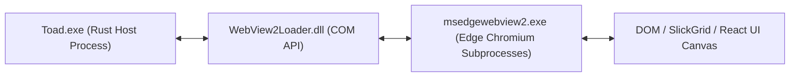

# CHUYÊN ĐỀ 05: CHUYÊN SÂU MICROSOFT EDGE WEBVIEW2 TRÊN WINDOWS
> **Mục tiêu:** Hiểu sâu về cơ chế vận hành của Microsoft Edge WebView2, mô hình phân phối Evergreen, cách cô lập dữ liệu người dùng (User Data Folder) cho ứng dụng Portable, và khắc phục các lỗi render CSS / Font / Dark Mode.

---

## 1. TỔNG QUAN KIẾN TRÚC MICROSOFT EDGE WEBVIEW2

Trên Windows, Tauri v2 sử dụng thư viện **WRY** để giao tiếp với **Microsoft Edge WebView2**. WebView2 sử dụng nhân Blink tương tự Google Chrome nhưng được tích hợp chặt chẽ vào hệ điều hành Windows:



* **Process Model**: Khi mở 1 cửa sổ WebView2, hệ điều hành sẽ sinh ra các tiến trình phụ:
  * `msedgewebview2.exe --type=gpu-process`: Xử lý tăng tốc phần cứng.
  * `msedgewebview2.exe --type=renderer`: Thực thi mã JavaScript và render DOM.
  * `msedgewebview2.exe --type=utility`: Điều khiển mạng (Network Service).

---

## 2. CHẾ ĐỘ PHÂN PHỐI (EVERGREEN vs FIXED VERSION)

### 2.1. Evergreen Runtime (Khuyến nghị mặc định)
* Sử dụng bộ cài WebView2 có sẵn trên Windows 10 (bản 20H2 trở lên) và mặc định 100% trên Windows 11.
* Microsoft tự động cập nhật bản vá bảo mật và tối ưu hiệu năng ngầm.
* Giúp file đóng gói của Toad chỉ còn **~8MB**.

### 2.2. Kiểm tra WebView2 bằng PowerShell / Registry
Trước khi khởi chạy Tauri, launcher kiểm tra sự tồn tại của runtime qua Registry:
```powershell
$regPath = "HKLM:\SOFTWARE\WOW6432Node\Microsoft\EdgeUpdate\Clients\{F3017226-FE2A-4295-8BDF-00C3A9A7E4C5}"
$installed = Test-Path $regPath
if ($installed) {
    $version = (Get-ItemProperty -Path $regPath).pv
    Write-Host "WebView2 đã cài đặt, phiên bản: $version"
} else {
    Write-Warning "Chưa có WebView2! Kích hoạt chế độ Fallback sang Electron."
}
```

---

## 3. CÔ LẬP THƯ MỤC DỮ LIỆU (USER DATA FOLDER CHO PORTABLE)

### 3.1. Vấn đề
Mặc định, WebView2 sẽ tạo thư mục lưu trữ cache, cookies, localStorage tại:
`C:\Users\<User>\AppData\Local\<AppIdentifier>\EBWebView\`  
Điều này vi phạm nguyên tắc **Ứng dụng Portable** (không để lại rác trên ổ C của khách hàng).

### 3.2. Cấu hình Thư mục Dữ liệu Riêng trong Rust
Trong mã nguồn Rust của Tauri, có thể cấu hình thư mục lưu trữ này về thư mục chạy của phần mềm:

```rust
// src-tauri/src/main.rs
use std::path::PathBuf;

fn main() {
    // Thiết lập thư mục UserData cạnh file thực thi portable
    let exe_dir = std::env::current_exe()
        .ok()
        .and_then(|p| p.parent().map(|p| p.to_path_buf()))
        .unwrap_or_else(|| PathBuf::from("."));

    let custom_data_dir = exe_dir.join("toadAppData").join("webview_cache");
    
    // Đặt biến môi trường trước khi WRY khởi tạo
    std::env::set_var("WEBVIEW2_USER_DATA_FOLDER", custom_data_dir);

    toad_lib::run();
}
```

---

## 4. KHẮC PHỤC CÁC LỖI RENDER CSS & DARK MODE TRÊN WEBVIEW2

Trong quá trình chuyển đổi giao diện từ Electron sang WebView2, thường phát sinh 3 lỗi hiển thị:

### 4.1. Lỗi Dark Mode không ăn thanh cuộn (Scrollbar)
* **Hiện tượng:** Nền ứng dụng màu tối (`#1E222B`), nhưng thanh cuộn Windows màu trắng tinh gây chói mắt.
* **Nguyên nhân:** WebView2 tuân thủ nghiêm ngặt thuộc tính `color-scheme` của CSS hơn Chromium cũ.
* **Cách khắc phục:** Thêm thuộc tính này vào CSS cấp thẻ `<html>` và `<body>`:
```css
html.theme-dark,
body.theme-dark {
  color-scheme: dark !important;
}

/* Tùy biến thanh cuộn hiện đại cho WebView2 */
::-webkit-scrollbar {
  width: 8px;
  height: 8px;
}
::-webkit-scrollbar-track {
  background: #161920;
}
::-webkit-scrollbar-thumb {
  background: #3B4252;
  border-radius: 4px;
}
::-webkit-scrollbar-thumb:hover {
  background: #4C566A;
}
```

### 4.2. Lỗi Font chữ hiển thị mờ hoặc không ăn Font Local
* **Hiện tượng:** Các icon BlueprintJS hoặc font Segoe UI / Roboto bị mờ viền.
* **Cách khắc phục:**
  1. Thêm cờ khử răng cưa chữ trong CSS:
  ```css
  * {
    -webkit-font-smoothing: antialiased;
    -moz-osx-font-smoothing: grayscale;
    text-rendering: optimizeLegibility;
  }
  ```
  2. Không tải font từ CDN qua internet (sẽ bị CSP của Tauri chặn), mà nhúng trực tiếp font dạng file WOFF2 nội bộ trong bundle.

---

## 5. MỞ DEVTOOLS ĐỂ DEBUG TRONG MÔI TRƯỜNG RELEASE

Mặc định khi build release (`cargo tauri build`), phím `F12` và chuột phải Inspect Element sẽ bị vô hiệu hóa để bảo mật.  
Nếu cần debug lỗi trên môi trường khách hàng, có thể bật cờ `devtools` trong `Cargo.toml`:

```toml
# src-tauri/Cargo.toml
[dependencies]
tauri = { version = "2.0", features = ["devtools"] }
```

Và mở bằng lệnh từ Rust:
```rust
#[tauri::command]
pub fn open_developer_tools(window: tauri::WebviewWindow) {
    #[cfg(debug_assertions)]
    window.open_devtools();
    
    #[cfg(not(debug_assertions))]
    {
        // Có thể kích hoạt nếu người dùng truyền cờ --debug vào dòng lệnh
        window.open_devtools();
    }
}
```

