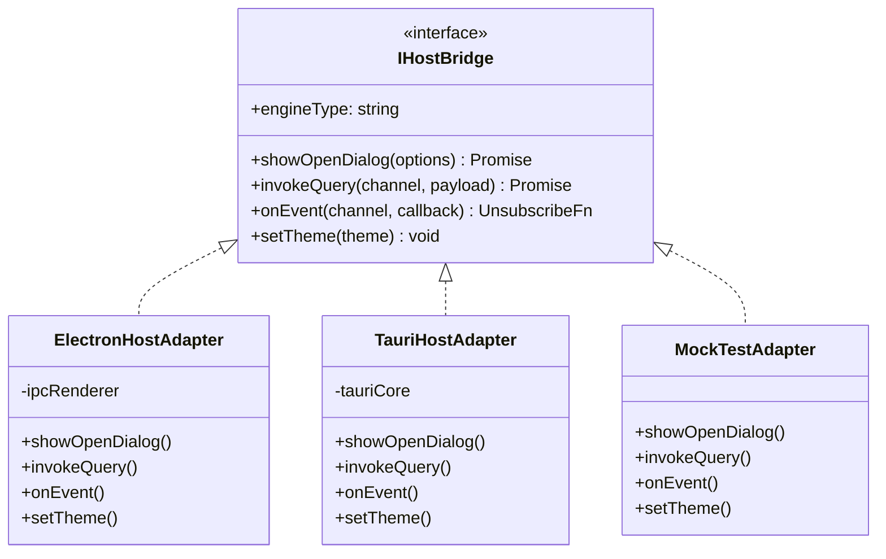

# CHUYÊN ĐỀ 06: CẨM NANG KẾT NỐI FRONTEND REACT / TYPESCRIPT (HOST BRIDGE ADAPTER)
> **Mục tiêu:** Xây dựng lớp Adapter trong TypeScript giúp giao diện React chạy mượt mà trên cả Electron và Tauri v2 mà không cần sửa code giao diện hay phụ thuộc cứng vào bất kỳ runtime nào.

---

## 1. THIẾT KẾ MẪU THIẾT KẾ ADAPTER (ADAPTER PATTERN)

Để đạt tính tương thích kép, tầng giao diện chỉ làm việc với một đối tượng trừu tượng duy nhất: `HostBridge`.



---

## 2. MÃ NGUỒN INTERFACE CHUẨN: `IHostBridge.ts`

```typescript
// src/bridge/IHostBridge.ts

export interface OpenDialogOptions {
  title?: string;
  defaultPath?: string;
  filters?: { name: string; extensions: string[] }[];
  multiple?: boolean;
  directory?: boolean;
}

export type UnsubscribeFn = () => void;

export interface IHostBridge {
  readonly engineType: 'electron' | 'tauri' | 'mock';

  // Hộp thoại mở file / thư mục
  showOpenDialog(options: OpenDialogOptions): Promise<string[] | null>;

  // Gọi lệnh truy vấn dữ liệu (DuckDB / Backend)
  invokeQuery<T = any>(command: string, payload?: any): Promise<T>;

  // Đăng ký lắng nghe sự kiện từ backend
  onEvent<T = any>(event: string, callback: (payload: T) => void): Promise<UnsubscribeFn>;

  // Quản lý giao diện và theme
  setTheme(theme: 'light' | 'dark'): void;
}
```

---

## 3. TRIỂN KHAI CHO TAURI v2: `TauriHostAdapter.ts`

```typescript
// src/bridge/TauriHostAdapter.ts
import { invoke } from '@tauri-apps/api/core';
import { listen } from '@tauri-apps/api/event';
import { open } from '@tauri-apps/plugin-dialog';
import { IHostBridge, OpenDialogOptions, UnsubscribeFn } from './IHostBridge';

export class TauriHostAdapter implements IHostBridge {
  readonly engineType = 'tauri' as const;

  async showOpenDialog(options: OpenDialogOptions): Promise<string[] | null> {
    try {
      const selected = await open({
        title: options.title,
        defaultPath: options.defaultPath,
        multiple: options.multiple ?? false,
        directory: options.directory ?? false,
        filters: options.filters,
      });

      if (!selected) return null;
      if (Array.isArray(selected)) return selected;
      return [selected];
    } catch (err) {
      console.error('[TauriBridge] Lỗi mở hộp thoại:', err);
      return null;
    }
  }

  async invokeQuery<T = any>(command: string, payload?: any): Promise<T> {
    // Map lệnh từ tên kênh sang Tauri Command tương ứng
    return await invoke<T>(command, payload ?? {});
  }

  async onEvent<T = any>(event: string, callback: (payload: T) => void): Promise<UnsubscribeFn> {
    const unlisten = await listen<T>(event, (e) => {
      callback(e.payload);
    });
    return unlisten;
  }

  setTheme(theme: 'light' | 'dark'): void {
    document.documentElement.classList.remove('theme-light', 'theme-dark');
    document.documentElement.classList.add(`theme-${theme}`);
    localStorage.setItem('toad-theme-v2', theme);
  }
}
```

---

## 4. TỰ ĐỘNG PHÁT HIỆN RUNTIME (RUNTIME DETECTOR FACTORY)

Hàm factory tự động xác định xem mã JavaScript đang chạy bên trong môi trường nào để nạp adapter phù hợp nhất:

```typescript
// src/bridge/index.ts
import { IHostBridge } from './IHostBridge';
import { ElectronHostAdapter } from './ElectronHostAdapter';
import { TauriHostAdapter } from './TauriHostAdapter';
import { MockTestAdapter } from './MockTestAdapter';

let activeBridgeInstance: IHostBridge | null = null;

export function getHostBridge(): IHostBridge {
  if (activeBridgeInstance) {
    return activeBridgeInstance;
  }

  // 1. Kiểm tra môi trường Tauri
  if (typeof window !== 'undefined' && ('__TAURI_INTERNALS__' in window || '__TAURI__' in window)) {
    console.log('[BridgeFactory] Đang khởi chạy với Tauri v2 Runtime');
    activeBridgeInstance = new TauriHostAdapter();
    return activeBridgeInstance;
  }

  // 2. Kiểm tra môi trường Electron
  if (typeof window !== 'undefined' && 'electron' in window) {
    console.log('[BridgeFactory] Đang khởi chạy với Electron Runtime');
    activeBridgeInstance = new ElectronHostAdapter();
    return activeBridgeInstance;
  }

  // 3. Môi trường kiểm thử Node.js / Trình duyệt thông thường
  console.log('[BridgeFactory] Đang sử dụng Mock Test Bridge');
  activeBridgeInstance = new MockTestAdapter();
  return activeBridgeInstance;
}
```

---

## 5. CÁCH SỬ DỤNG TRONG COMPONENT REACT

Mã nguồn trong React Component trở nên cực kỳ trong sáng và không còn vết tích của Electron hay Tauri:

```tsx
import React, { useState } from 'react';
import { getHostBridge } from '../bridge';

export const FileOpenButton: React.FC = () => {
  const [filePath, setFilePath] = useState<string | null>(null);

  const handleOpen = async () => {
    const bridge = getHostBridge();
    const result = await bridge.showOpenDialog({
      title: 'Mở tập tin dữ liệu',
      filters: [{ name: 'Data Files', extensions: ['csv', 'jsonl', 'parquet'] }],
    });

    if (result && result.length > 0) {
      setFilePath(result[0]);
      // Gọi truy vấn qua bridge
      await bridge.invokeQuery('load_file', { path: result[0] });
    }
  };

  return (
    <button onClick={handleOpen} className="btn-open-file">
      {filePath ? `Đã mở: ${filePath}` : 'Mở tập tin (Ctrl+O)'}
    </button>
  );
};
```
