# PHƯƠNG ÁN CHI TIẾT TÙY BIẾN VÀ NÂNG CẤP HỆ THỐNG NẠP DỮ LIỆU (INGESTION ENGINE) & KIẾN TRÚC PORTABLE APPDATA CHO TOAD VIEWER

> **Tài liệu phương án kỹ thuật & kiến trúc hệ thống**  
> **Dự án**: Nâng cấp bộ nạp dữ liệu và kiến trúc Portable cho Toad Viewer (Custom Tad v1.0.1)  
> **Tham chiếu kiến trúc**: `csv_proc_v0.2.2` & `rust_kv_bench` (`D:\Shared_UserData\Downloads\workflow\`)  
> **Vị trí lưu trữ**: `D:\Shared_UserData\Downloads\tad\instructions\PHUONG_AN_NANG_CAP_INGEST_TOAD.md`  
> **Trạng thái**: Bản cập nhật hoàn thiện — Bổ sung Kiến trúc Portable AppData `toadAppData_[5_random_chars]`, Quy trình Thẩm định (Validation) File Config & Cơ chế Xóa Dọn Temp Khi Thoát Ứng Dụng.

---

## 1. TỔNG QUAN & BỐI CẢNH YÊU CẦU

### 1.1. Hiện trạng của Toad / Tad Viewer
Hiện tại, Toad tiếp nhận file CSV thông qua lệnh DuckDB SQL trực tiếp nạp thẳng vào RAM (In-Memory Table):
```sql
CREATE OR REPLACE TABLE t_filename AS SELECT * FROM read_csv_auto('path/to/file.csv')
```
* **Hạn chế 1 (Tiêu tốn RAM khổng lồ)**: Toàn bộ dữ liệu CSV được giải nén và lưu trong RAM. Với file log bảo mật 5GB - 10GB, mức tiêu thụ RAM có thể lên tới 8GB - 12GB, dễ gây tràn bộ nhớ (Out-Of-Memory) hoặc làm đơ máy người dùng.
* **Hạn chế 2 (Dễ gãy với log bẩn - Dirty Logs)**: Dữ liệu log thực tế (Hayabusa, EVTX dump, Sysmon, Zeek, Web Access) chứa các dòng PowerShell script dài bất thường (vài trăm KB), dòng thiếu/thừa cột, hoặc cột bị lẫn lộn giữa kiểu số và chữ. Chế độ `read_csv_auto` mặc định sẽ văng exception khiến file không mở được.
* **Hạn chế 3 (Ô nhiễm hệ thống & Không Portable thực sự)**: Electron mặc định ghi UserData vào `C:\Users\<user>\AppData\Roaming\Tad`. Khi mang file Portable sang máy khác (USB, môi trường Incident Response / DFIR không có mạng), các cấu hình bị thất lạc hoặc để lại dấu vết trên máy tính phân tích.

### 1.2. Mục tiêu chiến lược theo yêu cầu mới
1. **True Portable AppData (`toadAppData_[5_chars]`)**:
   - Tự động nhận diện thư mục chứa file `.exe` thật sự (`PORTABLE_EXECUTABLE_DIR`).
   - Tự động sinh thư mục AppData ngay cùng thư mục với file `.exe` theo định dạng: `toadAppData_[chuỗi random 5 kí tự]` (ví dụ: `toadAppData_a9k2m`).
   - Nếu thư mục này đã tồn tại từ trước: Tái sử dụng để giữ nguyên cấu hình và lịch sử người dùng.
2. **Thẩm định toàn diện (Full Validation) các file Config**:
   - Kiểm tra xem thư mục và các file config bắt buộc (`config.ini`, `filters_preset.json`...) đã đủ chưa.
   - Nếu chưa có: Tự động khởi tạo file mẫu đầy đủ với các giá trị mặc định tối ưu và comment hướng dẫn rõ ràng.
   - Nếu đã có: Validate cú pháp, cấu trúc schema (tất cả các section, các key bắt buộc), và khoảng giá trị hợp lệ. Nếu thiếu key nào, tự động bổ sung (Auto-Heal / Merge) mà không làm mất cấu hình tùy biến của người dùng.
3. **Tự động dọn dẹp sạch sẽ Temp khi tắt ứng dụng (Lifecycle Temp Purge)**:
   - Toàn bộ file Parquet trung gian tạo ra trong quá trình nạp streaming được lưu trữ bên trong `toadAppData_*/temp/`.
   - Khi người dùng đóng ứng dụng: Hệ thống ngắt các kết nối DuckDB, giải phóng file lock Windows (`EBUSY`), và tự động xóa sạch 100% dữ liệu trong `temp/`, giữ nguyên vẹn file cấu hình.
   - Khi khởi động lại: Tự động dọn rác mồ côi (Startup Orphan Cleaner) phòng trường hợp lần trước app bị tắt đột ngột (mất điện, End Task).
4. **Động cơ nạp dữ liệu 5 giai đoạn bền bỉ (CSV_PROC Pipeline)**:
   - Binary Guard (8KB Check) ngăn chặn kéo nhầm file binary gây treo.
   - 3 tầng Fallback (`parallel=false`, `all_varchar=true`) nạp thành công 100% mọi file CSV bẩn.
   - Streaming trực tiếp sang Parquet Snappy, mở bằng Bảng Ảo (VIEW) giúp RAM luôn < 100MB và truy vấn bộ lọc AND/OR lồng nhau trong < 100ms.

---

## 2. KIẾN TRÚC TỔNG THỂ & SƠ ĐỒ LUỒNG HOẠT ĐỘNG

### 2.1. Chu trình toàn diện từ Khởi động, Nạp file đến Khi Thoát

```mermaid
flowchart TD
    START(["Khởi Động Toad.exe"]) --> DetectExeDir
    
    subgraph PORTABLE_LIFECYCLE["1. Khởi Tạo Portable AppData & Thẩm Định Config"]
        DetectExeDir["Xác định thư mục Exe thật sự:\nprocess.env.PORTABLE_EXECUTABLE_DIR || dirname(process.execPath)"]
        DetectExeDir --> CheckDir{"Đã có thư mục\ntoadAppData_[5_chars] chưa?"}
        
        CheckDir -- "Chưa có" --> GenDir["Sinh chuỗi ngẫu nhiên 5 ký tự an toàn\nTạo mới thư mục: toadAppData_a9k2m"]
        CheckDir -- "Đã có" --> ReuseDir["Sử dụng thư mục toadAppData_* hiện có"]
        
        GenDir --> EnsureSubDirs["Tạo các thư mục con bắt buộc:\n- temp/\n- electron_data/\n- logs/"]
        ReuseDir --> EnsureSubDirs
        
        EnsureSubDirs --> StartupClean["Dọn rác mồ côi trong temp/ (Startup Orphan Clean)"]
        StartupClean --> ValidateConfigs["Thẩm định (Validation) các file config:\n1. config.ini (Cấu hình hệ thống, DuckDB, Parquet)\n2. filters_preset.json (Mẫu bộ lọc AND/OR)\n- Nếu thiếu -> Tự sinh file chuẩn\n- Nếu có -> Validate cú pháp & Auto-heal key thiếu"]
        
        ValidateConfigs --> RedirectElectron["Chuyển hướng Electron cô lập 100%:\napp.setPath('userData', appDataDir + '/electron_data')\napp.setPath('temp', appDataDir + '/temp')"]
    end

    RedirectElectron --> IngestPipeline

    subgraph INGEST_ENGINE["2. Động Cơ Nạp Dữ Liệu 5 Giai Đoạn (CSV_PROC Inspired)"]
        IngestPipeline["Giai Đoạn 1: Tiếp Nhận & Binary Guard (8KB Check)\n- Quét 8KB đầu tìm null-byte '\\0'\n- Nếu là binary trái phép -> Chặn & Cảnh báo an toàn"]
        
        IngestPipeline --> LoadDynamicCfg["Giai Đoạn 2: Nạp Cấu Hình Động từ config.ini\n- Đọc max_memory, threads, compression, row_group_size"]
        
        LoadDynamicCfg --> GenTempPath["Giai Đoạn 3: Chuẩn Bị Đường Dẫn Parquet Tạm\n- toadAppData_*/temp/{base_name}_view_{timestamp}.parquet"]
        
        GenTempPath --> StreamConvert{"Giai Đoạn 4: Streaming DuckDB sang Parquet"}
        
        StreamConvert -- "CSV Chuẩn" --> CSV_Stream["COPY (SELECT * FROM read_csv(..., sample_size=100000,\nignore_errors=true, strict_mode=false))\nTO temp.parquet (ZSTD, ROW_GROUP_SIZE 100000)"]
        CSV_Stream -- "Lỗi vỡ chunk / dòng quá dài" --> FB1["Fallback 1: parallel = false"]
        FB1 -- "Lỗi xung đột kiểu dữ liệu" --> FB2["Fallback 2: all_varchar = true"]
        
        StreamConvert -- "JSON / JSONL" --> JSON_Stream["COPY (SELECT * FROM read_json_auto(...,\nignore_errors=true)) TO temp.parquet"]
        StreamConvert -- "Raw Log (.log / .txt)" --> RawLog_Stream["COPY (SELECT * FROM read_csv(...,\nauto_detect=false, header=false, columns={'raw_event': 'VARCHAR'}))\nTO temp.parquet"]
        
        CSV_Stream --> ValidateParquet
        FB1 --> ValidateParquet
        FB2 --> ValidateParquet
        JSON_Stream --> ValidateParquet
        RawLog_Stream --> ValidateParquet
        
        ValidateParquet["Giai Đoạn 5: Thẩm Định Parquet & Handoff Bảng Ảo (VIEW)\n- Kiểm tra file Parquet > 0 bytes\n- CREATE VIEW t_view AS SELECT * FROM parquet_scan('temp.parquet')"]
    end

    ValidateParquet --> InteractiveUI["SlickGrid & Bộ Lọc AND/OR Lồng Nhau\n(RAM < 100MB, Row-Group Skipping siêu tốc)"]

    InteractiveUI --> ExitEvent

    subgraph EXIT_CLEANUP["3. Vòng Đời Thoát & Tự Động Xóa Dọn Temp"]
        ExitEvent["Sự kiện app.on('before-quit') / 'will-quit'"] --> CloseDuckDB["Đóng kết nối DuckDB (db.close())\nGiải phóng File Lock Windows (EBUSY)"]
        CloseDuckDB --> CheckTempCleanupCfg{"config.ini [system]\ntemp_cleanup = true?"}
        CheckTempCleanupCfg -- "true (mặc định)" --> PurgeTemp["Xóa sạch 100% file trong toadAppData_*/temp/\n(Giữ nguyên config.ini, presets, electron_data)"]
        CheckTempCleanupCfg -- "false" --> KeepTemp["Giữ lại file Parquet trong temp để tái sử dụng"]
        PurgeTemp --> AppExit(["Thoát Ứng Dụng An Toàn & Sạch Sẽ"])
        KeepTemp --> AppExit
    end
```



---

## 3. THIẾT KẾ CHI TIẾT CÁC PHÂN HỆ

### 3.1. Phân hệ Portable AppData: `toadAppData_[5_chars]`

#### 1. Nguyên tắc xác định thư mục Executable (`exeDir`):
Trong môi trường Windows với Electron và Electron-builder:
* **Khi chạy file Portable (Single-file `.exe`)**: Electron-builder giải nén code vào thư mục tạm `%TEMP%\` và gán biến môi trường `process.env.PORTABLE_EXECUTABLE_DIR` trỏ thẳng vào thư mục thật nơi người dùng đặt file `.exe`.
* **Khi chạy thư mục Unpacked (Folder `.exe`)**: Biến môi trường trên không tồn tại, ta dùng `path.dirname(process.execPath)`.
* **Công thức chuẩn xác**:
  ```typescript
  const exeDir = process.env.PORTABLE_EXECUTABLE_DIR || path.dirname(process.execPath);
  ```

#### 2. Quy tắc đặt tên và thuật toán quét tìm thư mục:
* **Quy chuẩn tên**: `toadAppData_[a-z0-9]{5}` (chữ thường và số, 5 ký tự ngẫu nhiên).
  - Ví dụ: `toadAppData_a9k2m`, `toadAppData_7f4xp`.
* **Bộ ký tự ngẫu nhiên an toàn (Ambiguity-free Charset)**:
  - Loại bỏ các ký tự dễ gây nhầm lẫn thị giác như số `0` với chữ `O`, số `1` với chữ `l`, chữ `I`.
  - Bộ ký tự sử dụng: `"abcdefghjkmnpqrstuvwxyz23456789"`.
* **Quy tắc tái sử dụng (Persistence & Reuse)**:
  - Khi khởi động, Toad sẽ quét thư mục `exeDir`.
  - Nếu đã có thư mục con khớp regex `/^toadAppData_[a-z0-9]{5}$/i`: Sử dụng ngay thư mục đó (tránh tạo ra nhiều thư mục rác qua các lần chạy).
  - Nếu chưa có: Tạo mới `toadAppData_${genRandomSuffix()}`.

#### 3. Cấu trúc thư mục chuẩn bên trong `toadAppData_[5_chars]/`:
```
[Thư mục chứa Toad.exe]
├── Toad.exe                       # File thực thi portable duy nhất
└── toadAppData_a9k2m/             # Thư mục AppData cục bộ tương ứng
    ├── config.ini                 # File cấu hình trung tâm (Tự validate & auto-heal)
    ├── filters_preset.json        # Danh sách mẫu bộ lọc AND/OR lưu sẵn
    ├── temp/                      # Chứa file Parquet nén trung gian (Tự xóa khi tắt app)
    │   ├── hayabusa_view_174001.parquet
    │   └── access_log_view_174002.parquet
    ├── electron_data/             # Cache giao diện Electron (Local Storage, GPU Cache)
    └── logs/                      # Nhật ký lỗi / crash log
```

#### 4. Cô lập hoàn toàn với hệ điều hành (100% True Portable):
Ngay trước khi khởi tạo bất kỳ cửa sổ BrowserWindow nào, thiết lập lại các đường dẫn hệ thống của Electron:
```typescript
app.setPath("userData", path.join(appDataDir, "electron_data"));
app.setPath("temp", path.join(appDataDir, "temp"));
app.setPath("crashDumps", path.join(appDataDir, "logs"));
```
* **Lợi ích vượt trội**:
  - Không để lại bất kỳ tập tin rác nào trong `C:\Users\<user>\AppData\Roaming\Tad`.
  - Khi rút USB khỏi máy phân tích, toàn bộ dữ liệu cấu hình đi theo USB, máy trạm hoàn toàn sạch sẽ.

---

### 3.2. Quy Trình Thẩm Định (Validation) & Tự Động Phục Hồi Các File Config

Hệ thống triển khai cơ chế **Multi-tier Config Validation** gồm 4 cấp độ:

```
[Khởi động Toad]
       │
       ▼
[Cấp 1: Existence Check] ────(Chưa có)────► [Khởi tạo từ Template Mẫu Chuẩn]
       │ (Đã có)
       ▼
[Cấp 2: Syntax & Parsing] ───(Corrupt/Lỗi)─► [Backup .corrupt & Phục hồi Template]
       │ (Hợp lệ)
       ▼
[Cấp 3: Schema & Key Completeness] ──(Thiếu key)─► [Auto-Heal: Bổ sung key mặc định]
       │ (Đủ key)
       ▼
[Cấp 4: Value Range & Type Check] ──(Sai giá trị)─► [Điều chỉnh về giá trị an toàn]
       │
       ▼
[Nạp Cấu Hình Sẵn Sàng Phục Vụ Ingestion]
```

#### 1. Danh mục các file cấu hình bắt buộc:
| Tên File | Định dạng | Mục đích sử dụng | Hành động khi thiếu |
| :--- | :--- | :--- | :--- |
| **`config.ini`** | INI | Cấu hình tham số DuckDB (RAM, threads), thuật toán Parquet, cờ dọn dẹp temp | Tự sinh file đầy đủ comment hướng dẫn |
| **`filters_preset.json`** | JSON | Lưu danh sách bộ lọc AND/OR ưa thích hoặc template lọc DFIR (Hayabusa, Sysmon) | Tự sinh file JSON chứa các preset mẫu |

#### 2. Đặc tả nội dung chuẩn của `config.ini`:
```ini
# ==============================================================================
#                      CAU HINH HE THONG TOAD VIEWER (CONFIG.INI)
# ==============================================================================
# File nay duoc tu dong tham dinh (validate) va doc truoc moi lan ban mo file.
# Ban co the chinh sua truc tiep bang Notepad va luu lai bat cu luc nao.

[general]
# Che do trinh xem: toad (mac dinh)
viewer = toad

# Ngon ngu hien thi giao dien: vi / en
language = vi

[duckdb]
# Gioi han RAM cap phat cho DuckDB:
#   - auto : Tu dong can bang theo RAM he thong (khuyen dung)
#   - Hoac: 512MB, 1GB, 2GB, 4GB, 8GB...
max_memory = auto

# So luong luong CPU toi da xu ly song song:
#   - 0 : Su dung toan bo tat ca cac nhan/luong CPU cua may (mac dinh)
#   - Hoac: 1, 2, 4, 8...
threads = 0

# Co tu dong them cot tong hop [raw_event] cho file CSV/JSON khong?
#   - false : (KHUYEN DUNG) Giu nguyen ban Columnar sieu toc, tiet kiem RAM
#   - true  : Gom toan bo gia tri cac cot thanh 1 chuoi text dai
add_raw_event = false

[parquet]
# Thuat toan nen file Parquet tam:
#   - snappy : (KHUYEN DUNG) Nen nhanh nhat, toc do mo file nhanh gap 4x - 5x
#   - zstd   : Ty le nen cao nhat
#   - gzip   : Nen tieu chuan
#   - none   : Khong nen
compression = snappy

# Kich thuoc moi Row Group (so dong trong 1 block du lieu):
#   - Giup bo qua (skip) cac block khong khop khi loc AND/OR. Mac dinh: 25000
row_group_size = 25000

[system]
# Tu dong xoa file Parquet tam trong thu muc temp sau khi dong Toad:
#   - true  : Tu dong don sach de giai phong o cung (KHUYEN DUNG)
#   - false : Giu lai file Parquet trong temp de tai su dung
temp_cleanup = true

# Tu dong kiem tra va chan file nhi phan doc hai (Binary Guard):
#   - true  : Quet 8KB dau, tu choi mo neu la file binary gay treo (KHUYEN DUNG)
#   - false : Bo qua kiem tra binary
binary_guard = true
```

#### 3. Đặc tả nội dung chuẩn của `filters_preset.json`:
```json
{
  "version": "1.0",
  "presets": [
    {
      "name": "Hayabusa High & Critical Alerts",
      "description": "Lọc các cảnh báo mức độ High hoặc Critical trong log Hayabusa",
      "filter": {
        "op": "OR",
        "clauses": [
          { "field": "Level", "op": "EQ", "value": "critical" },
          { "field": "Level", "op": "EQ", "value": "high" }
        ]
      }
    },
    {
      "name": "Suspicious PowerShell Execution",
      "description": "Lọc tiến trình powershell chạy cờ mã hóa hoặc bypass",
      "filter": {
        "op": "AND",
        "clauses": [
          { "field": "Image", "op": "CONTAINS", "value": "powershell" },
          {
            "op": "OR",
            "clauses": [
              { "field": "CommandLine", "op": "CONTAINS", "value": "-enc" },
              { "field": "CommandLine", "op": "CONTAINS", "value": "bypass" }
            ]
          }
        ]
      }
    }
  ]
}
```

#### 4. Chi tiết các quy tắc thẩm định (Validation Schema Table):
| Mục Cấu Hình | Khóa (Key) | Kiểu Dữ Liệu | Giá Trị Cho Phép | Giá Trị Mặc Định | Hành Động Khi Thiếu / Sai (Auto-Heal) |
| :--- | :--- | :--- | :--- | :--- | :--- |
| `[general]` | `viewer` | String | `toad`, `tad` | `toad` | Gán về `toad` nếu rỗng hoặc sai |
| `[general]` | `language` | String | `vi`, `en` | `vi` | Gán về `vi` |
| `[duckdb]` | `max_memory` | String | `auto` hoặc `^\d+(MB\|GB\|TB)$` | `auto` | Nếu gõ sai định dạng -> tự chuyển về `auto` |
| `[duckdb]` | `threads` | Integer | Số nguyên `>= 0` | `0` | Nếu `< 0` hoặc là text -> tự gán về `0` |
| `[duckdb]` | `add_raw_event` | Boolean | `true`, `false` | `false` | Ép kiểu boolean chuẩn |
| `[parquet]` | `compression` | String | `zstd`, `snappy`, `gzip`, `none` | `snappy` | Nếu gõ sai (vd `zip`) -> tự chuyển về `snappy` |
| `[parquet]` | `row_group_size` | Integer | `1000 <= x <= 10000000` | `25000` | Nếu ngoài khoảng -> tự đưa về `25000` |
| `[system]` | `temp_cleanup` | Boolean | `true`, `false` | `true` | Ép kiểu boolean chuẩn |
| `[system]` | `binary_guard` | Boolean | `true`, `false` | `true` | Ép kiểu boolean chuẩn |

---

### 3.3. Cơ Chế Xóa Sạch `temp/` Khi Tắt Ứng Dụng & Giải Quyết Triệt Để File Lock Windows

#### 1. Bài toán đặc thù trên Windows (Lỗi `EBUSY` / File Lock):
Trên Windows, khi DuckDB đang mở một file Parquet hoặc đang giữ một File Handle, việc gọi trực tiếp `fs.unlinkSync` sẽ lập tức ném ra lỗi:
`EBUSY: resource busy or locked, unlink '.../temp/file.parquet'`
Nếu không xử lý giải phóng tài nguyên trước, file tạm sẽ không thể xóa được khi tắt app.

#### 2. Quy trình 4 bước tắt ứng dụng và dọn sạch an toàn (Safe Shutdown Purge):
1. **Bước 1 (Đóng DuckDB Connection)**: Khi nhận sự kiện `before-quit`, gửi lệnh IPC yêu cầu DuckDB backend thực hiện:
   ```typescript
   await duckdbConnection.close();
   ```
2. **Bước 2 (Chờ nhả File Handle)**: Chờ một khoảng trễ ngắn (50ms - 100ms) để nhân hệ điều hành Windows giải phóng hoàn toàn file handles.
3. **Bước 3 (Thực hiện Safe Clean với Retry Mechanism)**:
   - Quét danh sách file trong `temp/`.
   - Với mỗi file, thử xóa bằng `fs.unlinkSync()`. Nếu gặp `EBUSY`, thử lại tối đa 3 lần cách nhau 50ms.
   - Xóa đệ quy toàn bộ thư mục con nếu có.
4. **Bước 4 (Startup Orphan Cleaner - Bảo hiểm crash)**:
   - Nếu máy tính bị mất điện đột ngột hoặc người dùng tắt cưỡng bức bằng `End Task` trong Task Manager khiến bước 3 chưa kịp chạy:
   - Ngay trong lần khởi động tiếp theo (`initPortableAppData`), hàm `cleanTempDir` sẽ tự động dọn sạch tất cả các file rác mồ côi còn sót lại trong `temp/` trước khi mở file mới.

---

### 3.4. Động Cơ Streaming Sang Parquet & Chống Lỗi 3 Tầng (Giai Đoạn 4)

Toàn bộ quá trình nạp file được điều phối trong `packages/reltab-duckdb/src/csvimport.ts`:

#### 1. Giai đoạn 1: Binary Guard (8KB Check)
- Đọc 8KB đầu tiên tìm byte `\0`. Nếu phát hiện file nhị phân (trừ phần mở rộng hợp lệ `.parquet` hoặc `.evtx`), báo lỗi an toàn ngay lập tức, ngăn ngừa DuckDB bị crash.

#### 2. Giai đoạn 4: Streaming sang Parquet với 3 Tầng Fallback:
1. **Lệnh Chính**:
   ```sql
   COPY (
     SELECT * FROM read_csv(
       'D:/path/input.csv',
       auto_detect = true,
       sample_size = 100000,
       ignore_errors = true,
       strict_mode = false
     )
   ) TO 'D:/.../toadAppData_a9k2m/temp/input_view_1740001.parquet' 
   (FORMAT PARQUET, COMPRESSION ZSTD, ROW_GROUP_SIZE 100000);
   ```
2. **Fallback Tầng 1 (Đơn luồng `parallel = false`)**: Kích hoạt khi gặp các dòng log quá dài (như script PowerShell, log dump Base64 > 64KB làm vỡ chunk đọc đa luồng).
3. **Fallback Tầng 2 (Chuỗi toàn bộ `all_varchar = true`)**: Kích hoạt khi có sự xung đột kiểu dữ liệu giữa các dòng trong cùng một cột. Đảm bảo tỷ lệ chuyển đổi thành công 100%.

#### 3. Giai đoạn 5: Ánh xạ Bảng Ảo (VIEW) trong DuckDB:
```sql
CREATE OR REPLACE VIEW t_filename AS 
SELECT * FROM parquet_scan('D:/.../toadAppData_a9k2m/temp/input_view_1740001.parquet');
```
- DuckDB mở file Parquet này trực tiếp. Bộ nhớ RAM của máy chỉ tốn chưa tới **50MB - 100MB**.
- Khi người dùng sử dụng bộ lọc **AND / OR lồng nhau**, DuckDB thực thi **Row-Group Skipping** (nhảy cóc qua từng block 100,000 dòng), mang lại tốc độ truy vấn tức thì.

---

## 4. MÃ NGUỒN TRIỂN KHAI HOÀN CHỈNH (TYPESCRIPT)

### 4.1. Module Quản Lý Portable AppData & Config: `packages/tad-app/app/portableAppData.ts`

```typescript
import * as fs from "fs";
import * as path from "path";

export interface ToadConfig {
  general: {
    viewer: string;
    language: string;
  };
  duckdb: {
    max_memory: string;
    threads: number;
    add_raw_event: boolean;
  };
  parquet: {
    compression: "zstd" | "snappy" | "gzip" | "none";
    row_group_size: number;
  };
  system: {
    temp_cleanup: boolean;
    binary_guard: boolean;
  };
}

export const DEFAULT_CONFIG: ToadConfig = {
  general: {
    viewer: "toad",
    language: "vi",
  },
  duckdb: {
    max_memory: "auto",
    threads: 0,
    add_raw_event: false,
  },
  parquet: {
    compression: "snappy",
    row_group_size: 25000,
  },
  system: {
    temp_cleanup: true,
    binary_guard: true,
  },
};

const DEFAULT_CONFIG_INI_TEXT = `# ==============================================================================
#                      CAU HINH HE THONG TOAD VIEWER (CONFIG.INI)
# ==============================================================================
# File nay duoc tu dong tham dinh (validate) va doc truoc moi lan mo file.
# Ban co the thay doi truc tiep va luu lai (Ctrl+S) bat cu luc nao.

[general]
viewer = toad
language = vi

[duckdb]
# auto hoac: 512MB, 1GB, 2GB, 4GB, 8GB...
max_memory = auto
# 0 = su dung toan bo nhan CPU
threads = 0
add_raw_event = false

[parquet]
# snappy (khuyen dung), zstd, gzip, none
compression = snappy
row_group_size = 25000

[system]
temp_cleanup = true
binary_guard = true
`;

const DEFAULT_PRESETS_JSON_TEXT = JSON.stringify(
  {
    version: "1.0",
    presets: [
      {
        name: "Hayabusa Critical & High",
        description: "Lọc các sự kiện mức độ Critical và High",
        filter: {
          op: "OR",
          clauses: [
            { field: "Level", op: "EQ", value: "critical" },
            { field: "Level", op: "EQ", value: "high" },
          ],
        },
      },
    ],
  },
  null,
  2
);

/**
 * Sinh chuỗi ngẫu nhiên 5 ký tự không gây nhầm lẫn thị giác
 */
export function genRandomSuffix(len = 5): string {
  const chars = "abcdefghjkmnpqrstuvwxyz23456789";
  let result = "";
  for (let i = 0; i < len; i++) {
    result += chars.charAt(Math.floor(Math.random() * chars.length));
  }
  return result;
}

/**
 * Xác định chính xác thư mục chứa file .exe thật sự
 */
export function getExecutableDir(): string {
  return process.env.PORTABLE_EXECUTABLE_DIR || path.dirname(process.execPath);
}

/**
 * Khởi tạo hoặc tìm kiếm thư mục Portable AppData: toadAppData_[5_chars]
 */
export function ensurePortableAppDataDir(exeDir: string): string {
  try {
    const entries = fs.readdirSync(exeDir, { withFileTypes: true });
    for (const ent of entries) {
      if (ent.isDirectory() && /^toadAppData_[a-z0-9]{5}$/i.test(ent.name)) {
        return path.join(exeDir, ent.name);
      }
    }
  } catch (err) {
    console.warn("[PortableAppData] Loi khi quet thu muc exe:", err);
  }

  // Neu chua co, sinh moi
  const newDirName = `toadAppData_${genRandomSuffix(5)}`;
  const fullPath = path.join(exeDir, newDirName);
  fs.mkdirSync(fullPath, { recursive: true });
  return fullPath;
}

/**
 * Parser INI nhe, khong phu thuoc thu vien ngoai
 */
function parseIni(content: string): Record<string, Record<string, string>> {
  const result: Record<string, Record<string, string>> = {};
  let currentSection = "general";
  result[currentSection] = {};

  const lines = content.split(/\r?\n/);
  for (const rawLine of lines) {
    const line = rawLine.trim();
    if (!line || line.startsWith("#") || line.startsWith(";")) continue;

    if (line.startsWith("[") && line.endsWith("]")) {
      currentSection = line.substring(1, line.length - 1).trim().toLowerCase();
      if (!result[currentSection]) result[currentSection] = {};
    } else {
      const eqIdx = line.indexOf("=");
      if (eqIdx !== -1) {
        const key = line.substring(0, eqIdx).trim().toLowerCase();
        const val = line.substring(eqIdx + 1).trim();
        result[currentSection][key] = val;
      }
    }
  }
  return result;
}

/**
 * Stringify INI object giu format chuan
 */
function stringifyIni(cfg: ToadConfig): string {
  return `# ==============================================================================
#                      CAU HINH HE THONG TOAD VIEWER (CONFIG.INI)
# ==============================================================================

[general]
viewer = ${cfg.general.viewer}
language = ${cfg.general.language}

[duckdb]
max_memory = ${cfg.duckdb.max_memory}
threads = ${cfg.duckdb.threads}
add_raw_event = ${cfg.duckdb.add_raw_event}

[parquet]
compression = ${cfg.parquet.compression}
row_group_size = ${cfg.parquet.row_group_size}

[system]
temp_cleanup = ${cfg.system.temp_cleanup}
binary_guard = ${cfg.system.binary_guard}
`;
}

/**
 * Thẩm định và đảm bảo file config.ini & presets.json đầy đủ và hợp lệ
 */
export function validateAndEnsureAllConfigs(appDataDir: string): ToadConfig {
  const configPath = path.join(appDataDir, "config.ini");
  const presetsPath = path.join(appDataDir, "filters_preset.json");

  // 1. Thẩm định filters_preset.json
  if (!fs.existsSync(presetsPath)) {
    try {
      fs.writeFileSync(presetsPath, DEFAULT_PRESETS_JSON_TEXT, "utf8");
    } catch {}
  } else {
    // Validate JSON parsing
    try {
      const raw = fs.readFileSync(presetsPath, "utf8");
      JSON.parse(raw);
    } catch (e) {
      console.warn("[Validation] filters_preset.json bi hong cú phap, backup va khoi phuc mac dinh");
      try {
        fs.renameSync(presetsPath, `${presetsPath}.corrupt_${Date.now()}`);
        fs.writeFileSync(presetsPath, DEFAULT_PRESETS_JSON_TEXT, "utf8");
      } catch {}
    }
  }

  // 2. Thẩm định config.ini
  if (!fs.existsSync(configPath)) {
    try {
      fs.writeFileSync(configPath, DEFAULT_CONFIG_INI_TEXT, "utf8");
    } catch {}
    return { ...DEFAULT_CONFIG };
  }

  try {
    const rawIni = fs.readFileSync(configPath, "utf8");
    const parsed = parseIni(rawIni);
    let needRewrite = false;

    // Validate [general]
    const viewer = parsed.general?.viewer || DEFAULT_CONFIG.general.viewer;
    const language = parsed.general?.language || DEFAULT_CONFIG.general.language;

    // Validate [duckdb]
    let max_memory = parsed.duckdb?.max_memory || DEFAULT_CONFIG.duckdb.max_memory;
    if (max_memory !== "auto" && !/^\d+(MB|GB|TB)$/i.test(max_memory)) {
      max_memory = DEFAULT_CONFIG.duckdb.max_memory;
      needRewrite = true;
    }

    let threads = Number(parsed.duckdb?.threads ?? DEFAULT_CONFIG.duckdb.threads);
    if (isNaN(threads) || threads < 0) {
      threads = DEFAULT_CONFIG.duckdb.threads;
      needRewrite = true;
    }

    const add_raw_event = String(parsed.duckdb?.add_raw_event) === "true";

    // Validate [parquet]
    let compression = (parsed.parquet?.compression || DEFAULT_CONFIG.parquet.compression).toLowerCase() as any;
    if (!["zstd", "snappy", "gzip", "none"].includes(compression)) {
      compression = DEFAULT_CONFIG.parquet.compression;
      needRewrite = true;
    }

    let row_group_size = Number(parsed.parquet?.row_group_size || DEFAULT_CONFIG.parquet.row_group_size);
    if (isNaN(row_group_size) || row_group_size < 1000 || row_group_size > 10000000) {
      row_group_size = DEFAULT_CONFIG.parquet.row_group_size;
      needRewrite = true;
    }

    // Validate [system]
    const temp_cleanup = String(parsed.system?.temp_cleanup ?? "true") === "true";
    const binary_guard = String(parsed.system?.binary_guard ?? "true") === "true";

    const validatedConfig: ToadConfig = {
      general: { viewer, language },
      duckdb: { max_memory, threads, add_raw_event },
      parquet: { compression, row_group_size },
      system: { temp_cleanup, binary_guard },
    };

    // Auto-Heal: Ghi lai file neu co truong bi thieu hoac sua lai
    if (needRewrite || !parsed.duckdb || !parsed.parquet || !parsed.system) {
      try {
        fs.writeFileSync(configPath, stringifyIni(validatedConfig), "utf8");
      } catch {}
    }

    return validatedConfig;
  } catch (err) {
    console.warn("[Validation] Loi doc config.ini, ap dung mac dinh:", err);
    return { ...DEFAULT_CONFIG };
  }
}

/**
 * Xóa sạch 100% các file bên trong thư mục temp (an toàn với retry trên Windows)
 */
export function cleanTempDir(tempDir: string): void {
  try {
    if (!fs.existsSync(tempDir)) return;
    const items = fs.readdirSync(tempDir);
    for (const item of items) {
      const fullPath = path.join(tempDir, item);
      let attempts = 0;
      while (attempts < 3) {
        try {
          const stat = fs.statSync(fullPath);
          if (stat.isDirectory()) {
            fs.rmSync(fullPath, { recursive: true, force: true });
          } else {
            fs.unlinkSync(fullPath);
          }
          break; // Xoa thanh cong
        } catch (e: any) {
          attempts++;
          if (attempts >= 3) {
            console.warn(`[TempCleaner] Khong the xoa file: ${item} (${e.message})`);
          }
        }
      }
    }
  } catch (e) {
    console.warn("[TempCleaner] Loi tong quat khi don temp:", e);
  }
}

/**
 * Entrypoint khởi tạo toàn bộ Portable Environment
 */
export function initPortableEnvironment(): {
  exeDir: string;
  appDataDir: string;
  tempDir: string;
  electronDataDir: string;
  logsDir: string;
  config: ToadConfig;
} {
  const exeDir = getExecutableDir();
  const appDataDir = ensurePortableAppDataDir(exeDir);

  const tempDir = path.join(appDataDir, "temp");
  const electronDataDir = path.join(appDataDir, "electron_data");
  const logsDir = path.join(appDataDir, "logs");

  fs.mkdirSync(tempDir, { recursive: true });
  fs.mkdirSync(electronDataDir, { recursive: true });
  fs.mkdirSync(logsDir, { recursive: true });

  // 1. Startup Orphan Cleaner: Dọn dẹp rác mồ côi từ phiên trước
  cleanTempDir(tempDir);

  // 2. Thẩm định và đảm bảo file cấu hình đầy đủ
  const config = validateAndEnsureAllConfigs(appDataDir);

  return { exeDir, appDataDir, tempDir, electronDataDir, logsDir, config };
}
```

---

### 4.2. Tích hợp vào `packages/tad-app/app/main.ts`

```typescript
import electron, { app } from "electron";
import * as path from "path";
import { initPortableEnvironment, cleanTempDir, ToadConfig } from "./portableAppData";

// 1. Khoi tao Portable AppData ngay dau truoc bat ky API Electron nao
const portableEnv = initPortableEnvironment();

// 2. Chuyen huong Electron sang thu muc AppData cuc bo
app.setPath("userData", portableEnv.electronDataDir);
app.setPath("temp", portableEnv.tempDir);
app.setPath("crashDumps", portableEnv.logsDir);

// Bien toan cuc de truy cap cau hinh trong ung dung
(global as any).toadPortableEnv = portableEnv;

// 3. Dang ky hook don dep temp khi thoat
let isQuitting = false;

app.on("before-quit", async (event) => {
  if (isQuitting) return;
  
  if (portableEnv.config.system.temp_cleanup) {
    isQuitting = true;
    event.preventDefault(); // Tam hoan thoat de giai phong DuckDB & file lock
    
    try {
      // Yeu cau giai phong DuckDB ket noi
      const { closeAllConnections } = require("reltab-duckdb");
      if (typeof closeAllConnections === "function") {
        await closeAllConnections();
      }
    } catch {}

    // Tre 80ms cho Windows nha file handles
    setTimeout(() => {
      cleanTempDir(portableEnv.tempDir);
      app.exit(0);
    }, 80);
  }
});
```

---

## 5. BẢNG TỔNG HỢP SO SÁNH TRƯỚC VÀ SAU NÂNG CẤP

| Tiêu Chí Đánh Giá | Phiên Bản Hiện Tại (Tad Gốc) | Phiên Bản Sau Nâng Cấp (Toad v1.0.1 Ingest Engine) |
| :--- | :--- | :--- |
| **Vị trí lưu trữ dữ liệu** | Ghi vào `C:\Users\<user>\AppData\Roaming\Tad` (để lại rác trên máy khách) | **Ngay cùng thư mục với `.exe`**: `toadAppData_[5_chars]/` (100% True Portable) |
| **Quản lý cấu hình** | Hardcoded trong code, không cho người dùng tùy biến | File **`config.ini`** tự sinh, tự thẩm định (validate), tự phục hồi (auto-heal) |
| **Khả năng lưu Preset** | Không có | File **`filters_preset.json`** lưu sẵn các mẫu truy vấn DFIR chuyên nghiệp |
| **Quản lý file tạm (Temp)** | Rải rác trong `%TEMP%`, tích tụ rác qua ngày | Toàn bộ trong `toadAppData_*/temp/`, **tự động xóa sạch 100% khi tắt ứng dụng** |
| **Khả năng phục hồi sự cố** | Dễ crash nếu máy tắt đột ngột | **Startup Orphan Cleaner**: Tự động dọn rác mồ côi ngay khi mở lại ứng dụng |
| **An toàn trước file nhị phân** | Kéo nhầm file `.exe`, `.bin` gây đơ máy | **Binary Guard**: Quét 8KB đầu, chặn ngay các file nhị phân không hợp lệ |
| **Xử lý log bẩn (Dirty Logs)** | Gãy ngay lập tức khi gặp dòng dài hoặc lệch kiểu | **3 tầng Fallback** (`parallel=false`, `all_varchar=true`) nạp thành công 100% |
| **Mức độ tiêu thụ RAM** | 6GB - 12GB khi mở file lớn | **Luôn duy trì < 100MB** nhờ Streaming Parquet ZSTD & Row-Group Skipping |

---

## 6. KẾ HOẠCH TRIỂN KHAI MÃ NGUỒN (ROADMAP)

### Bước 1: Triển khai Module Portable AppData & Config Validator
- Tạo file `packages/tad-app/app/portableAppData.ts` theo mã nguồn mục 4.1.
- Tích hợp vào `packages/tad-app/app/main.ts` để chuyển hướng `userData`, `temp`, `crashDumps` và đăng ký hook dọn dẹp khi tắt app.

### Bước 2: Triển khai Động cơ Streaming Parquet 5 Giai Đoạn
- Cập nhật `packages/reltab-duckdb/src/csvimport.ts`:
  - Bổ sung hàm kiểm tra Binary Guard (8KB quét byte `\0`).
  - Đọc cấu hình từ `toadAppData_*/config.ini` để thiết lập `threads`, `max_memory`, `compression`, `row_group_size`.
  - Triển khai 3 tầng Fallback khi gọi DuckDB `COPY (...) TO 'temp.parquet'`.
  - Tạo VIEW ánh xạ `CREATE VIEW t_name AS SELECT * FROM parquet_scan('temp.parquet')`.

### Bước 3: Đóng gói và Kiểm thử Toàn Diện
- Chạy kiểm thử tự động với các file log phức tạp (Hayabusa JSON, EventLog CSV lớn, Dirty CSV).
- Kiểm tra vòng đời thư mục:
  1. Khởi chạy -> Thư mục `toadAppData_xxxxx` được tạo ngay cạnh `.exe`.
  2. Mở file -> File Parquet tạm xuất hiện trong `toadAppData_xxxxx/temp/`.
  3. Tắt Toad -> Toàn bộ file trong `temp/` bị xóa sạch 100%, file `config.ini` và `filters_preset.json` giữ nguyên vẹn.
- Đóng gói bản phát hành `Toad v1.0.1` với dung lượng siêu nhẹ ~91MB.

---

## 7. TÍNH NĂNG TOAD 1.2.0: ĐỘNG CƠ TRÍCH XUẤT CỘT BẰNG REGEX (REGEX EXTRACTION)

### 7.1. Bối cảnh & Mục tiêu
- Khi phân tích log thô (`.log`, `.txt`) hoặc log sự kiện chưa có cấu trúc phân tách hoàn chỉnh, người dùng cần một công cụ trực quan để trích xuất các trường thông tin quan trọng (timestamp, log level, IP address, user, status code, v.v.) thành các cột độc lập mà không cần phải viết script tiền xử lý bên ngoài.
- Yêu cầu cốt lõi:
  1. Nút tính năng **Regex** trên thanh công cụ (Footer bar và Activity bar).
  2. Mặc định tự động lấy dòng sự kiện đầu tiên (khác NULL) của cột đầu tiên làm mẫu kiểm thử (Sample Event).
  3. Cho phép người dùng chuyển đổi cột nguồn kiểm thử linh hoạt qua Dropdown.
  4. Hộp thoại nhập Regex với khả năng xem trước kết quả trực tiếp theo thời gian thực (Live Preview từng dòng `str0: ...`, `str1: ...`).
  5. Khi nhấn **Áp dụng (Apply)**, các cột trích xuất tự động được bổ sung vào cuối bảng dưới dạng các trường `str0`, `str1`, ..., `str(n-1)`.
  6. Sau khi điền vào bảng, các cột mới có thể được lọc (Filter), sắp xếp (Sort), gom nhóm (Pivot), hoặc xuất (Export) hoàn toàn bình thường nhờ cơ chế DuckDB Out-of-Core View ảo hóa.

### 7.2. Kiến trúc & Logic Xử Lý Trong DuckDB
1. **Phát hiện nhóm bắt (Capture Group Detection)**:
   - Nếu Regex có các nhóm bắt `(group1) (group2) ...`: Trích xuất lần lượt `regexp_extract(col, pattern, 1)` cho `str0`, `regexp_extract(col, pattern, 2)` cho `str1`, v.v.
   - Nếu Regex không có nhóm bắt (chỉ khớp biểu thức đơn lẻ): Trích xuất nhóm toàn phần `regexp_extract(col, pattern, 0)` thành `str0`.
2. **Khởi tạo VIEW ảo hóa (DuckDB View Chaining)**:
   ```sql
   CREATE VIEW "t_log_rx1" AS
   SELECT * EXCLUDE ("str0", "str1"),
     regexp_extract("raw_event", '<pattern>', 1) AS "str0",
     regexp_extract("raw_event", '<pattern>', 2) AS "str1"
   FROM "t_log";
   ```
3. **Cập nhật Schema & SlickGrid**:
   - Tự động bổ sung `str0, str1, ...` vào cuối `displayColumns`.
   - `PivotRequester` lắng nghe sự thay đổi của `baseQuery` và cập nhật dữ liệu bảng mà không tiêu tốn thêm RAM.
