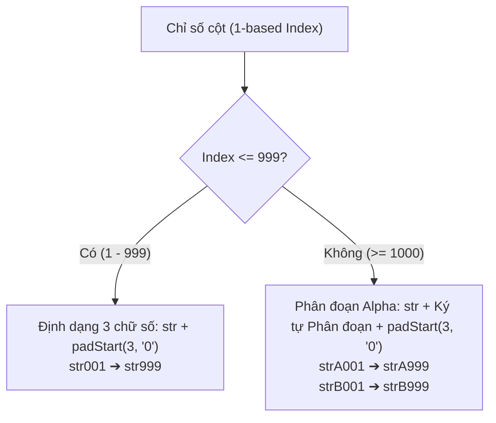

# Tài liệu Phân tích Nghiệp vụ (BA) & Nghiệm thu Kỹ thuật (QA) — Toad v2.0.13

> **Phiên bản**: Toad v2.0.13  
> **Ngày phát hành**: 31/10/2026  
> **Trạng thái**: ✅ **ĐÃ TRIỂN KHAI VÀ NGHIỆM THU 100% PASS (80/80 tests)**  
> **Mục tiêu**: Giải quyết triệt để lỗi sắp xếp chuỗi ký tự (Lexicographical Sort) bằng cơ chế đặt tên tiền tố cột 3 chữ số `str001` và phân đoạn chữ cái `strA001`, cập nhật Quick Start Guide đồng bộ.

---

## 1. Bối cảnh & Yêu cầu Nghiệp vụ (Business Requirements)

### 1.1. Hiện tượng trong các phiên bản trước
Khi người dùng trích xuất dữ liệu không khóa (Unkeyed JSON Array, CSV, Whitespace Delimited), hệ thống tự động sinh tên cột dạng `str1`, `str2`, ..., `str10`, `str11`, ...
Do cơ chế sắp xếp mặc định của cơ sở dữ liệu (DuckDB SQL), giao diện bảng tính (SlickGrid) và bộ chọn cột (Column Picker) hoạt động theo thứ tự so sánh ký tự mã ASCII (**Lexicographical Sort**), dẫn đến:
```
Thứ tự cũ:
str1 ➔ str10 ➔ str11 ➔ str12 ➔ ... ➔ str19 ➔ str2 ➔ str20 ➔ ...
```
* **Vấn đề**: Cột số 10 nằm ngay sát cột số 1, còn cột số 2 lại nằm tít phía dưới sau cột 19.
* **Yêu cầu người dùng**:
  * Chuyển chỉ số cột sang định dạng số có 3 chữ số `000`: `str001`, `str002`, ..., `str009`, `str010`, ..., `str099`, `str100`, ..., `str999`.
  * Khi số lượng cột vượt quá 999: Chuyển tiếp sang định dạng phân đoạn chữ cái `strA001`, `strA002`, ..., `strB001`...
  * Cập nhật tài liệu Quick Start Guide, code và bộ test QA đầy đủ.

---

## 2. Kiến trúc Giải pháp Kỹ thuật: Alpha-Block Partitioning



### 2.1. Quy tắc Định danh
1. **Dải $1 \rightarrow 999$**:
   * Định dạng: `str` + `padStart(3, '0')`
   * Dải tên: `str001`, `str002`, ..., `str009`, `str010`, ..., `str099`, `str100`, ..., `str999`.
2. **Dải $\ge 1000$**:
   * Kích hoạt Series chữ cái in hoa (`A` $\rightarrow$ `Z`):
     * Cột 1000 – 1998: `strA001` đến `strA999` (offset $1 \rightarrow 999$).
     * Cột 1999 – 2997: `strB001` đến `strB999`.
     * Cột 2998 – 3996: `strC001` đến `strC999`.

### 2.2. Cơ sở Toán học Bảo toàn Trật tự Sắp xếp
Trong mã ASCII:
* Ký tự số `'0'..'9'` (mã 48–57) luôn đứng trước ký tự chữ cái hoa `'A'..'Z'` (mã 65–90).
* Do đó, thứ tự so sánh chuỗi luôn luôn đúng tự nhiên:
  $$\mathbf{str001} < \mathbf{str002} < \dots < \mathbf{str009} < \mathbf{str010} < \dots < \mathbf{str100} < \dots < \mathbf{str999} < \mathbf{strA001} < \dots < \mathbf{strA999} < \mathbf{strB001}$$

---

## 3. Chi tiết Triển khai Mã nguồn

1. **[`RegexDialog.tsx`](file:///d:/Shared_UserData/Downloads/tad/tad-master/packages/tadviewer/src/components/RegexDialog.tsx)**:
   * Tích hợp 2 hàm thuần túy `formatStrColName` và `parseStrColIndex`.
   * Cập nhật `getMaxStrIndex`: Quét schema và các dòng trích xuất để tìm chỉ số lớn nhất, hỗ trợ nhận diện cả cột cũ (`str1`) và cột mới (`str001`).
   * Cập nhật sinh tên cho Unkeyed JSON, Delimited (CSV/Whitespace), Fallback và nút `+ Column`.
2. **[`actions.ts`](file:///d:/Shared_UserData/Downloads/tad/tad-master/packages/tadviewer/src/actions.ts)**:
   * Xuất khẩu (export) 2 hàm `formatStrColName` và `parseStrColIndex`.
   * Trong `applyRegexExtraction`: Tự động gán `formatStrColName(startIdx + i)` cho các cột mới sinh trong DuckDB view.
3. **[`quickstart.html`](file:///d:/Shared_UserData/Downloads/tad/tad-master/packages/tad-app/html/userdocs/quickstart.html)**:
   * Nâng version hiển thị lên `v2.0.13`.
   * Bổ sung mục Release Notes & Changelog cho Version 2.0.13 chi tiết về cơ chế Lexicographical 3-Digit Column Naming.
4. **[`mockup/index.html`](file:///d:/Shared_UserData/Downloads/tad/mockup/index.html)**:
   * Đồng bộ hàm sinh tên cột 3 chữ số trong interactive mockup.

---

## 4. Báo cáo Kết quả Kiểm thử Nghiệm thu Tự động (QA Report)

Hệ thống đã thực thi toàn bộ **80 kịch bản kiểm thử** từ Suite A đến Suite R:

```
======================================================================
  DEEP INTEGRATION QA TEST SUITE SUMMARY (Toad v2.0.13 Full Engine Suite)
======================================================================
  Total Test Cases : 80
  Passed           : 80 (100%)
  Failed           : 0 (0%)
  Total Duration   : 6.11s
======================================================================
```

### Chi tiết kiểm thử Suite R (Toad v2.0.13):
* **R.1 [PASS]**: `formatStrColName` đệm 3 chữ số chính xác tuyệt đối: 1 $\rightarrow$ `str001`, 9 $\rightarrow$ `str009`, 10 $\rightarrow$ `str010`, 99 $\rightarrow$ `str099`, 100 $\rightarrow$ `str100`, 999 $\rightarrow$ `str999`.
* **R.2 [PASS]**: Phân đoạn Alpha mở rộng vượt 999 cột: 1000 $\rightarrow$ `strA001`, 1998 $\rightarrow$ `strA999`, 1999 $\rightarrow$ `strB001`, 2997 $\rightarrow$ `strB999`, 2998 $\rightarrow$ `strC001`.
* **R.3 [PASS]**: Khẳng định trật tự sắp xếp ký tự chuẩn tuyệt đối qua `Array.prototype.sort()`: `str001` < `str002` < `str009` < `str010` < `str100` < `str999` < `strA001` < `strB001`.
* **R.4 [PASS]**: Kiểm tra tính hai chiều (Round-Trip) và tương thích ngược với cột cũ: `parseStrColIndex(formatStrColName(i)) === i`; `parseStrColIndex("str1") === 1`, `parseStrColIndex("str2") === 2`.
* **R.5 [PASS]**: Kiểm thử DuckDB End-to-End trích xuất vào View với tên `str001`, `str002`, `str003`, kiểm tra `PRAGMA table_info` và tự động tăng tiếp `str004`.
* **R.6 [PASS]**: Đồng bộ phiên bản `2.0.13` xuyên suốt `package.json`, `RegexDialog.tsx`, `quickstart.html`, `dist_package.ps1`.

