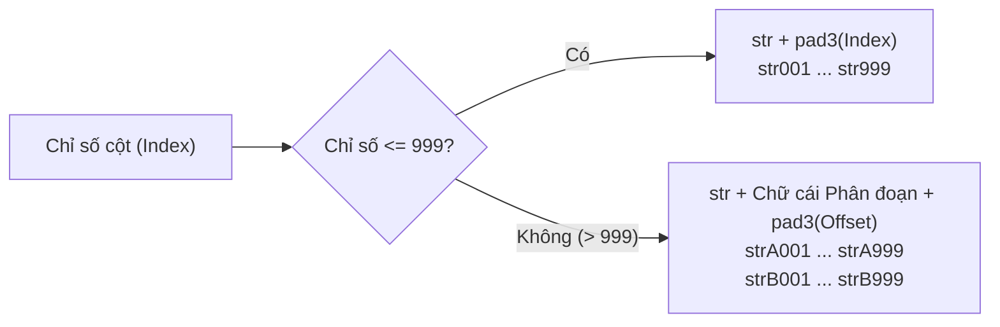

# Phương án kỹ thuật: Tối ưu hóa Tiền tố Tên cột 3 chữ số (`str001` - `str999` & `strA001`...) cho Toad v2.0.13

> **Trạng thái**: 📋 **ĐỀ XUẤT PHƯƠNG ÁN (CHƯA SỬA CODE)**  
> **Mục tiêu**: Giải quyết triệt để lỗi sắp xếp chuỗi ký tự (Lexicographical Sort) khiến `str10` đứng trước `str2`, tự động mở rộng sang phân đoạn chữ cái `strA001` khi vượt quá 999 cột, đồng thời tương thích ngược 100% với các cột `strX` hiện hữu.

---

## 1. Phân tích Bản chất Vấn đề Sắp xếp (Lexicographical vs Natural Sort)

### 1.1. Hiện tượng trong Toad v2.0.12 trở về trước
Trong cơ sở dữ liệu (DuckDB, SQLite, PostgreSQL), giao diện bảng (SlickGrid) và các ngôn ngữ lập trình, khi sắp xếp danh sách cột theo bảng chữ cái (Alphabetical Sort), hệ thống so sánh mã ASCII của từng ký tự từ trái sang phải:
```
"str1"        (Ký tự thứ 4 là '1')
"str10"       (Ký tự thứ 4 là '1', ký tự thứ 5 là '0')
"str11"       (Ký tự thứ 4 là '1', ký tự thứ 5 là '1')
...
"str19"
"str2"        (Ký tự thứ 4 là '2' -> lớn hơn '1' nên bị đẩy xuống sau str19!)
"str20"
```
**Hậu quả**: Khi trích xuất nhiều hơn 9 cột, người dùng mở danh sách cột hoặc bấm sort cột trong bảng tính sẽ thấy cột 10 nằm ngay sát cột 1, còn cột 2 lại nằm tít phía dưới.

---

## 2. Giải pháp Tối ưu: Pad 3 chữ số & Phân đoạn Alpha (`Alpha-Block Partitioning`)

### 2.1. Quy tắc đặt tên (Naming Specification)



1. **Phân đoạn 1 (Cột 1 đến 999)**:
   * Tiền tố cố định: `str`
   * Hậu tố: Số nguyên được đệm đủ 3 chữ số (`padStart(3, '0')`).
   * Dải tên: `str001`, `str002`, ..., `str009`, `str010`, ..., `str099`, `str100`, ..., `str999`.
2. **Phân đoạn 2 (Cột 1000 trở lên)**:
   * Khi số cột vượt quá 999, hệ thống kích hoạt tiền tố Series chữ cái in hoa (`A`, `B`, `C`, ... `Z`):
     * Cột 1000 – 1999: `strA001` đến `strA999` (cột 1000 là `strA001`, cột 1001 là `strA002`, ..., cột 1999 là `strA999`).
     * Cột 2000 – 2999: `strB001` đến `strB999`.
     * Cột 3000 – 3999: `strC001` đến `strC999`.
     * Hỗ trợ lên đến $26 \times 999 = 25,974$ cột!

### 2.2. Tại sao phương án này bảo toàn 100% thứ tự sắp xếp ký tự?
Trong bảng mã ASCII / UTF-8:
$$\text{Mã của '0' (48)} < \text{Mã của '9' (57)} < \mathbf{\text{Mã của 'A' (65)}} < \mathbf{\text{Mã của 'B' (66)}} < \dots < \mathbf{\text{Mã của 'Z' (90)}}$$

Do đó, bất kỳ thuật toán so sánh chuỗi nào (`<`, `>`, `ORDER BY`, `Array.prototype.sort()`, SlickGrid) cũng tự động sắp xếp chuẩn xác 100%:
$$\mathbf{str001} < \mathbf{str002} < \dots < \mathbf{str009} < \mathbf{str010} < \dots < \mathbf{str999} < \mathbf{strA001} < \dots < \mathbf{strA999} < \mathbf{strB001}$$

* Không bao giờ xảy ra tình trạng cột lớn nhảy lên trước cột bé.
* Bảng hiển thị thẳng hàng, đẹp mắt và chuyên nghiệp.

---

## 3. Thuật toán Kỹ thuật Đề xuất

### 3.1. Hàm sinh tên cột `formatStrColName(idx: number): string`
```ts
/**
 * Generates lexicographically sortable column names:
 * 1..999    -> str001 .. str999
 * 1000..1999 -> strA001 .. strA999
 * 2000..2999 -> strB001 .. strB999
 */
export function formatStrColName(idx: number): string {
  if (idx <= 0) idx = 1;
  if (idx <= 999) {
    return `str${String(idx).padStart(3, "0")}`;
  }
  const excess = idx - 1000;
  const blockIdx = Math.floor(excess / 999);
  const offset = (excess % 999) + 1;
  const letter = String.fromCharCode(65 + (blockIdx % 26)); // 'A' .. 'Z'
  const cycle = Math.floor(blockIdx / 26);
  const prefix = cycle > 0 ? `${letter}${cycle}` : letter;
  return `str${prefix}${String(offset).padStart(3, "0")}`;
}
```

### 3.2. Hàm quét chỉ số thông minh `parseStrColIndex(name: string): number | null` (Bảo đảm tương thích ngược 100%)
Để bảo vệ an toàn hệ thống khi người dùng mở lại các bảng cũ đã có cột `str1`, `str2` (từ Toad v2.0.12 về trước), hàm phân tích chỉ số hỗ trợ cả 3 định dạng:
1. Định dạng 3 chữ số mới: `str001` $\rightarrow$ trả về `1`, `str010` $\rightarrow$ `10`.
2. Định dạng mở rộng: `strA001` $\rightarrow$ trả về `1000`, `strB001` $\rightarrow$ `1999`.
3. Định dạng cũ: `str1`, `str2`, `str_1` $\rightarrow$ trả về `1`, `2`.

```ts
export function parseStrColIndex(name: string): number | null {
  if (!name) return null;
  const trimmed = name.trim();
  
  // Format 1: strA001, strB010
  const mAlpha = /^str([A-Z])(\d{3,})$/i.exec(trimmed);
  if (mAlpha) {
    const block = mAlpha[1].toUpperCase().charCodeAt(0) - 65;
    const offset = parseInt(mAlpha[2], 10);
    return 1000 + block * 999 + (offset - 1);
  }

  // Format 2 & Legacy: str001, str1, str_1, str10
  const mNum = /^str_?(\d+)$/i.exec(trimmed);
  if (mNum) {
    return parseInt(mNum[1], 10);
  }
  return null;
}
```

* **Lợi ích**: Nếu bảng hiện có đã có `str1` và `str2`, hệ thống nhận diện `maxStrIdx = 2` và sinh cột mới kế tiếp là `str003`. **Tuyệt đối không bao giờ bị trùng tên hay ghi đè dữ liệu cũ**.

---

## 4. Các vị trí cần cập nhật khi triển khai v2.0.13

1. **[`RegexDialog.tsx`](file:///d:/Shared_UserData/Downloads/tad/tad-master/packages/tadviewer/src/components/RegexDialog.tsx)**:
   - Cập nhật hàm `getMaxStrIndex` dùng `parseStrColIndex`.
   - Sinh tên ứng viên cho Unkeyed JSON / CSV / Whitespace Delimited và nút "+ Column" bằng `formatStrColName(colIdx)`.
2. **[`actions.ts`](file:///d:/Shared_UserData/Downloads/tad/tad-master/packages/tadviewer/src/actions.ts)**:
   - Trong `applyRegexExtraction`: Dùng `parseStrColIndex` và sinh `formatStrColName(startIdx + i)` khi gán tên cột mặc định trong DuckDB view.
3. **[`mockup/index.html`](file:///d:/Shared_UserData/Downloads/tad/mockup/index.html)**:
   - Cập nhật thuật toán sinh tên cột demo và nút Thêm cột thành `str001`, `str002`, ...
4. **[`test_deep_integration_qa.js`](file:///d:/Shared_UserData/Downloads/tad/test_deep_integration_qa.js)**:
   - Bổ sung **Suite R** kiểm thử tự động thuật toán `formatStrColName`, kiểm tra thứ tự sắp xếp ký tự (`str001` < `str002` < `str009` < `str010` < `str999` < `strA001`), và kiểm thử tính năng nối chuỗi trích xuất (chained extraction) không bị ghi đè.
5. **Nâng version hệ thống lên `2.0.13`**.

---

## 5. Bảng ma trận so sánh kết quả Sắp xếp (Before vs After)

| Chỉ số tự nhiên | Tên cột v2.0.12 cũ | Thứ tự Sort ký tự (Cũ) | Tên cột v2.0.13 mới | Thứ tự Sort ký tự (Mới) | Đánh giá |
| :---: | :---: | :---: | :---: | :---: | :---: |
| 1 | `str1` | `str1` (vị trí 1) | `str001` | `str001` (vị trí 1) | Chuẩn |
| 2 | `str2` | `str10` (vị trí 2 ⚠️) | `str002` | `str002` (vị trí 2) | ✅ Khắc phục |
| 9 | `str9` | `str11` (vị trí 3 ⚠️) | `str009` | `str009` (vị trí 9) | ✅ Khắc phục |
| 10 | `str10` | ... | `str010` | `str010` (vị trí 10) | ✅ Khắc phục |
| 100 | `str100` | ... | `str100` | `str100` (vị trí 100) | Chuẩn |
| 999 | `str999` | ... | `str999` | `str999` (vị trí 999) | Chuẩn |
| 1000 | `str1000` | ... | `strA001` | `strA001` (vị trí 1000) | ✅ Tự động mở rộng Series A |
| 1999 | `str1999` | ... | `strA999` | `strA999` (vị trí 1999) | ✅ Chuẩn |
| 2000 | `str2000` | ... | `strB001` | `strB001` (vị trí 2000) | ✅ Tự động mở rộng Series B |

