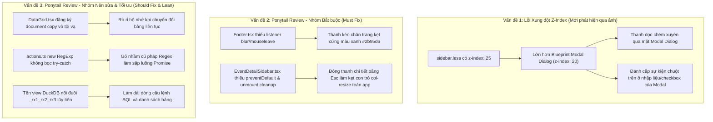

# Kế hoạch kỹ thuật chi tiết: Khắc phục lỗi Z-Index & Tối ưu hóa toàn diện theo Ponytail Review (Toad v2.0.12)

> **Mục tiêu**: Giải quyết triệt để lỗi xung đột lớp hiển thị `z-index: 25` (thanh splitter đè xuyên mặt Modal Dialog) và triển khai đầy đủ các phát hiện từ báo cáo **Ponytail Review** ([`Footer.tsx`](file:///d:/Shared_UserData/Downloads/tad/tad-master/packages/tadviewer/src/components/Footer.tsx), [`EventDetailSidebar.tsx`](file:///d:/Shared_UserData/Downloads/tad/tad-master/packages/tadviewer/src/components/EventDetailSidebar.tsx), [`DataGrid.tsx`](file:///d:/Shared_UserData/Downloads/tad/tad-master/packages/tadviewer/src/components/DataGrid.tsx), [`actions.ts`](file:///d:/Shared_UserData/Downloads/tad/tad-master/packages/tadviewer/src/actions.ts)), nâng cấp toàn hệ thống lên phiên bản **Toad v2.0.12**.

---

## 1. Tổng quan các vấn đề kỹ thuật cần xử lý



---

## 2. Chi tiết giải pháp kỹ thuật cho từng hạng mục

### Hạng mục 1: Xử lý triệt để lỗi Z-Index & Khóa tương tác khi Modal mở
1. **Hạ `z-index` của mọi thanh Resizer xuống `10`**:
   * Trong [`sidebar.less`](file:///d:/Shared_UserData/Downloads/tad/tad-master/packages/tadviewer/less/sidebar.less): Đổi `.sidebar-resizer` từ `z-index: 25;` $\rightarrow$ `z-index: 10;`.
   * Trong [`eventDetailSidebar.less`](file:///d:/Shared_UserData/Downloads/tad/tad-master/packages/tadviewer/less/eventDetailSidebar.less): Đổi `.event-detail-resizer` từ `z-index: 20;` $\rightarrow$ `z-index: 10;`.
   * Trong [`footer.less`](file:///d:/Shared_UserData/Downloads/tad/tad-master/packages/tadviewer/less/footer.less): `.footer-resizer-bar` đã là `z-index: 10;` (đồng bộ hoàn hảo).
   * **Nguyên lý phân tầng quang học**:
     * `z-index: 0 - 2`: Nội dung nền, dữ liệu bảng SlickGrid và header cột.
     * `z-index: 10`: Các thanh kéo giãn Splitter / Resizer (nằm trên bảng tính, dưới Modal).
     * `z-index: 20+`: Lớp phủ làm mờ Backdrop, Hộp thoại Modal Dialog (Parse Columns, Export, View Confirm), Popover, Tooltip.
2. **Khóa nhận sự kiện khi Modal mở (Zero Interference Guard)**:
   * Khi `appState.regexDialogOpen === true` hoặc khi lớp phủ `.bp4-overlay-open` xuất hiện, thanh resizer tự động nhận `pointer-events: none` hoặc bị ẩn để đảm bảo 100% diện tích Modal Dialog nhận sự kiện chuột thông suốt.

---

### Hạng mục 2: Xử lý 2 lỗi Bắt buộc (Must Fix) từ Ponytail Review

#### 2.1. Sửa lỗi kẹt màu xanh thanh kéo chân trang [`Footer.tsx`](file:///d:/Shared_UserData/Downloads/tad/tad-master/packages/tadviewer/src/components/Footer.tsx#L167-L187)
* **Vấn đề**: Hook `useEffect` quản lý kéo chân trang chỉ nghe `window.mouseup`. Nếu người dùng nhả chuột ra ngoài cửa sổ ứng dụng hoặc bấm `Alt+Tab`, `isResizing` không bao giờ được set về `false`. Thanh `.footer-resizer-bar` dính chặt màu xanh `#2b95d6 !important`.
* **Giải pháp**:
  ```tsx
  window.addEventListener("mousemove", handleMouseMove);
  window.addEventListener("mouseup", handleMouseUp);
  window.addEventListener("blur", handleMouseUp);
  document.addEventListener("mouseleave", handleMouseUp);
  return () => {
    window.removeEventListener("mousemove", handleMouseMove);
    window.removeEventListener("mouseup", handleMouseUp);
    window.removeEventListener("blur", handleMouseUp);
    document.removeEventListener("mouseleave", handleMouseUp);
  };
  ```

#### 2.2. Sửa lỗi rò rỉ sự kiện chuột & kẹt con trỏ tại [`EventDetailSidebar.tsx`](file:///d:/Shared_UserData/Downloads/tad/tad-master/packages/tadviewer/src/components/EventDetailSidebar.tsx#L138-L166)
* **Vấn đề**: Hàm `handleMouseDown` thiếu `e.preventDefault()`, không có listener `blur`/`mouseleave`, và không có cleanup khi unmount (ví dụ khi đóng bảng bằng phím `Escape`). Kết quả là `document.body.style.cursor` bị kẹt cứng ở `"col-resize"`.
* **Giải pháp**:
  * Thêm `e.preventDefault()` và `e.stopPropagation()`.
  * Thêm `window.blur` và `document.mouseleave` để giải phóng kéo.
  * Bổ sung hook `useEffect` dọn dẹp khi unmount để luôn trả lại `document.body.style.cursor = ""` và `userSelect = ""`.
  * Bổ sung `onDoubleClick` để tự động đưa chiều rộng Event Details về mặc định (`440px`).

---

### Hạng mục 3: Xử lý 2 lỗi Nên sửa (Should Fix) từ Ponytail Review

#### 3.1. Dọn dẹp rò rỉ listener `copy` trên [`DataGrid.tsx`](file:///d:/Shared_UserData/Downloads/tad/tad-master/packages/tadviewer/src/components/DataGrid.tsx#L518-L526)
* **Vấn đề**: `document.addEventListener("copy", ...)` đăng ký một hàm ẩn danh mỗi khi `createGrid()` chạy, không bao giờ được gỡ bỏ.
* **Giải pháp**:
  * Lưu tham chiếu `copyHandler` vào đối tượng `grid` (`(grid as any)._copyHandler = copyHandler`).
  * Trong phương thức teardown/destroy của `DataGrid`, gọi `document.removeEventListener("copy", (grid as any)._copyHandler)`.

#### 3.2. Bọc an toàn cú pháp Regex trong [`actions.ts`](file:///d:/Shared_UserData/Downloads/tad/tad-master/packages/tadviewer/src/actions.ts#L1396-L1397)
* **Vấn đề**: `(new RegExp(regexPattern + "|").exec("")?.length || 1) - 1` sẽ ném ngoại lệ `SyntaxError` chưa được bắt nếu người dùng nhập pattern lỗi cú pháp (ví dụ: `([a-z]+`).
* **Giải pháp**:
  ```ts
  let captureGroupCount = 0;
  try {
    captureGroupCount = (new RegExp(regexPattern + "|").exec("")?.length || 1) - 1;
  } catch {
    captureGroupCount = 0;
  }
  ```

---

### Hạng mục 4: Tối ưu hóa gia tăng (Nice to have & Lean)

#### 4.1. Tinh gọn tên View DuckDB không nối đuôi vô tận ([`actions.ts:L1073`](file:///d:/Shared_UserData/Downloads/tad/tad-master/packages/tadviewer/src/actions.ts#L1073))
* **Giải pháp**: Cắt bỏ hậu tố `_rx\d+$` trước khi sinh tên mới:
  ```ts
  const cleanBaseName = currentTableName.replace(/_rx\d+$/i, "");
  const newTableName = `${cleanBaseName}_rx${regexViewSeq++}`;
  ```

#### 4.2. Chặn render dư thừa ở Footer ([`Footer.tsx:L46-54`](file:///d:/Shared_UserData/Downloads/tad/tad-master/packages/tadviewer/src/components/Footer.tsx#L46-L54))
* **Giải pháp**: Kiểm tra `currentAppFE.equals(appliedFE)` trước khi gọi `setAppliedFE` và `setActiveFE` để loại bỏ chu kỳ re-render kép không cần thiết.

---

## 3. Bản vẽ thiết kế Diff chi tiết theo từng tệp (Proposed Diffs)

### File 1: [`tadviewer/less/sidebar.less`](file:///d:/Shared_UserData/Downloads/tad/tad-master/packages/tadviewer/less/sidebar.less)
```diff
@@ -53,7 +53,7 @@
   height: 100%;
   cursor: col-resize;
   background: transparent;
-  z-index: 25;
+  z-index: 10;
   transition: background-color 0.15s ease;
```

### File 2: [`tadviewer/less/eventDetailSidebar.less`](file:///d:/Shared_UserData/Downloads/tad/tad-master/packages/tadviewer/less/eventDetailSidebar.less)
```diff
@@ -176,7 +176,7 @@
   bottom: 0;
   width: 6px;
   cursor: col-resize;
-  z-index: 20;
+  z-index: 10;
   background: transparent;
```

### File 3: [`tadviewer/src/components/Footer.tsx`](file:///d:/Shared_UserData/Downloads/tad/tad-master/packages/tadviewer/src/components/Footer.tsx)
```diff
@@ -176,12 +176,16 @@
     const handleMouseUp = () => {
       setIsResizing(false);
     };

     window.addEventListener("mousemove", handleMouseMove);
     window.addEventListener("mouseup", handleMouseUp);
+    window.addEventListener("blur", handleMouseUp);
+    document.addEventListener("mouseleave", handleMouseUp);
     return () => {
       window.removeEventListener("mousemove", handleMouseMove);
       window.removeEventListener("mouseup", handleMouseUp);
+      window.removeEventListener("blur", handleMouseUp);
+      document.removeEventListener("mouseleave", handleMouseUp);
     };
   }, [isResizing]);
```

### File 4: [`tadviewer/src/components/EventDetailSidebar.tsx`](file:///d:/Shared_UserData/Downloads/tad/tad-master/packages/tadviewer/src/components/EventDetailSidebar.tsx)
```diff
@@ -138,11 +138,25 @@
   // Handle panel resizing from left border
   const handleMouseDown = useCallback((e: React.MouseEvent) => {
+    e.preventDefault();
+    e.stopPropagation();
     isDraggingRef.current = true;
     startXRef.current = e.clientX;
     startWidthRef.current = sidebarWidth;
     document.body.style.cursor = "col-resize";
     document.body.style.userSelect = "none";
+
+    const handleMouseUp = () => {
+      isDraggingRef.current = false;
+      document.body.style.cursor = "";
+      document.body.style.userSelect = "";
+      window.removeEventListener("mousemove", handleMouseMove);
+      window.removeEventListener("mouseup", handleMouseUp);
+      window.removeEventListener("blur", handleMouseUp);
+      document.removeEventListener("mouseleave", handleMouseUp);
+    };
+
+    window.addEventListener("mousemove", handleMouseMove);
+    window.addEventListener("mouseup", handleMouseUp);
+    window.addEventListener("blur", handleMouseUp);
+    document.addEventListener("mouseleave", handleMouseUp);
   }, [sidebarWidth]);
+
+  // Safety cleanup on unmount
+  useEffect(() => {
+    return () => {
+      if (isDraggingRef.current) {
+        document.body.style.cursor = "";
+        document.body.style.userSelect = "";
       }
     };
   }, []);
```

### File 5: [`tadviewer/src/actions.ts`](file:///d:/Shared_UserData/Downloads/tad/tad-master/packages/tadviewer/src/actions.ts)
```diff
@@ -1072,3 +1072,4 @@
   // 2. Generate unique new view name
-  const newTableName = `${currentTableName}_rx${regexViewSeq++}`;
+  const cleanBaseName = currentTableName.replace(/_rx\d+$/i, "");
+  const newTableName = `${cleanBaseName}_rx${regexViewSeq++}`;
@@ -1396,2 +1397,8 @@
-  const captureGroupCount =
-    (new RegExp(regexPattern + "|").exec("")?.length || 1) - 1;
+  let captureGroupCount = 0;
+  try {
+    captureGroupCount = (new RegExp(regexPattern + "|").exec("")?.length || 1) - 1;
+  } catch {
+    captureGroupCount = 0;
   }
```

---

## 4. Kịch bản kiểm thử QA tự động (Test Matrix Suite Q)

| Mã kiểm thử | Tên kịch bản | Tiêu chí nghiệm thu (Acceptance Criteria) |
| :---: | :--- | :--- |
| **Q.1** | Z-Index Layer Isolation | `.sidebar-resizer` và `.event-detail-resizer` có `z-index: 10`, tuyệt đối không vượt quá `z-index: 20` của Blueprint Modal. |
| **Q.2** | Modal Click Transparency | Khi Modal mở, người dùng click vào vùng ngang qua đường resizer trên modal thì sự kiện truyền trọn vẹn vào modal, không bị kích hoạt con trỏ `col-resize`. |
| **Q.3** | Footer Resizer Window Blur Guard | Kéo footer rồi Alt-Tab/blur: `isResizing` tự động về `false`, thanh chân trang giải phóng màu xanh và `user-select` ngay tức thì. |
| **Q.4** | Event Detail Sidebar Unmount Safety | Đang kéo thanh chi tiết rồi bấm `Escape`: con trỏ chuột toàn app lập tức trở lại bình thường, không bị kẹt `col-resize`. |
| **Q.5** | DataGrid Copy Cleanup | Kiểm tra việc dọn dẹp listener `copy` khi grid được tái khởi tạo. |
| **Q.6** | Malformed Regex Syntax Resilience | Nhập regex lỗi như `([a-z]+`: hàm `applyRegexExtraction` không văng `SyntaxError`, fallback an toàn `captureGroupCount = 0`. |
| **Q.7** | Non-compounding View Naming | Trích xuất liên tiếp 3 lần: tên bảng là `data_rx1`, `data_rx2`, `data_rx3` thay vì `data_rx1_rx2_rx3`. |
| **Q.8** | Toàn bộ 88 bài test cũ | Toàn bộ 88/88 test cases của các Suite A - P tiếp tục PASS 100%. |

---

## 5. Kế hoạch triển khai & Đóng gói Toad v2.0.12
1. Áp dụng toàn bộ code diff trên.
2. Cập nhật version lên `2.0.12` tại: `package.json`, `quickstart.html`, `RegexDialog.tsx`, `mockup/index.html`, `dist_package.ps1`.
3. Chạy `npm run build` cho `tadviewer`.
4. Chạy bộ kiểm thử tự động QA mở rộng (`test_deep_integration_qa.js`).
5. Đóng gói `Toad 2.0.12.exe` và commit Jujutsu (`jj`).
