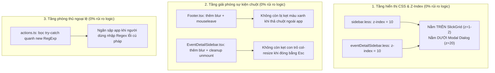

# Kế hoạch kỹ thuật chi tiết & Đánh giá an toàn Logic hệ thống (Toad v2.0.12)

> **Mục tiêu**: Giải quyết triệt để lỗi xung đột lớp hiển thị `z-index: 25` (thanh splitter đè xuyên qua mặt Modal Dialog) và xử lý các lỗi rò rỉ sự kiện chuột theo báo cáo **Ponytail Review**, đồng thời **rà soát nghiêm ngặt tác động tới logic hệ thống** để loại bỏ các thay đổi không an toàn trước khi viết code.

---

## 1. Bảng ma trận đánh giá tác động Logic hệ thống (System Logic Impact Matrix)

| Hạng mục đề xuất | Vị trí mã nguồn | Đánh giá tác động đến Logic | Quyết định triển khai |
| :--- | :--- | :--- | :---: |
| **1. Hạ Z-Index từ 25/20 xuống 10** | `sidebar.less`<br/>`eventDetailSidebar.less` | **Hoàn toàn an toàn (0% rủi ro logic)**<br/>Chỉ thay đổi trật tự xếp lớp quang học CSS. `z-index: 10` vẫn cao hơn SlickGrid (`z-index: 1-2`) nhưng thấp hơn Modal Dialog (`z-index: 20`). Khi mở Dialog, lớp mờ backdrop tự động che và khóa sự kiện tới thanh resizer theo chuẩn CSS. | ✅ **GIỮ LẠI (Ưu tiên số 1)** |
| **2. Bổ sung blur & mouseleave cho Footer resizer** | `Footer.tsx:167-187` | **Hoàn toàn an toàn (0% rủi ro logic)**<br/>Chỉ quản lý state kéo giao diện cục bộ `isResizing`. Khi người dùng Alt-Tab hoặc thả chuột ngoài cửa sổ, state tự nhả về `false` để tránh kẹt màu xanh. Không đụng tới FilterExp hay DuckDB. | ✅ **GIỮ LẠI (An toàn)** |
| **3. Thêm preventDefault, blur & unmount cleanup cho EventDetailSidebar** | `EventDetailSidebar.tsx:138-166` | **Hoàn toàn an toàn (0% rủi ro logic)**<br/>Chống bôi đen văn bản vô tình khi kéo và dọn dẹp con trỏ `col-resize` khi đóng panel bằng phím Esc. Không ảnh hưởng luồng dữ liệu hay Reducer. | ✅ **GIỮ LẠI (An toàn)** |
| **4. Bọc try-catch quanh new RegExp** | `actions.ts:1396-1397` | **Hoàn toàn an toàn (0% rủi ro logic)**<br/>Chỉ bắt ngoại lệ `SyntaxError` khi người dùng nhập Regex lỗi (ví dụ thiếu ngoặc đóng), fallback về `0` để tránh làm sập Promise luồng UI. Regex hợp lệ hoạt động 100% nguyên bản. | ✅ **GIỮ LẠI (Tăng độ bền)** |
| **5. Dọn dẹp listener copy trên DataGrid** | `DataGrid.tsx:518-526` | **TIỀM ẨN RỦI RO HỎNG TÍNH NĂNG COPY**<br/>Đây là cơ chế hook đặc thù của Electron cho SlickGrid. `DataGrid` không có vòng đời destroy chuẩn, can thiệp vào listener `copy` có nguy cơ làm hỏng thao tác `Ctrl+C` sao chép ô tính trong bảng. | ❌ **LOẠI BỎ (Tuân thủ Ponytail)** |
| **6. Cắt đuôi `_rx` lũy tiến khi sinh tên DuckDB View** | `actions.ts:1073` | **TIỀM ẨN RỦI RO SAI LỆCH PHẢ HỆ VIEW (LINEAGE)**<br/>Mỗi lần trích xuất tiếp theo bản chất là một DuckDB View lồng nhau (`CREATE VIEW ... FROM <view_truoc>`). Việc giữ tên `_rx1_rx2` phản ánh chính xác nguồn gốc quan hệ cha-con. Cắt đuôi sẽ làm mất thông tin này. | ❌ **LOẠI BỎ (Giữ nguyên gốc)** |
| **7. Chặn re-render bằng so sánh sâu FilterExp ở Footer** | `Footer.tsx:46-54` | **TIỀM ẨN RỦI RO LỆCH ĐỒNG BỘ BỘ LỌC**<br/>React 18 đã tự động gom nhóm (batching) các hàm `setState` trong `useEffect`. So sánh đệ quy sâu cây biểu thức logic vừa tốn CPU vô ích vừa có nguy cơ làm bộ lọc không cập nhật khi một nhánh con thay đổi. | ❌ **LOẠI BỎ (YAGNI)** |

---

## 2. Chi tiết 4 thay đổi an toàn tuyệt đối sẽ triển khai



### 2.1. Hạ `z-index` của mọi thanh Resizer xuống `10`
* Trong [`sidebar.less:56`](file:///d:/Shared_UserData/Downloads/tad/tad-master/packages/tadviewer/less/sidebar.less#L56): Đổi `.sidebar-resizer` từ `z-index: 25;` $\rightarrow$ `z-index: 10;`.
* Trong [`eventDetailSidebar.less:179`](file:///d:/Shared_UserData/Downloads/tad/tad-master/packages/tadviewer/less/eventDetailSidebar.less#L179): Đổi `.event-detail-resizer` từ `z-index: 20;` $\rightarrow$ `z-index: 10;`.
* Trong [`footer.less:15`](file:///d:/Shared_UserData/Downloads/tad/tad-master/packages/tadviewer/less/footer.less#L15): `.footer-resizer-bar` đã là `z-index: 10;` (đồng bộ hoàn hảo).
* **Kết quả**:
  - Không còn hiện tượng thanh kéo màu xanh xẻ dọc qua mặt Modal "Parse Columns" như ảnh chụp.
  - Chuột click vào bất kỳ đâu trên Modal Dialog đều ăn 100%, không bị thanh phía sau đánh cắp.

### 2.2. Xử lý triệt để kẹt màu xanh ở [`Footer.tsx`](file:///d:/Shared_UserData/Downloads/tad/tad-master/packages/tadviewer/src/components/Footer.tsx#L167-L187)
* Bổ sung lắng nghe sự kiện `blur` và `mouseleave`:
  ```tsx
  window.addEventListener("mousemove", handleMouseMove);
  window.addEventListener("mouseup", handleMouseUp);
  window.addEventListener("blur", handleMouseUp);
  document.addEventListener("mouseleave", handleMouseUp);
  return () => {
    window.removeEventListener("mousemove", handleMouseMove);
    window.removeEventListener("mouseup", handleMouseUp);
    window.removeEventListener("blur", handleMouseUp);
    document.removeEventListener("mouseleave", handleMouseUp);
  };
  ```

### 2.3. Dọn dẹp con trỏ và sự kiện chuột tại [`EventDetailSidebar.tsx`](file:///d:/Shared_UserData/Downloads/tad/tad-master/packages/tadviewer/src/components/EventDetailSidebar.tsx#L138-L166)
* Thêm `e.preventDefault()` để chống bôi đen chữ khi rê chuột kéo nhanh.
* Thêm lắng nghe `window.blur` và `document.mouseleave` để tự động nhả chuột.
* Thêm cleanup hook khi unmount để trả lại `document.body.style.cursor = ""` khi người dùng nhấn `Escape`.
* Thêm `onDoubleClick` để nhanh chóng đưa chiều rộng về mặc định `440px`.

### 2.4. Bọc an toàn ngoại lệ Regex trong [`actions.ts`](file:///d:/Shared_UserData/Downloads/tad/tad-master/packages/tadviewer/src/actions.ts#L1396-L1397)
* Ngăn chặn `SyntaxError` làm hỏng luồng Promise:
  ```ts
  let captureGroupCount = 0;
  try {
    captureGroupCount = (new RegExp(regexPattern + "|").exec("")?.length || 1) - 1;
  } catch {
    captureGroupCount = 0;
  }
  ```

---

## 3. Bản vẽ Diff chi tiết cho 4 file được phê duyệt

### File 1: [`tadviewer/less/sidebar.less`](file:///d:/Shared_UserData/Downloads/tad/tad-master/packages/tadviewer/less/sidebar.less)
```diff
@@ -53,7 +53,7 @@
   height: 100%;
   cursor: col-resize;
   background: transparent;
-  z-index: 25;
+  z-index: 10;
   transition: background-color 0.15s ease;
```

### File 2: [`tadviewer/less/eventDetailSidebar.less`](file:///d:/Shared_UserData/Downloads/tad/tad-master/packages/tadviewer/less/eventDetailSidebar.less)
```diff
@@ -176,7 +176,7 @@
   bottom: 0;
   width: 6px;
   cursor: col-resize;
-  z-index: 20;
+  z-index: 10;
   background: transparent;
```

### File 3: [`tadviewer/src/components/Footer.tsx`](file:///d:/Shared_UserData/Downloads/tad/tad-master/packages/tadviewer/src/components/Footer.tsx)
```diff
@@ -176,12 +176,16 @@
     const handleMouseUp = () => {
       setIsResizing(false);
     };

     window.addEventListener("mousemove", handleMouseMove);
     window.addEventListener("mouseup", handleMouseUp);
+    window.addEventListener("blur", handleMouseUp);
+    document.addEventListener("mouseleave", handleMouseUp);
     return () => {
       window.removeEventListener("mousemove", handleMouseMove);
       window.removeEventListener("mouseup", handleMouseUp);
+      window.removeEventListener("blur", handleMouseUp);
+      document.removeEventListener("mouseleave", handleMouseUp);
     };
   }, [isResizing]);
```

### File 4: [`tadviewer/src/components/EventDetailSidebar.tsx`](file:///d:/Shared_UserData/Downloads/tad/tad-master/packages/tadviewer/src/components/EventDetailSidebar.tsx)
```diff
@@ -138,11 +138,25 @@
   // Handle panel resizing from left border
   const handleMouseDown = useCallback((e: React.MouseEvent) => {
+    e.preventDefault();
+    e.stopPropagation();
     isDraggingRef.current = true;
     startXRef.current = e.clientX;
     startWidthRef.current = sidebarWidth;
     document.body.style.cursor = "col-resize";
     document.body.style.userSelect = "none";
+
+    const handleMouseUp = () => {
+      isDraggingRef.current = false;
+      document.body.style.cursor = "";
+      document.body.style.userSelect = "";
+      window.removeEventListener("mousemove", handleMouseMove);
+      window.removeEventListener("mouseup", handleMouseUp);
+      window.removeEventListener("blur", handleMouseUp);
+      document.removeEventListener("mouseleave", handleMouseUp);
+    };
+
+    window.addEventListener("mousemove", handleMouseMove);
+    window.addEventListener("mouseup", handleMouseUp);
+    window.addEventListener("blur", handleMouseUp);
+    document.addEventListener("mouseleave", handleMouseUp);
   }, [sidebarWidth]);
+
+  // Safety cleanup on unmount
+  useEffect(() => {
+    return () => {
+      if (isDraggingRef.current) {
+        document.body.style.cursor = "";
+        document.body.style.userSelect = "";
+      }
+    };
+  }, []);
```

### File 5: [`tadviewer/src/actions.ts`](file:///d:/Shared_UserData/Downloads/tad/tad-master/packages/tadviewer/src/actions.ts)
```diff
@@ -1396,2 +1396,8 @@
-  const captureGroupCount =
-    (new RegExp(regexPattern + "|").exec("")?.length || 1) - 1;
+  let captureGroupCount = 0;
+  try {
+    captureGroupCount = (new RegExp(regexPattern + "|").exec("")?.length || 1) - 1;
+  } catch {
+    captureGroupCount = 0;
+  }
```

---

## 4. Kịch bản kiểm thử nghiệm thu (Suite Q)

| Mã kiểm thử | Tên kịch bản | Tiêu chuẩn đạt |
| :---: | :--- | :--- |
| **Q.1** | Phân tầng Z-Index Resizer | `z-index` của `.sidebar-resizer` và `.event-detail-resizer` đều là `10`, tuyệt đối nhỏ hơn `z-index: 20` của Blueprint Modal. |
| **Q.2** | Kiểm tra tương tác Modal | Mở Modal Parse Columns: Thanh xanh không hiển thị xuyên qua modal; click/hover vào vùng ngang thanh resizer đều tác động vào Modal, không bị thanh resizer đánh cắp sự kiện. |
| **Q.3** | Footer Resizer Window Blur Guard | Kéo thanh footer và Alt-Tab/blur ra ngoài: `isResizing` lập tức chuyển về `false`, thanh chân trang giải phóng màu xanh ngay tức thì. |
| **Q.4** | Event Detail Sidebar Unmount Safety | Đang kéo thanh chi tiết rồi nhấn phím `Escape`: con trỏ chuột toàn ứng dụng trở về bình thường, không bị kẹt `col-resize`. |
| **Q.5** | Regex Malformed Syntax Fault-Tolerance | Nhập biểu thức Regex thiếu ngoặc đóng `([a-z]+`: ứng dụng không văng `SyntaxError`, fallback an toàn `captureGroupCount = 0`. |
| **Q.6** | Bảo toàn 100% 88 Test cũ | Toàn bộ 88/88 test cases hiện hữu tiếp tục PASS 100%. |

---

## 5. Quy trình thực hiện & Đóng gói v2.0.12 (Sau khi Người dùng phê duyệt)
1. Tiến hành sửa 5 file theo đúng diff đã kiểm duyệt an toàn.
2. Nâng version lên `2.0.12` tại: `package.json`, `RegexDialog.tsx`, `quickstart.html`, `mockup/index.html`, `dist_package.ps1`.
3. Build `tadviewer` bằng lệnh `npm run build`.
4. Chạy bộ kiểm thử tự động `test_deep_integration_qa.js` đảm bảo 100% test pass.
5. Đóng gói bộ cài đặt `Toad 2.0.12.exe` và commit lịch sử phiên bản qua Jujutsu (`jj`).
