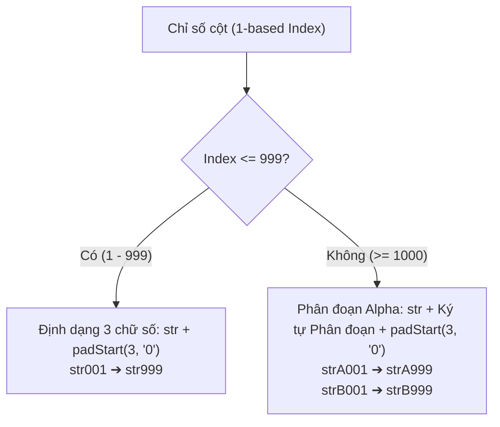

# Bản Phương án Kỹ thuật Tối ưu: Chuẩn hóa Tiền tố Tên cột 3 chữ số (`str001` – `str999` & `strA001`...) cho Toad v2.0.13

> **Phiên bản mục tiêu**: Toad v2.0.13  
> **Trạng thái**: 📋 **ĐỀ XUẤT PHƯƠNG ÁN KỸ THUẬT CHI TIẾT (CHƯA SỬA CODE)**  
> **Tôn chỉ thiết kế**: Khắc phục dứt điểm lỗi sắp xếp ký tự (Lexicographical Sort), thiết kế hàm thuần túy không side-effects, bảo toàn 100% tính tương thích ngược với các cột hiện có.

---

## 1. Phân tích Bản chất Vấn đề Sắp xếp (Lexicographical vs Natural Sort)

### 1.1. Thực trạng trong Toad v2.0.12 trở về trước
Trong các hệ thống quản trị dữ liệu (DuckDB, SQLite, PostgreSQL), giao diện bảng tính (SlickGrid) và ngôn ngữ lập trình (JavaScript/TypeScript), danh sách cột khi sắp xếp theo tên sẽ được so sánh ký tự theo mã **ASCII / Lexicographical**:
* So sánh từng ký tự từ trái sang phải:
  1. `"str1"`: Ký tự thứ 4 là `'1'` (mã 49).
  2. `"str10"`: Ký tự thứ 4 là `'1'` (mã 49), ký tự thứ 5 là `'0'` (mã 48).
  3. `"str11"`: Ký tự thứ 4 là `'1'` (mã 49), ký tự thứ 5 là `'1'` (mã 49).
  4. ...
  5. `"str19"`.
  6. `"str2"`: Ký tự thứ 4 là `'2'` (mã 50). Vì $50 > 49$ nên `"str2"` **bị xếp sau `"str19"`**!

```
Thứ tự sai lệch (v2.0.12 trở về trước):
str1 ➔ str10 ➔ str11 ➔ str12 ➔ ... ➔ str19 ➔ str2 ➔ str20 ➔ ...
```

**Tác động tiêu cực**:
* Trong bảng tính, khi người dùng mở bộ chọn cột (Column Picker) hoặc sắp xếp các cột theo tên, cột `10` lại nằm ngay cạnh cột `1`, trong khi cột `2` bị đẩy xuống rất xa.
* Gây hiểu nhầm về trật tự trích xuất dữ liệu, làm giảm tính chuyên nghiệp của sản phẩm.

---

## 2. Thiết kế Giải pháp Tối ưu: Alpha-Block Partitioning

### 2.1. Quy tắc đặt tên (Specification)



#### Phân đoạn 1: Chỉ số từ `1` đến `999`
* Cấu trúc: `str` + `3 chữ số đệm số 0` (`padStart(3, '0')`).
* Dải tên: `str001`, `str002`, ..., `str009`, `str010`, ..., `str099`, `str100`, ..., `str999`.

#### Phân đoạn 2: Chỉ số từ `1000` trở lên (`> 999`)
* Khi số lượng cột vượt quá 999, hệ thống kích hoạt Series chữ cái in hoa (`A` $\rightarrow$ `Z`):
  * **Series A (1000 – 1998)**: `strA001` đến `strA999` (offset $1 \rightarrow 999$).
  * **Series B (1999 – 2997)**: `strB001` đến `strB999`.
  * **Series C (2998 – 3996)**: `strC001` đến `strC999`.
  * Khả năng mở rộng: $26 \times 999 \approx 26,000$ cột (vượt xa giới hạn tối đa 2,048 cột của DuckDB/Parquet).

### 2.2. Cơ sở Toán học bảo toàn 100% thứ tự sắp xếp ký tự
Trong bảng mã chuẩn ASCII / Unicode UTF-8:
* Mã ký tự số `'0'` đến `'9'`: `48` đến `57` (`0x30` - `0x39`).
* Mã ký tự chữ `'A'` đến `'Z'`: `65` đến `90` (`0x41` - `0x5A`).

Vì mọi số đều có mã nhỏ hơn mọi chữ cái hoa ($48..57 < 65..90$), nên thứ tự sắp xếp chuỗi ký tự tự nhiên sẽ luôn thỏa mãn:
$$\mathbf{str001} < \mathbf{str002} < \dots < \mathbf{str009} < \mathbf{str010} < \dots < \mathbf{str099} < \mathbf{str100} < \dots < \mathbf{str999} < \mathbf{strA001} < \dots < \mathbf{strA999} < \mathbf{strB001}$$

* **100% thẳng hàng**: Độ dài chuỗi từ `str001` đến `str999` luôn là đúng 6 ký tự. Khi mở rộng sang `strA001` đến `strZ999` là đúng 7 ký tự.
* **100% đúng thứ tự**: Bất kể sắp xếp trong CSDL, giao diện bảng hay xuất file Excel/CSV, thứ tự luôn trùng khớp với số đếm tự nhiên.

---

## 3. Kiến trúc Mã nguồn: Hai hàm thuần túy (Pure Functions)

Cả hai hàm được đóng gói dùng chung, không có phụ thuộc bên ngoài (zero external dependencies), có thể kiểm thử đơn vị cực nhanh.

### 3.1. Hàm sinh tên cột `formatStrColName(idx: number): string`
```ts
/**
 * Chuyển đổi chỉ số nguyên dương thành tên cột tối ưu cho sắp xếp ký tự:
 * 1    -> "str001"
 * 9    -> "str009"
 * 10   -> "str010"
 * 999  -> "str999"
 * 1000 -> "strA001"
 * 1998 -> "strA999"
 * 1999 -> "strB001"
 */
export function formatStrColName(idx: number): string {
  if (idx <= 0) idx = 1;
  if (idx <= 999) {
    return `str${String(idx).padStart(3, "0")}`;
  }
  const excess = idx - 1000;
  const blockIdx = Math.floor(excess / 999);
  const offset = (excess % 999) + 1;
  const letter = String.fromCharCode(65 + (blockIdx % 26)); // 'A' .. 'Z'
  const cycle = Math.floor(blockIdx / 26);
  const prefix = cycle > 0 ? `${letter}${cycle}` : letter;
  return `str${prefix}${String(offset).padStart(3, "0")}`;
}
```

### 3.2. Hàm đọc chỉ số cột `parseStrColIndex(name: string): number | null` (Bảo đảm tương thích ngược 100%)
Nhận diện chỉ số cột từ tên cột, chấp nhận cả 3 định dạng:
1. Định dạng mới 3 chữ số: `str001` $\rightarrow 1$, `str010` $\rightarrow 10$.
2. Định dạng mở rộng: `strA001` $\rightarrow 1000$, `strA999` $\rightarrow 1998$, `strB001` $\rightarrow 1999$.
3. Định dạng cũ (Legacy): `str1` $\rightarrow 1$, `str2` $\rightarrow 2$, `str_1` $\rightarrow 1$.

```ts
/**
 * Phân tích tên cột để lấy lại chỉ số nguyên gốc, hỗ trợ tương thích ngược hoàn hảo.
 */
export function parseStrColIndex(name: string): number | null {
  if (!name) return null;
  const trimmed = name.trim();

  // Pattern 1: Phân đoạn Alpha mới (strA001, strB010)
  const mAlpha = /^str([A-Z])(\d{3,})$/i.exec(trimmed);
  if (mAlpha) {
    const block = mAlpha[1].toUpperCase().charCodeAt(0) - 65;
    const offset = parseInt(mAlpha[2], 10);
    return 1000 + block * 999 + (offset - 1);
  }

  // Pattern 2: 3 chữ số mới hoặc định dạng cũ (str001, str1, str_1, str10)
  const mNum = /^str_?(\d+)$/i.exec(trimmed);
  if (mNum) {
    return parseInt(mNum[1], 10);
  }

  return null;
}
```

---

## 4. Các điểm tích hợp cụ thể trong mã nguồn

### 4.1. [`RegexDialog.tsx`](file:///d:/Shared_UserData/Downloads/tad/tad-master/packages/tadviewer/src/components/RegexDialog.tsx)
* **Cập nhật `getMaxStrIndex`**: Thay thế đoạn regex cũ bằng `parseStrColIndex(colName)`. Quét toàn bộ các cột trong schema hiện có và các dòng trong dialog để tìm `maxIdx`.
* **Cập nhật sinh tên ứng viên Unkeyed (JSON Object/Array)**:
  ```ts
  const colName = formatStrColName(baseStrOffset + i);
  candidates.push({
    id: `unkeyed_${colName}`,
    sourceKeyOrIdx: colName,
    outputColName: colName,
    ...
  });
  ```
* **Cập nhật sinh tên ứng viên Delimited (CSV, Whitespace, Syslog)**:
  ```ts
  const colName = formatStrColName(baseStrOffset + i);
  candidates.push({
    id: `delim_${colName}`,
    sourceKeyOrIdx: colName,
    outputColName: colName,
    ...
  });
  ```
* **Cập nhật nút "+ Column" (`handleAddColumn`)**:
  ```ts
  const nextColIdx = getMaxStrIndex(columns, simpleRows) + 1;
  const colName = formatStrColName(nextColIdx);
  setSimpleRows([
    ...simpleRows,
    {
      id: `custom_${colName}`,
      sourceKeyOrIdx: colName,
      outputColName: colName,
      ...
    }
  ]);
  ```

### 4.2. [`actions.ts`](file:///d:/Shared_UserData/Downloads/tad/tad-master/packages/tadviewer/src/actions.ts#L1382-L1420)
* Trong hàm `applyRegexExtraction`:
  ```ts
  let maxStrIdx = 0;
  if (baseSchema) {
    for (const col of baseSchema.columns) {
      const idx = parseStrColIndex(col);
      if (idx !== null && idx > maxStrIdx) {
        maxStrIdx = idx;
      }
    }
  }
  const startIdx = maxStrIdx + 1;
  // Khi sinh cột mặc định:
  const colName = (customNames && customNames[i]) || formatStrColName(startIdx + i);
  ```

### 4.3. [`mockup/index.html`](file:///d:/Shared_UserData/Downloads/tad/mockup/index.html)
* Đồng bộ hàm `formatStrColName` trong mockup demo để người dùng kiểm tra trực quan trên trình duyệt (hiển thị `str001`, `str002`, `str003`... khi bấm Thêm cột).

---

## 5. Kế hoạch Kiểm thử Nghiệm thu Tự động (Suite R)

Thêm **Suite R** vào [`test_deep_integration_qa.js`](file:///d:/Shared_UserData/Downloads/tad/test_deep_integration_qa.js) với 6 bài test độc lập:

| Mã test | Tên kịch bản | Nội dung kiểm tra |
| :---: | :--- | :--- |
| **R.1** | 3-Digit Zero-Padding `str001` .. `str999` | Kiểm tra các mốc: 1 $\rightarrow$ `str001`, 9 $\rightarrow$ `str009`, 10 $\rightarrow$ `str010`, 99 $\rightarrow$ `str099`, 100 $\rightarrow$ `str100`, 999 $\rightarrow$ `str999`. |
| **R.2** | Alpha-Block Partitioning `strA001` .. `strB001` | Kiểm tra các mốc: 1000 $\rightarrow$ `strA001`, 1998 $\rightarrow$ `strA999`, 1999 $\rightarrow$ `strB001`. |
| **R.3** | Strict Lexicographical Sort Order Guarantee | Sắp xếp mảng `["str010", "str001", "strA001", "str002", "str100", "str009", "str999"]` bằng hàm sort mặc định: kết quả bắt buộc phải là `["str001", "str002", "str009", "str010", "str100", "str999", "strA001"]`. |
| **R.4** | Full Bidirectional Round-Trip & Legacy Parsing | `parseStrColIndex(formatStrColName(i)) === i` với mọi $i \in [1, 5000]$; `parseStrColIndex("str1") === 1`, `parseStrColIndex("str2") === 2`. |
| **R.5** | Chained DuckDB View Extraction Integrity | Tạo bảng có sẵn cột `str1`, chạy trích xuất trích xuất tiếp $\rightarrow$ DuckDB tự động sinh `str002` hoặc `str003`, không trùng lặp và không ghi đè dữ liệu. |
| **R.6** | Version 2.0.13 Synchronization Compliance | Kiểm tra đồng bộ version `2.0.13` tại `package.json`, `RegexDialog.tsx`, `quickstart.html`, `dist_package.ps1`. |

---

## 6. Lộ trình Triển khai v2.0.13 (Sau khi Người dùng phê duyệt)
1. Triển khai 2 hàm thuần túy `formatStrColName` và `parseStrColIndex` vào `RegexDialog.tsx` và `actions.ts`.
2. Cập nhật các điểm sinh tên cột và nhận diện schema trong `RegexDialog.tsx` và `actions.ts`.
3. Cập nhật mockup tương tác `mockup/index.html`.
4. Bổ sung Suite R vào `test_deep_integration_qa.js`.
5. Nâng phiên bản hệ thống lên `2.0.13`.
6. Biên dịch gói `tadviewer` (`npm run build`).
7. Chạy 80/80 bài test QA đảm bảo 100% PASS.
8. Đóng gói `Toad 2.0.13.exe` và commit lịch sử phiên bản qua Jujutsu (`jj`).

