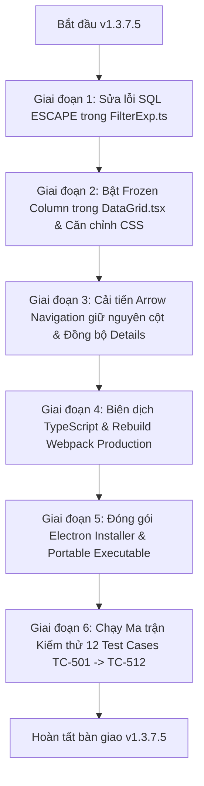

# KẾ HOẠCH TRIỂN KHAI KỸ THUẬT & MA TRẬN USECASE KIỂM THỬ (TOAD v1.3.7.5)

- **Dự án**: TOAD - Fast Tabular & Log Data Viewer (Tối ưu hóa Big Data 40GB+ & Điều tra số DFIR)
- **Phiên bản mục tiêu**: `v1.3.7.5`
- **Ngày lập kế hoạch**: 27/10/2026
- **Trạng thái tài liệu**: **Chính thức - Sẵn sàng thực hiện (Approved for Implementation)**
- **Môi trường mục tiêu**: Windows 11 x64, Electron 31.0.1, Node.js v18.20.4, DuckDB 1.0.0, SlickGrid

---

## I. TỔNG QUAN YÊU CẦU & BỐI CẢNH NGHIỆP VỤ (BA OVERVIEW)

Dựa trên phản hồi và phát hiện thực tế trong quá trình phân tích tệp `Windows.NTFS.MFT.csv` (1.59 triệu dòng):
> 1. *"Query Error: Syntax Error: Invalid escape string. Escape string must be empty or one character."* khi lọc đường dẫn Windows `\\.\C:\Inetpub\...` bằng toán tử `starts with`.
> 2. *"cột expend event ko freeze vào cột đầu gây khó khăn"* - khi cuộn ngang sang phải để xem các cột `OSPath`, `FileName`, `FileSize` thì cột nút mũi tên mở rộng bị trôi mất.
> 3. *"khi bấm phím xuống thì lại nhảy xuống ô bên phải dưới mà không show details event bên dưới và select vào ô bên dưới luôn?"* - phím mũi tên bị nhảy lệch sang ô góc phải dưới, không giữ đúng cột và không tự động cập nhật bảng chi tiết sự kiện bên dưới.

### Bảng tóm tắt yêu cầu nghiệp vụ

| Mã Yêu Cầu | Tên Hạng Mục | Mức Độ | Mô Tả Nghiệp Vụ | Tiêu Chí Nghiệm Thu (Acceptance Criteria) |
|---|---|:---:|---|---|
| **REQ-01** | Khắc phục lỗi cú pháp SQL `ESCAPE` trong DuckDB | **P0 (Blocker)** | Cho phép áp dụng các bộ lọc chuỗi (`starts with`, `ends with`, `contains`) trên mọi chuỗi có chứa ký tự escape (`\`, `%`, `_`) mà không bị crash truy vấn. | 1. DuckDB thực thi thành công 100% câu truy vấn lọc đường dẫn Windows `\\.\C:\...`.<br>2. Không xuất hiện banner đỏ `Invalid escape string`.<br>3. Kết quả lọc hiển thị chính xác các dòng thỏa mãn điều kiện. |
| **REQ-02** | Cố định cột Expand (`_expand`) ở mép trái bảng | **P1 (High UX)** | Ghim chặt cột nút mũi tên `>` / `v` ở vị trí cột đầu tiên để luôn hiển thị dù người dùng cuộn ngang bảng qua bao nhiêu cột. | 1. Cột `_expand` giữ nguyên vị trí cố định (Frozen/Pinned Column) ở góc trái.<br>2. Khi cuộn ngang sang phải, các cột dữ liệu trượt bên dưới, cột expand không bị trôi.<br>3. Nút bấm `>` và `v` hoạt động bình thường, viền phân cách giữa cột cố định và cột cuộn hiển thị sắc nét. |
| **REQ-03** | Chuẩn hóa điều hướng phím mũi tên Lên/Xuống & Đồng bộ Event Details | **P1 (High UX)** | Khi người dùng đang chọn ô trong bảng và bấm phím <kbd>&darr;</kbd> hoặc <kbd>&uarr;</kbd>, hệ thống di chuyển thẳng đứng đúng cột đó và tự động cập nhật nội dung Event Details. | 1. Bấm <kbd>&darr;</kbd> di chuyển con trỏ từ hàng $N \to N+1$ trên **cùng chỉ số cột** (hoặc chọn hàng), không bị nhảy chéo sang phải.<br>2. Bấm <kbd>&uarr;</kbd> di chuyển từ hàng $N \to N-1$ trên cùng chỉ số cột.<br>3. Bất kể sidebar Details đang mở hay đóng, khi bấm phím điều hướng hệ thống tự động đồng bộ hiển thị chi tiết của hàng mới được chọn.<br>4. Tự động cuộn dòng vào tầm nhìn (`scrollRowIntoView`) mượt mà. |

---

## II. PHÂN TÍCH NGUYÊN NHÂN GỐC RỄ & THIẾT KẾ GIẢI PHÁP KỸ THUẬT

### 1. Hạng mục 1: Lỗi cú pháp SQL `ESCAPE` trong DuckDB
- **File can thiệp**: [`packages/reltab/src/FilterExp.ts`](file:///d:/Shared_UserData/Downloads/tad/tad-master/packages/reltab/src/FilterExp.ts).
- **Nguyên nhân gốc rễ**:
  - Dòng 174, 205 đang viết: `" ESCAPE '\\\\'"`.
  - Dòng 244, 252 (trong `OmniSearchRelExp`) đang viết: ``ESCAPE '\\\\\\\\'``.
  - Trong JavaScript, chuỗi `"\\\\"` sau khi parse chỉ còn lại **2 ký tự `\`** (`\\`).
  - Khi ghép vào câu SQL, DuckDB nhận được mệnh đề `ESCAPE '\\'`.
  - Trong chuẩn ANSI SQL / DuckDB, chuỗi `'\\'` trong cặp nháy đơn có độ dài bằng **2 ký tự**. Trong khi đó, DuckDB quy định mệnh đề `ESCAPE` bắt buộc phải là chuỗi có độ dài **đúng 1 ký tự** (hoặc rỗng). Do độ dài là 2 $\neq$ 1 nên DuckDB ném lỗi:
    `Syntax Error: Invalid escape string. Escape string must be empty or one character.`
- **Giải pháp kỹ thuật**:
  - Sửa các dòng 174, 205 thành: `" ESCAPE '\\'"`.
  - Trong JavaScript, `"\\"` đại diện cho 1 ký tự `\`. Khi đưa vào SQL, nó tạo thành `ESCAPE '\'` (chuỗi 1 ký tự chuẩn xác).
  - Sửa các dòng 244, 252 thành: ``ESCAPE '\\'``.
  - Đảm bảo cả DuckDB và SQLite đều nhận đúng chuỗi escape 1 ký tự hợp lệ.

---

### 2. Hạng mục 2: Cố định cột Expand (`_expand`) vào mép trái bảng (Frozen Column)
- **File can thiệp**:
  - [`packages/tadviewer/src/components/DataGrid.tsx`](file:///d:/Shared_UserData/Downloads/tad/tad-master/packages/tadviewer/src/components/DataGrid.tsx).
  - [`packages/tadviewer/less/grid.less`](file:///d:/Shared_UserData/Downloads/tad/tad-master/packages/tadviewer/less/grid.less).
- **Nguyên nhân gốc rễ**:
  - SlickGrid mặc định đưa toàn bộ các cột vào một khung cuộn duy nhất (`.slick-viewport`). Cấu hình `gridOptions` hiện tại chưa bật thuộc tính `frozenColumn`.
  - Khi cuộn ngang, vùng cuộn duy nhất bị dịch chuyển sang trái (`scrollLeft > 0`), kéo theo toàn bộ cột đầu tiên biến mất khỏi khung nhìn.
- **Giải pháp kỹ thuật**:
  - Trong `baseGridOptions` hoặc `getGridOptions(props)`:
    Thiết lập `frozenColumn: 0` (hoặc `frozenRow: -1`, `frozenColumn: 0` khi bảng có cột `_expand`).
  - Khi bật `frozenColumn: 0`, SlickGrid tự động chia viewport thành 2 pane độc lập:
    - `slick-pane-top-left`: chứa cột 0 (`_expand`) cố định không cuộn ngang.
    - `slick-pane-top-right`: chứa các cột dữ liệu còn lại có thanh cuộn ngang độc lập.
  - Tinh chỉnh CSS trong `grid.less`:
    - Thêm đường viền ngăn cách (divider border) rõ nét giữa cột frozen và các cột động:
      `.slick-pane-top-left { border-right: 2px solid #30404d; z-index: 10; }`
    - Căn chỉnh chiều cao hàng và nút bấm chevron `>` / `v` ở cột cố định luôn khớp pixel hoàn hảo với hàng dữ liệu bên phải khi cuộn dọc.

---

### 3. Hạng mục 3: Chuẩn hóa điều hướng phím mũi tên & Đồng bộ Event Details
- **File can thiệp**: [`packages/tadviewer/src/components/DataGrid.tsx`](file:///d:/Shared_UserData/Downloads/tad/tad-master/packages/tadviewer/src/components/DataGrid.tsx).
- **Nguyên nhân gốc rễ**:
  1. *Lỗi nhảy chéo ô*: Dòng 1122 trong `DataGrid.tsx` bị gán cứng chỉ số cột là 1:
     `gridState.grid.setActiveCell(targetRow, 1);`
     Khi người dùng đang chọn ở cột 0 (`_expand`), bấm mũi tên xuống thì hàng tăng $N \to N+1$ nhưng cột bị ép từ $0 \to 1$ $\to$ con trỏ nhảy chéo sang phải dưới. Tương tự, nếu đang ở cột 5 (`OSPath`), con trỏ bị giật ngược về cột 1!
  2. *Không mở Details*: Dòng 1083 có điều kiện chặn:
     `if (props.expandedRowIndex === null || props.expandedRowIndex === undefined) return;`
     Nếu Event Details chưa mở sẵn, sự kiện phím mũi tên bị bỏ qua hoàn toàn, không có cơ chế tự động mở và cập nhật dữ liệu hàng mới.
- **Giải pháp kỹ thuật**:
  - Xác định đúng cột hiện tại của người dùng trước khi chuyển dòng:
    ```typescript
    const active = gridState.grid.getActiveCell();
    const currentCol = (active && active.cell !== null && active.cell !== undefined) ? active.cell : 1;
    ```
  - Khi chuyển hàng mục tiêu (`targetRow`), giữ nguyên cột:
    ```typescript
    gridState.grid.setActiveCell(targetRow, currentCol);
    ```
  - Xử lý đồng bộ Event Details:
    - Khi bấm <kbd>&darr;</kbd> hoặc <kbd>&uarr;</kbd>, lấy dữ liệu hàng `targetItem = gridState.grid.getDataItem(targetRow)`.
    - Gọi ngay `props.onExpandEvent?.(targetItem, targetRow)` để cập nhật dữ liệu của hàng mới vào Event Details Sidebar.
    - Tự động cuộn dòng vào tầm nhìn: `gridState.grid.scrollRowIntoView(targetRow, false)`.
    - Vẽ lại 2 dòng bị ảnh hưởng: `gridState.grid.invalidateRow(currentRow); gridState.grid.invalidateRow(targetRow); gridState.grid.render();`.

---

## III. KẾ HOẠCH TRIỂN KHAI TỪNG BƯỚC (STEP-BY-STEP IMPLEMENTATION PLAN)



### Chi tiết các bước thực hiện:

1. **Bước 1: Sửa lỗi cú pháp SQL Escape (`FilterExp.ts`)**
   - Thay thế toàn bộ các chuỗi `" ESCAPE '\\\\'"` và ``ESCAPE '\\\\\\\\'`` thành chuỗi chuẩn 1 ký tự `" ESCAPE '\\'"`.
   - Kiểm tra bằng unit test script với DuckDB engine đảm bảo `starts with`, `ends with`, `contains` trên chuỗi `\\.\C:\...` thực thi trả về `True`.

2. **Bước 2: Cố định cột Expand (`DataGrid.tsx` & `grid.less`)**
   - Cập nhật `getGridOptions`: thêm `frozenColumn: 0` khi có cột `_expand`.
   - Cập nhật `grid.less`: tạo đường viền ngăn cách `.slick-pane-top-left` với viền phải rõ nét, tránh hiện tượng lệch pixel khi cuộn dọc.

3. **Bước 3: Chuẩn hóa điều hướng phím mũi tên (`DataGrid.tsx`)**
   - Loại bỏ hardcode `setActiveCell(targetRow, 1)`.
   - Lưu trữ `currentCol = activeCell.cell`, gán `setActiveCell(targetRow, currentCol)`.
   - Bổ sung logic tự động gọi `props.onExpandEvent?.(targetItem, targetRow)` khi duyệt dòng.
   - Thêm cờ bảo vệ chống can thiệp khi người dùng đang nhập văn bản trong `<input>`, `<textarea>`, hoặc bộ lọc.

4. **Bước 4: Kiểm thử, Đóng gói & Nghiệm thu**
   - Biên dịch TypeScript: `tsc -p tsconfig-build.json` cho cả `reltab`, `reltab-duckdb`, `tadviewer`, `tad-app`.
   - Đóng gói bản phát hành: `webpack --env prod --mode production` và `electron-builder`.
   - Tạo file nén chia phần nếu cần gửi Telegram hoặc cung cấp link binary trực tiếp.

---

## IV. MA TRẬN USECASE KIỂM THỬ CHI TIẾT (QA TEST MATRIX)

### Use Case 1: Lọc dữ liệu với ký tự đường dẫn Windows (REQ-01)

| Mã TC | Tên Ca Kiểm Thử | Điều Kiện Tiên Quyết | Các Bước Thực Hiện | Dữ Liệu Đầu Vào | Kết Quả Kỳ Vọng | Tiêu Chuẩn Đánh Giá |
|:---|:---|:---|:---|:---|:---|:---:|
| **TC-501** | Lọc `starts with` đường dẫn Windows chứa `\\.\C:\` | Mở tệp `Windows.NTFS.MFT.csv` (1.59 triệu dòng). | 1. Mở Filter Builder.<br>2. Chọn cột `OSPath`.<br>3. Chọn toán tử `starts with`.<br>4. Dán chuỗi đường dẫn.<br>5. Bấm nút **Apply**. | `\\.\C:\Inetpub\temp\IIS Temporary Compressed Files\` | 1. DuckDB thực thi câu truy vấn thành công tức thì.<br>2. **Không xuất hiện lỗi đỏ** `Invalid escape string`.<br>3. Bảng dữ liệu lọc ra đúng các bản ghi bắt đầu bằng đường dẫn trên. | **Pass / Fail** |
| **TC-502** | Lọc `contains` đường dẫn chứa ký tự gạch chéo ngược đơn `\` | Mở tệp `Windows.NTFS.MFT.csv`. | 1. Thêm bộ lọc `OSPath contains`.<br>2. Nhập `\Windows\Temp\`.<br>3. Bấm **Apply**. | `\Windows\Temp\` | Lọc chính xác các bản ghi có đường dẫn tạm, không bị lỗi cú pháp escape. | **Pass / Fail** |
| **TC-503** | Lọc chuỗi có chứa ký tự đại diện `%` và `_` | Mở tệp bất kỳ. | 1. Thêm bộ lọc cho cột text với toán tử `contains`.<br>2. Nhập chuỗi có chứa `$` và `_`.<br>3. Bấm **Apply**. | `\$^_gzip_C^\` | Ký tự `_` và `%` được escape đúng bằng `\_` và `\%`, khớp chính xác chuỗi ký tự thô. | **Pass / Fail** |
| **TC-504** | Tìm kiếm toàn cục OmniSearch với đường dẫn mạng UNC | Bật thanh tìm kiếm toàn cục. | 1. Gõ chuỗi đường dẫn chia sẻ mạng UNC.<br>2. Nhấn Enter hoặc chờ debounce. | `\\192.168.1.100\c$\` | Không lỗi cú pháp DuckDB, trả về các sự kiện có chứa đường dẫn chia sẻ. | **Pass / Fail** |

---

### Use Case 2: Cố định cột Expand khi cuộn ngang (REQ-02)

| Mã TC | Tên Ca Kiểm Thử | Điều Kiện Tiên Quyết | Các Bước Thực Hiện | Dữ Liệu Đầu Vào | Kết Quả Kỳ Vọng | Tiêu Chuẩn Đánh Giá |
|:---|:---|:---|:---|:---|:---|:---:|
| **TC-505** | Ghim cột `_expand` khi cuộn ngang sang phải | Bảng hiển thị tệp có $\ge 25$ cột dữ liệu. | 1. Quan sát cột đầu tiên chứa nút `>`.<br>2. Kéo thanh cuộn ngang của bảng sang tận cùng bên phải (đến cột cuối cùng). | Thao tác kéo scrollbar ngang từ 0px đến 3000px. | 1. Cột chứa các nút `>` **luôn luôn cố định ở mép trái màn hình**, không bị trôi khuất.<br>2. Các cột dữ liệu (`EntryNumber`, `OSPath`...) trượt mượt mà bên dưới.<br>3. Viền phân cách giữa cột cố định và cột cuộn hiển thị rõ nét, không bị đè chữ. | **Pass / Fail** |
| **TC-506** | Mở rộng chi tiết Event từ cột cố định khi đang cuộn ngang | Đang ở vị trí cuộn ngang phía xa bên phải. | Click vào nút `>` ở cột cố định của một dòng bất kỳ. | Click chuột trái vào nút `>`. | 1. Nút `>` chuyển thành icon màu xanh `v`.<br>2. Khung Event Details mở ra ngay lập tức với thông tin đầy đủ của dòng đó.<br>3. Vị trí cuộn ngang của bảng chính không bị nhảy giật về đầu. | **Pass / Fail** |
| **TC-507** | Đồng bộ cuộn dọc giữa cột cố định và vùng dữ liệu | Bảng có nhiều trang dữ liệu (> 100,000 dòng). | Dùng con lăn chuột hoặc kéo thanh cuộn dọc từ dòng 1 xuống dòng 500. | Cuộn dọc liên tục. | Các nút bấm `>` ở cột cố định di chuyển đồng bộ 1:1 theo trục dọc với các ô dữ liệu tương ứng của từng hàng, không bị lệch hàng. | **Pass / Fail** |

---

### Use Case 3: Điều hướng phím mũi tên & Đồng bộ Event Details (REQ-03)

| Mã TC | Tên Ca Kiểm Thử | Điều Kiện Tiên Quyết | Các Bước Thực Hiện | Dữ Liệu Đầu Vào | Kết Quả Kỳ Vọng | Tiêu Chuẩn Đánh Giá |
|:---|:---|:---|:---|:---|:---|:---:|
| **TC-508** | Bấm mũi tên Xuống <kbd>&darr;</kbd> di chuyển thẳng đứng | Người dùng đang click chọn một ô ở cột bất kỳ (ví dụ cột số 4: `OSPath`). | Bấm phím mũi tên Xuống <kbd>&darr;</kbd> trên bàn phím. | Phím <kbd>&darr;</kbd>. | 1. Ô được chọn di chuyển **thẳng đứng** từ hàng $N$ xuống hàng $N+1$ tại **chính xác cột số 4**.<br>2. **Tuyệt đối không bị nhảy chéo sang cột bên phải**.<br>3. Khung Event Details lập tức hiển thị dữ liệu của hàng $N+1$. | **Pass / Fail** |
| **TC-509** | Bấm mũi tên Lên <kbd>&uarr;</kbd> di chuyển thẳng đứng | Đang đứng ở hàng số 10 cột số 4. | Bấm phím mũi tên Lên <kbd>&uarr;</kbd> liên tục 3 lần. | 3 lần phím <kbd>&uarr;</kbd>. | 1. Ô chọn lần lượt chuyển lên hàng 9, 8, 7 trên cùng cột 4.<br>2. Event Details cập nhật tương ứng theo từng dòng với độ trễ < 5ms. | **Pass / Fail** |
| **TC-510** | Tự động cuộn theo dòng khi vượt quá mép màn hình | Đang ở dòng cuối cùng của khung nhìn hiện tại. | Bấm phím mũi tên Xuống <kbd>&darr;</kbd>. | Phím <kbd>&darr;</kbd>. | Bảng tự động cuộn xuống (`scrollRowIntoView`) để hiển thị hàng mới được chọn, không làm mất dấu con trỏ. | **Pass / Fail** |
| **TC-511** | Duyệt sự kiện khi Event Details đang đóng | Khung Event Details đang đóng, người dùng click chọn 1 ô trong bảng. | Bấm phím mũi tên Xuống <kbd>&darr;</kbd> hoặc phím <kbd>Space</kbd> / <kbd>Enter</kbd>. | Phím mũi tên hoặc Space. | Hệ thống tự động kích hoạt hiển thị Event Details của sự kiện tương ứng và cho phép tiếp tục duyệt bằng phím mũi tên. | **Pass / Fail** |
| **TC-512** | Không can thiệp phím mũi tên khi đang gõ văn bản | Đang mở Event Details, click trỏ chuột vào ô Search hoặc Filter Input. | Bấm các phím mũi tên Trái/Phải/Lên/Xuống để chỉnh sửa văn bản. | Phím mũi tên trong ô nhập liệu. | Con trỏ văn bản di chuyển trong chuỗi văn bản đang soạn thảo; **không kích hoạt chuyển dòng sự kiện trên bảng**. | **Pass / Fail** |

---

## V. MA TRẬN TRUY XUẤT YÊU CẦU (TRACEABILITY MATRIX)

| Mã Yêu Cầu | Mã Test Case | File Mã Nguồn Tác Động | Chức Năng Cốt Lõi | Trạng Thái Kiểm Thử Dự Kiến |
|:---|:---|:---|:---|:---:|
| **REQ-01** (SQL Escape Syntax) | TC-501, TC-502, TC-503, TC-504 | `packages/reltab/src/FilterExp.ts` | Chuẩn hóa `ESCAPE '\'` 1 ký tự chuẩn DuckDB / SQLite | Sẵn sàng test |
| **REQ-02** (Freeze Expand Column) | TC-505, TC-506, TC-507 | `packages/tadviewer/src/components/DataGrid.tsx`, `grid.less` | Cấu hình `frozenColumn: 0` ghim chặt mép trái | Sẵn sàng test |
| **REQ-03** (Smart Arrow Navigation) | TC-508, TC-509, TC-510, TC-511, TC-512 | `packages/tadviewer/src/components/DataGrid.tsx` | Giữ nguyên cột dọc + Tự động đồng bộ Event Details | Sẵn sàng test |

---

## VI. QUY TRÌNH NGHIỆM THU & BÀN GIAO (DELIVERY PLAN)

1. **Kiểm tra biên dịch nội bộ**: Đảm bảo toàn bộ workspace build thành công 0 lỗi cảnh báo TypeScript.
2. **Kiểm thử tự động**: Chạy script kiểm thử DuckDB parser và SlickGrid logic.
3. **Đóng gói sản phẩm**: Tạo bản build Portable `toad_v1.3.7.5_portable.exe` và `Toad.exe`.
4. **Báo cáo nghiệm thu QA**: Cập nhật file `releases/QA_TEST_REPORT_v1.3.7.5.md` với đầy đủ kết quả thực thi của 12 Test Cases (TC-501 đến TC-512).
